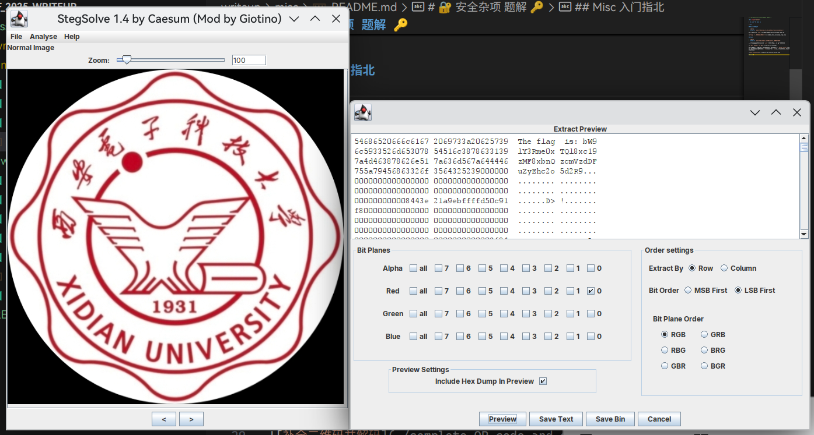
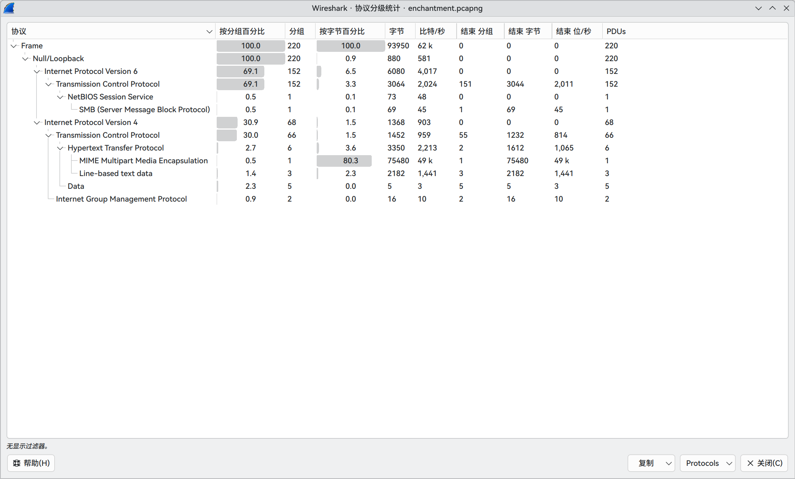
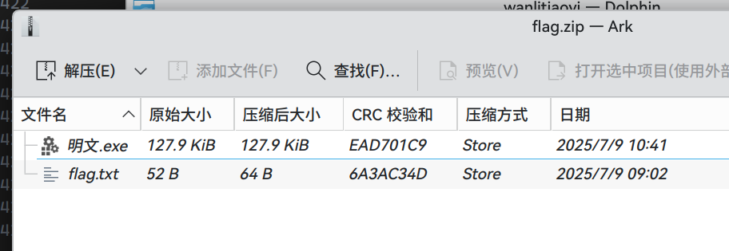

<!--markdownlint-disable MD033 MD036 MD041-->

<div align="center">

# 🔐 安全杂项 题解 🔑

</div>

## Misc 入门指北

> [!NOTE]
> **FLAG:** `moectf{We1c0m3_7o_tH3_w0R1d_0f_m1sc3111aN3ous!!`

不难注意到，该 `flag` 以白色文本隐藏在题目给定的 PDF 文件中。


## Rush

> [!NOTE]
> **FLAG:** `moectf{QR_C0d3s_feATUR3_eRror_c0RRECt10N}`

使用工具逐帧提取题目给定的 `.gif` 文件，得到第 12 帧图片如下。


不难发现这是一个残缺的二维码。判断该二维码的大小为 `37x37 (ver.5)`，根据给出的部分判断其纠错等级为 `H`，掩码图案为 `1`。使用工具补全该二维码并尝试解码即可。


## ez_LSB

> [!NOTE]
> **FLAG:** `moectf{LSB_1s_s0_1nt3rest1ng!!sj9wd}`

参考 [隐写技术 - Hello CTF](https://hello-ctf.com/hc-misc/stego/#lsb) 的内容，使用 StegSolve 的 Data Extract 功能，猜测并设置下图的参数，在解压出的数据最上部获得 `flag` 的 Base64 编码后内容。



使用任意 Base64 解码器解码后得到 `flag`。

## ez_锟斤拷????

> [!NOTE]
> **FLAG:** `moectf{EnC0d1ing_gbK_@nD_Utf_8_1s_4un!!ewwww}`

注意到「锟斤拷」是经典的 GBK 和 UTF-8 编码互转时出现的问题，我们直接使用编码恢复工具即可。需要注意的是得到的解码结果是全角字符，需要手动转为半角字符。


## weird_photo

> [!NOTE]
> **FLAG:** `moectf{Image_Height_Restored}`

使用 `pngcheck` 检验 `photo.png` 的 CRC 信息，直接发现问题：

```plain
┌──(stellalyrin㉿lyrin-A16)-[/mnt/s/MoeCTF/Misc]
└─$ pngcheck photo.png
zlib warning:  different version (expected 1.2.13, using 1.3.1)

photo.png  CRC error in chunk IHDR (computed d34d176f, expected b5a7bf8c)
ERROR: photo.png
```

这是诡异的。校正 CRC 信息至正确的高度可能有些困难，我们直接尝试部分拉长图片的高度信息。将图片使用 [HexEd.it](https://hexed.it) 打开后，更改第 17 个字节从 `01` 到 `02` 后另存为文件即可得到 `flag`。


Windows 11 的「照片」应用可以顺利打开被拉伸的图片。其他平台未做测试。

## SSTV

> [!NOTE]
> **FLAG:** `moectf{d3codiNG_SStV_reQu1REs-PATI3nC3}`

使用线上 SSTV Decoder 可直接得到 `flag`。


## encrypted_pdf

> [!NOTE]
> **FLAG:** `moectf{Pdf_1s_r3a1ly_c0lor4ul!!ihdw}`

题目给定的 `attachment.zip` 中，`diary.txt` 给出提示

> So I will use a password that is simple enough.

这说明加密的 `不知道写什么.pdf` 采用弱密码。使用 `pdf2john` 提取哈希后，再使用 `john` 爆破即可，得到弱密码 `qwe123`。


打开 PDF 后，在第 2 页得到了一个 ~~一个香香软软甜甜糯糯蜂蜜奶油甜甜腻腻酥酥脆脆滑滑嫩嫩番茄炒可乐番茄炒科比草莓蓝莓苹果香蕉葡萄香香甜甜酸酸甜甜辣辣爽爽咸咸鲜鲜苦苦甘甘滑滑嫩嫩酥酥脆脆软软绵绵弹弹润润油油腻腻清清爽爽浓浓醇醇淡淡幽幽热热乎乎冰冰凉凉黏黏糊糊爽爽脆脆鲜鲜嫩嫩辣辣麻苦苦辣辣苹果香蕉橙子草莓葡萄西瓜樱桃菠萝猕猴桃蓝莓桃子梨杏李子西红柿黄瓜胡萝卜生菜菠菜花椰菜卷心菜洋葱大蒜土豆红薯南瓜玉米豌豆扁豆红豆绿豆黄豆黑豆鸡蛋牛奶奶酪酸奶黄油面包面条米饭燕麦玉米片饼干蛋糕油鱼虾蟹龙虾贝类牛肉羊肉猪肉鸡肉鸭肉鹅肉火鸡肉香肠火腿培根肉丸汉堡热狗披萨寿司拉面咖喱炖肉烤肉烤鱼烤鸡沙拉汤粥蒸蛋豆腐豆浆豆奶豆腥草豆皮豆干芒果柠檬柚子金桔百香果火龙果牛油果无花果荔枝龙眼枇杷山楂桑葚甜瓜哈密瓜甜菜根莴苣茼蒿芥蓝芹菜荠菜苋菜意式烤蔬菜配香草酱和橄榄油鲜美多汁香脆可口滑嫩浓郁醇厚甘甜爽口香辣酸甜苦辣咸香酥软糯滑爽劲道鲜美清香扑鼻诱人色泽鲜艳香气扑鼻口感丰富层次分明风味独特香气四溢回味无穷色香味俱佳口感细腻肉质鲜嫩色泽金黄外酥里嫩香气浓郁味道鲜美口感滑嫩味道醇厚味道独特味道浓郁口感丰富味道鲜美味道醇厚味道独特香气扑鼻的~~ XDSEC 娘。根据题目提示，将 PDF 文件转换到 SVG 格式后，尝试寻找 `flag` 或 `moectf` 字样，但并未成功。

考虑到 `flag` 文本可能被 XDSEC 娘遮挡，我们

<div align="center">

😍😍  😋😋

# 直接将 XDSEC 娘从屏幕里抱走 <!--原标题：🔐 安全杂项 题解 🔑-->
<!--这是一个非常不规范的 H1 标题用法，米娜桑不要学星澜音哦😭-->

</div>


于是得到了 XDSEC 娘和题目的 `flag`。

<div align="center">

**呜呜呜 XDSEC 娘你带我走吧✋😭🤚我什么 CTF 都会做的😭😭😭**

</div>

## 捂住一只耳

> [!NOTE]
> **FLAG:** `moectf{HALF_RADIO_IN_XDU}`

解压 `li_zi_yi_shu.zip` 后得到 `粒子艺术.wav`。

> **"Particle Arts"**<br/>
> Performed by Virtual Self<br/>
> Written by Porter Robinson<br/>
> Courtesy of Virtual Self and mtheory<br/>
> By arrangement with Hidden Track Music

~~首先打开平板上的 Arcaea……哦不对，已经被下架了😭😭呜呜呜~~

注意到其中一个声道几乎没有声音，我们尝试使用 Audition 打开该 `.wav` 文件。注意到其中一个声道的波形呈现出摩斯密码状，手动解码即可。

Linux 下无法便捷地使用 Audition 等工具，故这里略去截图。

## Enchantment

> [!NOTE]
> **FLAG:** `moectf{???}` <!--wc 我突然忘了这个 `flag` 是啥了😭-->

注意到附件内是一个 `.pcapng` 文件，考虑使用 WireShark 分析。根据题目说明，「发了出去」的请求可能是 HTTP 请求，为了验证这一点，我们使用 `Statistic` > `Protocol Hierarchy`（`统计` > `协议分级`）工具，发现大部分请求均为 `Internet Protocol Version 6` 和 `Internet Protocol Version 4`。



运用 Filter（过滤器），输入 `http` 后过滤出全体 HTTP 请求。注意到第 193 个请求是一个 HTTP POST 请求，其内容为一个 `PNG` 文件，于是锁定该文件。


我们使用 `File` > `Export Object` > `HTTP`（`文件` > `导出对象` > `HTTP`）导出第 193 个请求，手动移除该请求体的头尾后，得到 `enchantment.png`。


注意到上面显示的是 Standard Galactic Alphabet（星际银河字母），使用 [解码器](https://www.dcode.fr/standard-galactic-alphabet) 即可。

## WebRepo

> [!NOTE]
> **FLAG:** `moectf{B1NwA1K_ANd_g1t_R3seT-MaG1C}`
<!---->
> [!WARNING]
> 请不要扫描来路不明的二维码。

我们解压并扫描这个来路不明的二维码，得到下面的提示：

> Flag is not here, but I can give you a hint:
> Use binwalk.

这给了我们极大的提示，使用 `binwalk` 得到：

```plain
┌──(stellalyrin㉿lyrin-A16)-[/mnt/s/MoeCTF/Misc]
└─$ binwalk WebRepo.webp

DECIMAL       HEXADECIMAL     DESCRIPTION
--------------------------------------------------------------------------------
16012         0x3E8C          7-zip archive data, version 0.3
```

注意到在 `0x3E8C` 后存在 7-zip 归档文件，我们使用 `dd` 来提取：

```bash
dd if=./WebRepo.webp of=./WebRepo.7z bs=1 skip=16012
```

得到 `WebRepo.7z`。使用 7-Zip 打开发现里面有一个 `.git` 文件，熟悉 Git 的朋友们一定知道这其中的奥秘了。

直接将 `.git` 文件夹拖拽到一个空文件夹中，使用 Visual Studio Code 的 Git 可视化工具读取名为 `flag` 的 commit 中提交的新文件即可。

## ez_ssl

> [!NOTE]
> **FLAG:** `moectf{upI0@d-l0G_TO-DeCrYPT_uploAD}`

解包附件后得到一个 `.pcapng` 文件，故继续使用 WireShark 打开分析。我们发现，近乎大部分的流量都是 `TLSv1.2` 的，故我们必须要先解密这些 `HTTPS` 流量。考虑到题目所说的

> 但与此同时，他的浏览器却悄悄上传了另一份文件。

我们推测解密必需的 `CLINET_RANDOM` 就包含在这份 `.pcapng` 文件中。运用 Filter（过滤器）输入 `frame contains "CLIENT_RANDOM"` 后确得到第 243 个请求包含了 `CLIENT_RANDOM`。


我们固然可以追踪该请求的 TCP Stream，将其 `CLIENT_RANDOM` 提取后导入到 WireShark 中。不过，更简便的方法是直接将整个 `.pcapng` 文件导入到 WireShark，让后者智能地从文件中获得 `CLIENT_RANDOM`。

在 `Edit` > `Preferences` > `Protocols` > `TLS`（ `编辑` > `首选项` > `Protocols` > `TLS`）的 `(Pre)-Master-Secret log filename` 中直接选择该 `.pcapng` 文件即可。


> [!TIP]
>
> 星澜音的实践中，在 Linux 上直接选择 `.pcapng` 文件就好了，但是在 Windows 上却不行🤔这有啥说法吗……？

之后继续过滤全体 HTTP POST 请求，在 Filter（过滤器）中输入 `http.request.method == "POST" && http.content_type contains "multipart/form-data"`，过滤出请求 165 和 243，又由于 243 是传输 `CLIENT_RANDOM` 的请求，锁定 165 后，导出其对象，手动移除该请求体的头尾后，得到 `flag_extracted.zip`。

不过该 `flag_extracted.zip` 仍然有一层密码保护，在 7-Zip 的 文件 > 属性 中发现了注释

> 锘垮瘑鐮佷负7浣嶇函鏁板瓧

继续使用乱码恢复器进行恢复，发现是将 UTF-8 编码的文本以 GBK 形式打开。通过解码得到

> 密码为7位纯数字

准备使用 `john` 爆破。生成哈希后，我们使用增量模式爆破即可。

```bash
zip2john flag_extracted.zip > flag_extracted.john
john --incremental=Digits --min-length=7 --max-length=7 flag_extracted.john
```

得到密码 `6921682`。解压后得到 `flag.txt`（省略了部分）——

```plain
Ook. Ook. Ook. Ook. Ook. Ook. Ook. Ook. Ook. Ook. Ook. Ook. Ook. Ook. Ook. Ook. Ook. Ook. Ook. Ook. Ook! Ook? Ook! Ook! Ook. Ook? Ook. Ook. Ook. Ook. Ook. Ook. Ook. Ook. Ook. Ook. Ook. Ook. Ook. Ook. Ook. Ook. Ook. Ook. Ook. Ook. Ook? Ook. Ook? Ook! Ook. Ook? Ook. Ook. Ook. Ook. Ook. Ook. ...
```

无敌了……用 Ook 解密器即可。

## ez_png

> [!NOTE]
> **FLAG:** `moectf{h1DdEn_P4YlOaD_IN-Id4T}`

根据题目提示

> 秘密不在颜色中，而在文件的骨骼里。<br/>
> 注意：某些数据段的长短似乎不太协调。

首先排除再次出现 LSB 隐写的可能。我们可能会认为该图片的大小发生了改变，`flag` 隐藏于未显示的像素中，故尝试更正图片的 IHDR 数据。对于一个 `.png` 文件，其文件头均为 `89 50 4E 47 0D 0A 1A 0A`，随后出现 IHDR 数据，结构如

```hex
... 49 48 44 52     WW WW WW WW     HH HH HH HH ...
    ^IHDR Chunk     ^Width (4B)     ^Height (4B)
```

尝试修改 `Width` 和 `Height` 后均失败。


聪明的读者可能会问，**零学姐你为什么要去修改图片的 `Width`？** ~~事实上星澜音自己也不知道为什么。~~ 总之此路不通，重新读题后考虑到可能是出题人向图片的某个部分中加入了数据，故尝试检验图片的结构。

首先使用 `pngcheck`，但未检查出 CRC 不符等的情况，再使用 `zsteg` 尝试，结果如下：

```plain
┌──(stellalyRin㉿lyrin-A16)-[/mnt/s/MoeCTF/Misc]
└─$ ~/.local/share/gem/ruby/3.3.0/bin/zsteg ./ez_png.png
[?] 38 bytes of extra data after zlib stream
extradata:0         .. file: zlib compressed data
    00000000: 78 9c cb cd 4f 4d 2e 49  ab ce 30 74 49 71 cd 8b  |x...OM.I..0tIq..|
    00000010: 0f 30 89 cc f1 4f 74 89  f7 f4 d3 f5 4c 31 09 a9  |.0...Ot.....L1..|
    00000020: 05 00 a8 d0 0a 5f                                 |....._          |
imagedata           .. text: " ! **-)(1\t"
b1,b,msb,xy         .. file: OpenPGP Public Key
b3,rgb,lsb,xy       .. file: OpenPGP Secret Key
b3,rgb,msb,xy       .. text: "?gkD$saTE"
b3,bgr,lsb,xy       .. file: OpenPGP Secret Key
b4,r,lsb,xy         .. text: "c#32>9cXv"
b4,r,msb,xy         .. text: "D$\"B@LRp"
b4,g,lsb,xy         .. text: "DUCC4DDD4eUUefff"
b4,g,msb,xy         .. text: "fjn)mBww"
b4,b,lsb,xy         .. text: "3C4DEUUfVfffvwgww"
b4,b,msb,xy         .. text: "nnffffff"
b4,rgb,lsb,xy       .. text: "3$2C5BS$14"
b4,bgr,lsb,xy       .. text: "14#BE3R4$1D"
```

`zsteg` 指示它检测出 IDAT 数据流后 38 个字节的冗余数据，并直接将其打印出来。注意到它经过了 `zlib compressed`，我们考虑使用 CyberChef 解码即可。冗余数据的十六进制表示如下：

```plain
789ccbcd4f4d2e49abce30744971cd8b0f3089ccf14f7489f7f4d3f54c3109a90500a8d00a5f
```

向 CyberChef 的 Recipe 中加入 `From Hex` 和 `Zlib Inflate` 即可。

## 万里挑一

> [!NOTE]
> 星澜音非常喜欢的 Misc 题目。<br/>
> **FLAG:** `moectf{Y0u_h4v3_cho5en_7h3_r1ght_z1pf1le!!uysdgfsad}`

下载 `attachment.zip` 后，内有 3 个文件。`hint.txt` 指示

> Only one password in the 10000 archives can open the lock

这倒好说——`lock.zip` 应该就是被加密的压缩包，而 `password.zip` 则为包含了 10,000 个密码的压缩包。打开 `password.zip`，直接震撼！😱文件结构大致如下：

```plain
.\password.zip\X.zip\X.zip\X.zip\X.zip\pwd.txt
```

这里 `X` 为 0, 1, 2, ..., 9。10,000 个密码直接递归地存储在给定的压缩包中……太吓人了。

也就是说，我们需要递归地解压并提取 `pwd.txt`。这里我们直接使用 Python 脚本完成。编写如下 Python 脚本：

```python
"""extract_passwords.py

该 Python 脚本供 MoeCTF 2025 的 Misc 赛道中，「万里挑一」题目使用。
由 星澜音 在 Claude 的帮助下编写。
"""

import os
import re
import shutil
import zipfile


def setup_temp_dir():
    """该函数设置解压 `.zip` 文件时的临时目录。"""

    if os.path.exists("temp_extract"):
        shutil.rmtree("temp_extract")
    os.makedirs("temp_extract")
    return "temp_extract"


def extract_passwords(
    zip_path, temp_dir, max_depth=10, current_depth=0, passwords=None, path_prefix=""
):
    """该函数递归地解压 `password.zip` 及其子压缩包。

    Args:
        zip_path (str): 压缩包路径。
        temp_dir (str): 临时目录路径。
        max_depth (int, optional): 解压时的递归深度。这里，Claude 为了确保递归完全进行，将其默认值设为了 10。实际上，由于我们完全已知压缩包结构，可以精确指定 `max_depth` 的值。
        current_depth (int, optional): 解压时的当前深度。
        passwords (str, optional): 解压得到的密码。
        path_prefix (str, optional): 路径的前缀。
    """
    if passwords is None:
        passwords = set()

    if current_depth >= max_depth:
        return passwords

    current_path = (
        f"{path_prefix}/{os.path.basename(zip_path)}"
        if path_prefix
        else os.path.basename(zip_path)
    )

    try:
        with zipfile.ZipFile(zip_path, "r") as zip_ref:
            zip_ref.extractall(temp_dir)

            # 检查是否存在 `pwd.txt`，如果有，就在其中匹配密码；如果没有，则跳过并继续向下递归解压。
            if "pwd.txt" in zip_ref.namelist():
                pwd_path = os.path.join(temp_dir, "pwd.txt")
                with open(pwd_path, "r", encoding="utf-8", errors="ignore") as f:
                    content = f.read()
                    password = None
                    # 尝试精确匹配密码格式。
                    match = re.search(r"The password is:([a-f0-9]+)", content)
                    if match:
                        password = match.group(1)
                    else:
                        # 尝试宽松匹配密码格式。
                        match = re.search(
                            r"password.*?[: ]([a-f0-9]+)", content, re.IGNORECASE
                        )
                        if match:
                            password = match.group(1)
                        else:
                            # 在完全无法正确匹配密码格式时，尝试匹配任何可能的密码，其判断标准为 16~40 个字符的字母、数字字符串。
                            match = re.search(r"([a-f0-9]{16,40})", content)
                            if match:
                                password = match.group(1)

                    if password:
                        passwords.add(password)
                        print(f"找到密码: {password} (来自 {current_path})")

            # 递归处理所有子 `zip` 文件。
            for i in range(10):
                sub_zip = os.path.join(temp_dir, f"{i}.zip")
                if os.path.exists(sub_zip):
                    sub_dir = os.path.join(temp_dir, f"extract_{i}")
                    if not os.path.exists(sub_dir):
                        os.makedirs(sub_dir)
                    extract_passwords(
                        sub_zip,
                        sub_dir,
                        max_depth,
                        current_depth + 1,
                        passwords,
                        current_path,
                    )
    except Exception as e:
        print(f"处理 {zip_path} 时出错：{str(e)[:100]}……")

    return passwords


def main():
    """主函数开始处理压缩包 `password.zip` 的解压。"""

    temp_dir = setup_temp_dir()

    # 解压第 1 层压缩包。
    try:
        with zipfile.ZipFile("password.zip", "r") as zip_ref:
            zip_ref.extractall(temp_dir)
    except Exception as e:
        print(f"无法解压 `password.zip`：{e}")
        return

    # 递归地提取所有密码。
    print("开始提取所有可能的密码……")
    all_passwords = set()

    # 处理所有 `zip` 文件。
    for i in range(10):
        sub_zip = os.path.join(temp_dir, f"{i}.zip")
        if os.path.exists(sub_zip):
            sub_dir = os.path.join(temp_dir, f"extract_{i}")
            if not os.path.exists(sub_dir):
                os.makedirs(sub_dir)
            passwords = extract_passwords(sub_zip, sub_dir, max_depth=10)
            all_passwords.update(passwords)

    print(f"总共找到 {len(all_passwords)} 个不同的密码。")

    # 将密码保存在 `extracted_passwords.txt` 中。
    with open("extracted_passwords.txt", "w", encoding="utf-8") as f:
        for pwd in all_passwords:
            f.write(f"{pwd}\n")
    print("所有密码已保存到 `extracted_passwords.txt` 文件中。")

    # 清理临时文件。
    print("正在清理临时文件……")
    try:
        shutil.rmtree(temp_dir)
    except Exception as e:
        print(f"清理临时文件时出错: {e}")


if __name__ == "__main__":
    main()
```

运行后输出如下：

```plain
[stellalyrin@stellasus wanlitiaoyi]$ python ./extract_passwords.py 
开始提取所有可能的密码……
找到密码: 3ce3a183fdf9cb067c67 (来自 0.zip/0.zip/0.zip/0.zip)
找到密码: b5205ec8584111d92eb3 (来自 0.zip/0.zip/0.zip/1.zip)
找到密码: 3e286d7994097a004a6c (来自 0.zip/0.zip/0.zip/2.zip)
找到密码: d5210f6f9985f820de00 (来自 0.zip/0.zip/0.zip/3.zip)
找到密码: ce6925729cf717111e50 (来自 0.zip/0.zip/0.zip/4.zip)
找到密码: b630735da35faad2456b (来自 0.zip/0.zip/0.zip/5.zip)
...
找到密码: a9c7c3bb08871cc8a8c3 (来自 9.zip/9.zip/9.zip/6.zip)
找到密码: 9fb43e7af580c54cf4ac (来自 9.zip/9.zip/9.zip/7.zip)
找到密码: 47c8e97022bd22ca9e75 (来自 9.zip/9.zip/9.zip/8.zip)
找到密码: 0dd5b779a1cacfeb32fa (来自 9.zip/9.zip/9.zip/9.zip)
总共找到 10000 个不同的密码。
所有密码已保存到 `extracted_passwords.txt` 文件中。
正在清理临时文件……
```

得到 `extracted_passwords.txt` 如下：

```plain
415f284a47bc1904eaae
ab9bbe23c7fde404bc78
6912443875e237e97329
8aa9afa026e0de5db04a
...
```

这很好；现在我们使用 `zip2john` 生成该 `lock.zip` 的 Hash 如下：

```plain
lock.zip/flag.zip:$zip2$*0*3*0*a88bcad537062a02a067a69d60dcc5ad*6017*20140*502fb5b3209956adc298cf4e0 ...
```

生成的 `lock.hash` 有足足 256 KiB，这里就不放完整版本了。接下来，指定字典为 `extracted_passwords.txt` 再进行爆破。

```bash
zip2john lock.zip > lock.hash
john --wordlist=./extracted_passwords.txt lock.hash
john show lock.hash
```

得到输出

```plain
[stellalyrin@stellasus wanlitiaoyi]$ john --show lock.hash
lock.zip/flag.zip:a296a5ec1385f394e8cb:flag.zip:lock.zip:lock.zip

1 password hash cracked, 0 left
```

这便得到了 `lock.zip` 的密码 `a296a5ec1385f394e8cb`。解压得到其中的 `flag.zip`，后者中有 `明文.exe` 和 `flag.txt`，终于拿到 `flag` 了！打开一看，不好，这 `flag.zip` 怎么还有密码？尝试用 `john` 再次爆破，跑了半个小时没有结果，遂放弃这条路。

其实到这里星澜音已经决定打舞萌去了，不过出题人 `E=hν` 联系到星澜音，让星澜音再想想，然后星澜音就备受鼓舞<sub>（存疑）</sub>地继续尝试新方法了。

目光回到 `flag.zip` 上。根据 [ZIP 格式 - CTF Wiki](https://ctf-wiki.org/misc/archive/zip/#_6) 中「明文攻击」记载的内容，ZIP 存在这样一种特性：倘若我们得到一个已有的未压缩的（仅打包的）`.zip` 文件，并已知其中至少 12 个字节的连续数据，就可以暴力破解出该 `.zip` 中的文件。当然，这要求 `.zip` 文件必须是 ZipCrypto Store 打包的，而这里，我们的 `.zip` 恰好满足这一点，这可以通过 Ark 压缩文件管理工具 验证。



参考 [Sj1t 的这篇文章](https://sj1t.cn/2024/07/14/ZIP%E6%98%8E%E6%96%87%E6%94%BB%E5%87%BB/index.html)，目光回到 `明文.exe` 上。熟悉 Windows 的朋友们应当知道，当你尝试用 `notepad` 打开一个 `.exe` 文件时，通常映入眼帘的是一堆乱码和一个

```plain
This program cannot be run in DOS mode.
```

事实上，这样的 `.exe` 文件都具有 PE 结构，而 PE 结构恰好具有类似的结构体，例如 DOS 头、PE 头、节表等。在 DOS 头中我们有 DOS 存根（DOS stub），包含一段汇编代码，它的功能就是显示刚刚的那一段文字。当该 `.exe` 文件运行在 16 位的环境中时，上面的文字就会被输出，然后进程便自动退出。

既然每一个 `.exe` 文件都有这样的结构，我们不妨直接使用这段连续数据来攻击 `.zip` 文件！我们随便写一个 `.exe` 程序，这里星澜音就将其命名为 `love_dryice.exe`，然后丢入 [HexEd.it](https://hexed.it) 中，观察文件头：


这段文字距离文件头 78 个字节，也就是说，它的偏移量为 `78`。我们将这段文字写入 `pe_header` 中，但需要注意的是，默认情况下，输入的内容都带有一个隐藏的换行符，它会导致稍后的破解工具无法正确匹配 `flag.zip` 中的内容，所以我们需要这样写入文件

```bash
echo -n "This program cannot be run in DOS mode." > pe_header
```

然后使用 `bkcrack` 工具开始爆破 `.zip` 文件！指令如下

```bash
bkcrack -C flag.zip -c 明文.exe -p pe_header -o 78
```

其中 `-C` 后接被爆破的 `.zip` 文件，`-c` 后接你所知道的连续数据出现的文件，`-p` 后接连续数据，`-o` 后接该连续数据相对于 `-c` 文件的文件头的偏移。运行后，输出如下：

```plain
[stellalyrin@stellasus wanlitiaoyi]$ time bkcrack -C flag.zip -c 明文.exe -p pe_header -o 78
bkcrack 1.7.1 - 2024-12-21
[16:36:18] Z reduction using 31 bytes of known plaintext
100.0 % (31 / 31)
[16:36:18] Attack on 246339 Z values at index 85
Keys: eec878a3 6808e48f 3aa41bd8
79.3 % (195440 / 246339)
Found a solution. Stopping.
You may resume the attack with the option: --continue-attack 195440
[16:37:49] Keys
eec878a3 6808e48f 3aa41bd8

real    1m31.451s
user    23m58.272s
sys     0m0.769s
```

这里星澜音加入了 `time` 以计时整个操作，用时约 0.6 个两分半完成。事实上，你可以为连续数据包含更多内容，这样爆破起来也会更快。我们得到了该 `.zip` 文件的 `keys`：`eec878a3 6808e48f 3aa41bd8`，下面就可以解压出该压缩包了。需要注意的是，这个 `keys` 并非解压密码。

这里我们继续使用 `bkcrack`，命令如下：

```bash
bkcrack -C flag.zip -c flag.txt -k eec878a3 6808e48f 3aa41bd8 -d flag.txt
```

其中 `-C` 仍然后接爆破的 `.zip` 文件，`-c` 后接需要解压的文件，`-k` 后接上面我们得到的 `keys`，`-d` 指定输出路径。运行结果如下：

```plain
[stellalyrin@stellasus wanlitiaoyi]$ bkcrack -C flag.zip -c flag.txt -k eec878a3 6808e48f 3aa41bd8 -d flag.txt
bkcrack 1.7.1 - 2024-12-21
[16:42:30] Writing deciphered data flag.txt
Wrote deciphered data (not compressed).
[stellalyrin@stellasus wanlitiaoyi]$ cat flag.txt
moectf{Y0u_h4v3_cho5en_7h3_r1ght_z1pf1le!!uysdgfsad}[stellalyrin@stellasus wanlitiaoyi]$ 
```

结束。

当然，星澜音还是想看看出题人在 `明文.exe` 里留了什么东西！按照同样的方法解开 `明文.exe` 并用 Ghidra 打开：


原来只有 `Hello World` 吗……😞（失望而归）

本题所涉及到的 `extract_passwords.py`、`extracted_passwords.txt` 和 `lock.hash` 均上传到了与该 README 文件同目录的 `wanlitiaoyi` 文件夹下。
