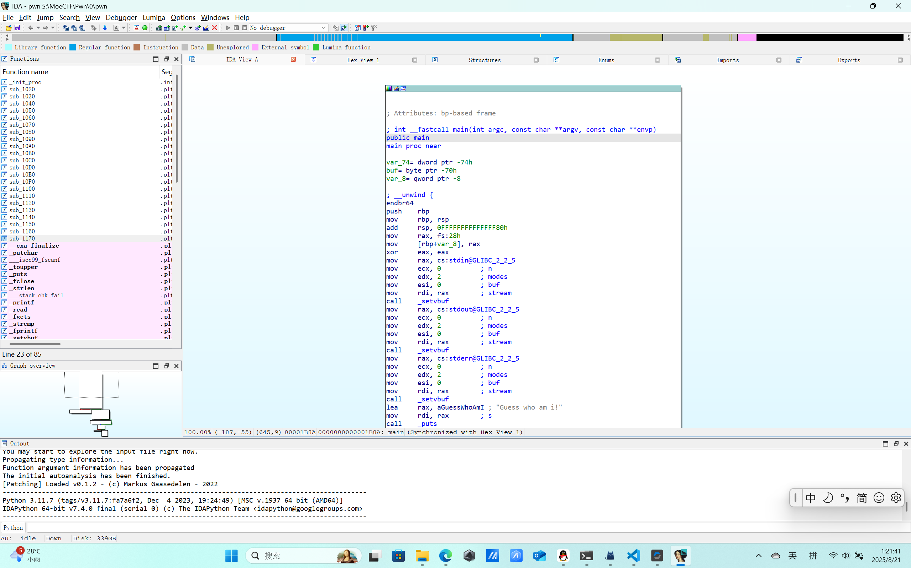

<!--markdownlint-disable MD033 MD041-->

<div align="center">

# 😈 二进制漏洞审计 题解 🔎

</div>

## 0 二进制漏洞审计

> [!NOTE]
> 准确来说，是星澜音接触到 Pwn 领域的第 1 道题目！星澜音因为初入 Pwn，做第一道题已经是巨大的灾难，所有的工具（例如 Ghidra、IDA Pro 和 Pwntools）都是现学现用的，第 1 道题快给星澜音卡死了😭不过这道题真的让星澜音收获满满，星澜音因为这道题，弄懂了一个之前百思不得其解的问题，收获巨大😋！
>
> **FLAG:** `moectf{the-BEgInNInG-of-FOrmAt7f5438332}`

题目已经给定一个 Pwntools 脚本，我们事实上只需要对它进行适当的修改即可。首先尝试在 WSL2 的 Kali Linux 中运行该可执行文件，得到如下结果：

```plain
┌──(stellalyrin㉿lyrin-A16)-[~/MoeCTF/Pwn/0]
└─$ ./pwn
Guess who am i!
⠀⠀⠀⠀⠀⠀⠀⣀⣤⡶⠶⠶⠶⠶⢶⣤⣀⠀⠀⠀⠀⠀⠀⠀⠀⠀⠀⠀⠀⠀⠀⠀⠀⠀⠀⠀⠀⠀⠀⠀⠀⠀⠀⠀⠀⠀⠀⠀⠀⠀⠀⠀⠀⠀⠀⠀⠀⠀⠀⠀⠀⠀⠀⠀⠀
⠀⠀⠀⠀⠀⢠⡾⠋⠁⢀⣀⣤⣤⣄⣀⠈⠙⢷⣄⠀⠀⠀⠀⠀⠀⠀⠀⠀⠀⠀⠀⠀⠀⠀⠀⠀⠀⠀⠀⠀⠀⠀⠀⠀⠀⠀⠀⠀⠀⠀⠀⠀⠀⠀⠀⠀⠀⠀⠀⠀⠀⠀⠀⠀⠀
⠀⠀⠀⠀⢰⡟⠀⢠⣾⣿⣿⣿⣿⣿⣿⣿⣄⠀⠹⣆⠀⠀⠀⠀⠀⠀⠀⠀⠀⠀⠀⠀⠀⠀⠀⠀⠀⠀⠀⠀⠀⠀⠀⠀⠀⠀⠀⠀⠀⠀⠀⠀⠀⠀⠀⠀⠀⠀⠀⠀⠀⠀⠀⠀⠀
⠀⠀⠀⠀⡿⠀⢠⣿⣿⣿⣿⣿⣿⣿⣿⣿⣿⡇⠀⢹⡆⠀⠀⠀⠀⠀⠀⠀⠀⠀⠀⠀⠀⠀⠀⠀⠀⠀⠀⠀⠀⠀⠀⠀⠀⠀⠀⠀⠀⠀⠀⠀⠀⠀⠀⠀⠀⠀⠀⠀⠀⠀⠀⠀⠀
⠀⠀⠀⢸⡇⠀⢸⣿⣿⣿⣿⣿⣿⣿⣿⣿⣿⡇⠀⢘⣇⣀⣀⣠⣄⠀⠀⠀⠀⠀⠀⠀⠀⠀⠀⠀⠀⠀⠀⠀⠀⠀⠀⠀⠀⠀⠀⠀⠀⠀⠀⠀⠀⣀⣤⡴⠶⠶⠶⣤⣄⡀⠀⠀⠀
⠀⠀⠀⠀⣿⡀⠀⢿⣿⣿⣿⣿⣿⣿⣿⣿⣿⠃⠀⡸⢿⣿⣿⣿⣿⣧⠀⠀⠀⠀⠀⠀⠀⠀⠀⠀⠀⠀⠀⠀⠀⠀⠀⠀⠀⠀⠀⠀⠀⠀⠀⣠⡾⠋⠁⣀⣠⣤⣄⣀⡈⠛⢶⡄⠀
⠀⠀⠀⠀⠘⣷⡀⠀⠙⠿⣿⣿⣿⣿⠿⠛⠁⢀⡔⠁⢸⣿⣿⣿⣿⣿⣇⣤⣤⣤⣴⣶⣶⣦⣤⣤⣤⣤⣀⠀⠀⠀⠀⠀⠀⠀⠀⠀⠀⠀⣼⠋⠀⣰⣿⣿⣿⣿⣿⣿⣿⣦⡀⢻⡆
⠀⠀⠀⠀⠀⠈⠻⣆⠀⠀⠀⠀⠀⠀⢀⡠⠔⠉⠀⠀⢸⣿⣿⣿⣿⣿⣿⣿⣿⣿⣿⣿⣿⣏⣁⣀⣀⠉⠙⠛⠷⣦⣤⡀⣴⠷⢶⣤⣀⣼⠏⠀⢰⣿⣿⣿⣿⣿⣿⣿⣿⣿⣧⠀⢻
⠀⠀⠀⠀⠀⣠⡾⠛⠷⣄⠀⠀⠀⠀⠹⡀⠀⠀⠀⠀⢸⣿⡇⣾⣶⡦⠟⠉⠀⠀⠀⠀⠀⣿⠁⠈⠉⠛⠳⣦⣤⣤⣭⣽⡋⣀⣄⡈⣹⠏⠀⠀⢸⣿⣿⣿⣿⣿⣿⣿⣿⣿⣿⠀⣸
⠀⠀⠀⠀⠸⣿⠀⠰⣿⣿⣷⣄⠀⠀⠀⠙⡄⠀⠀⠀⣸⢻⣇⢸⠟⢡⣀⡀⠀⠀⠀⢀⠀⠉⠀⠀⠀⠀⠀⠀⠰⣶⣾⢹⣷⣿⣿⣿⠏⠀⠀⠀⠀⠻⣿⣿⣿⣿⣿⣿⣿⡿⠃⢰⡟
⠀⠀⠀⠀⠀⠹⣧⠀⠻⣿⣿⣿⣷⣤⣀⣀⣘⣄⣤⠾⣣⡾⣻⠆⢀⡞⢩⣟⣦⣄⢀⡿⠀⠀⣿⠀⢀⣠⣴⢶⡆⠙⢣⣿⣿⣿⣿⡟⠀⠀⠀⠀⠀⡀⠈⠛⠿⠿⠿⠛⠋⢁⣴⠟⠁
⠀⠀⠀⠀⠀⠀⠙⣷⡀⠹⣿⣿⣿⠘⢯⣍⠉⢉⣠⡾⠋⢸⡏⠀⠘⠛⠛⠛⣛⠛⠘⠛⠛⠛⠿⢷⣿⣿⣿⣤⣷⠄⢾⣿⡟⣫⣽⠀⠀⠀⠀⣠⠋⠈⠒⠠⠤⠀⢠⣠⡾⠛⠁⠀⠀
⠀⠀⠀⠀⠀⢀⣼⠛⣷⣄⣘⣿⣿⣦⣤⣭⠿⠛⠁⠀⠀⣿⣡⡴⡶⠀⠀⠀⠙⢷⣤⣤⣤⣤⣀⣤⡶⠀⠀⠀⠀⠀⢸⡿⢿⡏⢸⣆⠀⢀⠞⠀⠀⠀⠀⢀⣠⣶⣿⣷⡀⠀⠀⠀⠀
⠀⠀⠀⠀⢠⣿⡷⠾⠛⠉⠉⠉⠉⠉⠀⠀⠀⠀⠀⢀⣴⣿⠋⠘⠷⣤⡤⠤⠤⠤⠥⢤⣤⣈⣉⡁⠀⠀⠀⠀⣶⢤⣼⡇⠀⠹⣦⡙⠶⣥⣀⣀⣀⣤⣶⣿⣿⣿⣿⣿⣿⡄⠀⠀⠀
⠀⠀⣠⣶⠟⠉⠀⠀⠀⢀⣀⣀⣀⡀⠀⠀⣠⣶⣶⣾⣿⣿⡄⠀⠀⠀⠀⠀⠀⠀⠀⠀⠀⠈⠉⠉⠓⠶⠶⠶⠏⠀⢹⣷⡄⠀⠈⣹⢦⣀⠉⣉⡿⢰⣿⣿⣿⣿⣿⣿⠟⠁⠀⠀⠀
⠀⣰⡟⠁⠀⢀⣤⡶⠟⠛⠛⠛⠛⠛⢷⣶⠏⡜⠈⠳⣟⣿⣷⣄⠀⠀⠀⠀⠀⠀⠀⠀⠀⠀⠀⠀⠀⡇⠀⠀⠀⢀⣿⣿⣧⣔⡋⠀⠀⠉⠛⢯⣴⣿⡿⠿⣿⣿⠟⠁⠀⠀⠀⠀⠀
⢰⡏⠀⢠⡾⠋⠁⠀⠀⠀⠀⠀⠀⠀⠀⠙⣯⠀⠀⠀⠈⠳⣽⣿⣷⣤⣀⠀⠀⠀⠀⠀⠀⠀⣀⠤⠊⠀⠀⢀⣤⣾⣿⣿⠞⠋⢻⡆⠀⠀⠀⠀⠈⠙⠳⣾⣿⣿⡀⠀⠀⠀⠀⠀⠀
⢸⡇⢰⡟⠁⠀⠀⠀⠀⣀⣀⣀⣀⣀⠀⠀⣿⠀⠀⠀⠀⠀⠈⠙⠯⣿⣿⢿⣷⣶⣦⣤⣤⣬⣤⣤⣶⣶⡿⣿⣿⠿⠋⠀⠀⠀⠀⣿⠀⠀⠀⠀⠀⠀⠀⠘⡛⢿⣇⠀⠀⠀⠀⠀⠀
⢸⣧⡿⠁⠀⣠⣴⠾⠛⠉⠉⠉⠉⠙⠳⣦⡿⠀⠀⠀⠀⠀⠀⠀⠀⠈⠉⠛⠺⠿⠭⠭⠭⠭⠭⠽⠿⠗⠛⠉⠁⠀⠀⠀⠀⠀⠀⣸⢀⣠⣤⠴⠶⠦⣤⣀⡇⠀⠹⣷⡀⠀⠀⠀⠀
⠀⢻⣇⣰⠞⠉⠀⠀⠀⠀⠀⠀⠀⠀⠀⠈⢿⡄⠀⠀⠀⠀⠀⠀⠀⠀⠀⠀⠀⠀⠀⠀⠀⠀⠀⠀⠀⠀⠀⠀⠀⠀⠀⠀⠀⠀⢠⡿⠋⠁⠀⠀⠀⠀⠀⠉⠻⣶⡄⢹⣧⠀⠀⠀⠀
⠀⠀⣿⠇⠀⠀⠀⠀⢀⣀⣤⣤⣤⣄⣀⠀⢸⡇⠀⠀⠀⠀⠀⠀⠀⠀⠀⠀⠀⠀⠀⠀⠀⠀⠀⠀⠀⠀⠀⠀⠀⠀⠀⠀⠀⠀⣿⣡⣤⣤⣤⣄⡀⠀⠀⠀⠀⠈⢿⣦⡿⠀⠀⠀⠀
⠀⢰⡏⠀⠀⢀⣴⠿⠛⠉⠁⠀⠀⠉⠙⠻⢿⣟⢦⣄⠀⠀⠀⠀⠀⠀⠀⠀⠀⠀⠀⠀⠀⠀⠀⠀⠀⠀⠀⠀⠀⠀⠀⠀⢠⡾⠋⠁⠀⠀⠀⠈⠛⢷⣄⠀⠀⠀⠀⣿⡃⠀⠀⠀⠀
⠀⠸⣧⠀⣴⠟⠁⠀⠀⠀⠀⠀⠀⠀⠀⠀⠀⠹⡿⠯⣿⡶⢤⣀⡀⠀⠀⠀⠀⠀⠀⠀⠀⠀⠀⠀⠀⠀⠀⠀⠀⣀⣠⢴⣿⠃⠀⠀⠀⠀⠀⠀⠀⠀⠹⣧⡀⠀⠀⢹⡇⠀⠀⠀⠀
⠀⠀⢹⢿⡏⠀⠀⠀⠀⠀⠀⠀⠀⠀⠀⠀⠀⢀⡇⠀⠈⠙⠳⠿⢯⣟⣲⣶⠶⠤⢤⣤⣤⣤⣤⠤⢤⣴⣶⣶⡿⠿⠛⣩⣿⠶⠶⠶⠶⣤⡀⠀⠀⠀⠀⠙⣷⠀⠀⣿⠃⠀⠀⠀⠀
⠀⠀⣾⢸⠀⠀⠀⠀⠀⠀⠀⠀⠀⠀⠀⠀⠀⣸⣧⠀⠀⠀⠀⠀⠀⠈⠉⠉⠙⠛⠛⠛⠛⠛⠛⠋⡍⠉⠉⠀⠀⠀⣸⡟⠁⠀⠀⠀⠀⠈⠙⣦⡀⠀⠀⠀⣿⣀⣼⠋⠀⠀⠀⠀⠀
⠀⠀⣿⠸⣇⠀⠀⠀⠀⠀⠀⠀⠀⠀⠀⢀⣼⠏⢸⡆⠀⠀⠀⠀⠀⠀⠀⠀⠀⠀⠀⠀⠀⠀⠀⠰⠀⠀⠀⠀⠀⣰⣿⠀⠀⠀⠀⠀⠀⠀⠀⠈⣿⡀⠀⠀⣾⠋⠁⠀⠀⠀⠀⠀⠀
⠀⠀⢹⡇⠙⣷⣤⣄⣀⠀⠀⣀⣀⣤⣶⢿⣅⠰⣼⡇⠀⠀⠀⠀⠀⠀⠀⠀⠀⠀⠀⠀⠀⠀⠀⠀⠀⠀⠀⠀⣸⠇⣿⡀⠀⠀⠀⠀⠀⠀⠀⠀⠘⣧⣀⣴⠟⠀⠀⠀⠀⠀⠀⠀⠀
⠀⠀⢸⣧⠀⠘⣧⠉⢩⡟⣯⠉⢹⢁⣟⠀⠙⠳⢿⣦⣄⡀⠀⠀⠀⠀⠀⠀⠀⠀⠀⠀⠀⠀⠎⠀⠀⠀⠀⠀⠻⢒⡿⣧⡀⠀⠀⠀⠀⠀⠀⠀⠀⣿⠉⠁⠀⠀⠀⠀⠀⠀⠀⠀⠀
⠀⠀⠀⢿⣆⣠⡿⠷⠟⠋⠉⢷⣤⣼⠋⠙⠳⠶⣤⡉⠻⠿⣷⣶⣤⣀⣀⡀⠀⠀⠀⠀⢀⠎⠀⠀⠀⠀⠀⠀⠀⣼⣃⣘⣷⣦⣀⠀⠀⠀⠀⣀⣼⡇⠀⠀⠀⠀⠀⠀⠀⠀⠀⠀⠀
⠀⠀⠀⣼⡿⠋⠀⠀⠀⠀⠀⠀⠈⠁⠀⠀⠀⠀⠈⠻⣦⡀⠀⠉⠛⠺⠿⢿⣿⣒⣶⣦⢿⣤⣤⣤⣤⢤⣶⣖⣾⡿⠟⠛⢻⣋⣻⣿⣶⠶⠟⠛⠁⠻⣆⠀⠀⠀⠀⠀⠀⠀⠀⠀⠀
⠀⠀⣼⠏⠀⠀⠀⠀⠀⠀⠀⠀⠀⠀⠀⠀⠀⠀⠀⠀⠘⣷⡀⠀⠀⠀⠀⠀⠀⢀⡜⠉⠉⠉⠉⠉⠉⠉⠁⠀⠀⠀⠀⠀⠀⠀⠀⣼⠃⠀⠀⠀⠀⠀⢻⡄⠀⠀⠀⠀⠀⠀⠀⠀⠀
⠀⢸⡏⠀⠀⠀⠀⠀⠀⠀⠀⠀⠀⠀⠀⠀⠀⠀⠀⠀⠀⢹⡇⠀⠀⠀⠀⢀⠔⠋⠀⠀⠀⠀⠀⠀⠀⠀⠀⠀⠀⠀⠀⠀⠀⢀⣾⠃⠀⠀⠀⠀⠀⠀⠈⣷⠀⠀⠀⠀⠀⠀⠀⠀⠀
⠀⢸⡇⠀⠀⠀⠀⠀⠀⠀⠀⠀⠀⠀⠀⠀⠀⠀⠀⠀⠀⢸⣧⠀⡀⠴⠊⠁⠀⠀⠀⠀⠀⠀⠀⠀⠀⠀⠀⠀⠀⠀⠀⣀⣴⠟⠁⠀⠀⠀⠀⠀⠀⠀⠀⣿⠀⠀⠀⠀⠀⠀⠀⠀⠀
⠀⢸⡇⠀⠀⠀⠀⠀⠀⠀⠀⠀⠀⠀⠀⠀⠀⠀⠀⠀⠀⣸⣿⣷⣶⣦⣤⣄⣀⣀⣀⡀⠀⠀⠀⢀⣀⣀⣀⣤⣴⣶⣿⡿⠋⠀⠀⠀⠀⠀⠀⠀⠀⠀⢸⡟⠀⠀⠀⠀⠀⠀⠀⠀⠀
⠀⣾⣷⡀⠀⠀⠀⠀⠀⠀⠀⠀⠀⠀⠀⠀⠀⠀⠀⠀⣰⡟⣿⠀⠈⠉⠛⠛⠛⠛⠛⠛⠛⠛⠛⠛⠛⠛⢋⣩⣴⠟⠋⠀⠀⠀⠀⠀⠀⠀⠀⠀⠀⢀⣿⠃⠀⠀⠀⠀⠀⠀⠀⠀⠀
⠀⣿⠹⣷⣄⠀⠀⠀⠀⠀⠀⠀⠀⠀⠀⠀⠀⠀⣠⣾⠏⢠⣿⣤⣀⣀⠀⠀⠀⠀⠀⢀⣀⣠⣤⣤⡶⠟⠻⣯⣄⡀⠀⠀⠀⠀⠀⠀⠀⠀⠀⠀⣠⡾⠃⠀⠀⠀⠀⠀⠀⠀⠀⠀⠀
⠀⣿⠀⠈⠛⠷⣦⣤⣀⣀⣀⣀⣀⣀⣀⣀⣴⡾⠛⠁⠀⢸⡏⠈⠉⠙⠛⠛⠛⠛⠛⠛⢉⡽⣿⠀⠀⠀⠀⠀⠙⠻⠷⣶⣦⣤⣤⣤⣤⠴⠶⣿⡏⠀⠀⠀⠀⠀⠀⠀⠀⠀⠀⠀⠀
⠀⢿⡄⠀⠀⠀⠀⠀⠉⠙⠉⠉⠉⠉⠉⠉⠁⠀⠀⠀⠀⣾⠇⠀⠀⠀⠀⠀⠀⠀⠀⠀⠿⠷⢿⣧⡀⢀⣠⣤⣄⣀⠀⠀⠀⢀⣀⣠⣤⣀⣴⠟⠀⠀⠀⠀⠀⠀⠀⠀⠀⠀⠀⠀⠀
⠀⠘⣷⣀⣤⣶⣶⣦⣤⣤⣤⣀⡀⠀⠀⠀⣀⡴⠖⠛⠺⣏⠀⠀⠀⠀⠀⠀⠀⠀⠀⠀⠀⠀⠀⠉⢻⣏⠁⠀⢈⡝⢳⣤⡞⠋⠁⠀⠀⠹⣻⣦⠀⠀⠀⠀⠀⠀⠀⠀⠀⠀⠀⠀⠀
⠀⠀⢸⡏⠀⠀⠀⠀⠀⠀⠀⡏⠙⠻⣦⣴⠏⠀⠀⠀⠀⢿⠀⠀⠀⠀⠀⠀⠀⠀⠀⠀⠀⠀⠀⠀⠀⢻⣦⠀⢘⣤⡾⠋⠻⣦⣄⠀⠀⠀⠘⢿⡄⠀⠀⠀⠀⠀⠀⠀⠀⠀⠀⠀⠀
⠀⠀⢸⡇⠀⠀⠀⠀⠀⡠⠚⠀⢀⣠⡼⠟⠷⣤⣀⣀⣀⣼⠃⠀⠀⠀⠀⠀⠀⠀⠀⠀⠀⠀⠀⠀⠀⠀⠙⠛⠛⠁⠀⠀⠀⠀⠉⠛⠳⢦⣤⣤⣿⠀⠀⠀⠀⠀⠀⠀⠀⠀⠀⠀⠀
⠀⠀⠈⢿⣤⣀⣀⣴⣭⡶⠶⠟⠋⠉⠀⠀⠀⠀⠉⠉⠉⠉⠀⠀⠀⠀⠀⠀⠀⠀⠀⠀⠀⠀⠀⠀⠀⠀⠀⠀⠀⠀⠀⠀⠀⠀⠀⠀⠀⠀⠀⠉⠁⠀⠀⠀⠀⠀⠀⠀⠀⠀⠀⠀⠀

Before u answer me,solve some bypass function!
First,you need to tell me the password.
114511
Right!Then,give the answer.
shuijiangui
Something wrong.
```

很明显文件要求了两个输出。大致猜测脚本意思后，我们直接修改该脚本即可。

```python
from pwn import *

context(arch="amd64", os="linux", log_level="debug")

io = connect("127.0.0.1", 5896)

io.sendlineafter(b"password.", b"114511")

payload = p32(0xdeadbeef)
payload += b"shuijiangui"
io.sendafter(b"answer.", payload)

io.interactive()
```

执行后即可得到 `flag`，输出如下所示（节选）：

```plain
[DEBUG] Received 0x1 bytes:
    b'\n'
[DEBUG] Received 0x57 bytes:
    b'Before u answer me,solve some bypass function!\n'
    b'First,you need to tell me the password.\n'
[DEBUG] Sent 0x7 bytes:
    b'114511\n'
[DEBUG] Received 0x1b bytes:
    b'Right!Then,give the answer.'
[DEBUG] Sent 0xf bytes:
    00000000  ef be ad de  73 68 75 69  6a 69 61 6e  67 75 69     │····│shui│jian│gui│
    0000000f
[*] Switching to interactive mode
[DEBUG] Received 0x1 bytes:
    b'\n'

[DEBUG] Received 0x52 bytes:
    b'You are right!Now i give u what u want!\n'
    b'moectf{the-BEgInNInG-of-FOrmAt7f5438332}\n'
    b'\n'
You are right!Now i give u what u want!
moectf{the-BEgInNInG-of-FOrmAt7f5438332}

[*] Got EOF while reading in interactive
```

这是容易的，但星澜音在这一过程中被激起极大的好奇心，衍生出了大量的问题——经过询问朋友和 AI 以及查阅各种资料，终于搞明白了一二。下面简要记录当时想到的几个问题：

### 一些衍生出的问题和答案

#### （一）Pwntools 和远程服务器是如何 `connect` 的？是通过 SSH 连接吗？

这其实是星澜音当时最理解不了的点之一。星澜音总认为 Pwntools 是通过类似于 SSH 连接一样的东西连接到远程服务器，然后模拟终端的输入、操作并将输出打回到用户端，但事实上并非如此。我们说，Pwntools 的 `connect` 是通过 **非常底层的 TCP 连接** 得到的。

在绝大多数 CTF Pwn 题目中，主办方会使用一种叫做 `socat` 或 `xinetd` 的工具，它们在服务器上监听一个特定的 TCP 端口，一旦有客户端（比如我们的 Pwntools 脚本）尝试连接到这个端口，它们就会为这个连接启动一个 `pwn` 程序的全新实例，紧接着，将这个程序实例的 **标准输入、标准输出和标准错误**（也就是 `stdin`、`stdout` 和 `stderr`，后面我们还会提到）完完全全地重新定向到这个网络连接上。这建立起了一个非常纯粹而双向的数据通道。

我们使用 Pwntools 去 `send` 数据，该数据会通过 TCP 连接发送到目标服务器，由对方的工具接收后，直接写入到 `pwn` 程序的标准输入中；而 `pwn` 程序通过 `printf` 或 `puts` 打印出的数据，在写入到其标准输出后，也会由工具接收并通过 TCP 连接发送到我们的 Pwntools 端。

这一过程使用的是裸的 TCP/IP 套接字通信：TCP 协议将数据可靠地传递到另一端，但它完全不会修改数据或对数据进行任何的解释和修饰。而我们所说的 SSH 是一个应用层协议，它构建在 TCP 之上，目的是提供一个安全的、加密和认证的远程命令行会话。SSH 的交互是面向人类的、基于文本行的，它会加入大量控制字符和封装。

#### （二）`p32(0xdeadbeef)`、`b"\xde\xad\xbe\xef"`、`b"deadbeef"` 有什么区别？

这是出题人为我们留下的问题。

首先看 `b"\xde\xad\xbe\xef"` 和 `b"deadbeef"`，这二者均为 **字节串**，`b` 表示将后面的东西当做字节处理。我们使用 Python 解释器即可一窥究竟。

```python
In [3]: text_str = "helloworld"

In [4]: type(text_str)
Out[4]: str

In [5]: text_bytes = b"helloworld"

In [6]: type(text_bytes)
Out[6]: bytes
```

可以看到，对于共有部分 `helloworld`，前面有没有 `b` 参数会直接影响变量的类型。那么这两个字节串又有何区别呢？

对于 `b"deadbeef"`。它是一个 ASCII 字符字面量，这种表示方式下，引号内的每一个字符都代表其自身的 ASCII 编码值。Python 会取出引号中的每一个字符，将其转换为对应的 ASCII 码（一个字节），再组合成一个字节串。经过这样的处理，我们会得到一个长度为 8 的 `bytes` 对象。

对于 `b"\xde\xad\xbe\xef`，这实际上使用了转义序列：Python 会将一个 `\x` 后紧跟的两个十六进制数字，直接解析为一个字节的值。经过这样的处理，我们会得到一个长度为 4 的 `bytes` 对象。

那么 `p32(0xdeadbeef)` 呢？首先，`0xdeadbeef` 定义了一个十六进制表示的 32 位整数，而来自 Pwntools 的 `p32` 会将这个整数也打包为一个字节串。但它的打包结果与我们前面所提到的 `b"\xde\xad\xbe\xef"` 不同，或者说——恰好相反！因为 `p32` 函数会按照小端序（Little-Endian）的方式打包数据，它所打包的结果为 `b'\xef\xbe\xad\xde'`。

「大端序」和「小端序」是两种不同的「端序 / 字节序」。大端序要求高位字节在前，正如我们书写数字一般，左边的数字是最高位；而小端序则要求低位字节在前，与我们的习惯相反。而 `p32` 的功能就是将一个 32 位整数打包为小端序字节串，由于它面向的平台是 x86 和 x86-64 架构的 CPU，因此 `p32` 就遵从这一习惯选择了小端序。

#### （三）为何第二次 `send` 请求不使用 `sendlineafter` 而使用 `sendafter`？

倘若我们抛开 `pwn` 文件的内容，单纯从 Pwntools 的 DEBUG 输出中来看，也能窥见其中一二。在我们使用 `sendafter` 时，我们是直接对远程服务器发送了 `p32(0xdeadbeef) + "shuijiangui"` 这一串输入，用十六进制表示就是这样：

```plain
[DEBUG] Sent 0xf bytes:
    00000000  ef be ad de  73 68 75 69  6a 69 61 6e  67 75 69     │····│shui│jian│gui│
    0000000f
```

如此干净利落的 15 个字节。但一旦使用 `sendlineafter`，情况就变了！我们的输入变成了这样：

```plain
[DEBUG] Sent 0x10 bytes:
    00000000  ef be ad de  73 68 75 69  6a 69 61 6e  67 75 69 0a  │····│shui│jian│gui·│
    00000010
```

我们可以清晰地看见，15 个字节之后又追加了一个字节 `0x0a`，它便是这 `line` 所带来的一个换行符。比如说我们进行终端操作，输入了长长一串命令之后敲一下回车，这个回车其实也会带来一个换行符，它追加在这一堆命令之后，被终端一齐送到标准输入（`stdin`）里。

那么为何这个 `pwn` 程序如此看重是否有这个换行符？我们打开 IDA Pro，直接展开逆向！



按下 F5 以命令 IDA Pro 尝试将汇编代码转换为伪代码，一般均为类 C 风格的代码。在第二次请求输入时，有如下代码片段：

```c
puts("Right!Then,give the answer.");
read(0, buf, 0x64uLL);
if ( !(unsigned int)bypass(buf) )
{
    puts("You are right!Now i give u what u want!");
    backdoor();
}
```

在 Linux 系统调用中，`read` 是一个原始字节流读取函数，其原型为

```c
ssize_t read(int fd, void buf[.count], size_t count);
```

根据 [read(2) - Linux manual page](https://www.man7.org/linux/man-pages/man2/read.2.html) 给出的解释：

> `read()` attempts to read up to `count` bytes from file descriptor `fd` into the buffer starting at `buf`.

我们看到题目中的 `read` 指令：

```c
read(0, buf, 0x64uLL);
```

它从 `0`（即标准输入 `stdin`）中读取 `0x64` 个字节（也就是 100 个字节）的数据，并存储在目标内存 `buf` 处。接下来，它携带 `buf` 作为参数，调用 `bypass` 函数。首先要注意的一点是，`read` 函数与我们所熟知的 `scanf` 和 `fgets` 等不同，它读取的是 **原始字节流**，并且会将自己读取到的东西 **完整保留**！它既不会向其他函数一样截断 `x00`，也不会跳过或转义空白字符或非打印字符。更重要的是，它仅会从 `stdin` 中取 100 个字节，然后将 `stdin` 的读取指针前移 100 个字节；至于 `stdin` 里是否还有其他等待着的数据，`read` 就不会再管了。

> [!TIP]
> 准确来说，Linux 端的 `read` 函数的行为模式是这样的：首先它会一直阻塞（等待），直到输入缓冲区中有数据供它读取了。一旦有了数据，它就会开始读取，直到以下条件中任一成立，它就会返回（停止阻塞）：
>
> - 已经读取了一定或指定数量的字节；
> - 读取到了文件的末尾（可能是 EOF 结束符）；
> - 遇到了某些非阻塞的情况，没有更多内容可读。
>
> 换句话说，只要 `fd` 中有了数据，`read` 就拿上至多 `count` 字节的数据；哪怕拿到的数据长度远小于 `count`，它也会移动完读取指针后直接跑路！

接下来我们来看 `bypass` 函数：

```c
__int64 __fastcall bypass(__int64 a1)
{
    if ( !a1 )
        return 0LL;
    if ( *(_DWORD *)a1 == -559038737 && !strcmp((const char *)(a1 + 4), "shuijiangui") )
        return 0LL;
    puts("Something wrong.");
    return 1LL;
}
```

`a1` 即 `buf` 的起始地址，也就是一个指针。首先检验 `a1` 是否为空指针，然后：

1. 将 `a1` 强制转换为 `_DWORD*`（32 位无符号整数指针；这里的具体操作是，创建一个 `_DWORD` 指针，并将其指向 `a1` 的起始地址；也就是取 `a1` 的前 4 个字节）并解引用它，检验它的值是否等于 `-559038737`，或者十六进制的 `DEADBEEF`。
2. 将 `a1` 从第 5 个字节开始（`a1 + 4`）强制转换为 `const char`（字符串；这里的具体操作是，创建一个 `const char` 指针，并将其指向 `a1 + 4` 这个地址），调用 `strcmp`（C 语言标准库中的字符串比较函数）对 `(const char *)(a1 + 4)` 和 `"shuijiangui"` 进行比较。一般地，`strcmp` 会对两个字符串的第一个字符开始，逐个字节进行比较，直到遇到空字符 `'\0'` 或不相等的字符为止。

若二者均比对成功，则返回 `0`（`LL` 表示 `long long`，这里是为了符合函数要求的返回类型 `__int64`）并进入 `backdoor()` 流程；否则输出 `Something wrong.` 并返回 `1`。

这么说来我们便理解了：倘若我们使用的是 `sendlineafter`，它便会为我们的输入 `shuijiangui` 后附加一个 `0x0a` 换行符，这样的话，`strcmp` 就会认为第 2 个比较不成功了。

### （四）Pwntools 到底是如何让远程服务器继续下一步操作的？

星澜音更困惑的点便在这里。倘若我们一般使用终端来操作 Linux 程序，我们的常规动作就是，在程序请求用户输入时打一堆文字进去，然后敲下回车键，这样程序就能进行下一步了。但为何这一次，我们使用 `sendafter` 直接发送了数据后，不需要回车键（换行符）就能让程序进行下一步操作？

这里我们需要引入一个概念：**行缓冲（Line Buffering）机制**。我们说缓冲区的类型有三种：全缓冲、行缓冲和无缓冲。

- 全缓冲要求当填满 I/O 缓存后才进行实际 I/O 操作，其代表是对磁盘文件的读写；
- 行缓冲要求在输入和输出中遇到换行符时，才执行真正的 I/O 操作。我们输入的字符会先放在缓冲区，按下回车键后才进行实际的 I/O 操作，其代表是标准输入和标准输出；
- 无缓冲不会进行缓冲，例如标准错误。

一般来讲，我们使用的终端都被配置为了规范模式，也就是运行在行缓冲模式下，这也是为什么我们通常认为，输入完一个东西后，必须要回车才能进行下一步。每当我们敲下回车，终端就会将缓冲区内的数据送到标准输入里；但事实上，程序对于行缓冲是无感的：它不知道你在敲回车键之前是怎么输入的，输入了多少，它只知道标准输入不知为何突然多了一些东西，然后它从标准输入取回这些东西就好了。而标准输入也不总是来自一个配置为行缓冲的交互式终端；它可以来自很多地方，无论是文件重定向、管道、还是像 Pwntools 这样的网络套接字（Socket）。

对于本题的 `pwn` 程序而言，它也感受不到自己正在和网络交互，它只是通过 `read` 函数，从标准输入里读取数据罢了。通过网络套接字传输的数据是没有「行缓冲」这种概念的：你 `send` 了什么，它就 `read` 什么；这就够了。
