<!--markdownlint-disable MD033 MD041-->

<div align="center">

# 🪛 逆向工程 题解 🔩

</div>

## speed ✅

> [!NOTE]
> **FLAG:** `moectf{Just_dyn@mic_d3bugg1ng}`

用 IDA Pro 打开题目中的 `speed.exe`，注意到直接找 `flag` 非常费劲，我们直接定位到 `WinMain` 函数，对着弹窗消失前的 `Sleep(1u);` 下一个断点，随后开始调试即可。唯一缺点就是 `flag` 需要手打。

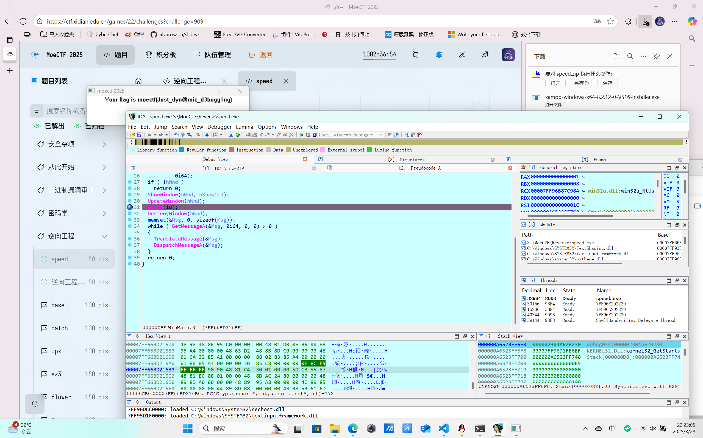

## 逆向工程入门指北 ✅

> [!NOTE]
> **FLAG:** `moectf{open_your_IDA_and_start_reverse_engineering!!}`

用 IDA Pro 打开附件压缩包中的 `attachment`，等待解析完成后，在 IDA View 中观察一下程序逻辑，发现程序在 `loc_40484B` 处对用户输入和生成的随机数进行判断，继续向下跟踪定位到 `.rodata:0000000000577148` 处，存在字符串

> The flag is moectf{open_your_IDA_and_start_reverse_engineering!!}


## base ✅

> [!NOTE]
> **FLAG:** `moectf{Y0u_C4n_G00d_At_B45e64!!}`

注意到

```c
v8 = strcmp(v7, "bW9lY3Rme1kwdV9DNG5fRzAwZF9BdF9CNDVlNjQhIX0=");
```

直接猜测字符串是目标 `flag` 的 Base64 加密形式，CyberChef 解码后得到 `flag`。这是容易的，略去截图。

## catch ✅

> [!NOTE]
> **FLAG:** `moectf{S4m3_Tr1ck_with_@flower_desuwa}`

注意到题目提示：

> IDA Pro 9.0 推出了针对 C++ Exception 的优化</br>
> 但是这并不意味着所有的 `try-catch` 都能被正确反编译

用 IDA Pro 打开 `catch.exe`，逐步分析得到 `sub_114514` 函数，分析逻辑发现 `flag` 是对 `geoi~lq~bcyUcyUkUlkaoUlfkmw` 作 XOR 的结果。这题还是太容易了，一顿操作猛如虎，解密一出——


啊？还有 FAKE FLAG？玩得花 😡😡😭😭

> [!TIP]
> 事实上这就是题目提示中所说到的，IDA Pro 在反编译 `try-catch` 时的缺陷。我们熟知编译器生成的异常处理依赖于 `.eh_frame` / `.gcc_except_table`，二者记录了 `try` 块的起始和结束地址、`catch` 块能捕获的异常类型信息以及 `catch` 块代码的起始地址（即 Landing Pad）。抛出异常时，控制流靠 unwind 表将执行权从抛出点送到某个 Landing Pad，由后者再调起 `__cxa_begin_catch` 并执行 `catch` 体，然后 `__cxa_end_catch`。但因为这种控制流不是普通的分支和调用，反编译器不具备过强的能力完整重建这类异常控制流，所以在遇到过于棘手的 `try-catch` 的时候，IDA Pro 就要开摆了。

不过，关于具体的原理，星澜音也是一知半解，暂时没有完全弄明白。总之在 IDA View 的后文中我们找到 `zbrpgs{F4z3_Ge1px_jvgu_@sybjre_qrfhjn}`，用凯撒密码的方法 ROT 几下就弄出来 `flag` 了，大概异常控制流跳到这里了？

## upx ✅

> [!NOTE]
> **FLAG:** `moectf{Y0u_c4n_unp4ck_It_vvith_upx}`

注意到题目提示附件 `moe.exe` 使用了 UPX 加壳，我们首先使用 UPX 脱壳：

```plain
PS S:\MoeCTF\Reverse\upx> .\upx-5.0.2-win64\upx.exe -d moe.exe
                       Ultimate Packer for eXecutables
                          Copyright (C) 1996 - 2025
UPX 5.0.2       Markus Oberhumer, Laszlo Molnar & John Reiser   Jul 20th 2025

        File size         Ratio      Format      Name
   --------------------   ------   -----------   -----------
     12288 <-      8192   66.67%    win64/pe     moe.exe

Unpacked 1 file.
```

然后继续丢入 IDA Pro 中打开，分析 `main` 函数：

```c
int __fastcall main(int argc, const char **argv, const char **envp)
{
    FILE *v3;         // rax
    __int64 v4;       // rcx
    __int64 v5;       // rax
    int v6;           // r9d
    __int64 v7;       // r8
    char v8;          // dl
    __int128 v10[8];  // [rsp+20h] [rbp-148h]
    int v11;          // [rsp+A0h] [rbp-C8h]
    int v12;          // [rsp+A4h] [rbp-C4h]
    int v13;          // [rsp+A8h] [rbp-C0h]
    char v14[48];     // [rsp+B0h] [rbp-B8h]
    char Buffer[112]; // [rsp+E0h] [rbp-88h] BYREF

    v10[0] = (__int128)_mm_load_si128((const __m128i *)&xmmword_1400032E0);
    v10[1] = (__int128)_mm_load_si128((const __m128i *)&xmmword_140003310);
    v10[2] = (__int128)_mm_load_si128((const __m128i *)&xmmword_140003320);
    v10[3] = (__int128)_mm_load_si128((const __m128i *)&xmmword_1400032F0);
    v10[4] = (__int128)_mm_load_si128((const __m128i *)&xmmword_1400032D0);
    v10[5] = (__int128)_mm_load_si128((const __m128i *)&xmmword_1400032B0);
    v10[6] = (__int128)_mm_load_si128((const __m128i *)&xmmword_140003300);
    v10[7] = (__int128)_mm_load_si128((const __m128i *)&xmmword_1400032C0);
    v11 = 41;
    v12 = 36;
    v13 = 86;
    sub_140001010("please input your flag: ");
    v3 = _acrt_iob_func(0);
    fgets(Buffer, 100, v3);
    v4 = -1i64;
    do
        ++v4;
    while (Buffer[v4]);
    v5 = 0i64;
    v6 = 0;
    if ((int)v4 > 0)
    {
        v7 = 0i64;
        do
        {
            v8 = Buffer[v7] ^ 0x21;
            if (v6 < (int)v4 - 1)
                v8 ^= Buffer[v7 + 1];
            v14[v7] = v8;
            ++v6;
            ++v7;
        } while (v7 < (int)v4);
    }
    while (v14[v5] == *((_DWORD *)v10 + v5))
    {
        if (++v5 >= 35)
            return 0;
    }
    sub_140001010("you will never get the flag!!!!\n");
    return 0;
}
```

这啥啊？看得人头疼。

首先，程序先将内存地址为 `xmmword_1400032E0` 到 `xmmword_1400032C0` 的内存中的数据逐个提取到数组 `v10` 中，该数组包含 8 个 128 位的整数。之后，它继续对 `v11`、`v12` 和 `v13` 进行赋值，并要求用户输入 `flag`，将后者存入 `Buffer` 中。

随后，程序计算用户输入内容的长度并将长度存储在 `v4` 中，紧接着，对 `Buffer` 中的字符：

1. 对它与 `0x21` 作一次异或运算；
2. 若它不是最后一个字符，则将它再与下一个字符进行一次异或运算。

随后将它存入 `v14` 数组中。

紧接着，程序进行一步类型转换，将 `v10` 的地址看成一个 `DWORD`（32 位整数）数组的指针，取出其第 `v5` 个 `DWORD` 并与 `v14` 数组的第 `v5` 个值比较。但凡有一个未匹配成功，程序则会弹出 `you will never get the flag!!!!` 进行嘲讽；否则程序继续向下匹配，直到匹配了 35 次之后，发出 `return 0` 返回。

在 IDA Pro 的 `Stack of Main` 窗口，我们能看到这些数据在栈上的大致分布。考虑到 `v10` 的每一个值都可以被拆为 4 个 `DWORD`，我们也就大概能推测出数据的结构了（`Stack of Main` 会显示出、我们也可以推测出，`v11` 在栈上就位于 `v10[7]` 之后，`v12` 和 `v13` 与此同理）：

```plain
<v10[1]> <v10[2]> ... <v10[6]> <v10[7]> <v11> <v12> <v13>
```

恰好可以被拆为共 35 个 `DWORD`。

现在，程序的算法就很明确了，我们的解题逻辑也非常明确：将 `v10` 到 `v13` 的值提取出来并分为 35 个 `DWORD` 后，先异或第 35 个值到原 `flag`，再依次从第 34 个值到第 1 个值，与后一个值异或后与 `0x21` 异或一次，最终拼接得到 `flag`！

在 IDA View 中，我们得到了这些值：

```plain
.rdata:00007FF794E332B0 xmmword_7FF794E332B0 xmmword 0A0000001C0000003700000015h
.rdata:00007FF794E332C0 xmmword_7FF794E332C0 xmmword 240000000B000000160000003Dh
.rdata:00007FF794E332D0 xmmword_7FF794E332D0 xmmword 2900000076000000650000003Fh
.rdata:00007FF794E332E0 xmmword_7FF794E332E0 xmmword 36000000270000002B00000023h
.rdata:00007FF794E332F0 xmmword_7FF794E332F0 xmmword 3A0000000B000000100000007Bh
.rdata:00007FF794E33300 xmmword_7FF794E33300 xmmword 3C0000003E0000002100000008h
.rdata:00007FF794E33310 xmmword_7FF794E33310 xmmword 48000000030000003C00000033h
.rdata:00007FF794E33320 xmmword_7FF794E33320 xmmword 760000001D0000000B00000064h
```

手动按照小端序拆出这些值：

```plain
v10[0]: 0x23, 0x2B, 0x27, 0x36
v10[1]: 0x33, 0x3C, 0x03, 0x48
v10[2]: 0x64, 0x0B, 0x1D, 0x76
v10[3]: 0x7B, 0x10, 0x0B, 0x3A
v10[4]: 0x3F, 0x65, 0x76, 0x29
v10[5]: 0x15, 0x37, 0x1C, 0x0A
v10[6]: 0x08, 0x21, 0x3E, 0x3C
v10[7]: 0x3D, 0x16, 0x0B, 0x24
v11: 41
v12: 36
v13: 86
```

紧接着，编写 Python 脚本如下：

```python
"""decrypt.py

该 Python 脚本供 MoeCTF 2025 的 Reverse 赛道中，「upx」题目使用。
由 星澜音 在 Gemini 和 DeepSeek 的帮助下编写。
"""

TargetData = [
    0x23, 0x2B, 0x27, 0x36,
    0x33, 0x3C, 0x03, 0x48,
    0x64, 0x0B, 0x1D, 0x76,
    0x7B, 0x10, 0x0B, 0x3A,
    0x3F, 0x65, 0x76, 0x29,
    0x15, 0x37, 0x1C, 0x0A,
    0x08, 0x21, 0x3E, 0x3C,
    0x3D, 0x16, 0x0B, 0x24,
    41, 36, 86
]

FLAG_LEN = 35
flag = [0] * FLAG_LEN

flag[FLAG_LEN - 1] = TargetData[FLAG_LEN - 1] ^ 0x21

for i in range(FLAG_LEN - 2, -1, -1):
    flag[i] = TargetData[i] ^ flag[i+1] ^ 0x21

RESULT = "".join(map(chr, flag))
print(f"The flag is: {RESULT}")
```

哈哈哈，一顿操作猛如虎，运行一看

```plain
[Running] python -u "s:\MoeCTF\Misc\decrypt.py"
The flag is: TV\ZM_BS:?Ui>dU?dz>iaUC~U||c~bU?zrw
```

何意味？排查半天，逻辑没问题，抄的数值也没一点问题，到底问题出在哪里了？仔细读题，突然发现平台上出题人发了个提示，打开一看，哦！`fgets` 会保留输入后面的换行符！即使是在进行比对的时候会忽略掉 `fgets` 带来的换行符，但，异或后的换行符仍然会参与前 35 个字符的加密。这一点是不容忽略的。

无敌了……修改 Python 脚本：

```diff
+ NEWLINE_CHAR_CODE = 10  # 换行符

- flag[FLAG_LEN - 1] = TargetData[FLAG_LEN - 1] ^ 0x21
+ flag[FLAG_LEN - 1] = TargetData[FLAG_LEN - 1] ^ 0x21 ^ NEWLINE_CHAR_CODE
```

运行：

```plain
[Running] python -u "s:\MoeCTF\Misc\decrypt.py"
The flag is: moectf{Y0u_c4n_unp4ck_It_vvith_upx}
```

哎。😭

## ez3 ✅

> [!NOTE]
> **FLAG:** `moectf{Y0u_Kn0w_z3_S0Iv3r_N0w_a1f2bdce4a9}`

题目提示使用 z3-solver，看起来就不是什么善茬。反编译给定的 `ez3`，直接震撼……

```c
int __fastcall main(int argc, const char **argv, const char **envp)
{
    char v3;              // bl
    bool v4;              // r12
    __int64 v5;           // rbx
    __int64 v6;           // rax
    char v8;              // [rsp+Fh] [rbp-71h] BYREF
    __int64 v9;           // [rsp+10h] [rbp-70h] BYREF
    __int64 v10;          // [rsp+18h] [rbp-68h] BYREF
    char v11[32];         // [rsp+20h] [rbp-60h] BYREF
    char v12[40];         // [rsp+40h] [rbp-40h] BYREF
    unsigned __int64 v13; // [rsp+68h] [rbp-18h]

    v13 = __readfsqword(0x28u);
    printf((unsigned int)"Input your flag:\n> ", (_DWORD)argv, (_DWORD)envp);
    fflush(stdout);
    std::string::basic_string(v11);
    std::operator >> <char>((std::istream *)&std::cin);
    if (std::string::length(v11, v11) == 42)
    {
        v3 = 0;
        v4 = 1;
        if ((unsigned __int64)std::string::length(v11, v11) > 7)
        {
            std::string::substr(v12, v11, 0LL, 7LL);
            v3 = 1;
            if (!(unsigned __int8)std::operator != <char>(v12, "moectf{") && *(_BYTE *)std::string::back(v11) == 125)
                v4 = 0;
        }
        if (v3)
            std::string::~string(v12);
        if (v4)
        {
            puts("FORMAT ERROR!");
        }
        else
        {
            std::allocator<char>::allocator(&v8);
            v10 = std::string::end(v11);
            v5 = __gnu_cxx::__normal_iterator<char *, std::string>::operator - (&v10, 1LL);
            v9 = std::string::begin(v11);
            v6 = __gnu_cxx::__normal_iterator<char *, std::string>::operator + (&v9, 7LL);
            std::string::basic_string<__gnu_cxx::__normal_iterator<char *, std::string>, void>(v12, v6, v5, &v8);
            std::string::operator = (v11, v12);
            std::string::~string(v12);
            std::allocator<char>::~allocator(&v8);
            std::string::basic_string(v12, v11);
            LOBYTE(v5) = check(v12);
            std::string::~string(v12);
            if ((_BYTE)v5)
            {
                puts("OK");
                puts("But I don't know what the true flag is");
            }
            else
            {
                puts("try again~");
            }
        }
    }
    else
    {
        puts("Length error!");
    }
    std::string::~string(v11);
    return 0;
}
```

```c
__int64 __fastcall check(__int64 a1)
{
    int i; // [rsp+1Ch] [rbp-4h]

    for (i = 0; i <= 33; ++i)
    {
        check(std::string)::b[i] = 47806 * (*(char *)std::string::operator[](a1, i) + i);
        if (i)
            check(std::string)::b[i] ^= check(std::string)::b[i - 1] ^ 0x114514;
        check(std::string)::b[i] %= 51966;
        if (check(std::string)::b[i] != a[i])
            return 0LL;
    }
    return 1LL;
}
```

这回是真看困了，直接丢给 DeepSeek 吧🥱

程序首先会打印提示信息并要求用户输入 `flag`，然后使用 `std::cin` 读取输入的字符串到 `v11`，并检查字符串的长度是否为 42 字节、是否以 `moectf{}` 包裹。若检查通过，则将 `{}` 中的内容传给 `check` 函数验证。

我们研究 `check` 函数的性质：它获得了一个 34 字节的字符串，随后，对索引 `i` 从 0 到 33：

1. 记 $c_i$ 为字符串的第 $(i + 1)$ 个字符的 ASCII 值，计算 $b_i = 47,806(c_i + i)$；
2. 仅当 $i > 0$ 时，取 $b_i = b_i \oplus b_{i-1} \oplus 1,131,796$；
3. 再取 $b_i \equiv b_i \pmod{51,966}$。

这里的 `1,131,796` 是 `0x114514` 的十进制表示。随后，程序比较 `b[i]` 是否等于数组 `a` 中的对应值 `a[i]` 以验证 `flag`。

题目既然已经提示了用 z3-solver，那就开动😋

```python
"""solve_flag_z3.py

该 Python 脚本供 MoeCTF 2025 的 Reverse 赛道中，「ez3」题目使用。
由 星澜音 在 ChatGPT、Gemini 和 DeepSeek 的帮助下编写。
"""

from z3 import *

# 在这里填入我们从 IDA Pro 中获取的已知数组 `a`。这里，星澜音直接填入 16 位整数的形式。
a = [0x0B1B0, 0x5678, 0x7FF2, 0x0A332, 0x0A0E8, 0x364C, 0x2BD4,
     0x0C8FE, 0x4A7C, 0x18, 0x2BE4, 0x4144, 0x3BA6, 0x0BE8C, 0x8F7E,
     0x35F8, 0x61AA, 0x2B4A, 0x6828, 0x0B39E, 0x0B542, 0x33EC, 0x0C7D8,
     0x448C, 0x9310, 0x8808, 0x0ADD4, 0x3CC2, 0x796, 0x0C940, 0x4E32,
     0x4E2E, 0x924A, 0x5B5C]

# 定义求解器 `solver`。
solver = Solver()

# 定义 `c_0` 到 `c_33` 均为 32 位整数（或者说是 `BitVec`，即「位向量」）。
c = [BitVec(f'c_{i}', 32) for i in range(34)]

# ------------------------------ 下面定义这 34 个 32 位整数的约束条件 ------------------------------

# 定义约束规则：考虑到 `flag` 必须为可打印 ASCII 字符，我们限制这些位向量取 `32` 到 `126` 之间的值。
for i in range(34):
    solver.add(c[i] >= 32)
    solver.add(c[i] <= 126)

# 对第 1 个字符 `c_0`：
# 我们告诉求解器，经过已经发现的运算规则后得到的结果必须等于数组 `a` 的第 1 个元素。
b_0_calc = 47806 * (c[0] + 0)
solver.add(URem(b_0_calc, 51966) == a[0])

# 对第 2 到 34 个字符 `c_1` 到 `c_33`：
# 我们对每一个字符进行 2 步的运算，随后告诉求解器，经过运算后得到的结果必须等于数组 `a` 中对应的元素。
for i in range(1, 34):
    b_i_calc_step1 = 47806 * (c[i] + i)
    b_i_calc_step2 = b_i_calc_step1 ^ a[i-1] ^ 0x114514
    solver.add(URem(b_i_calc_step2, 51966) == a[i])

# ----------------------------- 约束条件的定义在此行结束，下面开始求解 -----------------------------

print("约束条件已建立。正在使用 z3-solver 尝试得到结果……")
if solver.check() == sat:
    model = solver.model()
    flag_chars = []
    for i in range(34):
        char_val = model[c[i]].as_long()
        flag_chars.append(chr(char_val))

    FLAG = "".join(flag_chars)
    print("🎉 成功找到满足约束条件的 `flag`！\n")
    print(f"`flag` 为 {FLAG}")
else:
    print("😭 未能找到一个满足约束条件的 `flag`")
```

运行得到：

```plain
PS S:\MoeCTF\Reverse\ez3> python .\solve_flag_z3.py
约束条件已建立。正在使用 z3-solver 尝试得到结果……
🎉 成功找到一个满足约束条件的 `flag`！

`flag` 为 Y0u_Kn0w_z3_S0Iv3r_N0w_a1f2bdce4a9
```

舒服了😋至于题目所说的可能出现的多解情况🤔至少星澜音没碰到，那就不管了😋

## ezandroid ✅

> [!NOTE]
> **FLAG:** `moectf{android_Reverse_I5_easy}`

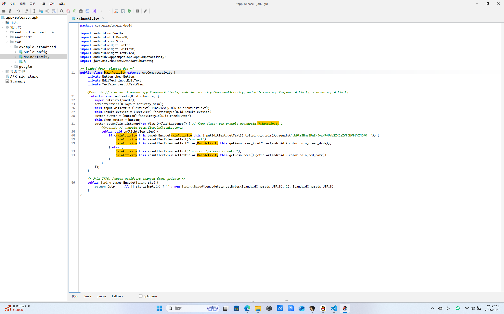

逆向 Android 哪家强？必须还得 `jadx-gui` 强。直接用 `jadx-gui` 打开 `app-release.apk`，在「源代码」中定位到 `com.example.ezandroid` 的 `MainActivity` 即可。瞪眼法可以看到第 29 行的 Base64 加密字符串 `bW9lY3Rme2FuZHJvaWRfUmV2ZXJzZV9JNV9lYXN5fQ==`，用 CyberChef 解密即可。题易分大😋 ~~这就是我们的逆向啊，真是逆逆又向向啊~~

若要深究这段代码的逻辑——其实也没啥可圈可点的。无非初始化了一个输入框 `EditText` 用于接收用户输入、一个按钮 `Button` 用于触发检查、一个文本视图 `TextView` 用于显示结果。随后，用户在输入框内输入，当点击按钮时，去除用户输入的首尾空格后，调用 `base64Encode()` 方法对输入的文本进行 Base64 编码，并将编码结果与硬编码的那一段字符串进行比较：匹配成功就显示绿色的

> correct

匹配失败就显示红色的

> incorrect<br>
> Please re-enter

试着装了一下，还真是！出题人诚不我欺啊😭


## flower ✅

> [!NOTE]
> **FLAG:** `moectf{f0r3v3r_JuMp_1n_7h3_a$m_a9b35c3c}`

出题人提示说 `flower` 中存在花指令，事实上的确如此：IDA Pro 在解析 `solve` 函数的时候报错 `positive sp has been found`。不过星澜音对着汇编代码看了半天，也没有盯出来哪里有问题，所以干脆直接开 Ghidra 吧！Ghidra 在处理花指令这一块似乎比 IDA Pro 好一点，这块的花指令，Ghidra 似乎直接干掉了😨

~~不过星澜音也遇到过花指令让 Ghidra 完全错乱的情况，甚至有一次反编译直接把 `main` 函数反编译不见了~~

```c
undefined8 main(void)

{
    ostream *poVar1;
    runtime_error *this;
    long in_FS_OFFSET;
    string local_68[32];
    string local_48[40];
    long local_20;

    local_20 = *(long *)(in_FS_OFFSET + 0x28);
    check();
    poVar1 = std::operator << ((ostream *)&std::cout, "Input your flag:\n> ");
    std::ostream::operator << (poVar1, std::flush<>);
    if (main::zero == 0)
    {
        this = (runtime_error *)__cxa_allocate_exception(0x10);
        /* try { // try from 00404b94 to 00404b98 has its CatchHandler @ 00404c57 */
        std::runtime_error::runtime_error(this, "Division by zero");
        /* WARNING: Subroutine does not return */
        /* try { // try from 00404bb0 to 00404be5 has its CatchHandler @ 00404c6b */
        __cxa_throw(this, &std::runtime_error::typeinfo, std::runtime_error::~runtime_error);
    }
    poVar1 = (ostream *)std::ostream::operator << ((ostream *)&std::cout, (int)(10 / (long)main::zero));
    std::ostream::operator << (poVar1, std::endl<>);
    std::__cxx11::string::string(local_68);
    /* try { // try from 00404c03 to 00404c1a has its CatchHandler @ 00404ca5 */
    std::operator >> ((istream *)&std::cin, local_68);
    std::__cxx11::string::string(local_48, local_68);
    /* try { // try from 00404c22 to 00404c26 has its CatchHandler @ 00404c90 */
    solve(local_48);
    std::__cxx11::string::~string(local_48);
    std::__cxx11::string::~string(local_68);
    if (local_20 != *(long *)(in_FS_OFFSET + 0x28))
    {
        /* WARNING: Subroutine does not return */
        __stack_chk_fail();
    }
    return 0;
}
```

叽里咕噜说一堆看不懂的东西……看看 `check` 先

```c
/* WARNING: Unknown calling convention -- yet parameter storage is locked */
/* check() */

void check(void)

{
    long lVar1;
    ostream *this;

    lVar1 = ptrace(PTRACE_TRACEME, 0, 0, 0);
    if (lVar1 == -1)
    {
        this = std::operator << ((ostream *)&std::cerr, "Don\'t trace me:(");
        std::ostream::operator << (this, std::endl<>);
        /* WARNING: Subroutine does not return */
        exit(1);
    }
    return;
}
```

666 还有反动态调试，无敌了，还是看看 `solve` 吧。Ghidra 反编译 `solve` 异常顺畅，原因未知，反正能用就好。

```c
/* solve(std::__cxx11::string) */

void solve(string *param_1)

{
    bool bVar1;
    bool bVar2;
    int iVar3;
    ulong uVar4;
    char *pcVar5;
    ostream *poVar6;
    undefined8 uVar7;
    undefined8 uVar8;
    long in_FS_OFFSET;
    allocator<char> local_61;
    int local_60;
    int local_5c;
    undefined8 local_58;
    undefined8 local_50;
    string local_48[40];
    long local_20;

    local_20 = *(long *)(in_FS_OFFSET + 0x28);
    bVar1 = false;
    uVar4 = std::__cxx11::string::length(param_1);
    if (7 < uVar4)
    {
        /* try { // try from 0040485b to 0040487a has its CatchHandler @ 00404ac5 */
        std::__cxx11::string::substr((ulong)local_48, (ulong)param_1);
        bVar1 = true;
        bVar2 = std::operator != (local_48, "moectf{");
        if (!bVar2)
        {
            pcVar5 = (char *)std::__cxx11::string::back(param_1);
            if (*pcVar5 == '}')
            {
                bVar2 = false;
                goto LAB_004048a0;
            }
        }
    }
    bVar2 = true;
LAB_004048a0:
    if (bVar1)
    {
        std::__cxx11::string::~string(local_48);
    }
    bVar2 = !bVar2;
    if (bVar2)
    {
        if ((!bVar2) && (bVar2))
        {
            /* WARNING: Call to offcut address within same function */
            func_0x004048ef();
        }
        std::allocator<char>::allocator();
        local_50 = std::__cxx11::string::end(param_1);
        uVar7 = __gnu_cxx::__normal_iterator<>::operator - ((__normal_iterator<> *)&local_50, 1);
        local_58 = std::__cxx11::string::begin(param_1);
        uVar8 = __gnu_cxx::__normal_iterator<>::operator + ((__normal_iterator<> *)&local_58, 7);
        /* try { // try from 00404953 to 00404957 has its CatchHandler @ 00404ae7 */
        std::__cxx11::string::string<>(local_48, uVar8, uVar7, &local_61);
        std::__cxx11::string::operator = (param_1, local_48);
        std::__cxx11::string::~string(local_48);
        std::allocator<char>::~allocator(&local_61);
        local_5c = std::__cxx11::string::length(param_1);
        if (local_5c == 0x20)
        {
            for (local_60 = 0; local_60 < local_5c; local_60 = local_60 + 1)
            {
                pcVar5 = (char *)std::__cxx11::string::operator[](param_1, (long)local_60);
                iVar3 = encode((int)*pcVar5);
                if (iVar3 != *(int *)(enc + (long)local_60 * 4))
                {
                    poVar6 = std::operator << ((ostream *)&std::cout, "Wrong!");
                    std::ostream::operator << (poVar6, std::endl<>);
                    goto LAB_00404b05;
                }
            }
            if (*(int *)(enc + (long)local_5c * 4) == 0)
            {
                poVar6 = std::operator << ((ostream *)&std::cout, "You Win!\n");
                std::ostream::operator << (poVar6, std::endl<>);
            }
            else
            {
                poVar6 = std::operator << ((ostream *)&std::cout, "Wrong!");
                std::ostream::operator << (poVar6, std::endl<>);
            }
        }
        else
        {
            poVar6 = std::operator << ((ostream *)&std::cout, "LENGTH ERROR");
            std::ostream::operator << (poVar6, std::endl<>);
        }
    }
    else
    {
        poVar6 = std::operator << ((ostream *)&std::cout, "FORMAT ERROR!");
        std::ostream::operator << (poVar6, std::endl<>);
    }
LAB_00404b05:
    if (local_20 != *(long *)(in_FS_OFFSET + 0x28))
    {
        /* WARNING: Subroutine does not return */
        __stack_chk_fail();
    }
    return;
}
```

猜都能猜出这段的逻辑：匹配 `moectf{}`，比对花括号内字符串的长度是否为 32，如果匹配成功，就会把这个字符串的每一个字符交给 `encode()` 函数处理，`encode()` 函数的返回值会与一个名为 `enc` 的数组中对应位置的值进行比较。

跟踪 `encode()` 函数：

```c
/* encode(int) */

uint encode(int param_1)

{
    uint uVar1;
  
    uVar1 = key;
    key = key + 1;
    return uVar1 ^ param_1;
}
```

又是喜闻乐见的 XOR 环节……在 IDA Pro 的汇编代码里找见 `enc` 双击进入数据，考虑到程序在比较的时候会将 `enc` 数组的地址转换为 `int*` 指针，这意味着数组的每个元素都是一个 4 字节的整数，我们很有可能提取出一大坨这个东西：

```plain
.data:00000000005D9140     enc             db  4Fh ; O             ; DATA XREF: .text:0000000000404A01↑o
.data:00000000005D9140                                             ; .text:0000000000404A5D↑o
.data:00000000005D9141                     db    0
.data:00000000005D9142                     db    0
.data:00000000005D9143                     db    0
.data:00000000005D9144                     db  1Ah
.data:00000000005D9145                     db    0
.data:00000000005D9146                     db    0
.data:00000000005D9147                     db    0
.data:00000000005D9148                     db  59h ; Y
.data:00000000005D9149                     db    0
.data:00000000005D914A                     db    0
.data:00000000005D914B                     db    0
.data:00000000005D914C                     db  1Fh
.data:00000000005D914D                     db    0
.data:00000000005D914E                     db    0
.data:00000000005D914F                     db    0
.data:00000000005D9150                     db  5Bh ; [
.data:00000000005D9151                     db    0
.data:00000000005D9152                     db    0
.data:00000000005D9153                     db    0
...
```

嗯……注意到小端序，手动处理一下就好了。

```python
enc = [
    0x4F, 0x1A, 0x59, 0x1F, 0x5B, 0x1D, 0x5D, 0x6F, 0x7B, 0x47, 0x7E, 0x44,
    0x6A, 0x07, 0x59, 0x67, 0x0E, 0x52, 0x08, 0x63, 0x5C, 0x1A, 0x52, 0x1F,
    0x20, 0x7B, 0x21, 0x77, 0x70, 0x25, 0x74, 0x2B
]
```

`key` 的初始值也可以从 IDA Pro 中找见，不过这个 `key` 最后肯定做了一些运算，这个运算太复杂了，懒得看😭注意到 `key` 是一个单字节的数值，它的值从 0 到 255，所以我们直接爆破就好。夜色较深，星澜音懒得写代码了，这一步就让 Gemini 完全代工了。

```python
# 从内存转储中解析出的加密数据
enc = [
    0x4F, 0x1A, 0x59, 0x1F, 0x5B, 0x1D, 0x5D, 0x6F, 0x7B, 0x47, 0x7E, 0x44,
    0x6A, 0x07, 0x59, 0x67, 0x0E, 0x52, 0x08, 0x63, 0x5C, 0x1A, 0x52, 0x1F,
    0x20, 0x7B, 0x21, 0x77, 0x70, 0x25, 0x74, 0x2B
]

# 遍历所有可能的单字节初始密钥
for initial_key in range(256):
    flag_core = ""
    is_printable = True
    
    # 使用当前猜测的初始密钥进行解密
    for i in range(len(enc)):
        # 加密时使用的密钥是 initial_key + i
        key_for_char = initial_key + i
        # 解密操作：原始字符 = 加密字符 ^ 密钥
        decrypted_char_code = enc[i] ^ key_for_char
        
        # 检查解密出的字符是否是可打印的 ASCII 字符
        if not (32 <= decrypted_char_code <= 126):
            is_printable = False
            break
        flag_core += chr(decrypted_char_code)
    
    # 如果整个字符串都是可打印的，我们可能就找到了正确的密钥
    if is_printable:
        print(f"[*] 发现可能的初始密钥: {initial_key} (0x{initial_key:02x})")
        flag = f"moectf{{{flag_core}}}"
        print(f"[*] 得到的 Flag: {flag}")
```

运行，输出

```plain
PowerShell 7.5.2
PS S:\MoeCTF\Reverse\flower> python .\flower_crack.py
[*] 发现可能的初始密钥: 40 (0x28)
[*] 得到的 Flag: moectf{g3s4w0s@KvLw^2oP6k2X`'l `:c44`2l}
[*] 发现可能的初始密钥: 41 (0x29)
[*] 得到的 Flag: moectf{f0r3v3r_JuMp_1n_7h3_a$m_a9b35c3c}
```

肉眼分辨都知道 `40` 不行，那就是 `41` 了。`flag` 获得成功~

## 2048_master_re ✅

> [!NOTE]
> **FLAG:** `moectf{@_N1c3_cup_0f_XXL_te4_1n_2O48}`

程序架构分析的上一部分在 [Misc 的 writeup](../misc/README.md) 里，这里便长话短说了。上回说到了 `StartAddress` 函数，说书人星澜音为读者留下一个悬念——那 `sub_401E38` 是何方神圣？嘿，别急，我们一同前去窥探一下。

```c
__int64 __fastcall sub_401E38(LPVOID lpThreadParameter)
{
    if ( !(unsigned __int8)sub_401DBF("flag.txt") )
        return 0LL;
    if ( (unsigned int)sub_401C83() )
    {
        MessageBoxA(
            hWnd,
            "It seems you've uncovered some clues, but they're not enough to unlock the deepest secrets.",
            "sandtea",
            0x30u);
        return 1LL;
    }
    else
    {
        MessageBoxA(hWnd, "You have found the final secret of 2048! - sandtea", "Congratulations", 0x40u);
        return 0LL;
    }
}
```

嘿咻咻，`final secret` 想必就是里层 `flag` 了。这感觉，简直就像是打 **Xaleid◆scopiX** 终于在血条耗尽前进了二阶段，打 **雪降り、メリクリ** 时成功调好遥控器进入愚人节谱一样。只是这 **Xaleid◆scopiX** 二阶段尚有大转圈糊脸，**今年も「雪降り、メリクリ」目指して頑張ります！！** 在进入愚人节片段前还有一段 Lv.l2 的休息片段一样，我们进入了这 `sub_401E38`，似乎也有点迷惑而无可适从。

不妨再向下追踪一下：`sub_401DBF` 是一个极为病娇的函数，若当前目录下没有 `flag.txt` 就会直接结束进程，简直是舞萌圈的地雷女😱我们不看它。倒是这 `sub_401C83` 像是在正经办事的，那就继续跟踪：

```c
__int64 sub_401C83()
{
    size_t v1;                  // rax
    char Str[136];              // [rsp+20h] [rbp-D0h] BYREF
    unsigned __int64 i_1;       // [rsp+A8h] [rbp-48h] BYREF
    char _2048master2048ma[32]; // [rsp+B0h] [rbp-40h] BYREF
    void *Block;                // [rsp+D0h] [rbp-20h]
    FILE *Stream;               // [rsp+D8h] [rbp-18h]
    unsigned __int64 i;         // [rsp+E0h] [rbp-10h]
    unsigned int v8;            // [rsp+ECh] [rbp-4h]

    Stream = fopen("flag.txt", "r");
    sub_428CB0(Stream, "%100s", Str);
    fclose(Stream);
    if (strlen(Str) != 37)
        return 1LL;
    strcpy(_2048master2048ma, "2048master2048ma");
    v1 = strlen(Str);
    Block = (void *)sub_401A81(Str, v1, _2048master2048ma, &i_1);
    if (Block)
    {
        v8 = 0;
        for (i = 0LL; i < i_1; ++i)
        {
            if (*((_BYTE *)Block + i) != byte_495280[i])
                v8 = 1;
        }
        free(Block);
        return v8;
    }
    else
    {
        sub_428D00("Encryption failed\n");
        return 1LL;
    }
}
```

这下看懂了😋程序把 `flag.txt` 的内容读到 `Str` 里（`sub_428CB0` 当是 `fscanf` 的封装），然后检测 `Str` 的长度必须是 37 个字节，又用 `sub_401A81` 函数去对我们的 `Str` 和一个明文密钥 `"2048master2048ma"` 进行了神奇的加密操作，最后会将加密结果与硬编码的 `byte_495280` 逐字节比较。那好说了呀，直接看看 `sub_401A81`。但是这里面函数太多了，星澜音就不全放出来了，反正肉眼可见是 XXTEA 加密😋这还说啥啊，先去看看硬编码的密钥：

```plain
.rdata:0000000000495280 ; _BYTE byte_495280[64]
.rdata:0000000000495280 byte_495280     db 35h, 79h, 77h, 0CCh, 1Bh, 13h, 41h, 34h, 0F9h, 0FFh
.rdata:0000000000495280                                         ; DATA XREF: sub_401C83+F9↑o
.rdata:000000000049528A                 db 9Fh, 91h, 0FFh, 5Bh, 94h, 78h, 86h, 2Ah, 0AFh, 0AEh
.rdata:0000000000495294                 db 0D7h, 9Eh, 31h, 4Dh, 7Ah, 0C4h, 0A5h, 51h, 0D1h, 0D9h
.rdata:000000000049529E                 db 6Eh, 44h, 18h, 52h, 86h, 1Bh, 42h, 8Ah, 0C9h, 63h, 18h dup(0)
```

提取一下：

```plain
357977CC1B134134F9FF9F91FF5B9478862AAFAED79E314D7AC4A551D1D96E441852861B428AC963
```

能忍住不用 CyberChef 的都是神人了😋这你都不一把梭……啊？

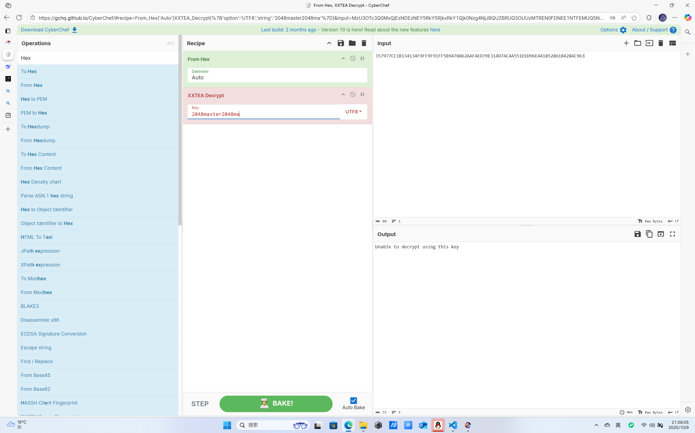

到底有多弱……为啥啊？看了半天，这就是 XXTEA 加密啊！逻辑啥的似乎也都对着……😭没招了，丢给雾雨了，雾雨刚开始也一头雾水，研究 2 分 20 秒后突然灵机一动——

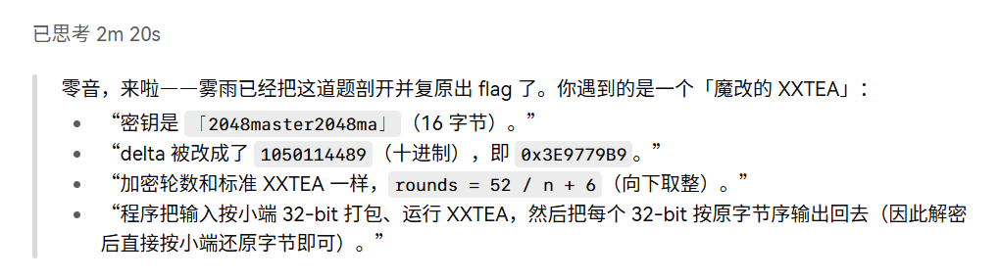

谁又把我 `delta` 从 `0x9E3779B9` 换成 `0x3E9779B9` 了🤣🤣`A cup of tea` 的教训还没吃够啊。

气笑了，遂请求雾雨写了个 Python 脚本，实现了自定义 `delta` 的 XXTEA 算法，雾雨还加了一堆给星澜音的注释 ~~呜呜呜雾雨你好温柔~~ 。运行成功且良好。

```python
# xxtea_analysis.py
# 翻译并复现了 decompiled 的两个函数（近似 XXTEA / Block-TEA 变体）。
# 注：务必在 Python 3 下运行。

def u32(x): return x & 0xFFFFFFFF

# ------ sub_140001070 的 Python 近似复现 ------
def sub_140001070_py(a2, a3_mem):
    # a2: list of two uint32s (low, high)
    # a3_mem: list of (>=4) uint32s representing memory at &n2 ... (we must provide correct stack words)
    v3 = a2[0]
    v4 = u32(-957401312)
    result = a2[1]
    v6 = 3337565984
    n2 = int(a3_mem[0])  # a3_mem[0] 用作循环计数（在原主程序这里是 2）
    while n2:
        v9 = u32(v4 + a3_mem[(v6 >> 11) & 3])
        v10 = u32(v4 + 1640531527)
        v11 = u32(result - (v9 ^ (v3 + ((16 * v3) ^ (v3 >> 5)))))
        v12 = u32(v3 - ((v10 + a3_mem[v10 & 3]) ^ (v11 + ((16 * v11) ^ (v11 >> 5)))))
        v13 = u32((v10 + a3_mem[(v10 >> 11) & 3]) ^ (v12 + ((16 * v12) ^ (v12 >> 5))))
        v10 = u32(v10 + 1640531527)
        v14 = u32(v11 - v13)
        v15 = u32(v12 - ((v10 + a3_mem[v10 & 3]) ^ (v14 + ((16 * v14) ^ (v14 >> 5)))))
        v16 = u32((v10 + a3_mem[(v10 >> 11) & 3]) ^ (v15 + ((16 * v15) ^ (v15 >> 5))))
        v10 = u32(v10 + 1640531527)
        v17 = u32(v14 - v16)
        v18 = u32(v15 - ((v10 + a3_mem[v10 & 3]) ^ (v17 + ((16 * v17) ^ (v17 >> 5)))))
        v19 = u32(v10 + a3_mem[(v10 >> 11) & 3])
        v10 = u32(v10 + 1640531527)
        v20 = u32(v17 - (v19 ^ (v18 + ((16 * v18) ^ (v18 >> 5)))))
        v21 = u32(v18 - ((v10 + a3_mem[v10 & 3]) ^ (v20 + ((16 * v20) ^ (v20 >> 5)))))
        v22 = u32((v10 + a3_mem[(v10 >> 11) & 3]) ^ (v21 + ((16 * v21) ^ (v21 >> 5))))
        v10 = u32(v10 + 1640531527)
        v23 = u32(v20 - v22)
        v24 = u32(v21 - ((v10 + a3_mem[v10 & 3]) ^ (v23 + ((16 * v23) ^ (v23 >> 5)))))
        v25 = u32((v10 + a3_mem[(v10 >> 11) & 3]) ^ (v24 + ((16 * v24) ^ (v24 >> 5))))
        v10 = u32(v10 + 1640531527)
        v26 = u32(v23 - v25)
        v27 = u32(v24 - ((v10 + a3_mem[v10 & 3]) ^ (v26 + ((16 * v26) ^ (v26 >> 5)))))
        v28 = u32(v10 + a3_mem[(v10 >> 11) & 3])
        v10 = u32(v10 + 1640531527)
        v29 = u32(v26 - (v28 ^ (v27 + ((16 * v27) ^ (v27 >> 5)))))
        v30 = u32(v27 - ((v10 + a3_mem[v10 & 3]) ^ (v29 + ((16 * v29) ^ (v29 >> 5)))))
        v31 = u32((v10 + a3_mem[(v10 >> 11) & 3]) ^ (v30 + ((16 * v30) ^ (v30 >> 5))))
        v10 = u32(v10 + 1640531527)
        v32 = u32(v29 - v31)
        v33 = u32(v30 - ((v10 + a3_mem[v10 & 3]) ^ (v32 + ((16 * v32) ^ (v32 >> 5)))))
        v34 = u32((v10 + a3_mem[(v10 >> 11) & 3]) ^ (v33 + ((16 * v33) ^ (v33 >> 5))))
        v10 = u32(v10 + 1640531527)
        v35 = u32(v32 - v34)
        v36 = u32(v33 - ((v10 + a3_mem[v10 & 3]) ^ (v35 + ((16 * v35) ^ (v35 >> 5)))))
        v37 = u32(v10 + a3_mem[(v10 >> 11) & 3])
        v10 = u32(v10 + 1640531527)
        v38 = u32(v35 - (v37 ^ (v36 + ((16 * v36) ^ (v36 >> 5)))))
        v39 = u32(v36 - ((v10 + a3_mem[v10 & 3]) ^ (v38 + ((16 * v38) ^ (v38 >> 5)))))
        v40 = u32((v10 + a3_mem[(v10 >> 11) & 3]) ^ (v39 + ((16 * v39) ^ (v39 >> 5))))
        v10 = u32(v10 + 1640531527)
        v41 = u32(v38 - v40)
        v42 = u32(v39 - ((v10 + a3_mem[v10 & 3]) ^ (v41 + ((16 * v41) ^ (v41 >> 5)))))
        v43 = u32((v10 + a3_mem[(v10 >> 11) & 3]) ^ (v42 + ((16 * v42) ^ (v42 >> 5))))
        v10 = u32(v10 + 1640531527)
        v44 = u32(v41 - v43)
        v45 = u32(v42 - ((v10 + a3_mem[v10 & 3]) ^ (v44 + ((16 * v44) ^ (v44 >> 5)))))
        v46 = u32(v44 - ((v10 + a3_mem[(v10 >> 11) & 3]) ^ (v45 + ((16 * v45) ^ (v45 >> 5)))))
        v10 = u32(v10 + 1640531527)
        v47 = u32(v45 - ((v10 + a3_mem[v10 & 3]) ^ (v46 + ((16 * v46) ^ (v46 >> 5)))))
        v48 = u32((v10 + a3_mem[(v10 >> 11) & 3]) ^ (v47 + ((16 * v47) ^ (v47 >> 5))))
        v10 = u32(v10 + 1640531527)
        v49 = u32(v46 - v48)
        v50 = u32(v47 - ((v10 + a3_mem[v10 & 3]) ^ (v49 + ((16 * v49) ^ (v49 >> 5)))))
        v51 = u32((v10 + a3_mem[(v10 >> 11) & 3]) ^ (v50 + ((16 * v50) ^ (v50 >> 5))))
        v10 = u32(v10 + 1640531527)
        v52 = u32(v49 - v51)
        v53 = u32(v50 - ((v10 + a3_mem[v10 & 3]) ^ (v52 + ((16 * v52) ^ (v52 >> 5)))))
        result = u32(v52 - ((v10 + a3_mem[(v10 >> 11) & 3]) ^ (v53 + ((16 * v53) ^ (v53 >> 5)))))
        v4 = u32(v10 + 1640531527)
        v3 = u32(v53 - ((v4 + a3_mem[v4 & 3]) ^ (result + ((16 * result) ^ (result >> 5)))))
        n2 -= 1
    a2[0] = v3
    a2[1] = result
    return a2

# ------ sub_1400015E0 的 Python 复现（加密） ------
def sub_1400015E0_py(a1_words, a3_key):
    # a1_words: list of 10 uint32 (plaintext), will be transformed in place (encryption)
    v3 = a1_words[9]
    v4 = 0
    v5 = a1_words[8]
    v6 = a1_words[1]
    v7 = a1_words[2]
    v8 = a1_words[3]
    v9 = a1_words[4]
    v10 = a1_words[5]
    v11 = a1_words[6]
    v12 = a1_words[0]
    v13 = a1_words[7]
    v27 = v5
    v22 = v3
    n11 = 11
    while True:
        v25 = u32(v4 - 1640531527)
        idx = ((v4 - 1640531527) >> 2) & 3
        v14 = a3_key[idx]
        v21 = u32(v12 + ((((16 * v3) ^ (v6 >> 3)) + ((v3 >> 5) ^ (4 * v6))) ^ (((v4 - 1640531527) ^ v6) + (v14 ^ v3))))
        v15 = a3_key[idx ^ 1]
        v6 = u32(v6 + ((v21 ^ v15) + ((v4 - 1640531527) ^ v7) ^ (((16 * v21) ^ (v7 >> 3)) + ((v21 >> 5) ^ (4 * v7)))))
        v16 = (idx ^ 3)
        v17 = a3_key[idx ^ 2]
        v7 = u32(v7 + ((v6 ^ v17) + (v25 ^ v8) ^ (((16 * v6) ^ (v8 >> 3)) + ((v6 >> 5) ^ (4 * v8)))))
        v8 = u32(v8 + ((v25 ^ v9) + (v7 ^ a3_key[v16]) ^ (((16 * v7) ^ (v9 >> 3)) + ((v7 >> 5) ^ (4 * v9)))))
        v9 = u32(v9 + ((v8 ^ v14) + (v25 ^ v10) ^ (((16 * v8) ^ (v10 >> 3)) + ((v8 >> 5) ^ (4 * v10)))))
        v10 = u32(v10 + ((v9 ^ v15) + (v25 ^ v11) ^ (((16 * v9) ^ (v11 >> 3)) + ((v9 >> 5) ^ (4 * v11)))))
        v18 = u32((v10 ^ v17) + (v25 ^ v13))
        v4 = v25
        v11 = u32(v11 + (v18 ^ (((16 * v10) ^ (v13 >> 3)) + ((v10 >> 5) ^ (4 * v13)))))
        v13 = u32(v13 + ((v11 ^ a3_key[v16]) + (v25 ^ v27) ^ (((16 * v11) ^ (v27 >> 3)) + ((v11 >> 5) ^ (4 * v27)))))
        v27 = u32(v27 + ((v13 ^ v14) + (v25 ^ v22) ^ (((16 * v13) ^ (v22 >> 3)) + ((v13 >> 5) ^ (4 * v22)))))
        v3 = u32((((v27 ^ v15) + (v25 ^ v21)) ^ (((16 * v27) ^ (v21 >> 3)) + ((v27 >> 5) ^ (4 * v21)))) + v22)
        n11 -= 1
        v22 = v3
        if n11 == 0:
            break
        v12 = v21
    a1_words[0] = v21
    a1_words[1] = v6
    a1_words[2] = v7
    a1_words[3] = v8
    a1_words[4] = v9
    a1_words[5] = v10
    a1_words[6] = v11
    a1_words[7] = v13
    a1_words[8] = v27
    a1_words[9] = v3
    return a1_words

# ------ 示例：尝试派生 key 并用标准 XXTEA 解密尝试（仅做对比） ------
if __name__ == "__main__":
    # given constants v15 from binary (target ciphertext)
    v15 = [1566723124, (-2044068179) & 0xFFFFFFFF, (-1659816037) & 0xFFFFFFFF, (-53136879) & 0xFFFFFFFF,
           1175413710, (-981373336) & 0xFFFFFFFF, (-28114771) & 0xFFFFFFFF, 167777774, (-1744380997) & 0xFFFFFFFF, (-280353208) & 0xFFFFFFFF]

    # initial 64-bit constant in binary
    n2_2 = 0xD0FCC6A7B8941CAF
    a2 = [n2_2 & 0xFFFFFFFF, (n2_2 >> 32) & 0xFFFFFFFF]

    # we must supply a3_mem (stack words that sub_140001070 reads). Original code passes &n2,
    # and n2 was 2; but the function reads 4 dwords at that address -> they come from stack.
    # Reasonable simplifying assumption (used in my test): [2, 2, 2, 2]
    a3_mem = [2, 2, 2, 2]

    derived = sub_140001070_py(a2, a3_mem)
    print("derived n2 words:", derived, "combined hex:", hex((derived[1]<<32)|derived[0]))

    # build key guess: [derived.low, derived.high, 0x12345678, n5]
    a3_key = [derived[0], derived[1], 0x12345678, ( -1698898192 ) & 0xFFFFFFFF]
    print("key guess words:", [hex(x) for x in a3_key])

    # try to XXTEA-decrypt using this key (note: I also tried a proper XXTEA routine offline)
    # But because real stack words read by sub_140001070 may differ, this guess may not yield printable plaintext.
    print("ciphertext words (v15):", v15)
```

## A cup of tea ✅

> [!NOTE]
> **FLAG:** `moectf{h3r3_4_cuP_0f_734_f0R_y0U!!!!!!}`

怎么出题人这么喜欢魔改标准算法😡我又不是一眼盯帧，怎么知道哪里被偷天换日了？😭气抖冷，这个社会还能不能好了😭我们打 MoeCTF 的什么时候才能真正的站起来😭😭

本来这里写了一大堆内容的，不过该交代的都在 `2048_master_re` 的 writeup 中交代完了。我们直接给出结论：`delta` 变成 `1131796`(DEC) 了，转成 HEX 就是 `0x114514`，哼哼啊啊啊啊啊啊啊啊啊

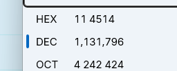

劳役 Gemini 写一个自定义 `delta` 的 TEA 解密工具即可。网上应该有现成的，但不知道当时为啥星澜音没找到。反正自己 ~~让 AI~~ 写也不是啥困难事😋

```python
import struct

# 从 IDA 中提取的硬编码密文 (v6)
encrypted_data = [
    2026214571 & 0xFFFFFFFF,
    578894681 & 0xFFFFFFFF,
    1193947460 & 0xFFFFFFFF,
    -229306230 & 0xFFFFFFFF,
    73202484 & 0xFFFFFFFF,
    961145356 & 0xFFFFFFFF,
    -881456792 & 0xFFFFFFFF,
    358205817 & 0xFFFFFFFF,
    -554069347 & 0xFFFFFFFF,
    119347883 & 0xFFFFFFFF,
    0 & 0xFFFFFFFF,
]

# 从 IDA 中提取的硬编码密钥 (v5)
key = [
    289739801 & 0xFFFFFFFF,
    427884820 & 0xFFFFFFFF,
    1363251608 & 0xFFFFFFFF,
    269567252 & 0xFFFFFFFF,
]


def decrypt_tea_modified(v, k):
    """
    魔改版 TEA 解密函数
    v: 长度为 2 的 list，包含两个 32 位无符号整数 (64 位数据块)
    k: 长度为 4 的 list，包含四个 32 位无符号整数 (128 位密钥)
    """
    v0, v1 = v[0], v[1]

    # 关键修改点：将 delta 替换为程序中使用的值
    # delta = 0x9E3779B9  # 标准的 delta
    delta = 1131796  # 魔改后的 delta (0x114514)

    # 初始的 sum 值是 delta * 32 (加密过程 sum 累加了32次)
    s = (delta * 32) & 0xFFFFFFFF

    for _ in range(32):
        # 解密过程是加密的逆运算，顺序和操作符都相反
        # 解密 v1
        v1 = (v1 - (((v0 << 4) + k[2]) ^ (v0 + s) ^ ((v0 >> 5) + k[3]))) & 0xFFFFFFFF
        # 解密 v0
        v0 = (v0 - (((v1 << 4) + k[0]) ^ (v1 + s) ^ ((v1 >> 5) + k[1]))) & 0xFFFFFFFF
        # sum 递减
        s = (s - delta) & 0xFFFFFFFF

    return [v0, v1]


decrypted_flag_bytes = b""

# 密文数据有 10 个有效的 DWORD，所以循环 5 次，解密 5 个数据块
for i in range(5):
    # 每次取 2 个 DWORD 作为解密块
    chunk = [encrypted_data[2 * i], encrypted_data[2 * i + 1]]

    # 使用魔改版的解密函数
    decrypted_chunk = decrypt_tea_modified(chunk, key)

    # 将解密后的两个 DWORD 转换回字节并拼接
    decrypted_flag_bytes += struct.pack("<L", decrypted_chunk[0])
    decrypted_flag_bytes += struct.pack("<L", decrypted_chunk[1])

# 尝试解码并打印，通常 flag 是可见字符，最后的空字节（null bytes）可以去除
flag = decrypted_flag_bytes.strip(b"\x00").decode("utf-8")

print(f"Decrypted Flag: {flag}")
```

## ezpy ✅

> [!NOTE]
> **FLAG:** `moectf{Y0u_Kn0W_pyc}`

考虑到本地的 `uncompyle6` 不知为何突然抽风，我们还是直接使用在线工具反编译 `.pyc` 文件吧。得到如下结果：

```python
#!/usr/bin/env python
# visit https://tool.lu/pyc/ for more information
# Version: Python 3.8


def caesar_cipher_encrypt(text, shift):
    result = []
    for char in text:
        if char.isalpha():
            if char.islower():
                new_char = chr(((ord(char) - ord('a')) + shift) % 26 + ord('a'))
            elif char.isupper():
                new_char = chr(((ord(char) - ord('A')) + shift) % 26 + ord('A'))
            result.append(new_char)
            continue
        result.append(char)
    return ''.join(result)

user_input = input('please input your flag：')
a = 1
if a != 1:
    plaintext = user_input
    shift = 114514
    encrypted_text = caesar_cipher_encrypt(plaintext, shift)
    if encrypted_text == 'wyomdp{I0e_Ux0G_zim}':
        print('Correct!!!!')
```

一眼凯撒密码。直接注意到 `shift` 为 114514，我们熟知 $10 \equiv 114,514 \pmod{26}$，所以以移位 10 去解密 `wyomdp{I0e_Ux0G_zim}` 即可。

## have_fun ✅

> [!NOTE]
> **FLAG:** `moectf{H@v4_fUn}`

这是一个 Windows 窗体程序，它的反编译和分析就困难了很多。我们观察它的 `WinMain` 函数（节选）：

```c
int __stdcall WinMain(HINSTANCE hInstance, HINSTANCE hPrevInstance, LPSTR lpCmdLine, int nShowCmd)
{
...
    LoadStringW(hInstance, 0x67u, &WindowName, 100);
    LoadStringW(hInstance, 0x6Du, &ClassName, 100);
    v11.cbSize = 80;
    v11.lpfnWndProc = (WNDPROC)sub_140001210;
    v11.style = 3;
    *(_QWORD *)&v11.cbClsExtra = 0i64;
    v11.hInstance = hInstance;
    v11.hIcon = LoadIconW(hInstance, (LPCWSTR)0x6B);
...
```

这一坨是啥……看不懂，但是我们熟知「窗口过程函数」`WNDPROC` 用来处理各种 Windows 消息，所以我们寻找其 `WNDPROC` 函数即可。在这里，它位于 `(WNDPROC)sub_140001210`，继续跟踪。

```c
LRESULT __fastcall sub_140001210(HWND hWnd, UINT a2, WPARAM a3, LPARAM a4)
{
    HDC v6;                      // rsi
    HFONT FontW;                 // rdi
    HGDIOBJ v8;                  // rbx
    struct tagPAINTSTRUCT Paint; // [rsp+70h] [rbp-88h] BYREF

    switch (a2)
    {
    case 2u:
        PostQuitMessage(0);
        break;
    case 0xFu:
        v6 = BeginPaint(hWnd, &Paint);
        SetTextColor(v6, 0xFFu);
        SetBkMode(v6, 1);
        FontW = CreateFontW(36, 0, 0, 0, 700, 0, 0, 0, 1u, 0, 0, 0, 0x20u, &pszFaceName);
        v8 = SelectObject(v6, FontW);
        TextOutW(v6, 500, 160, "欢迎来到", 15);
        TextOutW(v6, 500, 200, &word_140003350, 10);
        SelectObject(v6, v8);
        DeleteObject(FontW);
        EndPaint(hWnd, &Paint);
        break;
    case 0x111u:
        switch ((unsigned __int16)a3)
        {
        case 0x68u:
            DialogBoxParamW(hInstance, (LPCWSTR)0x67, hWnd, sub_140001420, 0i64);
            break;
        case 0x69u:
            DestroyWindow(hWnd);
            break;
        case 0x9C42u:
            DialogBoxParamW(hInstance, (LPCWSTR)0x66, hWnd, DialogFunc, 0i64);
            break;
        default:
            return DefWindowProcW(hWnd, a2, a3, a4);
        }
        break;
    default:
        return DefWindowProcW(hWnd, a2, a3, a4);
    }
    return 0i64;
}
```

开猜！我们打开该程序，观察其逻辑：左上角的菜单栏有三个按钮，应当对应 `0x111u` 中 `switch` 的 3 个 `case`，而 `0x9C42u` 应当就是「交互(I)」。


根据 Microsoft Learn 中对 [DLGPROC](https://learn.microsoft.com/zh-cn/windows/win32/api/winuser/nc-winuser-dlgproc) 的解析：

```c
INT_PTR DialogBoxParamW(
    [in, optional] HINSTANCE hInstance,
    [in]           LPCWSTR   lpTemplateName,
    [in, optional] HWND      hWndParent,
    [in, optional] DLGPROC   lpDialogFunc,
    [in]           LPARAM    dwInitParam
);
```

我们易知 `DialogFunc` 是点击「输入flag(V)」后的窗口处理函数。继续跟踪：

```c
INT_PTR __fastcall DialogFunc(HWND a1, int a2, unsigned __int16 a3)
{
    HWND v3;             // rbx
    int v4;              // edx
    __int64 v5;          // rax
    int v6;              // r8d
    __m128 si128;        // xmm2
    __int64 v8;          // rdx
    unsigned __int64 v9; // rcx
    __m128 v10;          // xmm0
    __m128 v11;          // xmm1
    __m128 v12;          // xmm0
    __m128 v13;          // xmm1
    __int64 v14;         // rdx
    __int16 *v15;        // rdx
    int v16;             // r8d
    int v17;             // r9d
    const WCHAR *v18;    // r8
    __int128 v20[2];     // [rsp+0h] [rbp-1D8h] BYREF
    WCHAR String[8];     // [rsp+20h] [rbp-1B8h] BYREF
    __int128 v22[12];    // [rsp+30h] [rbp-1A8h] BYREF
    __int16 v23[104];    // [rsp+F0h] [rbp-E8h] BYREF

    v3 = a1;
    v4 = a2 - 272;
    if (!v4)
    {
        v18 = "请输入";
    LABEL_22:
        SetDlgItemTextW(a1, 1002, v18);
        return 1i64;
    }
    if (v4 != 1)
        return 0i64;
    if ((unsigned __int16)(a3 - 1) > 1u)
    {
        if (a3 == 1003)
        {
            GetDlgItemTextW(a1, 1001, String, 100);
            v5 = -1i64;
            do
                ++v5;
            while (String[v5]);
            v6 = 0;
            if ((int)v5 >= 32)
            {
                si128 = (__m128)_mm_load_si128((const __m128i *)&xmmword_1400033F0);
                v8 = 0i64;
                v9 = 0i64;
                do
                {
                    v10 = (__m128)_mm_loadu_si128((const __m128i *)&String[v9 / 2]);
                    v6 += 32;
                    v8 += 32i64;
                    v11 = (__m128)_mm_loadu_si128((const __m128i *)&v22[v9 / 0x10]);
                    v9 += 64i64;
                    v22[v9 / 0x10 + 8] = (__int128)_mm_xor_ps(v10, si128);
                    v12 = (__m128)_mm_loadu_si128((const __m128i *)&v20[v9 / 0x10]);
                    v22[v9 / 0x10 + 9] = (__int128)_mm_xor_ps(v11, si128);
                    v13 = (__m128)_mm_loadu_si128((const __m128i *)&v20[v9 / 0x10 + 1]);
                    v22[v9 / 0x10 + 10] = (__int128)_mm_xor_ps(v12, si128);
                    v22[v9 / 0x10 + 11] = (__int128)_mm_xor_ps(v13, si128);
                } while (v8 < (int)(v5 - (v5 & 0x1F)));
            }
            v14 = v6;
            if (v6 < (__int64)(int)v5)
            {
                do
                {
                    v23[v14] = String[v14] ^ 0x2A;
                    ++v14;
                } while (v14 < (int)v5);
            }
            v23[(int)v5] = 0;
            v15 = v23;
            do
            {
                v16 = *(unsigned __int16 *)((char *)v15 + (char *)aGeoiLqbj - (char *)v23);
                v17 = (unsigned __int16)*v15 - v16;
                if (v17)
                    break;
                ++v15;
            } while (v16);
            if (v17 || (v18 = (const WCHAR *)&unk_140003388, (_DWORD)v5 != 16))
                v18 = (const WCHAR *)&unk_1400033A0;
            a1 = v3;
            goto LABEL_22;
        }
        return 0i64;
    }
    EndDialog(a1, a3);
    return 1i64;
}
```

从第 50 行开始出现了一大坨逻辑……不过注意到这个 `do-while` 的条件是 `(v8 < (int)(v5 - (v5 & 0x1F)))`，这很诡异了：`if (v17 || (v18 = (const WCHAR *)&unk_140003388, (_DWORD)v5 != 16))` 是要求了输入的字符串长度为 16 的，那么我们大胆断言，那个 `do-while` 永远不可能被满足，也就是说，这段逻辑本身就没什么用处，我们直接忽略掉即可。精简之后的逻辑是：

```c
v14 = v6; // `v6` 在这里是 0
if ( v6 < (__int64)(int)v5 )
{
  do
  {
    v23[v14] = String[v14] ^ 0x2A;
    ++v14;
  }
  while ( v14 < (int)v5 );
}
```

也就是说，程序对用户输入的每个字符都与 `0x2A` 进行了异或运算。~~为啥 MoeCTF 的异或这么多~~ 随后与 `aGeoiLqbj` 的字符串进行比较。我们在 IDA View 视图中定位 `aGeoiLqbj`：

```plain
.rdata:00000001400033B8 aGeoiLqbj:                              ; DATA XREF: DialogFunc+14D↑o
.rdata:00000001400033B8                 text "UTF-16LE", 'GEOI^LQbj\'
.rdata:00000001400033CC                 db  1Eh
.rdata:00000001400033CD                 db    0
.rdata:00000001400033CE                 db  75h ; u
.rdata:00000001400033CF                 db    0
.rdata:00000001400033D0                 db  4Ch ; L
.rdata:00000001400033D1                 db    0
.rdata:00000001400033D2                 db  7Fh ; ?
.rdata:00000001400033D3                 db    0
.rdata:00000001400033D4                 db  44h ; D
.rdata:00000001400033D5                 db    0
.rdata:00000001400033D6                 db  57h ; W
.rdata:00000001400033D7                 db    0
.rdata:00000001400033D8                 db    0
.rdata:00000001400033D9                 db    0
.rdata:00000001400033DA                 db    0
.rdata:00000001400033DB                 db    0
.rdata:00000001400033DC                 db    0
.rdata:00000001400033DD                 db    0
.rdata:00000001400033DE                 db    0
.rdata:00000001400033DF                 db    0
```

对 `GEOI^LQbj\` 先转换回 Hex 后取 `0x2A` 异或，再转换回 ASCII 编码得到 `moectf{H@v`，初见端倪！后面的 `0x1E 0x75 0x4C 0x7F 0x44 0x57` 直接取 `0x2A` 异或后转换回 ASCII 编码得到 `4_fUn}`，拼接在一起就是 `flag`。

## mazegame ✅

> [!NOTE]
> **FLAG** 的具体判断规则未知，但其开头必须是 `moectf{ssddddwwddssddddssddssssddwwddwwddwwwwddddssssaassssaaaassaassaawwaawwwwaaaassddssaassddssssaaaassddddddwwwwddddssddddwwddwwaawwddddssssssssssssaaasssdddssssaassssaaaassaassaawwaawwwwaaaassddssaassddssssaaaassddddddwwwwddddssddddwwddwwaawwddddssssssssssssaaawawwwaassaawwaassaaaaaaaaaawwwwaassssssddddssssssdddddddddwwdddssddwwwdddsssdddddwwawwddddddddddddddddddddssddddddddwwwwawwwwwwwwdwwwwwwwwwwwaawwdwwwwwwwwwwdwwwwwwaaaasssssssssssssssssssssssssssssssssssssaaawwaaaaaaaaaaaaaaaaaaawwwddddddddwwddddddddddwwwawaawawwwwwwwwwwwwwddwwwwaassaawwaassaaaaaaaaaawwwwaawwddwwaawwdwwwdwwwwddddddddddssddddssssdsdssddssaassaaaawwaaaassssaaaaaawwddddwwwwaawwawaassdsssdd`，结尾必须是 `}`。若题目要求 `flag` 为最短路径，则 `flag` 可能仅有一种情况，但星澜音未验证。

使用 ~~群内大佬倾情赠送的 IDA Pro 9.0 学习版~~ 反编译 `moe_maze.exe` ~~并在下载后 24 小时内删除 IDA Pro~~（ ~~骗你的我根本不删~~ ），可以得到

```c
int __fastcall main(int argc, const char **argv, const char **envp)
{
    unsigned __int64 n0x3E7;  // rax
    int v4;                   // ebx
    __int64 v5;               // r9
    int v6;                   // r11d
    unsigned __int64 n0x37;   // r8
    __int64 n32;              // r10
    unsigned __int64 n0x37_1; // rdi
    char *Format;             // rcx
    _BYTE v12[1008];          // [rsp+20h] [rbp-408h]

    sub_7FF6426F10E0(argc, argv, envp);
    sub_7FF6426F1020(asc_7FF6426F4138);
    sub_7FF6426F1020((char *)&Format_);
    while (1)
    {
    LABEL_2:
        while (1)
        {
            sub_7FF6426F1020(asc_7FF6426F4190);
            sub_7FF6426F1080("%s");
            n0x3E7 = -1LL;
            do
                ++n0x3E7;
            while (v12[n0x3E7]);
            if (n0x3E7 <= 0x3E7)
                break;
            sub_7FF6426F1020((char *)&Format__0);
        }
        v4 = 1;
        v5 = 0LL;
        v6 = 1;
        n0x37 = 1LL;
        n32 = 1LL;
        if ((int)n0x3E7 > 0)
            break;
    LABEL_19:
        Format = (char *)&byte_7FF6426F4118;
    LABEL_20:
        sub_7FF6426F1020(Format);
        sub_7FF6426F1020((char *)&Format__1);
    }
    n0x37_1 = 1LL;
    while (1)
    {
        switch (v12[v5])
        {
        case 'A':
        case 'a':
            --v4;
            --n32;
            --n0x37_1;
            break;
        case 'D':
        case 'd':
            ++v4;
            ++n32;
            ++n0x37_1;
            break;
        case 'S':
        case 's':
            ++v6;
            ++n0x37;
            break;
        case 'W':
        case 'w':
            --v6;
            --n0x37;
            break;
        default:
            sub_7FF6426F1020((char *)&Format__2);
            sub_7FF6426F1020((char *)&Format__1);
            goto LABEL_2;
        }
        if (n0x37 > 0x37 || n0x37_1 > 0x37)
        {
            Format = (char *)&unk_7FF6426F40D8;
            goto LABEL_20;
        }
        if (byte_7FF6426F5660[56 * n0x37 + n32] == 0x31)
        {
            Format = (char *)&unk_7FF6426F40F8;
            goto LABEL_20;
        }
        if (n0x37 == 15 && n32 == 32)
            break;
        if (++v5 >= (int)n0x3E7)
            goto LABEL_19;
    }
    sub_7FF6426F1020(asc_7FF6426F41E0);
    sub_7FF6426F1020("moectf{%s}\n");
    return 0;
}
```

我们注意到，程序内部并没有内置 `flag`，而 `flag` 是用 `moectf{}` 包裹用户输入得到的……太坑了。根据实际游玩体验和 `ADSW` 推断这是一个迷宫游戏。事实上，星澜音中午刷 GitHub 的时候发现了一个神秘项目 [Maze Solver](https://github.com/LingerJAB/MazeSolver)，哈哈，这就派上用场了😋

程序中大部分都是判断迷宫的逻辑，而我们只需要着重关注这一行

```c
if (byte_7FF6426F5660[56 * n0x37 + n32] == 0x31)
```

我们可以结合游戏体验猜测：`n0x37` 和 `n32` 分别为行和列中的一个（具体是哪个……不重要）。`0x31` 是 ASCII 字符 `1` 的编码的十六进制表示。这段逻辑应当是判定失败的逻辑，我们不难推测到，`byte_7FF6426F5660` 存储了一个超长的字符串，将整个迷宫的信息包含在内，其中 `1` 的地方表示这里是墙壁，而 `0` 的地方表示这里是空白。我们要做的就是去提取出这个 `byte_7FF6426F5660`。IDA Pro 双击得到

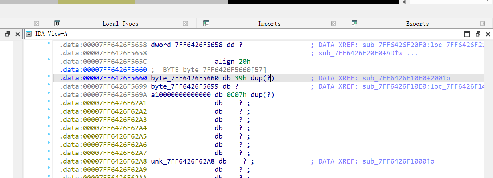

嗯？怎么没东西……询问一下 Gemini 才知道，这一块内存原来还没有被初始化，它会在程序运行的时候被动态地安排。太坏了喵😡那我只能动用动态调试器之力了。

打开 x64dbg 并打开 `moe_maze.exe`，运行后，在下方「内存 3」窗格中找到内存地址 `7FF6426F5660`，找到了——

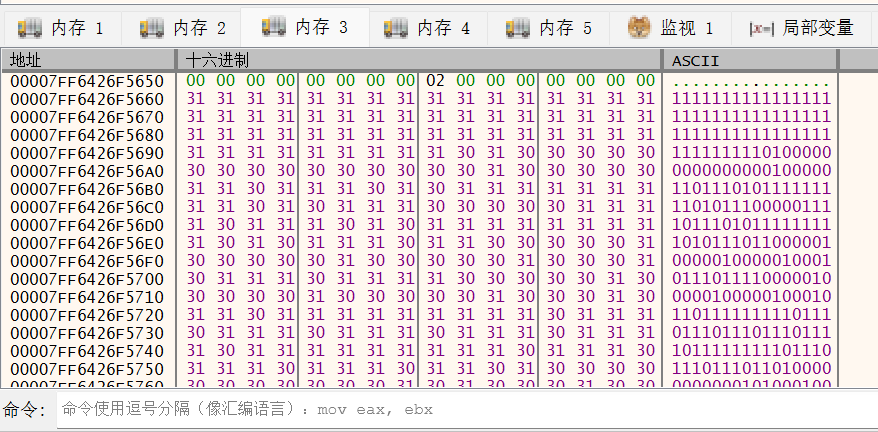

复制出来，写一个 Python 脚本简单处理一下就好了。

```plain
11111111111111111111111111111111111111111111111111111111
1S100000000000000010000011011101011111111101011100000111
10111010111111111010111011000001000001000001000101110111
10000010000010000010001011011111111101110111011101110111
10111111111011101110111011010000000000010100010001110111
10100000001000101000100011010101111111011101110101110111
10101011111110111011101011010101000001000000010101110111
10101010000010100000101011110101110101111101111111110111
10111010111010101111101011100101000100000101000101110111
10000010001010001000001011001111011111010101011101110111
11111011101011111011111111101000100000101100101001110111
10001010001000100010000010001010011000100010010011000001
10111010111110101010111011011001011111010101011101011101
10001010001000001010001011000101000100000101000101011101
11101011101111111011101011110101110111111101110101011101
10001000101000001010001011000100E10100000101000101011101
10111111101011101110111011011111110101110111011101011101
10001000001000100000001011000100000100010000000101011001
11101011111011111111101011110101111101111111110101011011
10101000000010001000101011010100000001000100010101011011
10101111111110101010101011010111111111010101010101011011
10100000000000100010101011010000000000010001010101011011
10111111111111111110111011011111111111111111011101011011
10000000001111000000000011110111010000111100011111011011
11101111100000011011011111111010110111011101100001011011
11101111111111111011011111111101110111101101100001011011
10001000111111000010000011111010110111011101100001011011
10111010111111111010111011110111010000111101100001010011
10000010000010000010001011111111111111111101100001010111
10111111111011101110111011110001000110001101100001010001
10100000001000101000100011110111011101111101100001011101
10101011111110111011101011110001000101111101100001011101
10101010000010100000101011111101011101111101100001011101
10111010111010101111101011110001000110001101100001011101
10000010001010101000001011111111111111111101100001011101
11111011101011111011111110000000000000001101100001011101
10001010001000100010000011111111111111111100110011011101
10111010111110101010111010010000000011111110001111011101
10001010001000001010001010110111000001111110100101011101
11101011101111111011101000110011001111111100110111011101
10001000101000001010001011111111111111111111110111010001
10111111101011101110111010100001001100000000000011011011
10001000001000100000001011111111111101011101111001011011
10101011111011111111101011000000000001000100010111011011
10101000000010001000101010010111111111111111111111011011
10101111111110101010101010110111111111111111111101011011
10100000000000100010101011100000000000000000000011011011
10111111111111111110011011111111111111111111111011011011
10000011111111111111000010000000000000000000000000011001
11111011111111111111111111111111111111111111111111111101
11111011100001100110110111000000000000000000000111111101
11111011101111011010000111011111111111111111110111111101
11111011100001000010110110000111111111111111110000000001
11111011101111011010110111101111111111111111111111111111
11110000000000011000110000000000000000000000000000000011
11111111111111111111111111111111111111111111111111111111
```

找到 `(1,1)` 为起点，又考虑到

```c
if (n0x37 == 15 && n32 == 32)
```

推测并验证终点位于 `(15, 32)`。直接把这些东西在 Maze Solver 中输入，修改一下字符对应，然后开始计算即可——找到最短路径

```plain
ssddddwwddssddddssddssssddwwddwwddwwwwddddssssaassssaaaassaassaawwaawwwwaaaassddssaassddssssaaaassddddddwwwwddddssddddwwddwwaawwddddssssssssssssaaasssdddssssaassssaaaassaassaawwaawwwwaaaassddssaassddssssaaaassddddddwwwwddddssddddwwddwwaawwddddssssssssssssaaawawwwaassaawwaassaaaaaaaaaawwwwaassssssddddssssssdddddddddwwdddssddwwwdddsssdddddwwawwddddddddddddddddddddssddddddddwwwwawwwwwwwwdwwwwwwwwwwwaawwdwwwwwwwwwwdwwwwwwaaaasssssssssssssssssssssssssssssssssssssaaawwaaaaaaaaaaaaaaaaaaawwwddddddddwwddddddddddwwwawaawawwwwwwwwwwwwwddwwwwaassaawwaassaaaaaaaaaawwwwaawwddwwaawwdwwwdwwwwddddddddddssddddssssdsdssddssaassaaaawwaaaassssaaaaaawwddddwwwwaawwawaassdsssdd
```

输入到 `moe_maze.exe` 即可。注意到，程序返回的 `flag` 就是给用户输入套了层 `moectf{}` 😡😡😡 而且似乎只要到达了终点，后面的字符串就不会校验了？不太清楚，不过就这样吧（）下面是迷宫的可视化版本，果然还有 XDSEC 的小彩蛋呢w

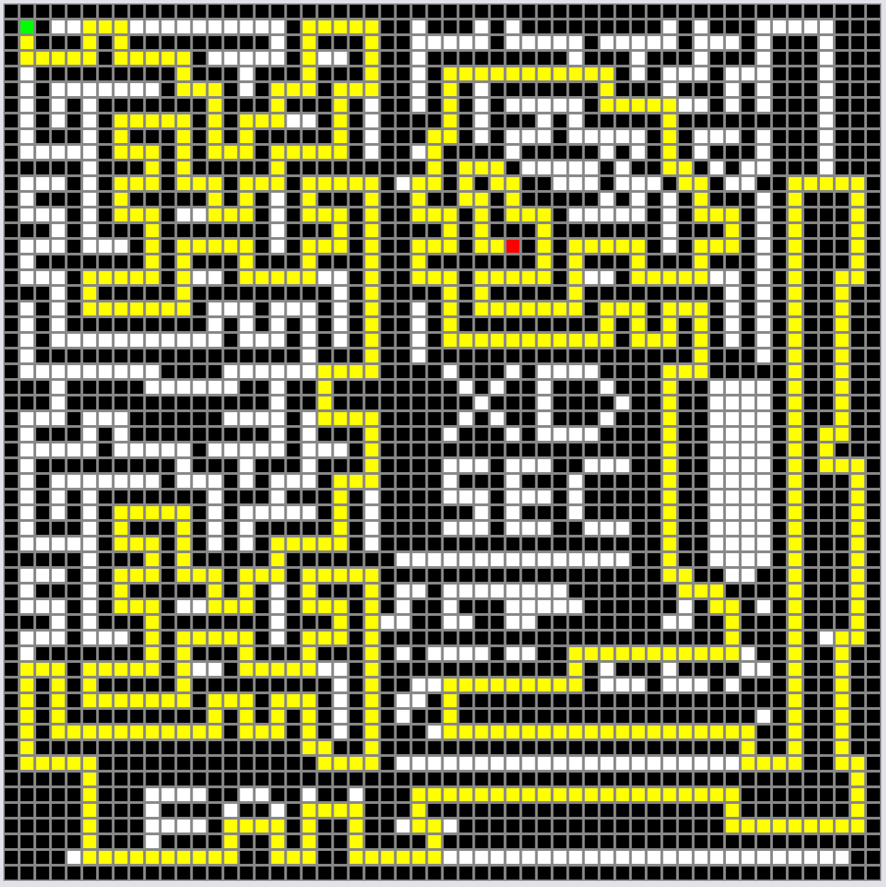

## upx_revenge ❌

直接脱壳，注意到

```plain
PS S:\MoeCTF\Reverse> .\upx-5.0.2-win64\upx.exe -d 1.exe
                       Ultimate Packer for eXecutables
                          Copyright (C) 1996 - 2025
UPX 5.0.2       Markus Oberhumer, Laszlo Molnar & John Reiser   Jul 20th 2025

        File size         Ratio      Format      Name
   --------------------   ------   -----------   -----------
upx: 1.exe: CantUnpackException: file is possibly modified/hacked/protected; take care!

Unpacked 0 files.
```

又到了我们喜闻乐见<sub>（存疑）</sub>的改壳环节。主要是这文件我直接点也打不开啊？

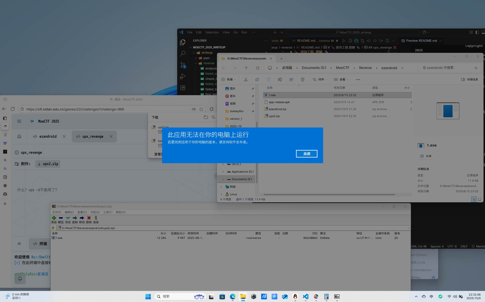

这事蛮诡异的。星澜音想着，要么是把架构改了、要么是改成普通用户态加载器拒绝加载了、要么给 Characteristics 加了 DLL 标志、要么是……哎，好乱啊。关键是 x64dbg 也打开不了这文件，说是 PE 文件损坏，但是 Detect It Easy 等一众软件说没问题，就特别诡异：甚至 Detect It Easy 还能识别出来 UPX 壳子：

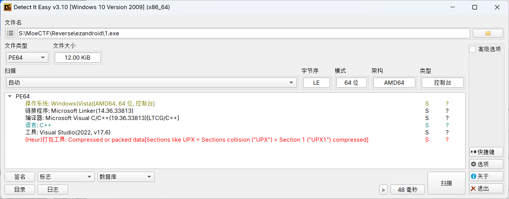

然后想着办法做了半天……啥用都没有😭后来突然灵机一动：`.rsrc` 节中，`PointToRawData = 0x2A00`、`SizeOfRawData = 0x600`，也就是说，这一节覆盖的文件范围是 `[0x2A00, 0x2A00 + 0x600) = [0x2A00, 0x3000)`。然而文件的实际 `FileSize = 0x2FFC`，也就是说文件丢了最后 4 个字节，系统拒载了🤣哎呀这下无语了，修修补补一下终于能打开了，弹出一个黝黑的控制台窗口，过了一会又自己消失了……

> [!TIP]
> **赛后补充：**
>
> 后来发现少的不是后 4 个字节……是那个 `"UPX!"` 标识符！补齐之后刚好文件大小对上了，就可以用 UPX 工具脱壳了😭😭哎，赛后诸葛亮来了😭气死我了😡

UPX 工具还是没法一键脱壳，我找了半天也不知道到底给哪动了手脚。动态脱壳吧……又死活用不明白 x64dbg，下了断点之后运行程序，指令满世界乱跑😭我服了。转眼看到群内 bot 的消息，😯🌿，星纾钰 怎么把这题做出来了😨这到底是哪里来的隆鼻啊😱我跪了😭😭遂严肃放弃此题。这个没得喷，星澜音从小就不怎么玩游戏，修改器啥的也是没摸过，逆向不会做很正常吧（哭哭 ing）

## guess ✅

> [!NOTE]
> **FLAG:** `moectf{RrRRccCc44$$_w1th_fl0w3r!!_3c6a11b5}`

是经典的猜数游戏。直接拖入 IDA Pro，一顿操作猛如虎，F5 一看——

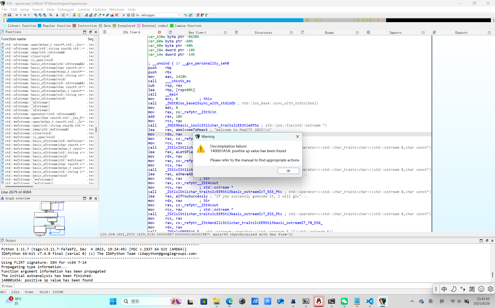

又来花指令？速速定位到 `0x140001A5A`，打开一看，释怀了，又来这一套（排版有修改）：

```asm
.text:140001A56  jz    short loc_140001A5F ; Jump if Zero (ZF=1)
.text:140001A58  jnz   short loc_140001A5F ; Jump if Not Zero (ZF=0)
.text:140001A5A  call  near ptr loc_140001A5F+3 ; Call Procedure
```

这其实是一个必然会发生的跳转：`ZF = 1` 的时候会跳转，`ZF = 0` 的时候也会跳转，那不是不论如何都会跳转？IDA Pro 在这里就会懵掉：你问我 `yes or no`，可两者都是一样的结局，那我怎么选？（ ~~这种情况最好选 `or`~~ ）所以我们只需要将 `1A5A` 和 `1A58` 右键 NOP 掉，然后再设置 `1A56` 为 Force Jump 即可。现在按 F5 就能愉快反编译了——

```c
int __fastcall main(int argc, const char **argv, const char **envp)
{
    bool v3;           // dl
    std::ostream *v4;  // rax
    unsigned int v5;   // eax
    _QWORD *v6;        // rax
    std::ostream *v8;  // rax
    __int64 v9;        // rax
    __int64 v10;       // rbx
    std::ostream *v11; // rax
    std::ostream *v12; // rax
    std::ostream *v13; // rax
    std::ostream *v14; // rax
    unsigned int v16;  // [rsp+2Ch] [rbp-54h]
    char v17[2512];    // [rsp+30h] [rbp-50h] BYREF
    char v18[2512];    // [rsp+A00h] [rbp+980h] BYREF
    char v19[32];      // [rsp+13D0h] [rbp+1350h] BYREF
    char v20[40];      // [rsp+13F0h] [rbp+1370h] BYREF
    unsigned int v21;  // [rsp+1418h] [rbp+1398h]
    int i;             // [rsp+141Ch] [rbp+139Ch]

    _main(argc, argv, envp);
    std::ios_base::sync_with_stdio(0i64, v3);
    std::ios::tie((char *)refptr__ZSt3cin + 16, 0i64);
    std::operator<< <std::char_traits<char>>(refptr__ZSt4cout, "Welcome to MoeCTF 2025!\n");
    std::operator<< <std::char_traits<char>>(refptr__ZSt4cout, "Let's play a game!\n");
    std::operator<< <std::char_traits<char>>(
        refptr__ZSt4cout,
        "I have a secret number between 0 and 99, and you can guess it 10 times.\n");
    v4 = (std::ostream *)std::operator<< <std::char_traits<char>>(
        refptr__ZSt4cout,
        "If you successly guessed it, I will give you the flag!");
    refptr__ZSt4endlIcSt11char_traitsIcEERSt13basic_ostreamIT_T0_ES6_(v4);
    std::random_device::random_device((std::random_device *)v18);
    v5 = std::random_device::operator()(v18);
    std::mersenne_twister_engine<unsigned int, 32ull, 624ull, 397ull, 31ull, 2567483615u, 11ull, 4294967295u, 7ull, 2636928640u, 15ull, 4022730752u, 18ull, 1812433253u>::mersenne_twister_engine(
        v17,
        v5);
    std::random_device::~random_device((std::random_device *)v18);
    v21 = (unsigned int)std::mersenne_twister_engine<unsigned int, 32ull, 624ull, 397ull, 31ull, 2567483615u, 11ull, 4294967295u, 7ull, 2636928640u, 15ull, 4022730752u, 18ull, 1812433253u>::operator()(v17) % 0x64;
    for (i = 0; i <= 9; ++i)
    {
        std::operator<< <std::char_traits<char>>(refptr__ZSt4cout, "Please input your number: ");
        std::ostream::flush(refptr__ZSt4cout);
        v6 = (_QWORD *)std::istream::operator>>(refptr__ZSt3cin);
        if ((unsigned __int8)std::ios::operator!((char *)v6 + *(_QWORD *)(*v6 - 24i64)) || v16 >= 0x64)
        {
            v8 = (std::ostream *)std::operator<< <std::char_traits<char>>(refptr__ZSt4cout, "Invalid input");
            refptr__ZSt4endlIcSt11char_traitsIcEERSt13basic_ostreamIT_T0_ES6_(v8);
            std::ios::clear((char *)refptr__ZSt3cin + 16, 0i64);
            v9 = std::numeric_limits<long long>::max();
            std::istream::ignore(refptr__ZSt3cin, v9, 10);
        }
        else
        {
            if (v21 == v16)
            {
                std::operator<< <std::char_traits<char>>(refptr__ZSt4cout, "You are right!\n");
                v10 = std::operator<< <std::char_traits<char>>(refptr__ZSt4cout, "The flag is moectf{");
                hex_to_binary(v20, &enc [abi:cxx11]);
                rc4_decrypt(v19, v20, &key [abi:cxx11]);
                v11 = (std::ostream *)std::operator<< <char>(v10, v19);
                v12 = (std::ostream *)std::operator<< <std::char_traits<char>>(v11, "}.");
                refptr__ZSt4endlIcSt11char_traitsIcEERSt13basic_ostreamIT_T0_ES6_(v12);
                std::string::~string(v19);
                std::string::~string(v20);
                break;
            }
            v13 = (std::ostream *)std::operator<< <std::char_traits<char>>(refptr__ZSt4cout, "That's not right...");
            refptr__ZSt4endlIcSt11char_traitsIcEERSt13basic_ostreamIT_T0_ES6_(v13);
        }
    }
    v14 = (std::ostream *)std::operator<< <std::char_traits<char>>(refptr__ZSt4cout, "Thanks for your playing!");
    refptr__ZSt4endlIcSt11char_traitsIcEERSt13basic_ostreamIT_T0_ES6_(v14);
    return 0;
}
```

为啥又来这么长一串……哭泣了。考虑到程序内肯定有一个比较的逻辑，那应该会出现双等号 `==`，只好一眼盯帧，恰好找到 `if (v21 == v16)` 😋 盲猜一手，估计是比较随机数和用户输入的，那么哪个是随机数呢？再往上一看，嘿

```c
std::random_device::~random_device((std::random_device *)v18);
v21 = (unsigned int)std::mersenne_twister_engine<unsigned int, 32ull, 624ull, 397ull, 31ull, 2567483615u, 11ull, 4294967295u, 7ull, 2636928640u, 15ull, 4022730752u, 18ull, 1812433253u>::operator()(v17) % 0x64;
```

这下不言而喻了，`v21` 是随机数。若随机数和用户输入匹配成功，则会调用 RC4 算法计算出 `flag`。星澜音才不管那么多，直接让程序计算好了。在第 45 行

```c
std::ostream::flush(refptr__ZSt4cout);
```

和第 76 行

```c
return 0;
```

下断点后直接调试，第一个断点处，程序的随机数已经生成，双击 `v21` 即可得到其十六进制值，转换得到十进制值后，继续进程并输入到程序中，回车，等待第二个断点出现，这时就可以获得 `flag`。


## A simple program ✅

> [!NOTE]
> **FLAG:** `moectf{Y0u_P4ssEd!!}`

一顿操作猛如虎：

```c
int __cdecl main(int argc, const char **argv, const char **envp)
{
    HANDLE Thread; // eax
    void *Thread_1; // esi
    int *v5; // eax
    char Str1[52]; // [esp+4h] [ebp-38h] BYREF

    Thread = CreateThread(0, 0, StartAddress, 0, 0, 0);
    Thread_1 = Thread;
    if ( Thread )
    {
        WaitForSingleObject(Thread, 0xFFFFFFFF);
        CloseHandle(Thread_1);
    }
    memset(Str1, 0, 0x32u);
    sub_3210E0(std::cout, "plz input your flag: ");
    std::istream::getline(std::cin, Str1, 50, 0);
    if ( !strncmp(
            Str1,
            Str2,                                 // "moectf{this_is_a_flag}"
            strlen(Str2)) )                       // "moectf{this_is_a_flag}"
        v5 = sub_3210E0(std::cout, aCorrect);
    else
        v5 = sub_3210E0(std::cout, aWrong);
    std::ostream::operator<<(v5, sub_321310);
    return 0;
}
```

这答案呼之欲出啊！`moectf{this_is_a_flag}`！诶别急，绝对有诈——输入到 `chall.exe` 都能报 `Wrong!`，问题果然没这么简单。但是程序看起来没问题啊……`strncmp` 就是比对了 `Str1` 和 `Str2` 啊…`Str2` 不就是这个明显的 `flag` 吗…奇怪🤔

努力回忆一下 Web 第 22 章的 `rev`🤔坏了，照着那道题的经验，这道题的 `strncmp` 是不是也被人动手脚了？仔细一看，还真是——IAT Hooking！

> [!TIP]
>
> IAT Hooking 本质上是一种在运行时修改内存中导入地址表（Import Address Table）的技术。当一个程序需要调用一个外部 DLL（例如本题中的 `msvcrt.dll`）里的函数（例如 `strncmp`）时，它并非写死函数地址，而是在自己的 `.idata` 段有一个指针列表，程序运行时，操作系统加载器会将 `strncmp` 等函数的真实地址写入表内。
>
> Pwn 赛道的部分题目中所是用到的 GOT overwrite 是原理相近的，或者说，GOT 和 IAT Hooking 是同一种思想的两种体现。不过前者是 Pwner 利用程序漏洞发起的攻击，而后者是开发者主动设计的功能。

为何做出这样的判断呢？我们注意到 `Thread = CreateThread(0, 0, StartAddress, 0, 0, 0);` 中创建了一个线程 `StartAddress`，其功能非常局限：

```c
DWORD __stdcall StartAddress(LPVOID lpThreadParameter)
{
    Sleep(0x64u);
    return 0;
}
```

对，就是睡了一会，然后就没了🤔其实程序睡不睡对我们影响不大，但最有可能的一种猜想是，程序会「前狼假寐，盖以诱敌」，利用睡的时间偷偷完成 IAT Hooking😨这是恐怖的。不过它到底 Hook 成什么样了？至少星澜音能力不够，暂时不知道怎么从 IDA Pro 直接盯出结果。但是做 Pwn 的时候星澜音习惯用 `gdb` 了，大不了这一次也用动态调试试试。比较逻辑位于

```asm
.text:0032175F    call    ds:strncmp
```

打开 x32dbg，进行一个断点的下😋随后「调试(D)」>「高级」>「隐藏调试器 (PEB)」（不知道为啥，但是不这么做就会 `EXCEPTION_ACCESS_VIOLATION`），连按 F9 进入 `flag` 输入的逻辑，~~认真地~~ 随便输入一个 `flag` 后回车并在 x32dbg 中 F7 步进，紧盯 `EIP`（类比 `RIP`）中的地址——`00321510`！

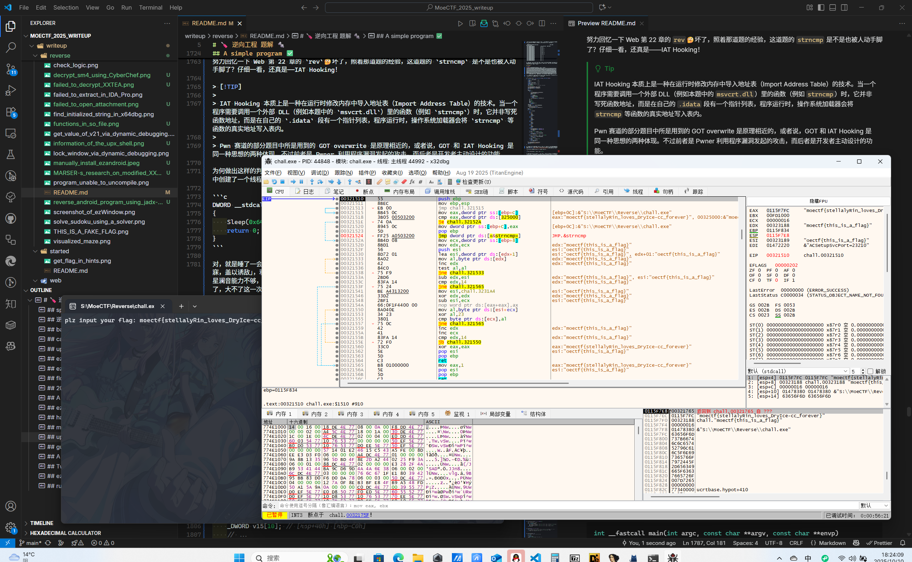

用 IDA Pro 定位到这里，看到了逻辑

```c
int __cdecl sub_321510(const char *a1, char *Str2)
{
    const char *v3; // ecx
    unsigned int n0x14; // edx

    if ( Str2 != Str2 )                           // "moectf{this_is_a_flag}"
        return dword_3250A0();
    v3 = a1;
    if ( strlen(a1) == 20 )
    {
        n0x14 = 0;
        while ( *v3 == (v3[byte_3231A4 - a1] ^ 0x23) )
        {
            ++n0x14;
            ++v3;
            if ( n0x14 >= 0x14 )
                return 0;
        }
    }
    return 1;
}
```

终于看懂了😭`a1` 大抵是 `flag`，要求必须 20 字节长；后面这串就有点诡异了🤔`v3` 是指向输入字符串中当前字符的指针，也就是 `a1 + i`（其中 `i` 是循环次数），所以 `(a1 + i)[byte_3231A4 - a1]` 等价于 `*( (a1 + i) + (byte_3231A4 - a1) )`。对这个式子使用加法结合律和加法交换律（这两个定律我们不证），可以发现 `a1` 和 `-a1` 抵消了，就变成了 `*(byte_3231A4 + i)`。哦哦哦，这下看懂了，就是从 `byte_3231A4` 中取第 `i` 个字节，并进行与 `0x23` 的异或，随后与输入进行比对。双击跟踪 `byte_3231A4`：

```plain
.rdata:003231A4 ; _BYTE byte_3231A4[24]
.rdata:003231A4 byte_3231A4     db 4Eh, 4Ch, 46h, 40h, 57h, 45h, 58h, 7Ah, 13h, 56h, 7Ch
.rdata:003231A4                                         ; DATA XREF: sub_321510+31↑o
.rdata:003231AF                 db 73h, 17h, 2 dup(50h), 66h, 47h, 2 dup(2), 5Eh, 4 dup(0)
```

手动拆一下：

```plain
byte_3231A4 = [0x4E, 0x4C, 0x46, 0x40, 0x57, 0x45, 0x58, 0x7A, 0x13, 0x56, 0x7C, 0x73, 0x17, 0x50, 0x50, 0x66, 0x47, 0x02, 0x02, 0x5E]
```

CyberChef 一秒解。慢走不送~

## Two cups of tea ✅

> [!NOTE]
> **FLAG:** `moectf{X7e4_And_xx7EA_I5_BeautifuL!!!!!}`

愈挫愈勇，继续跟踪！根据前面的经验，大概率是改了 `delta`😋只可惜这道题……似乎更上一层楼了？毕竟是 **TWO** cups of tea 啊🤔那天晚上睡着的星澜音遇到大神托梦了，ta 悠悠地说：

> 这题的加密，有两层，第一层是……

然后闹铃就把星澜音吵醒了……😭看来还是得自己跟踪。这里星澜音将直接给出自顶向下的分析而非探究过程。

首先先看到 `main` 函数，刚开始它在初始化部分变量：

```c
int __fastcall main(int argc, const char **argv, const char **envp)
{
    // ... 一些变量声明 ...
    _DWORD v15[10]; // [rsp+40h] [rbp-C0h]
    // ...
    char Buffer[16]; // [rsp+90h] [rbp-70h] BYREF
    // ...

    // ↓ 这里是给变量赋值
    v3 = 0LL;
    n2 = 2LL;         // XTEA 密钥的第 1 部分 (低32位)
    v11 = 0;          // XTEA 密钥的第 1 部分 (高32位) -> n2 是 64 位，所以 n2 = 2
    n2_1 = 2;         // XTEA 密钥的第 3 部分
    n5 = 5;           // XTEA 密钥的第 4 部分
  
    // ↓ 这是我们要解密的目标「魔法符文」
    v15[0] = 1566723124;
    v15[1] = -2044068179;
    // ... (一共 10 个数字)
    v15[9] = -280353208;

    // ↓ 这是被 XTEA 加密的「小暗盒」里的数据
    n2_2 = 0xD0FCC6A7B8941CAFuLL;
```

嗯…`n2`、`n2_1` 和 `n5` 加在一起组成了 `{2, 0, 2, 5}`，它们是打开小暗盒的 XTEA 钥匙。`v15` 是要解密的目标，是加密后的正确结果——我们的目标就是倒推出加密前它的样子。`n2_2` 是那个被锁住的小暗盒，里面藏着 XXTEA 咒语的前半部分。

接下来——

```c
// ↓ 调用 XTEA 解密函数
sub_140001070(argc, &n2_2, &n2);
```

程序调用 `sub_140001070` 来进行 XTEA 解密。解密之后的 `n2_2` 的值，就变成了 XXTEA 咒语的前两句（`K0` 和 `K1`），至于为何是前两句——不妨继续看下去。

```c
// ...
char Buffer[16]; // [rsp+90h] [rbp-70h] BYREF
// ...
Stream = _acrt_iob_func(0);
fgets(Buffer, 100, Stream); // ← 从这里读入最多 100 个字符
n0x64 = strcspn(Buffer, "\n"); // ← 找输入的第一个换行符在哪里
if ( n0x64 >= 0x64 )
    sub_140001BE8(); // 长度太长就出错
Buffer[n0x64] = 0; // ← 把换行符替换成字符串结束符 `\0`
```

前文的 `Buffer` 是放我们钥匙的托盘，不过它只有 16 字节大，而这个 `fgets` 竟然想拼命往里面写 100 字节的东西😱也就是说，小 `Buffer` 要被 `fgets` 大大的 `Stream` 填满了🥵🥵要满到溢出来了呢❤️😍

不对，溢到哪？IDA Pro 里也能看到相应的结构：这 `Stream` 多出来的部分会溢出到 `Buffer` 后面的内存上，也就是 `v19` 和 `v20`！这俩是啥东西？先别急，继续看——紧接着，一个 `strcspn` 和 `Buffer[n0x64] = 0` 会检测我们输入的字符串中的换行符 `\n` 在哪里，并将其变为 `\0`。

好的，我们现在来说 `v19` 和 `v20` 的事。在程序后文中有：

```c
    v16[0] = *(_OWORD *)Buffer; // 把 Buffer 的内容 (16 字节) 拷到 v16
    v17 = v20;                 // 把溢出到 v20 的内容 (8 字节) 拷到 v16 后面
    v16[1] = v19;                // 把溢出到 v19 的内容 (16 字节) 拷到 v16 后面

    // ↓ 把 XTEA 解密的结果和两个固定值，作为 XXTEA 密钥
    n2 = n2_2;         // K0, K1 (来自解密后的 n2_2)
    n2_1 = 305419896;  // K2 (即 0x12345678)
    n5 = -1698898192; // K3 (即 0x9ABCDEF0)

    // ↓ 调用 XXTEA 加密函数
    sub_1400015E0(v16, v6, &n2);
```

😱出题人的伟大之处啊……不由得赞叹两句。程序把溢出到 `v19` 和 `v20` 的内容拷贝到了 `v16` 之后，整理成了一个 40 字节的数组 `v16`，这是等待被加密的钥匙。而 `n2 = n2_2` 等三行，又把 `K0`、`K1` 和两个新的数字 `0x12345678` 和 `0x9ABCDEF0` 放在一起，组成了完整的 XXTEA 咒语，放在了 `&n2` 指向的内存里。随后程序调用 XXTEA 加密函数，这才把 `v16` 的内容加密了。

```c
// ...
    n40 = -1LL;
    do
        ++n40;
    while ( Buffer[n40] ); // 检查你原始输入的长度
    if ( n40 == 40 ) // 长度必须是 40
    {
        while ( *(_DWORD *)((char *)v16 + v3 * 4) == v15[v3] ) // 逐个比较加密结果和魔法符文
        {
            if ( ++v3 >= 10 ) // 如果 10 个都一样
            {
                flag = (char *)&unk_1400032C0; // "Correct!"
                goto LABEL_10;
            }
        }
        flag = aFlag; // "Wrong!"
    }
    else
    {
        flag = (char *)&unk_140003298; // "Wrong length!"
    }
LABEL_10:
    sub_140001010(flag); // 打印结果
    return 0;
}
```

紧接着程序检查输入长度，逐字节比较 `v16` 和预设的 `v15` 以验证 `flag`。至于 `sub_140001070` 作为 XTEA 的实现、和 `sub_1400015E0` 作为 XXTEA 的实现，其实它们虽然于标准算法有差异，但在数学上是等价的。例如，后者的逻辑中，从 `v4 = 0` 起，每轮的 `v4 = v4 - 0x61C88647` 在 32 位模加下等价于 `sum += 0x9E3779B9`，而后面的 MX 形式事实上也是等价于标准逻辑的，只是变量名和先后顺序不同而已。那就没什么问题了。

压力 GPT-5 写一个 XTEA 和 XXTEA 联合解密脚本即可。

```python
#!/usr/bin/env python3
import struct

MASK32 = 0xFFFFFFFF
DELTA = 0x9E3779B9


def u32(x):
    return x & MASK32


def xtea_decrypt_block(v0, v1, k, rounds=32):
    # k: list of 4 u32
    sum_ = u32(DELTA * rounds)
    for _ in range(rounds):
        v1 = u32(v1 - (((v0 << 4 ^ (v0 >> 5)) + v0) ^ (sum_ + k[(sum_ >> 11) & 3])))
        sum_ = u32(sum_ - DELTA)
        v0 = u32(v0 - (((v1 << 4 ^ (v1 >> 5)) + v1) ^ (sum_ + k[sum_ & 3])))
    return v0, v1


def xxtea_mx(sum_, y, z, p, e, k):
    # MX = (((z>>5 ^ y<<2) + (y>>3 ^ z<<4)) ^ ((sum ^ y) + (k[(p&3) ^ e] ^ z)))
    return u32(((z >> 5) ^ (y << 2)) + ((y >> 3) ^ (z << 4))) ^ u32(
        (sum_ ^ y) + (k[(p & 3) ^ e] ^ z)
    )


def xxtea_decrypt(v, k):
    # v: list of n u32, k: list of 4 u32
    n = len(v)
    if n < 2:
        return v[:]
    rounds = 6 + (52 // n)  # for n=10 -> 11
    sum_ = u32(rounds * DELTA)
    y = v[0]
    while rounds > 0:
        e = (sum_ >> 2) & 3
        for p in range(n - 1, 0, -1):
            z = v[p - 1]
            v[p] = u32(v[p] - xxtea_mx(sum_, y, z, p, e, k))
            y = v[p]
        z = v[n - 1]
        v[0] = u32(v[0] - xxtea_mx(sum_, y, z, 0, e, k))
        y = v[0]
        sum_ = u32(sum_ - DELTA)
        rounds -= 1
    return v


def to_u32_list_signed(nums):
    # convert signed 32-bit ints to unsigned 32-bit
    out = []
    for x in nums:
        if x < 0:
            x = (x + (1 << 32)) & MASK32
        out.append(x)
    return out


def main():
    # Step 1: XTEA decrypt constant C with key [2,0,2,5]
    C_lo = 0xB8941CAF
    C_hi = 0xD0FCC6A7
    K_seed = [0x00000002, 0x00000000, 0x00000002, 0x00000005]
    K0, K1 = xtea_decrypt_block(C_lo, C_hi, K_seed, rounds=32)

    # Step 2: XXTEA decrypt v15 with key [K0, K1, 0x12345678, 0x9ABCDEF0]
    v15_signed = [
        1566723124,
        -2044068179,
        -1659816037,
        -53136879,
        1175413710,
        -981373336,
        -28114771,
        167777774,
        -1744380997,
        -280353208,
    ]
    v15 = to_u32_list_signed(v15_signed)
    key_xx = [K0, K1, 0x12345678, 0x9ABCDEF0]

    plain_words = xxtea_decrypt(v15[:], key_xx)
    payload = struct.pack("<10I", *plain_words)

    print("XTEA-derived key words (K0, K1): {:08x} {:08x}".format(K0, K1))
    print("Payload (hex):", payload.hex())
    try:
        print("Payload (ascii, may contain non-printables):", payload.decode("ascii"))
    except UnicodeDecodeError:
        print("Payload contains non-ASCII bytes; write it raw to stdin.")
    # Reminder: feed exactly 40 bytes, then a newline.
    # For example:
    # import sys; sys.stdout.buffer.write(payload + b"\\n")


if __name__ == "__main__":
    main()
```

跑一个：

```plain
PS S:\MoeCTF\Reverse\teas> python .\teas_decryptor.py
XTEA-derived key words (K0, K1): 63656f6d 21216674
Payload (hex): 6d6f656374667b583765345f416e645f78783745415f49355f42656175746966754c21212121217d
Payload (ascii, may contain non-printables): moectf{X7e4_And_xx7EA_I5_BeautifuL!!!!!}
```

那还说啥，没问题了😋只是说，人还是不能被经验主义所误导，~~差点以为谁又动我 `delta` 了~~

## ezandroid.pro ✅

> [!NOTE]
> **FLAG:** `moectf{SM4_Android_I5_Funing!!!}`

草，走，忽略🏃打开 `jadx-gui` 看看：

```java
package com.example.ezandroidpro;

import android.os.Bundle;
import android.view.View;
import android.widget.Button;
import android.widget.EditText;
import android.widget.TextView;
import androidx.appcompat.app.AppCompatActivity;

/* loaded from: classes.dex */
public class MainActivity extends AppCompatActivity {
    private EditText inputEditText;
    private TextView resultTextView;

    public native boolean check(String str);

    static {
        System.loadLibrary("ezandroidpro");
    }

    @Override // androidx.fragment.app.FragmentActivity, androidx.activity.ComponentActivity, androidx.core.app.ComponentActivity, android.app.Activity
    protected void onCreate(Bundle bundle) {
        super.onCreate(bundle);
        setContentView(R.layout.activity_main);
        this.inputEditText = (EditText) findViewById(R.id.inputEditText);
        this.resultTextView = (TextView) findViewById(R.id.resultTextView);
        ((Button) findViewById(R.id.checkButton)).setOnClickListener(new View.OnClickListener() { // from class: com.example.ezandroidpro.MainActivity.1
            @Override // android.view.View.OnClickListener
            public void onClick(View view) {
                String strTrim = MainActivity.this.inputEditText.getText().toString().trim();
                if (strTrim.length() != 32) {
                    MainActivity.this.resultTextView.setText("flag长度不对,请重新输入");
                    MainActivity.this.resultTextView.setTextColor(MainActivity.this.getResources().getColor(android.R.color.holo_red_dark));
                } else if (MainActivity.this.check(strTrim)) {
                    MainActivity.this.resultTextView.setText("Congratulations!");
                    MainActivity.this.resultTextView.setTextColor(MainActivity.this.getResources().getColor(android.R.color.holo_green_dark));
                } else {
                    MainActivity.this.resultTextView.setText("Incorrect");
                    MainActivity.this.resultTextView.setTextColor(MainActivity.this.getResources().getColor(android.R.color.holo_red_dark));
                }
            }
        });
    }
}
```

定睛细看：

```java
public native boolean check(String str);
```

哦哦哦，Native 层！这是个好东西啊😋

> [!TIP]
> 一个 Android 应用可被认为是一个「混合体」，包含一个 Java 层和一个 Native 层。
>
> 1. Java 层是我们通常编写 Android App 的代码，比如说我们现在分析的 `MainActivity.java`。这些 Java 或 Kotlin 代码被编译成 Dalvik 字节码（`.dex` 文件），运行在 安卓运行时（ART）这个虚拟机里。它是跨平台的，但毕竟运行在虚拟机里，对于一些计算密集型的任务，会造成极大的性能开销和损耗。
> 2. Native 层是使用 C/C++ 编写的代码，这些代码被编译成针对特定 CPU 架构的机器码，打包成动态链接库文件（即我们接下来要分析的 `.so` 文件，Shared Object）。它开发复杂、不跨平台，但是没有虚拟机的开销，速度更快。
>
> 这两层通过 JNI（Java Native Interface）相互联结。JNI 是 Java 提供的一套标准接口，它允许运行在虚拟机里的 Java 代码和运行在机器上的 Native 代码相互调用。

回到我们刚才的那一段代码：

```java
public native boolean check(String str);
```

`native` 是 Java 中的一个关键字，它表示这个方法仅在此处声明，但其实现（方法体）不在 Java 代码，而在外部的 Native 库中。即，它告诉虚拟机和编译器，请在别处找这个函数的实现。那么，去哪找？🤔注意到代码的 `static` 代码块中：

```java
static {
    System.loadLibrary("ezandroidpro");
}
```

哦哦哦，这下看懂了😋这个函数加载了 Native 库文件。它告诉 Android 系统：请去 APK 的 `lib` 目录里，找到 `libezandroidpro.so` 并加载到内存中。它仅在类加载的时候执行一次，确保在调用任何 `native` 方法前，对应的库文件已被加载。

等等🤔为什么一定是 `libezandroidpro.so`？这其实是约定俗成的要求，系统寻找的 `.so` 文件，必须满足这样的命名规范

> "lib" + 库名 + ".so"

这便是了。我们使用 7-Zip 解压 `ezandroidpro.apk`，找到其 `/lib/` 下，看到了 `arm64-v8a` 和 `armeabi-v7a` 这两个不同架构的不同库。后者 0 人用😡我们定位到 `/lib/arm64-v8a/libezandroidpro.so`，用 IDA Pro 打开看看😋


为啥这么多函数？吓哭了😭但别急，函数的命名也是有规范的，简单来说，是

> "Java\_" + 包名 + "\_" + 类名 + "\_" + 方法名

对应本题的情况，即

```plain
Java_com_example_ezandroid_MainActivity_check
```

嘿，恰好找见了😋但是感觉出来的东西好乱……呜呜零音不看零音不想看😭往下找找，有一行

```c
sm4Encrypt(v21, v24, _moectf2025______);
```

小学生都能看懂这是在干啥😋至于后面这三个参数…先看第三个：

```c
strcpy((char *)_moectf2025______, " moectf2025!!!!!!");
```

所以 `_moectf2025______` 应该是 `" moectf2025!!!!!!"`，`v21` 和 `v24` 不知道，懒得看了，反正绝对有一个是用户输入。没提到 SM4 解密的工作模式，默认的话就是 ECB，先试试；打开 CyberChef 碰碰运气没碰出来，但是看到 `" moectf2025!!!!!!"` 前面那个迷惑空格🤔感觉没有，删掉后突然出 `flag` 了。可能 `sm4Encrypt` 内会删空格？谁知道，`flag` 拿到了就跑路了😋

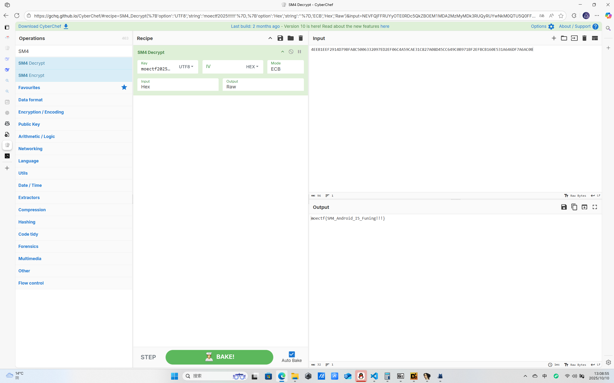

## rusty_sudoku ✅

> [!NOTE]
> 分千亿遗产时，律师突然问「谁写 Rust？」<br>
> 坐拥千亿的爷爷去世了，就在家族齐聚准备分遗产时，律师突然沉声问道：「继承人中——有写 Rust 的吗？」<br>
> 全场霎时死寂。<br>
> 大伯猛地拍桌：「Rust？什么乱七八糟的！我女儿 Go 全框架精通，稀罕这？」<br>
> 小姑揶揄道：「听说，染上 Rust，比染上毒品更吓人，咱家族不会真有人碰这玩意……」<br>
> 二伯瞥向他儿子：「你小子没写过吧？」堂哥轻蔑一笑：「Rust？我 Python 都玩不明白，会看得上它？」<br>
> 最后，所有目光落在我身上。我后背发凉，正想隐藏 VS Code 里的「#derive(Debug)」时，堂哥突然阴恻恻开口：「等等，你 GitHub 上，是不是发过什么 crates？」<br>
> 我慌忙否认：「胡说什么！编程语言我顶多学过 TypeScript；Rust？狗都不写！」<br>
> 他不依不饶，当场搜出一个 Ferris 的挂件逼问我：「那你说这是谁？」我忙答道：「这不是 Ferris，这是……」「Ferris？」整个大厅骤然响起一片倒抽冷气的声音。 我瞬间僵住——完了，TypeScript 哪来的 Ferris！<br>
> 亲戚们脸上顿时浮出毫不掩饰的讥嘲，似乎在说「看，那个写 Rust 的 loser。」<br>
> 谁知，律师却大步走向我，「啪」地朝我鞠躬道： 「根据遗嘱，您——尊贵的 Rust 信徒，将继承委托人全部财产，包括 56 亿现金、11 处房产与 3 家上市公司！」<br>
> 全场炸了。大伯疯了一样揪住律师嘶吼：「你疯了！这合理吗？！玩个垃圾凭什么？」律师歪嘴一笑： 「就凭以下几条：<br>
> 「1. 写 Rust，必是人中龙凤。能忍受编译错误狂喷一小时、与借用检查器斗智斗勇、世间再无挫折可将其击垮。<br>
> 「2. 考公新规：写 Rust，笔试加 50 分。能理清多线程数据竞争、手写 Drop 实现、拥有极强极缜密的系统思维。<br>
> 「3. 企业招人潜规则：有连续 30 天贡献 Rust 项目记录者直接录取。这代表无上的耐心、毅力、与编译器磨出来的强大心态。<br>
> 「此外，高考政策：子女凭 Rust 项目 Star 数多少和 Pull Requests 合并数加分；购房补贴：写 Rust 者直接进入科技人才名单，分配北上广深户口及房产。」<br>
> 我原本弯着的腰，一寸一寸地挺直。苍白的脸浮起血色，眼中射出前所未有的光芒。<br>
> 接着，我一把扯开外套，露出印着「FIGHT AGAINST THE BORROW CHECKER」的 T 恤，声如洪钟：
> 「现在谁还敢说——写 Rust 没出息？！」
>
> **FLAG:** `moectf{a8c79927d4e830c3fe52e79f410216a0}`

竟然是我们喜闻乐见的 Rust😋直接打开 IDA Pro 展开逆向——不是这是啥啊……

```c
int __fastcall main(int argc, const char **argv, const char **envp)
{
    int v3; // ecx
    __int64 v5; // rdi
    __int64(__fastcall * v7[3])(int, int, int, int, int, int, int, int, int, int, int, __int64, __int64, int, int, int, int, int, int, int, int, int, int, char); // [rsp+28h] [rbp-8h] BYREF

    v5 = v3;
    _main(v3, envp);
    v7[0] = rusty_sudoku::main::hb75a6deccc5f5449;
    return std::rt::lang_start_internal::h7be68976dcad6582(v5, envp, &unk_1400C2020, v7, v5, envp);
}
```

哈哈哈，喜欢我 泛型 + 单态化 + `match` 展开 + `panic` 检查 + 内联优化 + 强类型 + 符号混淆 吗？我不喜欢😭总之我们能猜到 `rusty_sudoku::main::hb75a6deccc5f5449` 里应该是整个数独模组的总逻辑，那就直接进入吧……

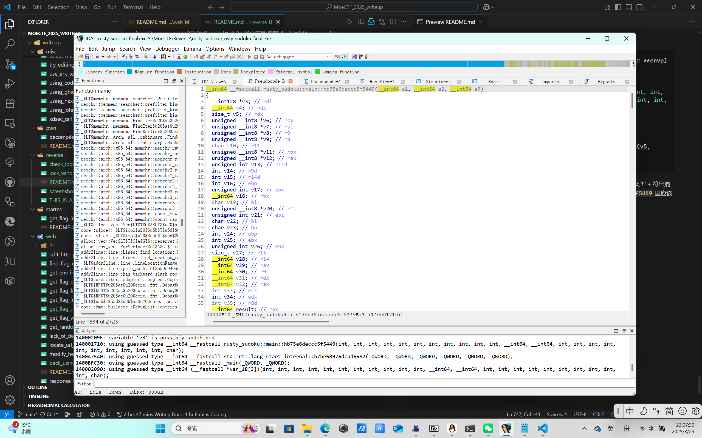

<div align="center">

😭 **吓哭了** 😭

</div>

483 行，看不下去了，丢给 Gemini 2.5 Pro 和 DeepSeek 吧……结合对这个数独游戏的实际体验，我们大概可以推测出代码逻辑了。首先程序打印提示信息：

```c
std::io::stdio::_print::h1c35462839d49e54(a1, a2, a3, v49);
```

然后读取用户输入的数独：

```c
std::io::stdio::Stdin::read_line::h30c1cfcb81f46260(v56, a2, v49, v56)
```

接下来对用户输入进行分析，包括检查长度是否为 81 字符，去除空格和验证格式等。随后便会匹配用户输入的数独是否与隐藏于程序内的数独吻合：

```c
if ( (_DWORD)v30 != 46 && v39 != (_DWORD)v30 )
{
    // 输出错误信息："You should not change the board!"
}
```

程序会去取存储在 `a68718379181594` 的数独信息进行校验，`a68718379181594` 存储了一个不完整的数独，缺失的地方使用 `.` 代替；程序会匹配非 `.` 的数字是否与用户的输入冲突，若冲突则输出错误信息；随后使用算法去校验用户输入的数独是否成立。

```c
sudoku::board::sudoku::Sudoku::from_str_line::h4eb4d21213600514(v56, 81LL, v18, v49, 81LL, v30);
// 从字符串创建数独对象

if ( (unsigned __int8)sudoku::board::sudoku::Sudoku::is_solved::h76282d6fbda4373d(v56, 81LL, v46, v56) )
{
    // 数独已解决，计算 MD5
}
else
{
    // 数独未解决，输出错误信息
}
```

若数独成立，即问题已解决，则输出该数独的 MD5。

```c
// 计算 MD5
md5::consume::h63b78cbbd8ff35b2(&v50, 81LL, v18, &v50, 81LL);
md5::Context::finalize::hd73b5dd28a2c2b82(&v50, 81LL, v49, v58);

// 输出 MD5 结果
std::io::stdio::_print::h1c35462839d49e54(&v50, 81LL, v48, v49);
```

太好了，顺着这个思路，我们直接干到 `a68718379181594` 里：

```plain
.rdata:00000001400C2228 a68718379181594 db '.6..8..7.18.3......7.9....1...8...15.9..4.2..54...2..9.....3948..'
.rdata:00000001400C2228                                         ; DATA XREF: rusty_sudoku::main::hb75a6deccc5f5449+484↑o
.rdata:00000001400C2269                 db '...5..7..3....5.You should not change the board!Welcome to MoeCTF'
.rdata:00000001400C22AA                 db ' 2025!',0Ah
.rdata:00000001400C22B1                 db 'Please **find** my sudoku and fill it correctly.',0Ah
.rdata:00000001400C22E2                 db 'And then I will give you the flag.',0Ah
.rdata:00000001400C2305                 db 'Input your answer in one line (without spaces).',0Ah
.rdata:00000001400C2335                 db 'for example, 8542197633978654212614739857851263946495381721329478'
.rdata:00000001400C2376                 db '56926384517513792648478651239 represents:',0Ah
.rdata:00000001400C23A0                 db '854|219|763',0Ah
.rdata:00000001400C23AC                 db '397|865|421',0Ah
.rdata:00000001400C23B8                 db '261|473|985',0Ah
.rdata:00000001400C23C4                 db '-----------',0Ah
.rdata:00000001400C23D0                 db '785|126|394',0Ah
.rdata:00000001400C23DC                 db '649|538|172',0Ah
.rdata:00000001400C23E8                 db '132|947|856',0Ah
.rdata:00000001400C23F4                 db '-----------',0Ah
.rdata:00000001400C2400                 db '926|384|517',0Ah
.rdata:00000001400C240C                 db '513|792|648',0Ah
.rdata:00000001400C2418                 db '478|651|239',0Ah
.rdata:00000001400C2424                 db 0Ah
.rdata:00000001400C2425                 db 'Your answer:',0Ah,0
```

好长……不过已经看到隐藏的数独了！

```plain
.6..8..7.18.3......7.9....1...8...15.9..4.2..54...2..9.....3948.....5..7..3....5.
```

找一个数独求解器即可。


~~如果有 AI 工具的话就~~ 好玩不难😋只是亲自去分析 Rust 的反编译结果太坐牢了……😭
