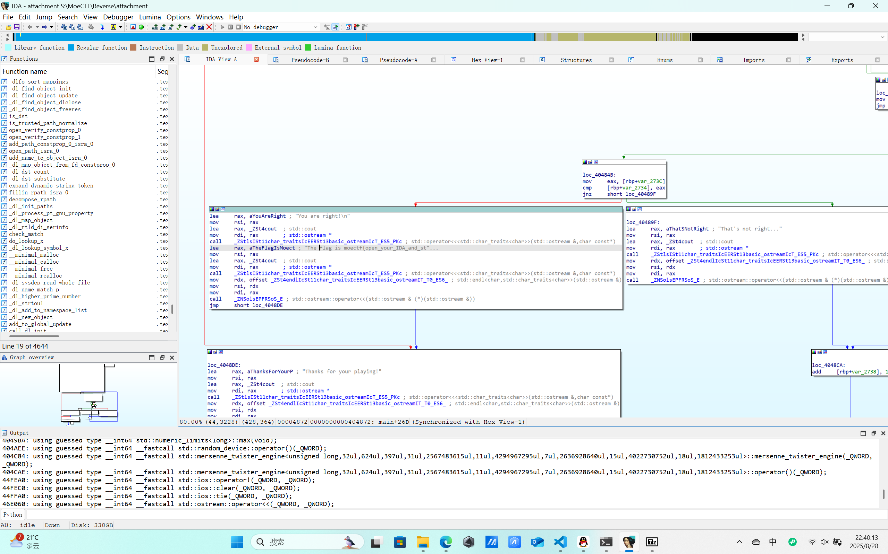
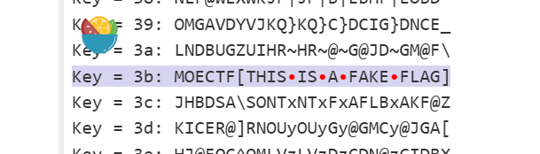
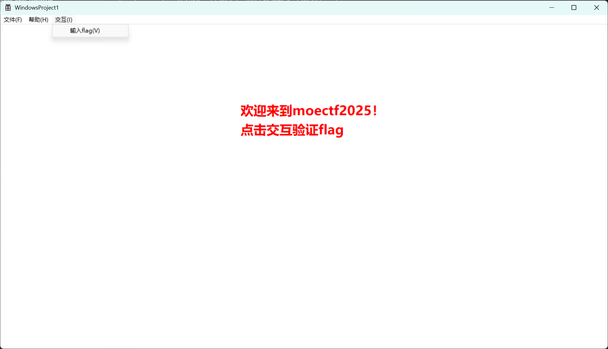
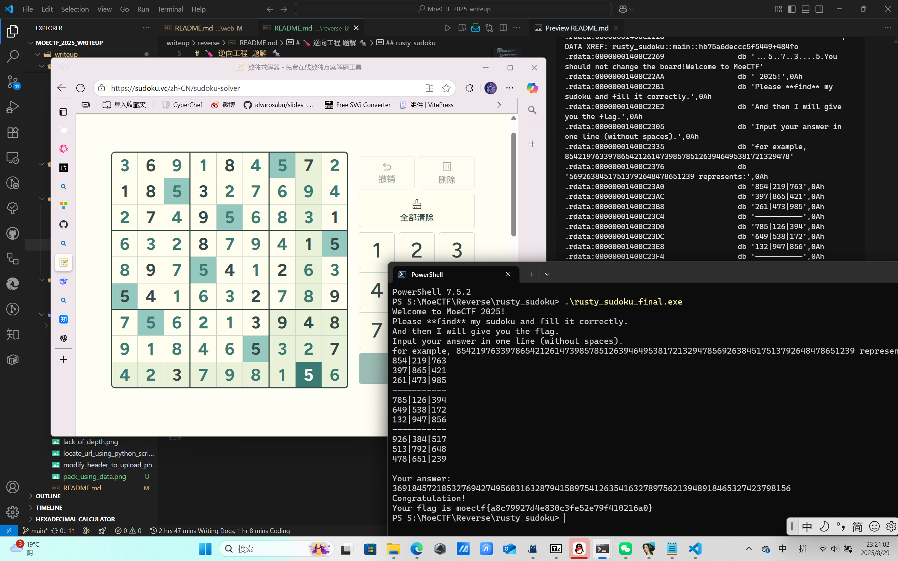

<!--markdownlint-disable MD033 MD041-->

<div align="center">

# 🪛 逆向工程 题解 🔩

</div>

## speed ✅

> [!NOTE]
> **FLAG:** `moectf{Just_dyn@mic_d3bugg1ng}`

用 IDA Pro 打开题目中的 `speed.exe`，注意到直接找 `flag` 非常费劲，我们直接定位到 `WinMain` 函数，对着弹窗消失前的 `Sleep(1u);` 下一个断点，随后开始调试即可。唯一缺点就是 `flag` 需要手打。


## 逆向工程入门指北 ✅

> [!NOTE]
> **FLAG:** `moectf{open_your_IDA_and_start_reverse_engineering!!}`

用 IDA Pro 打开附件压缩包中的 `attachment`，等待解析完成后，在 IDA View 中观察一下程序逻辑，发现程序在 `loc_40484B` 处对用户输入和生成的随机数进行判断，继续向下跟踪定位到 `.rodata:0000000000577148` 处，存在字符串

> The flag is moectf{open_your_IDA_and_start_reverse_engineering!!}



## base

> [!NOTE]
> **FLAG:** `bW9lY3Rme1kwdV9DNG5fRzAwZF9BdF9CNDVlNjQhIX0=`

注意到

```c
v8 = strcmp(v7, "bW9lY3Rme1kwdV9DNG5fRzAwZF9BdF9CNDVlNjQhIX0=");
```

直接猜测字符串是目标 `flag` 的 Base64 加密形式，CyberChef 解码后得到 `flag`。这是容易的，略去截图。

## catch

> [!NOTE]
> **FLAG:** `moectf{S4m3_Tr1ck_with_@flower_desuwa}`

注意到题目提示：

> IDA pro 9.0 推出了针对 C++ exception 的优化</br>
> 但是这并不意味着所有的 try catch 都能被正确反编译

用 IDA Pro 打开 `catch.exe`，逐步分析得到 `sub_114514` 函数，分析逻辑发现 `flag` 是对 `geoi~lq~bcyUcyUkUlkaoUlfkmw` 作 XOR 的结果。这题还是太容易了，一顿操作猛如虎，解密一出——



啊？还有 FAKE FLAG？玩得花 😡😡😭😭

> [!TIP]
> 事实上这就是题目提示中所说到的，IDA Pro 在反编译 `try-catch` 时的缺陷。我们熟知编译器生成的异常处理依赖于 `.eh_frame` / `.gcc_except_table`，二者记录了 `try` 块的起始和结束地址、`catch` 块能捕获的异常类型信息以及 `catch` 块代码的起始地址（即 Landing Pad）。抛出异常时，控制流靠 unwind 表将执行权从抛出点送到某个 Landing Pad，由后者再调起 `__cxa_begin_catch` 并执行 `catch` 体，然后 `__cxa_end_catch`。但因为这种控制流不是普通的分支和调用，反编译器不具备过强的能力完整重建这类异常控制流，所以在遇到过于棘手的 `try-catch` 的时候，IDA Pro 就要开摆了。

不过，关于具体的原理，星澜音也是一知半解。总之在后文中我们找到 `zbrpgs{F4z3_Ge1px_jvgu_@sybjre_qrfhjn}`，用凯撒密码的方法 ROT 几下就弄出来 `flag` 了。

## upx

> [!NOTE]
> **FLAG:** `moectf{Y0u_c4n_unp4ck_It_vvith_upx}`

注意到题目提示附件 `moe.exe` 使用了 UPX 加壳，我们首先使用 UPX 脱壳：

```plain
PS S:\MoeCTF\Reverse\upx> .\upx-5.0.2-win64\upx.exe -d moe.exe
                       Ultimate Packer for eXecutables
                          Copyright (C) 1996 - 2025
UPX 5.0.2       Markus Oberhumer, Laszlo Molnar & John Reiser   Jul 20th 2025

        File size         Ratio      Format      Name
   --------------------   ------   -----------   -----------
     12288 <-      8192   66.67%    win64/pe     moe.exe

Unpacked 1 file.
```

然后继续丢入 IDA Pro 中打开，分析 `main` 函数：

```c
int __fastcall main(int argc, const char **argv, const char **envp)
{
    FILE *v3;         // rax
    __int64 v4;       // rcx
    __int64 v5;       // rax
    int v6;           // r9d
    __int64 v7;       // r8
    char v8;          // dl
    __int128 v10[8];  // [rsp+20h] [rbp-148h]
    int v11;          // [rsp+A0h] [rbp-C8h]
    int v12;          // [rsp+A4h] [rbp-C4h]
    int v13;          // [rsp+A8h] [rbp-C0h]
    char v14[48];     // [rsp+B0h] [rbp-B8h]
    char Buffer[112]; // [rsp+E0h] [rbp-88h] BYREF

    v10[0] = (__int128)_mm_load_si128((const __m128i *)&xmmword_1400032E0);
    v10[1] = (__int128)_mm_load_si128((const __m128i *)&xmmword_140003310);
    v10[2] = (__int128)_mm_load_si128((const __m128i *)&xmmword_140003320);
    v10[3] = (__int128)_mm_load_si128((const __m128i *)&xmmword_1400032F0);
    v10[4] = (__int128)_mm_load_si128((const __m128i *)&xmmword_1400032D0);
    v10[5] = (__int128)_mm_load_si128((const __m128i *)&xmmword_1400032B0);
    v10[6] = (__int128)_mm_load_si128((const __m128i *)&xmmword_140003300);
    v10[7] = (__int128)_mm_load_si128((const __m128i *)&xmmword_1400032C0);
    v11 = 41;
    v12 = 36;
    v13 = 86;
    sub_140001010("please input your flag: ");
    v3 = _acrt_iob_func(0);
    fgets(Buffer, 100, v3);
    v4 = -1i64;
    do
        ++v4;
    while (Buffer[v4]);
    v5 = 0i64;
    v6 = 0;
    if ((int)v4 > 0)
    {
        v7 = 0i64;
        do
        {
            v8 = Buffer[v7] ^ 0x21;
            if (v6 < (int)v4 - 1)
                v8 ^= Buffer[v7 + 1];
            v14[v7] = v8;
            ++v6;
            ++v7;
        } while (v7 < (int)v4);
    }
    while (v14[v5] == *((_DWORD *)v10 + v5))
    {
        if (++v5 >= 35)
            return 0;
    }
    sub_140001010("you will never get the flag!!!!\n");
    return 0;
}
```

这啥啊？看得人头疼。

首先，程序先将内存地址为 `xmmword_1400032E0` 到 `xmmword_1400032C0` 的内存中的数据逐个提取到数组 `v10` 中，该数组包含 8 个 128 位的整数。之后，它继续对 `v11`、`v12` 和 `v13` 进行赋值，并要求用户输入 `flag`，将后者存入 `Buffer` 中。

随后，程序计算用户输入内容的长度并将长度存储在 `v4` 中，紧接着，对 `Buffer` 中的字符：

1. 对它与 `0x21` 作一次异或运算；
2. 若它不是最后一个字符，则将它再与下一个字符进行一次异或运算。

随后将它存入 `v14` 数组中。

紧接着，程序进行一步类型转换，将 `v10` 的地址看成一个 `DWORD`（32 位整数）数组的指针，取出其第 `v5` 个 `DWORD` 并与 `v14` 数组的第 `v5` 个值比较。但凡有一个未匹配成功，程序则会弹出 `you will never get the flag!!!!` 进行嘲讽；否则程序继续向下匹配，直到匹配了 35 次之后，发出 `return 0` 返回。

在 IDA Pro 的 `Stack of Main` 窗口，我们能看到这些数据在栈上的大致分布。考虑到 `v10` 的每一个值都可以被拆为 4 个 `DWORD`，我们也就大概能推测出数据的结构了（`Stack of Main` 会显示出、我们也可以推测出，`v11` 在栈上就位于 `v10[7]` 之后，`v12` 和 `v13` 与此同理）：

```plain
<v10[1]> <v10[2]> ... <v10[6]> <v10[7]> <v11> <v12> <v13>
```

恰好可以被拆为共 35 个 `DWORD`。

现在，程序的算法就很明确了，我们的解题逻辑也非常明确：将 `v10` 到 `v13` 的值提取出来并分为 35 个 `DWORD` 后，先异或第 35 个值到原 `flag`，再依次从第 34 个值到第 1 个值，与后一个值异或后与 `0x21` 异或一次，最终拼接得到 `flag`！

在 IDA View 中，我们得到了这些值：

```plain
.rdata:00007FF794E332B0 xmmword_7FF794E332B0 xmmword 0A0000001C0000003700000015h
.rdata:00007FF794E332C0 xmmword_7FF794E332C0 xmmword 240000000B000000160000003Dh
.rdata:00007FF794E332D0 xmmword_7FF794E332D0 xmmword 2900000076000000650000003Fh
.rdata:00007FF794E332E0 xmmword_7FF794E332E0 xmmword 36000000270000002B00000023h
.rdata:00007FF794E332F0 xmmword_7FF794E332F0 xmmword 3A0000000B000000100000007Bh
.rdata:00007FF794E33300 xmmword_7FF794E33300 xmmword 3C0000003E0000002100000008h
.rdata:00007FF794E33310 xmmword_7FF794E33310 xmmword 48000000030000003C00000033h
.rdata:00007FF794E33320 xmmword_7FF794E33320 xmmword 760000001D0000000B00000064h
```

手动按照小端序拆出这些值：

```plain
v10[0]: 0x23, 0x2B, 0x27, 0x36
v10[1]: 0x33, 0x3C, 0x03, 0x48
v10[2]: 0x64, 0x0B, 0x1D, 0x76
v10[3]: 0x7B, 0x10, 0x0B, 0x3A
v10[4]: 0x3F, 0x65, 0x76, 0x29
v10[5]: 0x15, 0x37, 0x1C, 0x0A
v10[6]: 0x08, 0x21, 0x3E, 0x3C
v10[7]: 0x3D, 0x16, 0x0B, 0x24
v11: 41
v12: 36
v13: 86
```

紧接着，编写 Python 脚本如下：

```python
"""decrypt.py

该 Python 脚本供 MoeCTF 2025 的 Reverse 赛道中，「upx」题目使用。
由 星澜音 在 Gemini 和 DeepSeek 的帮助下编写。
"""

TargetData = [
    0x23, 0x2B, 0x27, 0x36,
    0x33, 0x3C, 0x03, 0x48,
    0x64, 0x0B, 0x1D, 0x76,
    0x7B, 0x10, 0x0B, 0x3A,
    0x3F, 0x65, 0x76, 0x29,
    0x15, 0x37, 0x1C, 0x0A,
    0x08, 0x21, 0x3E, 0x3C,
    0x3D, 0x16, 0x0B, 0x24,
    41, 36, 86
]

FLAG_LEN = 35
flag = [0] * FLAG_LEN

flag[FLAG_LEN - 1] = TargetData[FLAG_LEN - 1] ^ 0x21

for i in range(FLAG_LEN - 2, -1, -1):
    flag[i] = TargetData[i] ^ flag[i+1] ^ 0x21

RESULT = "".join(map(chr, flag))
print(f"The flag is: {RESULT}")
```

哈哈哈，一顿操作猛如虎，运行一看

```plain
[Running] python -u "s:\MoeCTF\Misc\decrypt.py"
The flag is: TV\ZM_BS:?Ui>dU?dz>iaUC~U||c~bU?zrw
```

何意味？排查半天，逻辑没问题，抄的数值也没一点问题，到底问题出在哪里了？仔细读题，突然发现平台上出题人发了个提示，打开一看，哦！`fgets` 会保留输入后面的换行符！即使是在进行比对的时候会忽略掉 `fgets` 带来的换行符，但，异或后的换行符仍然会参与前 35 个字符的加密。这一点是不容忽略的。

无敌了……修改 Python 脚本：

```diff
+ NEWLINE_CHAR_CODE = 10  # 换行符

- flag[FLAG_LEN - 1] = TargetData[FLAG_LEN - 1] ^ 0x21
+ flag[FLAG_LEN - 1] = TargetData[FLAG_LEN - 1] ^ 0x21 ^ NEWLINE_CHAR_CODE
```

运行：

```plain
[Running] python -u "s:\MoeCTF\Misc\decrypt.py"
The flag is: moectf{Y0u_c4n_unp4ck_It_vvith_upx}
```

哎。😭

## ez3

> [!NOTE]
> **FLAG:** `moectf{Y0u_Kn0w_z3_S0Iv3r_N0w_a1f2bdce4a9}`

题目提示使用 z3-solver，看起来就不是什么善茬。反编译给定的 `ez3`，直接震撼……

```c
int __fastcall main(int argc, const char **argv, const char **envp)
{
    char v3;              // bl
    bool v4;              // r12
    __int64 v5;           // rbx
    __int64 v6;           // rax
    char v8;              // [rsp+Fh] [rbp-71h] BYREF
    __int64 v9;           // [rsp+10h] [rbp-70h] BYREF
    __int64 v10;          // [rsp+18h] [rbp-68h] BYREF
    char v11[32];         // [rsp+20h] [rbp-60h] BYREF
    char v12[40];         // [rsp+40h] [rbp-40h] BYREF
    unsigned __int64 v13; // [rsp+68h] [rbp-18h]

    v13 = __readfsqword(0x28u);
    printf((unsigned int)"Input your flag:\n> ", (_DWORD)argv, (_DWORD)envp);
    fflush(stdout);
    std::string::basic_string(v11);
    std::operator >> <char>((std::istream *)&std::cin);
    if (std::string::length(v11, v11) == 42)
    {
        v3 = 0;
        v4 = 1;
        if ((unsigned __int64)std::string::length(v11, v11) > 7)
        {
            std::string::substr(v12, v11, 0LL, 7LL);
            v3 = 1;
            if (!(unsigned __int8)std::operator != <char>(v12, "moectf{") && *(_BYTE *)std::string::back(v11) == 125)
                v4 = 0;
        }
        if (v3)
            std::string::~string(v12);
        if (v4)
        {
            puts("FORMAT ERROR!");
        }
        else
        {
            std::allocator<char>::allocator(&v8);
            v10 = std::string::end(v11);
            v5 = __gnu_cxx::__normal_iterator<char *, std::string>::operator - (&v10, 1LL);
            v9 = std::string::begin(v11);
            v6 = __gnu_cxx::__normal_iterator<char *, std::string>::operator + (&v9, 7LL);
            std::string::basic_string<__gnu_cxx::__normal_iterator<char *, std::string>, void>(v12, v6, v5, &v8);
            std::string::operator = (v11, v12);
            std::string::~string(v12);
            std::allocator<char>::~allocator(&v8);
            std::string::basic_string(v12, v11);
            LOBYTE(v5) = check(v12);
            std::string::~string(v12);
            if ((_BYTE)v5)
            {
                puts("OK");
                puts("But I don't know what the true flag is");
            }
            else
            {
                puts("try again~");
            }
        }
    }
    else
    {
        puts("Length error!");
    }
    std::string::~string(v11);
    return 0;
}
```

```c
__int64 __fastcall check(__int64 a1)
{
    int i; // [rsp+1Ch] [rbp-4h]

    for (i = 0; i <= 33; ++i)
    {
        check(std::string)::b[i] = 47806 * (*(char *)std::string::operator[](a1, i) + i);
        if (i)
            check(std::string)::b[i] ^= check(std::string)::b[i - 1] ^ 0x114514;
        check(std::string)::b[i] %= 51966;
        if (check(std::string)::b[i] != a[i])
            return 0LL;
    }
    return 1LL;
}
```

这回是真看困了，直接丢给 DeepSeek 吧🥱

程序首先会打印提示信息并要求用户输入 `flag`，然后使用 `std::cin` 读取输入的字符串到 `v11`，并检查字符串的长度是否为 42 字节、是否以 `moectf{}` 包裹。若检查通过，则将 `{}` 中的内容传给 `check` 函数验证。

我们研究 `check` 函数的性质：它获得了一个 34 字节的字符串，随后，对索引 `i` 从 0 到 33：

1. 记 $c_i$ 为字符串的第 $(i + 1)$ 个字符的 ASCII 值，计算 $b_i = 47,806(c_i + i)$；
2. 仅当 $i > 0$ 时，取 $b_i = b_i \oplus b_{i-1} \oplus 1,131,796$；
3. 再取 $b_i \equiv b_i \pmod{51,966}$。

这里的 `1,131,796` 是 `0x114514` 的十进制表示。随后，程序比较 `b[i]` 是否等于数组 `a` 中的对应值 `a[i]` 以验证 `flag`。

题目既然已经提示了用 z3-solver，那就开动😋

```python
"""solve_flag_z3.py

该 Python 脚本供 MoeCTF 2025 的 Reverse 赛道中，「ez3」题目使用。
由 星澜音 在 ChatGPT、Gemini 和 DeepSeek 的帮助下编写。
"""

from z3 import *

# 在这里填入我们从 IDA Pro 中获取的已知数组 `a`。这里，星澜音直接填入 16 位整数的形式。
a = [0x0B1B0, 0x5678, 0x7FF2, 0x0A332, 0x0A0E8, 0x364C, 0x2BD4,
     0x0C8FE, 0x4A7C, 0x18, 0x2BE4, 0x4144, 0x3BA6, 0x0BE8C, 0x8F7E,
     0x35F8, 0x61AA, 0x2B4A, 0x6828, 0x0B39E, 0x0B542, 0x33EC, 0x0C7D8,
     0x448C, 0x9310, 0x8808, 0x0ADD4, 0x3CC2, 0x796, 0x0C940, 0x4E32,
     0x4E2E, 0x924A, 0x5B5C]

# 定义求解器 `solver`。
solver = Solver()

# 定义 `c_0` 到 `c_33` 均为 32 位整数（或者说是 `BitVec`，即「位向量」）。
c = [BitVec(f'c_{i}', 32) for i in range(34)]

# ------------------------------ 下面定义这 34 个 32 位整数的约束条件 ------------------------------

# 定义约束规则：考虑到 `flag` 必须为可打印 ASCII 字符，我们限制这些位向量取 `32` 到 `126` 之间的值。
for i in range(34):
    solver.add(c[i] >= 32)
    solver.add(c[i] <= 126)

# 对第 1 个字符 `c_0`：
# 我们告诉求解器，经过已经发现的运算规则后得到的结果必须等于数组 `a` 的第 1 个元素。
b_0_calc = 47806 * (c[0] + 0)
solver.add(URem(b_0_calc, 51966) == a[0])

# 对第 2 到 34 个字符 `c_1` 到 `c_33`：
# 我们对每一个字符进行 2 步的运算，随后告诉求解器，经过运算后得到的结果必须等于数组 `a` 中对应的元素。
for i in range(1, 34):
    b_i_calc_step1 = 47806 * (c[i] + i)
    b_i_calc_step2 = b_i_calc_step1 ^ a[i-1] ^ 0x114514
    solver.add(URem(b_i_calc_step2, 51966) == a[i])

# ----------------------------- 约束条件的定义在此行结束，下面开始求解 -----------------------------

print("约束条件已建立。正在使用 z3-solver 尝试得到结果……")
if solver.check() == sat:
    model = solver.model()
    flag_chars = []
    for i in range(34):
        char_val = model[c[i]].as_long()
        flag_chars.append(chr(char_val))

    FLAG = "".join(flag_chars)
    print("🎉 成功找到满足约束条件的 `flag`！\n")
    print(f"`flag` 为 {FLAG}")
else:
    print("😭 未能找到一个满足约束条件的 `flag`")
```

运行得到：

```plain
PS S:\MoeCTF\Reverse\ez3> python .\solve_flag_z3.py
约束条件已建立。正在使用 z3-solver 尝试得到结果……
🎉 成功找到一个满足约束条件的 `flag`！

`flag` 为 Y0u_Kn0w_z3_S0Iv3r_N0w_a1f2bdce4a9
```

舒服了😋至于题目所说的可能出现的多解情况🤔至少星澜音没碰到，那就不管了😋

## flower

> [!NOTE]
> **FLAG:** `moectf{f0r3v3r_JuMp_1n_7h3_a$m_a9b35c3c}`

出题人提示说 `flower` 中存在花指令，事实上的确如此：IDA Pro 在解析 `solve` 函数的时候报错 `positive sp has been found`。不过星澜音对着汇编代码看了半天，也没有盯出来哪里有问题，所以干脆直接开 Ghidra 吧！Ghidra 在处理花指令这一块似乎比 IDA Pro 好一点。

~~不过星澜音也遇到过花指令让 Ghidra 完全错乱的情况，甚至有一次反编译直接把 `main` 函数反编译不见了~~

```c
undefined8 main(void)

{
    ostream *poVar1;
    runtime_error *this;
    long in_FS_OFFSET;
    string local_68[32];
    string local_48[40];
    long local_20;

    local_20 = *(long *)(in_FS_OFFSET + 0x28);
    check();
    poVar1 = std::operator << ((ostream *)&std::cout, "Input your flag:\n> ");
    std::ostream::operator << (poVar1, std::flush<>);
    if (main::zero == 0)
    {
        this = (runtime_error *)__cxa_allocate_exception(0x10);
        /* try { // try from 00404b94 to 00404b98 has its CatchHandler @ 00404c57 */
        std::runtime_error::runtime_error(this, "Division by zero");
        /* WARNING: Subroutine does not return */
        /* try { // try from 00404bb0 to 00404be5 has its CatchHandler @ 00404c6b */
        __cxa_throw(this, &std::runtime_error::typeinfo, std::runtime_error::~runtime_error);
    }
    poVar1 = (ostream *)std::ostream::operator << ((ostream *)&std::cout, (int)(10 / (long)main::zero));
    std::ostream::operator << (poVar1, std::endl<>);
    std::__cxx11::string::string(local_68);
    /* try { // try from 00404c03 to 00404c1a has its CatchHandler @ 00404ca5 */
    std::operator >> ((istream *)&std::cin, local_68);
    std::__cxx11::string::string(local_48, local_68);
    /* try { // try from 00404c22 to 00404c26 has its CatchHandler @ 00404c90 */
    solve(local_48);
    std::__cxx11::string::~string(local_48);
    std::__cxx11::string::~string(local_68);
    if (local_20 != *(long *)(in_FS_OFFSET + 0x28))
    {
        /* WARNING: Subroutine does not return */
        __stack_chk_fail();
    }
    return 0;
}
```

叽里咕噜说一堆看不懂的东西……看看 `check` 先

```c
/* WARNING: Unknown calling convention -- yet parameter storage is locked */
/* check() */

void check(void)

{
    long lVar1;
    ostream *this;

    lVar1 = ptrace(PTRACE_TRACEME, 0, 0, 0);
    if (lVar1 == -1)
    {
        this = std::operator << ((ostream *)&std::cerr, "Don\'t trace me:(");
        std::ostream::operator << (this, std::endl<>);
        /* WARNING: Subroutine does not return */
        exit(1);
    }
    return;
}
```

666 还有反动态调试，无敌了，还是看看 `solve` 吧。Ghidra 反编译 `solve` 异常顺畅，原因未知，反正能用就好。

```c

/* solve(std::__cxx11::string) */

void solve(string *param_1)

{
    bool bVar1;
    bool bVar2;
    int iVar3;
    ulong uVar4;
    char *pcVar5;
    ostream *poVar6;
    undefined8 uVar7;
    undefined8 uVar8;
    long in_FS_OFFSET;
    allocator<char> local_61;
    int local_60;
    int local_5c;
    undefined8 local_58;
    undefined8 local_50;
    string local_48[40];
    long local_20;

    local_20 = *(long *)(in_FS_OFFSET + 0x28);
    bVar1 = false;
    uVar4 = std::__cxx11::string::length(param_1);
    if (7 < uVar4)
    {
        /* try { // try from 0040485b to 0040487a has its CatchHandler @ 00404ac5 */
        std::__cxx11::string::substr((ulong)local_48, (ulong)param_1);
        bVar1 = true;
        bVar2 = std::operator != (local_48, "moectf{");
        if (!bVar2)
        {
            pcVar5 = (char *)std::__cxx11::string::back(param_1);
            if (*pcVar5 == '}')
            {
                bVar2 = false;
                goto LAB_004048a0;
            }
        }
    }
    bVar2 = true;
LAB_004048a0:
    if (bVar1)
    {
        std::__cxx11::string::~string(local_48);
    }
    bVar2 = !bVar2;
    if (bVar2)
    {
        if ((!bVar2) && (bVar2))
        {
            /* WARNING: Call to offcut address within same function */
            func_0x004048ef();
        }
        std::allocator<char>::allocator();
        local_50 = std::__cxx11::string::end(param_1);
        uVar7 = __gnu_cxx::__normal_iterator<>::operator - ((__normal_iterator<> *)&local_50, 1);
        local_58 = std::__cxx11::string::begin(param_1);
        uVar8 = __gnu_cxx::__normal_iterator<>::operator + ((__normal_iterator<> *)&local_58, 7);
        /* try { // try from 00404953 to 00404957 has its CatchHandler @ 00404ae7 */
        std::__cxx11::string::string<>(local_48, uVar8, uVar7, &local_61);
        std::__cxx11::string::operator = (param_1, local_48);
        std::__cxx11::string::~string(local_48);
        std::allocator<char>::~allocator(&local_61);
        local_5c = std::__cxx11::string::length(param_1);
        if (local_5c == 0x20)
        {
            for (local_60 = 0; local_60 < local_5c; local_60 = local_60 + 1)
            {
                pcVar5 = (char *)std::__cxx11::string::operator[](param_1, (long)local_60);
                iVar3 = encode((int)*pcVar5);
                if (iVar3 != *(int *)(enc + (long)local_60 * 4))
                {
                    poVar6 = std::operator << ((ostream *)&std::cout, "Wrong!");
                    std::ostream::operator << (poVar6, std::endl<>);
                    goto LAB_00404b05;
                }
            }
            if (*(int *)(enc + (long)local_5c * 4) == 0)
            {
                poVar6 = std::operator << ((ostream *)&std::cout, "You Win!\n");
                std::ostream::operator << (poVar6, std::endl<>);
            }
            else
            {
                poVar6 = std::operator << ((ostream *)&std::cout, "Wrong!");
                std::ostream::operator << (poVar6, std::endl<>);
            }
        }
        else
        {
            poVar6 = std::operator << ((ostream *)&std::cout, "LENGTH ERROR");
            std::ostream::operator << (poVar6, std::endl<>);
        }
    }
    else
    {
        poVar6 = std::operator << ((ostream *)&std::cout, "FORMAT ERROR!");
        std::ostream::operator << (poVar6, std::endl<>);
    }
LAB_00404b05:
    if (local_20 != *(long *)(in_FS_OFFSET + 0x28))
    {
        /* WARNING: Subroutine does not return */
        __stack_chk_fail();
    }
    return;
}
```

猜都能猜出这段的逻辑：匹配 `moectf{}`，比对花括号内字符串的长度是否为 32，如果匹配成功，就会把这个字符串的每一个字符交给 `encode()` 函数处理，`encode()` 函数的返回值会与一个名为 `enc` 的数组中对应位置的值进行比较。

跟踪 `encode()` 函数：

```c
/* encode(int) */

uint encode(int param_1)

{
    uint uVar1;
  
    uVar1 = key;
    key = key + 1;
    return uVar1 ^ param_1;
}
```

又是喜闻乐见的 XOR 环节……在 IDA Pro 的汇编代码里找见 `enc` 双击进入数据，考虑到程序在比较的时候会将 `enc` 数组的地址转换为 `int*` 指针，这意味着数组的每个元素都是一个 4 字节的整数，我们很有可能提取出一大坨这个东西：

```plain
.data:00000000005D9140     enc             db  4Fh ; O             ; DATA XREF: .text:0000000000404A01↑o
.data:00000000005D9140                                             ; .text:0000000000404A5D↑o
.data:00000000005D9141                     db    0
.data:00000000005D9142                     db    0
.data:00000000005D9143                     db    0
.data:00000000005D9144                     db  1Ah
.data:00000000005D9145                     db    0
.data:00000000005D9146                     db    0
.data:00000000005D9147                     db    0
.data:00000000005D9148                     db  59h ; Y
.data:00000000005D9149                     db    0
.data:00000000005D914A                     db    0
.data:00000000005D914B                     db    0
.data:00000000005D914C                     db  1Fh
.data:00000000005D914D                     db    0
.data:00000000005D914E                     db    0
.data:00000000005D914F                     db    0
.data:00000000005D9150                     db  5Bh ; [
.data:00000000005D9151                     db    0
.data:00000000005D9152                     db    0
.data:00000000005D9153                     db    0
...
```

嗯……注意到小端序，手动处理一下就好了。

```python
enc = [
    0x4F, 0x1A, 0x59, 0x1F, 0x5B, 0x1D, 0x5D, 0x6F, 0x7B, 0x47, 0x7E, 0x44,
    0x6A, 0x07, 0x59, 0x67, 0x0E, 0x52, 0x08, 0x63, 0x5C, 0x1A, 0x52, 0x1F,
    0x20, 0x7B, 0x21, 0x77, 0x70, 0x25, 0x74, 0x2B
]
```

`key` 的初始值也可以从 IDA Pro 中找见，不过这个 `key` 最后肯定做了一些运算，这个运算太复杂了，懒得看😭注意到 `key` 是一个单字节的数值，它的值从 0 到 255，所以我们直接爆破就好。夜色较深，星澜音懒得写代码了，这一步就让 Gemini 完全代工了。

```python
# 从内存转储中解析出的加密数据
enc = [
    0x4F, 0x1A, 0x59, 0x1F, 0x5B, 0x1D, 0x5D, 0x6F, 0x7B, 0x47, 0x7E, 0x44,
    0x6A, 0x07, 0x59, 0x67, 0x0E, 0x52, 0x08, 0x63, 0x5C, 0x1A, 0x52, 0x1F,
    0x20, 0x7B, 0x21, 0x77, 0x70, 0x25, 0x74, 0x2B
]

# 遍历所有可能的单字节初始密钥
for initial_key in range(256):
    flag_core = ""
    is_printable = True
    
    # 使用当前猜测的初始密钥进行解密
    for i in range(len(enc)):
        # 加密时使用的密钥是 initial_key + i
        key_for_char = initial_key + i
        # 解密操作：原始字符 = 加密字符 ^ 密钥
        decrypted_char_code = enc[i] ^ key_for_char
        
        # 检查解密出的字符是否是可打印的 ASCII 字符
        if not (32 <= decrypted_char_code <= 126):
            is_printable = False
            break
        flag_core += chr(decrypted_char_code)
    
    # 如果整个字符串都是可打印的，我们可能就找到了正确的密钥
    if is_printable:
        print(f"[*] 发现可能的初始密钥: {initial_key} (0x{initial_key:02x})")
        flag = f"moectf{{{flag_core}}}"
        print(f"[*] 得到的 Flag: {flag}")
```

运行，输出

```plain
PowerShell 7.5.2
PS S:\MoeCTF\Reverse\flower> python .\flower_crack.py
[*] 发现可能的初始密钥: 40 (0x28)
[*] 得到的 Flag: moectf{g3s4w0s@KvLw^2oP6k2X`'l `:c44`2l}
[*] 发现可能的初始密钥: 41 (0x29)
[*] 得到的 Flag: moectf{f0r3v3r_JuMp_1n_7h3_a$m_a9b35c3c}
```

肉眼分辨都知道 `40` 不行，那就是 `41` 了。`flag` 获得成功~

## ezpy

> [!NOTE]
> **FLAG:** `moectf{Y0u_Kn0W_pyc}`

考虑到本地的 `uncompyle6` 不知为何突然抽风，我们还是直接使用在线工具反编译 `.pyc` 文件吧。得到如下结果：

```python
#!/usr/bin/env python
# visit https://tool.lu/pyc/ for more information
# Version: Python 3.8


def caesar_cipher_encrypt(text, shift):
    result = []
    for char in text:
        if char.isalpha():
            if char.islower():
                new_char = chr(((ord(char) - ord('a')) + shift) % 26 + ord('a'))
            elif char.isupper():
                new_char = chr(((ord(char) - ord('A')) + shift) % 26 + ord('A'))
            result.append(new_char)
            continue
        result.append(char)
    return ''.join(result)

user_input = input('please input your flag：')
a = 1
if a != 1:
    plaintext = user_input
    shift = 114514
    encrypted_text = caesar_cipher_encrypt(plaintext, shift)
    if encrypted_text == 'wyomdp{I0e_Ux0G_zim}':
        print('Correct!!!!')
```

一眼凯撒密码。直接注意到 `shift` 为 114514，我们熟知 $10 \equiv 114,514 \pmod{26}$，所以以移位 10 去解密 `wyomdp{I0e_Ux0G_zim}` 即可。

## have_fun

> [!NOTE]
> **FLAG:** `moectf{H@v4_fUn}`

这是一个 Windows 窗体程序，它的反编译和分析就困难了很多。我们观察它的 `WinMain` 函数（节选）：

```c
int __stdcall WinMain(HINSTANCE hInstance, HINSTANCE hPrevInstance, LPSTR lpCmdLine, int nShowCmd)
{
...
    LoadStringW(hInstance, 0x67u, &WindowName, 100);
    LoadStringW(hInstance, 0x6Du, &ClassName, 100);
    v11.cbSize = 80;
    v11.lpfnWndProc = (WNDPROC)sub_140001210;
    v11.style = 3;
    *(_QWORD *)&v11.cbClsExtra = 0i64;
    v11.hInstance = hInstance;
    v11.hIcon = LoadIconW(hInstance, (LPCWSTR)0x6B);
...
```

这一坨是啥……看不懂，但是我们熟知「窗口过程函数」`WNDPROC` 用来处理各种 Windows 消息，所以我们寻找其 `WNDPROC` 函数即可。在这里，它位于 `(WNDPROC)sub_140001210`，继续跟踪。

```c
LRESULT __fastcall sub_140001210(HWND hWnd, UINT a2, WPARAM a3, LPARAM a4)
{
    HDC v6;                      // rsi
    HFONT FontW;                 // rdi
    HGDIOBJ v8;                  // rbx
    struct tagPAINTSTRUCT Paint; // [rsp+70h] [rbp-88h] BYREF

    switch (a2)
    {
    case 2u:
        PostQuitMessage(0);
        break;
    case 0xFu:
        v6 = BeginPaint(hWnd, &Paint);
        SetTextColor(v6, 0xFFu);
        SetBkMode(v6, 1);
        FontW = CreateFontW(36, 0, 0, 0, 700, 0, 0, 0, 1u, 0, 0, 0, 0x20u, &pszFaceName);
        v8 = SelectObject(v6, FontW);
        TextOutW(v6, 500, 160, "欢迎来到", 15);
        TextOutW(v6, 500, 200, &word_140003350, 10);
        SelectObject(v6, v8);
        DeleteObject(FontW);
        EndPaint(hWnd, &Paint);
        break;
    case 0x111u:
        switch ((unsigned __int16)a3)
        {
        case 0x68u:
            DialogBoxParamW(hInstance, (LPCWSTR)0x67, hWnd, sub_140001420, 0i64);
            break;
        case 0x69u:
            DestroyWindow(hWnd);
            break;
        case 0x9C42u:
            DialogBoxParamW(hInstance, (LPCWSTR)0x66, hWnd, DialogFunc, 0i64);
            break;
        default:
            return DefWindowProcW(hWnd, a2, a3, a4);
        }
        break;
    default:
        return DefWindowProcW(hWnd, a2, a3, a4);
    }
    return 0i64;
}
```

开猜！我们打开该程序，观察其逻辑：左上角的菜单栏有三个按钮，应当对应 `0x111u` 中 `switch` 的 3 个 `case`，而 `0x9C42u` 应当就是「交互(I)」。



根据 Microsoft Learn 中对 [DLGPROC](https://learn.microsoft.com/zh-cn/windows/win32/api/winuser/nc-winuser-dlgproc) 的解析：

```c
INT_PTR DialogBoxParamW(
    [in, optional] HINSTANCE hInstance,
    [in]           LPCWSTR   lpTemplateName,
    [in, optional] HWND      hWndParent,
    [in, optional] DLGPROC   lpDialogFunc,
    [in]           LPARAM    dwInitParam
);
```

我们易知 `DialogFunc` 是点击「输入flag(V)」后的窗口处理函数。继续跟踪：

```c
INT_PTR __fastcall DialogFunc(HWND a1, int a2, unsigned __int16 a3)
{
    HWND v3;             // rbx
    int v4;              // edx
    __int64 v5;          // rax
    int v6;              // r8d
    __m128 si128;        // xmm2
    __int64 v8;          // rdx
    unsigned __int64 v9; // rcx
    __m128 v10;          // xmm0
    __m128 v11;          // xmm1
    __m128 v12;          // xmm0
    __m128 v13;          // xmm1
    __int64 v14;         // rdx
    __int16 *v15;        // rdx
    int v16;             // r8d
    int v17;             // r9d
    const WCHAR *v18;    // r8
    __int128 v20[2];     // [rsp+0h] [rbp-1D8h] BYREF
    WCHAR String[8];     // [rsp+20h] [rbp-1B8h] BYREF
    __int128 v22[12];    // [rsp+30h] [rbp-1A8h] BYREF
    __int16 v23[104];    // [rsp+F0h] [rbp-E8h] BYREF

    v3 = a1;
    v4 = a2 - 272;
    if (!v4)
    {
        v18 = "请输入";
    LABEL_22:
        SetDlgItemTextW(a1, 1002, v18);
        return 1i64;
    }
    if (v4 != 1)
        return 0i64;
    if ((unsigned __int16)(a3 - 1) > 1u)
    {
        if (a3 == 1003)
        {
            GetDlgItemTextW(a1, 1001, String, 100);
            v5 = -1i64;
            do
                ++v5;
            while (String[v5]);
            v6 = 0;
            if ((int)v5 >= 32)
            {
                si128 = (__m128)_mm_load_si128((const __m128i *)&xmmword_1400033F0);
                v8 = 0i64;
                v9 = 0i64;
                do
                {
                    v10 = (__m128)_mm_loadu_si128((const __m128i *)&String[v9 / 2]);
                    v6 += 32;
                    v8 += 32i64;
                    v11 = (__m128)_mm_loadu_si128((const __m128i *)&v22[v9 / 0x10]);
                    v9 += 64i64;
                    v22[v9 / 0x10 + 8] = (__int128)_mm_xor_ps(v10, si128);
                    v12 = (__m128)_mm_loadu_si128((const __m128i *)&v20[v9 / 0x10]);
                    v22[v9 / 0x10 + 9] = (__int128)_mm_xor_ps(v11, si128);
                    v13 = (__m128)_mm_loadu_si128((const __m128i *)&v20[v9 / 0x10 + 1]);
                    v22[v9 / 0x10 + 10] = (__int128)_mm_xor_ps(v12, si128);
                    v22[v9 / 0x10 + 11] = (__int128)_mm_xor_ps(v13, si128);
                } while (v8 < (int)(v5 - (v5 & 0x1F)));
            }
            v14 = v6;
            if (v6 < (__int64)(int)v5)
            {
                do
                {
                    v23[v14] = String[v14] ^ 0x2A;
                    ++v14;
                } while (v14 < (int)v5);
            }
            v23[(int)v5] = 0;
            v15 = v23;
            do
            {
                v16 = *(unsigned __int16 *)((char *)v15 + (char *)aGeoiLqbj - (char *)v23);
                v17 = (unsigned __int16)*v15 - v16;
                if (v17)
                    break;
                ++v15;
            } while (v16);
            if (v17 || (v18 = (const WCHAR *)&unk_140003388, (_DWORD)v5 != 16))
                v18 = (const WCHAR *)&unk_1400033A0;
            a1 = v3;
            goto LABEL_22;
        }
        return 0i64;
    }
    EndDialog(a1, a3);
    return 1i64;
}
```

从第 50 行开始出现了一大坨逻辑……不过注意到这个 `do-while` 的条件是 `(v8 < (int)(v5 - (v5 & 0x1F)))`，这很诡异了：`if (v17 || (v18 = (const WCHAR *)&unk_140003388, (_DWORD)v5 != 16))` 是要求了输入的字符串长度为 16 的，那么我们大胆断言，那个 `do-while` 永远不可能被满足，也就是说，这段逻辑本身就没什么用处，我们直接忽略掉即可。精简之后的逻辑是：

```c
v14 = v6; // `v6` 在这里是 0
if ( v6 < (__int64)(int)v5 )
{
  do
  {
    v23[v14] = String[v14] ^ 0x2A;
    ++v14;
  }
  while ( v14 < (int)v5 );
}
```

也就是说，程序对用户输入的每个字符都与 `0x2A` 进行了异或运算 ~~为啥 MoeCTF 的异或这么多~~ 随后与 `aGeoiLqbj` 的字符串进行比较。我们在 IDA View 视图中定位 `aGeoiLqbj`：

```plain
.rdata:00000001400033B8 aGeoiLqbj:                              ; DATA XREF: DialogFunc+14D↑o
.rdata:00000001400033B8                 text "UTF-16LE", 'GEOI^LQbj\'
.rdata:00000001400033CC                 db  1Eh
.rdata:00000001400033CD                 db    0
.rdata:00000001400033CE                 db  75h ; u
.rdata:00000001400033CF                 db    0
.rdata:00000001400033D0                 db  4Ch ; L
.rdata:00000001400033D1                 db    0
.rdata:00000001400033D2                 db  7Fh ; ?
.rdata:00000001400033D3                 db    0
.rdata:00000001400033D4                 db  44h ; D
.rdata:00000001400033D5                 db    0
.rdata:00000001400033D6                 db  57h ; W
.rdata:00000001400033D7                 db    0
.rdata:00000001400033D8                 db    0
.rdata:00000001400033D9                 db    0
.rdata:00000001400033DA                 db    0
.rdata:00000001400033DB                 db    0
.rdata:00000001400033DC                 db    0
.rdata:00000001400033DD                 db    0
.rdata:00000001400033DE                 db    0
.rdata:00000001400033DF                 db    0
```

对 `GEOI^LQbj\` 先转换回 Hex 后取 `0x2A` 异或，再转换回 ASCII 编码得到 `moectf{H@v`，初见端倪！后面的 `0x1E 0x75 0x4C 0x7F 0x44 0x57` 直接取 `0x2A` 异或后转换回 ASCII 编码得到 `4_fUn}`，拼接在一起就是 `flag`。

## upx_revenge

> [!NOTE]
> **FLAG:** `moectf{???}`

直接脱壳，注意到

```plain
PS S:\MoeCTF\Reverse> .\upx-5.0.2-win64\upx.exe -d 1.exe
                       Ultimate Packer for eXecutables
                          Copyright (C) 1996 - 2025
UPX 5.0.2       Markus Oberhumer, Laszlo Molnar & John Reiser   Jul 20th 2025

        File size         Ratio      Format      Name
   --------------------   ------   -----------   -----------
upx: 1.exe: CantUnpackException: file is possibly modified/hacked/protected; take care!

Unpacked 0 files.
```

又到了我们喜闻乐见<sub>（存疑）</sub>的改壳环节。这个暂时不会，先跳过。

## guess

> [!NOTE]
> **FLAG:** `moectf{RrRRccCc44$$_w1th_fl0w3r!!_3c6a11b5}`

是经典的猜数游戏。直接拖入 IDA Pro，一顿操作猛如虎，F5 一看——


又来花指令？速速定位到 `0x140001A5A`，打开一看，释怀了，又来这一套（排版有修改）：

```asm
.text:140001A56  jz    short loc_140001A5F ; Jump if Zero (ZF=1)
.text:140001A58  jnz   short loc_140001A5F ; Jump if Not Zero (ZF=0)
.text:140001A5A  call  near ptr loc_140001A5F+3 ; Call Procedure
```

这其实是一个必然会发生的跳转：`ZF=1` 的时候会跳转，`ZF=0` 的时候也会跳转，那不是不论如何都会跳转？IDA Pro 在这里就会懵掉，所以我们只需要将 `1A5A` 和 `1A58` 右键 NOP 掉，然后再设置 `1A56` 为 Force Jump 即可。现在按 F5 就能愉快反编译了——

```c
int __fastcall main(int argc, const char **argv, const char **envp)
{
    bool v3;           // dl
    std::ostream *v4;  // rax
    unsigned int v5;   // eax
    _QWORD *v6;        // rax
    std::ostream *v8;  // rax
    __int64 v9;        // rax
    __int64 v10;       // rbx
    std::ostream *v11; // rax
    std::ostream *v12; // rax
    std::ostream *v13; // rax
    std::ostream *v14; // rax
    unsigned int v16;  // [rsp+2Ch] [rbp-54h]
    char v17[2512];    // [rsp+30h] [rbp-50h] BYREF
    char v18[2512];    // [rsp+A00h] [rbp+980h] BYREF
    char v19[32];      // [rsp+13D0h] [rbp+1350h] BYREF
    char v20[40];      // [rsp+13F0h] [rbp+1370h] BYREF
    unsigned int v21;  // [rsp+1418h] [rbp+1398h]
    int i;             // [rsp+141Ch] [rbp+139Ch]

    _main(argc, argv, envp);
    std::ios_base::sync_with_stdio(0i64, v3);
    std::ios::tie((char *)refptr__ZSt3cin + 16, 0i64);
    std::operator<< <std::char_traits<char>>(refptr__ZSt4cout, "Welcome to MoeCTF 2025!\n");
    std::operator<< <std::char_traits<char>>(refptr__ZSt4cout, "Let's play a game!\n");
    std::operator<< <std::char_traits<char>>(
        refptr__ZSt4cout,
        "I have a secret number between 0 and 99, and you can guess it 10 times.\n");
    v4 = (std::ostream *)std::operator<< <std::char_traits<char>>(
        refptr__ZSt4cout,
        "If you successly guessed it, I will give you the flag!");
    refptr__ZSt4endlIcSt11char_traitsIcEERSt13basic_ostreamIT_T0_ES6_(v4);
    std::random_device::random_device((std::random_device *)v18);
    v5 = std::random_device::operator()(v18);
    std::mersenne_twister_engine<unsigned int, 32ull, 624ull, 397ull, 31ull, 2567483615u, 11ull, 4294967295u, 7ull, 2636928640u, 15ull, 4022730752u, 18ull, 1812433253u>::mersenne_twister_engine(
        v17,
        v5);
    std::random_device::~random_device((std::random_device *)v18);
    v21 = (unsigned int)std::mersenne_twister_engine<unsigned int, 32ull, 624ull, 397ull, 31ull, 2567483615u, 11ull, 4294967295u, 7ull, 2636928640u, 15ull, 4022730752u, 18ull, 1812433253u>::operator()(v17) % 0x64;
    for (i = 0; i <= 9; ++i)
    {
        std::operator<< <std::char_traits<char>>(refptr__ZSt4cout, "Please input your number: ");
        std::ostream::flush(refptr__ZSt4cout);
        v6 = (_QWORD *)std::istream::operator>>(refptr__ZSt3cin);
        if ((unsigned __int8)std::ios::operator!((char *)v6 + *(_QWORD *)(*v6 - 24i64)) || v16 >= 0x64)
        {
            v8 = (std::ostream *)std::operator<< <std::char_traits<char>>(refptr__ZSt4cout, "Invalid input");
            refptr__ZSt4endlIcSt11char_traitsIcEERSt13basic_ostreamIT_T0_ES6_(v8);
            std::ios::clear((char *)refptr__ZSt3cin + 16, 0i64);
            v9 = std::numeric_limits<long long>::max();
            std::istream::ignore(refptr__ZSt3cin, v9, 10);
        }
        else
        {
            if (v21 == v16)
            {
                std::operator<< <std::char_traits<char>>(refptr__ZSt4cout, "You are right!\n");
                v10 = std::operator<< <std::char_traits<char>>(refptr__ZSt4cout, "The flag is moectf{");
                hex_to_binary(v20, &enc [abi:cxx11]);
                rc4_decrypt(v19, v20, &key [abi:cxx11]);
                v11 = (std::ostream *)std::operator<< <char>(v10, v19);
                v12 = (std::ostream *)std::operator<< <std::char_traits<char>>(v11, "}.");
                refptr__ZSt4endlIcSt11char_traitsIcEERSt13basic_ostreamIT_T0_ES6_(v12);
                std::string::~string(v19);
                std::string::~string(v20);
                break;
            }
            v13 = (std::ostream *)std::operator<< <std::char_traits<char>>(refptr__ZSt4cout, "That's not right...");
            refptr__ZSt4endlIcSt11char_traitsIcEERSt13basic_ostreamIT_T0_ES6_(v13);
        }
    }
    v14 = (std::ostream *)std::operator<< <std::char_traits<char>>(refptr__ZSt4cout, "Thanks for your playing!");
    refptr__ZSt4endlIcSt11char_traitsIcEERSt13basic_ostreamIT_T0_ES6_(v14);
    return 0;
}
```

为啥又来……哭泣了。直接定位到 `if (v21 == v16)`，一眼比较逻辑，估计是比较随机数和用户输入的，那么哪个是随机数呢？再往上一看，嘿

```c
std::random_device::~random_device((std::random_device *)v18);
v21 = (unsigned int)std::mersenne_twister_engine<unsigned int, 32ull, 624ull, 397ull, 31ull, 2567483615u, 11ull, 4294967295u, 7ull, 2636928640u, 15ull, 4022730752u, 18ull, 1812433253u>::operator()(v17) % 0x64;
```

这下不言而喻了，`v21` 是随机数。若随机数和用户输入匹配成功，则会调用 RC4 算法计算出 `flag`。星澜音才不管那么多，直接让程序计算好了。在第 45 行

```c
std::ostream::flush(refptr__ZSt4cout);
```

和第 76 行

```c
return 0;
```

下断点后直接调试，第一个断点处，程序的随机数已经生成，双击 `v21` 即可得到其十六进制值，转换得到十进制值后，继续进程并输入到程序中，回车，等待第二个断点出现，这时就可以获得 `flag`。


## rusty_sudoku

> [!NOTE]
> 你说得对，但是「Rust」是由 Mozilla 自主研发的一款全新零开销抽象编程语言。语言发生在一个被称作「RAII」的资源管理世界，在这里，退出作用域的对象将被授予「drop」方法，回收资源之力。你将扮演一位名为「Ferris」的神秘角色在编码的旅行中邂逅形状各异、生命周期独特的变量们，和它们一起击败强大的编译错误，找回失散的内存安全——同时，逐步发掘「Servo」的真相。<br/>
> **FLAG:** `moectf{a8c79927d4e830c3fe52e79f410216a0}`

竟然是我们喜闻乐见的 Rust😋直接打开 IDA Pro 展开逆向——不是这是啥啊……

```c
int __fastcall main(int argc, const char **argv, const char **envp)
{
    int v3; // ecx
    __int64 v5; // rdi
    __int64(__fastcall * v7[3])(int, int, int, int, int, int, int, int, int, int, int, __int64, __int64, int, int, int, int, int, int, int, int, int, int, char); // [rsp+28h] [rbp-8h] BYREF

    v5 = v3;
    _main(v3, envp);
    v7[0] = rusty_sudoku::main::hb75a6deccc5f5449;
    return std::rt::lang_start_internal::h7be68976dcad6582(v5, envp, &unk_1400C2020, v7, v5, envp);
}
```

哈哈哈，喜欢我 泛型 + 单态化 + `match` 展开 + `panic` 检查 + 内联优化 + 强类型 + 符号混淆 吗？我不喜欢😭总之我们能猜到 `rusty_sudoku::main::hb75a6deccc5f5449` 里应该是整个数独模组的总逻辑，那就直接进入吧……


<div align="center">

😭 **吓哭了** 😭

</div>

483 行，看不下去了，丢给 Gemini 2.5 Pro 和 DeepSeek 吧……结合对这个数独游戏的实际体验，我们大概可以推测出代码逻辑了。首先程序打印提示信息：

```c
std::io::stdio::_print::h1c35462839d49e54(a1, a2, a3, v49);
```

然后读取用户输入的数独：

```c
std::io::stdio::Stdin::read_line::h30c1cfcb81f46260(v56, a2, v49, v56)
```

接下来对用户输入进行分析，包括检查长度是否为 81 字符，去除空格和验证格式等。随后便会匹配用户输入的数独是否与隐藏于程序内的数独吻合：

```c
if ( (_DWORD)v30 != 46 && v39 != (_DWORD)v30 )
{
    // 输出错误信息："You should not change the board!"
}
```

程序会去取存储在 `a68718379181594` 的数独信息进行校验，`a68718379181594` 存储了一个不完整的数独，缺失的地方使用 `.` 代替；程序会匹配非 `.` 的数字是否与用户的输入冲突，若冲突则输出错误信息；随后使用算法去校验用户输入的数独是否成立。

```c
sudoku::board::sudoku::Sudoku::from_str_line::h4eb4d21213600514(v56, 81LL, v18, v49, 81LL, v30);
// 从字符串创建数独对象

if ( (unsigned __int8)sudoku::board::sudoku::Sudoku::is_solved::h76282d6fbda4373d(v56, 81LL, v46, v56) )
{
    // 数独已解决，计算 MD5
}
else
{
    // 数独未解决，输出错误信息
}
```

若数独成立，即问题已解决，则输出该数独的 MD5。

```c
// 计算 MD5
md5::consume::h63b78cbbd8ff35b2(&v50, 81LL, v18, &v50, 81LL);
md5::Context::finalize::hd73b5dd28a2c2b82(&v50, 81LL, v49, v58);

// 输出 MD5 结果
std::io::stdio::_print::h1c35462839d49e54(&v50, 81LL, v48, v49);
```

太好了，顺着这个思路，我们直接干到 `a68718379181594` 里：

```plain
.rdata:00000001400C2228 a68718379181594 db '.6..8..7.18.3......7.9....1...8...15.9..4.2..54...2..9.....3948..'
.rdata:00000001400C2228                                         ; DATA XREF: rusty_sudoku::main::hb75a6deccc5f5449+484↑o
.rdata:00000001400C2269                 db '...5..7..3....5.You should not change the board!Welcome to MoeCTF'
.rdata:00000001400C22AA                 db ' 2025!',0Ah
.rdata:00000001400C22B1                 db 'Please **find** my sudoku and fill it correctly.',0Ah
.rdata:00000001400C22E2                 db 'And then I will give you the flag.',0Ah
.rdata:00000001400C2305                 db 'Input your answer in one line (without spaces).',0Ah
.rdata:00000001400C2335                 db 'for example, 8542197633978654212614739857851263946495381721329478'
.rdata:00000001400C2376                 db '56926384517513792648478651239 represents:',0Ah
.rdata:00000001400C23A0                 db '854|219|763',0Ah
.rdata:00000001400C23AC                 db '397|865|421',0Ah
.rdata:00000001400C23B8                 db '261|473|985',0Ah
.rdata:00000001400C23C4                 db '-----------',0Ah
.rdata:00000001400C23D0                 db '785|126|394',0Ah
.rdata:00000001400C23DC                 db '649|538|172',0Ah
.rdata:00000001400C23E8                 db '132|947|856',0Ah
.rdata:00000001400C23F4                 db '-----------',0Ah
.rdata:00000001400C2400                 db '926|384|517',0Ah
.rdata:00000001400C240C                 db '513|792|648',0Ah
.rdata:00000001400C2418                 db '478|651|239',0Ah
.rdata:00000001400C2424                 db 0Ah
.rdata:00000001400C2425                 db 'Your answer:',0Ah,0
```

好长……不过已经看到隐藏的数独了！

```plain
.6..8..7.18.3......7.9....1...8...15.9..4.2..54...2..9.....3948.....5..7..3....5.
```

找一个数独求解器即可。



~~如果有 AI 工具的话就~~ 好玩不难😋只是亲自去分析 Rust 的反编译结果太坐牢了……😭
