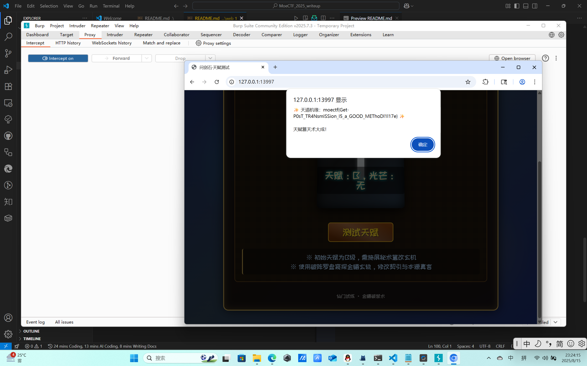

<!--markdownlint-disable MD033 MD041-->

<div align="center">

# 🌍 Web 安全与渗透测试 题解 🛡️

</div>

## 0 Web 入门指北

> [!NOTE]
> **FLAG:** `moectf{jv@vScr1p7_14_so0o0o0o_inT3r3&t!!!}`

题目所给出的 `moectf2025__web_signin.txt` 附件显然是经过了 [JSFuck](https://jsfuck.com/) 混淆的 JavaScript 脚本。在 F12 开发者工具的控制台中输入该脚本即可得到 `flag`。


## 01 第一章 神秘的手镯

> [!NOTE]
> **FLAG:** `moectf{f_i2_1s_Your_g00d_fri3nd!!}`

注意到启动的网页不允许使用 `Ctrl+V` 粘贴启封咒 `wan_yan_qi_feng_zhou.txt`，我们不妨直接在 F12 开发者工具的源代码中寻找出路。以下截取 `shouzhuo.js` 中的部分内容（第 20 行起）：

```javascript
// 验证密码
function validatePassword() {
    const input = document.getElementById('passwordInput').value;
    const resultDiv = document.getElementById('result');

    if (input === CORRECT_PASSWORD) {
        resultDiv.innerHTML = `
            <div class="success">
                <p>🌟 手镯迸发青光，K皇虚影浮现：</p>
                <p>"小辈不错！此物赠你——"</p>
                <!-- 恭喜你已经会阅读前端代码了！这是解题的另一条道路！以下是你的flag和小说的后半段。 -->
                <div class="flag">moectf{f_i2_1s_Your_g00d_fri3nd!!}</div>
                <p>《金曦玄轨感应篇》已注入神识</p>
```


这里即可得到 `flag` 内容。或许也可以尝试绕过或禁用禁止粘贴的 JavaScript 代码，但具体如何操作，星澜音并未进一步尝试。

## 02 第二章 初识金曦玄轨

> [!NOTE]
> **FLAG:** `moectf{0bs3rv3_Th3_Gold3n_traiL}`

根据小说描述，「破阵罗盘」可能指 Burp Suite 等抓包工具，「玄枢灵印」指 Burp Suite 生成的 CA 证书。**[信物连接] -> [法则与隐私] -> [权限管理] -> [玄枢灵印] -> [导入灵印]** 应当指在 Windows 中导入证书的过程，**[信物连接] -> [法则网络] -> [灵枢代理] -> [手动设置灵枢]** 即设置 Windows 代理的过程。

但事实上，星澜音在未开启 Burp Suite 和设置代理的情况下亦完成了此题。打开给定的网页后，根据提示访问 `localhost:13581/golden_trail`（端口号可能因人而异），同时在 F12 开发者工具中抓取该 HTTP GET 请求，在响应标头的 `X-Jinxi-Secret` 中得到了 `flag`。


## 03 第三章 问剑石！篡天改命！<!---->

> [!NOTE]
> **FLAG:** `moectf{Get-P0sT_TR4NsmISSion_I5_a_GOOD_METhoDl1l17e}`

根据小说描述，我们需要在网页发出「测试天赋」请求时，抓取该 HTTP POST 包并修改其参数和数据体内容。我们使用 Burp Suite 的 Proxy，打开 Intercept 后，在 Burp Suite 内置的 Chromium 浏览器中访问给定的网址，并进行一次「测试天赋」。

截取到一次 HTTP POST 请求如下：

```plain
POST /test_talent?level=B HTTP/1.1
Host: 127.0.0.1:13997
Content-Length: 24
sec-ch-ua-platform: "Windows"
Accept-Language: zh-CN,zh;q=0.9
sec-ch-ua: "Chromium";v="139", "Not;A=Brand";v="99"
Content-Type: application/json
sec-ch-ua-mobile: ?0
User-Agent: Mozilla/5.0 (Windows NT 10.0; Win64; x64) AppleWebKit/537.36 (KHTML, like Gecko) Chrome/139.0.0.0 Safari/537.36
Accept: */*
Origin: http://127.0.0.1:13997
Sec-Fetch-Site: same-origin
Sec-Fetch-Mode: cors
Sec-Fetch-Dest: empty
Referer: http://127.0.0.1:13997/
Accept-Encoding: gzip, deflate, br
Connection: keep-alive

{"manifestation":"none"}
```

`manifestation` 应为「显现、出现」之意，在这里我们理解为「显现的光芒」。修改 `POST` 的参数和 `manifestation` 的值即可。

```diff
- POST /test_talent?level=B HTTP/1.1
+ POST /test_talent?level=S HTTP/1.1

- {"manifestation":"none"}
+ {"manifestation":"flowing_azure_clouds"}
```



## 05 第五章 打上门来！<!---->

> [!NOTE]
> **FLAG:** `moectf{Al1_1NPUT-lS-MAI1Ci0U52e744a19}`

注意到打开的网页类似文件管理器，根据题目描述

> 破阵之机，在于「破界之眼」，寻得迷宫「源点」（根目录）！

故我们尝试使用 `../` 结构访问其父目录。简要尝试后显然得知，`flag` 文件位于 `../../flag` 处。


## Moe 笑传之猜猜爆

> [!NOTE]
> **FLAG:** `moectf{a1ca9f03-7218-e4ca-0e31-67a065670470}`

在 F12 开发者工具的源代码中，于 `static` 文件夹下找到 `main.js` 文件。注意到第 1 行

```javascript
let randomNumber = Math.floor(Math.random()*10000) + 1; // 1-10000
```

即知随机数的变量名为 `randomNumber`。打开网页时，该随机数已经生成，故我们直接在控制台中输入 `randomNumber` 以得到随机数的值，再输入回原网页以得到 `flag`。


事实上，`main.js` 也指示了另外一条路（从第 24 行）：

```javascript
    // 猜对后请求flag
    fetch('/flag', {method: 'POST'})
      .then(res => res.json())
      .then(data => {
        document.querySelector('.flagResult').textContent = "FLAG: " + data.flag;
      });
    setGameOver();
```

我们可以直接向 `/flag` 发送 HTTP POST 请求以得到 `flag`。这里星澜音不再赘述。
